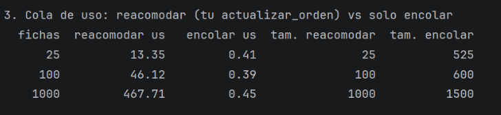
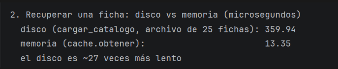
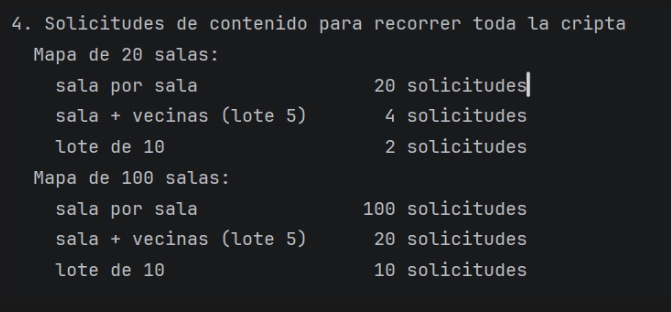
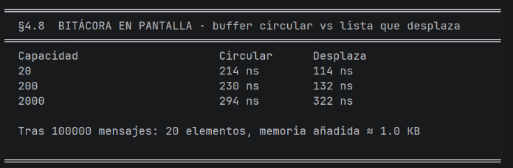
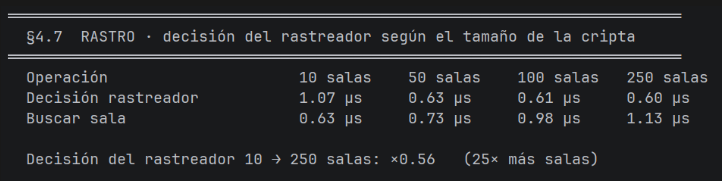
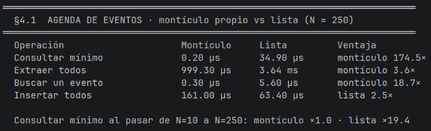
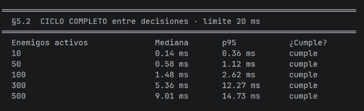
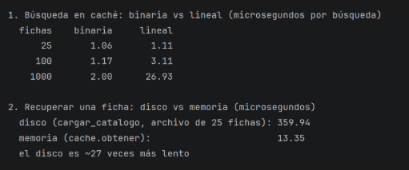

# Documento de Decisiones de Diseño — Proyecto Cripta

Marielle Céspedes Saborio · Lucía Garay García · Camila González Artavia · Yariela Lanzas Cubero
Escuela de Informática, Universidad Nacional de Costa Rica · 50560 Estructuras de Datos · Prof. Jose Pablo Calvo Suarez

# Parte I (entregada el 18 de octubre de 2026)

> Convertido desde `Proyecto Cripta.docx` sin cambios de contenido.

*Secciones de Persona A*

## §4.1 — Agenda de eventos

### 1. Problema

En cada paso del bucle hay que obtener el evento pendiente con menor tiempo_siguiente y, ante un empate, el de menor número de secuencia. Con varios cientos de eventos simultáneos y decenas de miles de extracciones, no se puede examinar toda la agenda en cada paso. Además, cuando un actor muere sus eventos futuros no deben ejecutarse, un efecto puede cancelarse antes de activarse, un cambio de velocidad modifica el tiempo de una acción ya programada, y el orden debe seguir siendo determinista con cancelaciones, reprogramaciones y empates.

### 2. Alternativas consideradas

> • **Lista ordenada o búsqueda lineal del mínimo:** guardar los eventos en una lista y recorrerla para encontrar el menor. Es simple, pero consultar el mínimo cuesta O(n) y se repite decenas de miles de veces; quedó descartada.
>
> • **Montículo con un diccionario auxiliar evento → posición:** permitía cancelar y reprogramar un evento sin buscarlo. Se descartó porque el enunciado (§7) prohíbe usar dict como índice o tabla de búsqueda.
>
> • **Borrar un evento cancelado en el momento:** ahorra espacio, pero obliga a ubicar el evento dentro del montículo para cada muerte o efecto cancelado. Se prefirió marcar el evento como cancelado y descartarlo al llegar a la raíz.

### 3. Decisión

La agenda es un montículo binario de mínimos propio, hecho sobre una lista (AgendaEventos). Los eventos se comparan por (tiempo, secuencia); la secuencia es un contador creciente que el motor asigna al programar, así que dos eventos con el mismo tiempo salen en el orden en que se programaron y la simulación es determinista.

Para no usar un diccionario, cada Evento guarda su propia posición en el montículo (indice_heap), que se actualiza en cada intercambio. Con eso, contiene(evento) es una comprobación directa (la posición es válida y apunta a ese mismo evento) y se puede sacar un evento cualquiera sin buscarlo.

La cancelación es perezosa: cancelar marca el evento (cancelado) y no lo mueve. Cuando un evento cancelado llega a la raíz, siguiente() y extraer() lo descartan antes de devolver el siguiente válido. Así, cuando un actor muere, \_al_morir cancela su acción pendiente, su veneno y su regeneración sin recorrer la agenda, y un efecto cancelado antes de activarse simplemente nunca se ejecuta.

Un cambio de velocidad con una acción pendiente conserva lo que ya avanzó: el tiempo restante se reescala con restante_nuevo = max(1, (t_siguiente - t) \* v_anterior // v_nueva), se cancela el evento viejo y se programa uno nuevo en t + restante_nuevo. Todas estas operaciones registran su inversa en el historial de retroceso (§4.6, a cargo de Persona C), que el motor usa pero no implementa.

### 4. Análisis de complejidad

Agregar un evento y extraer el mínimo cuestan O(log n); consultar el mínimo, comprobar si un evento está en la agenda y cancelarlo cuestan O(1). Sacar un evento cualquiera por su posición cuesta O(log n). El descarte de eventos cancelados es amortizado: cada evento cancelado se elimina una sola vez, así que no suma más de O(log n) por evento programado. Espacialmente es O(n) en los eventos pendientes; los cancelados ocupan lugar hasta llegar a la raíz.

### 5. Evidencia empírica

Medido con tests/bench_decisiones.py en el equipo del proyecto (montículo propio contra una lista con búsqueda lineal), con N = 250 eventos:

La lista solo gana al insertar (2.5 veces), y ese costo no se paga en el bucle principal, donde lo que domina es consultar y extraer. Al pasar de 10 a 250 eventos, consultar el mínimo cuesta lo mismo en el montículo (×1.0) y 19.4 veces más en la lista. Con muy pocos eventos la lista puede igualar al montículo en algunas operaciones, por lo que la ventaja aparece desde unas decenas de eventos, que es la escala de las pruebas.

### 6. Límites conocidos

> • Los eventos cancelados se quedan en el montículo hasta llegar a la raíz; con muchas muertes la agenda ocupa más memoria de la necesaria por un tiempo.
>
> • Cada cambio de velocidad crea un evento nuevo y deja uno cancelado, en vez de modificar el existente en su sitio.
>
> • siguiente() modifica la agenda (descarta cancelados), por lo que una consulta no es estrictamente de solo lectura.

## §4.7 — El rastro del jugador

### 1. Problema

Un enemigo rastreador debe seguir al jugador, pero la decisión debe costar en proporción al número de salidas de su sala, no al tamaño de la cripta ni a la longitud del recorrido del jugador. Un rastro de 400 unidades o más de antigüedad no sirve, y hay que decidir si se elimina activamente o se detecta su caducidad al consultarlo. Con varios rastreadores, el trabajo por ciclo no debe crecer más que linealmente con los enemigos que actúan.

### 2. Alternativas consideradas

> • **Guardar el recorrido completo del jugador (lista de salas visitadas) y buscar en él:** cada decisión costaría O(longitud del recorrido), justo lo que el enunciado prohíbe; quedó descartada.
>
> • **Buscar el camino más corto hacia el jugador (recorrido por el mapa):** cuesta O(salas) por decisión, depende del tamaño de la cripta y además deja de ser un “rastro”; quedó descartada.
>
> • **Eliminar activamente los rastros viejos con un evento periódico:** exige un evento adicional o recorrer todas las salas para limpiar, con un costo que depende del tamaño de la cripta; quedó descartada.

### 3. Decisión

Cada sala guarda un solo número: el reloj de la última vez que el jugador estuvo en ella (rastro). Se actualiza al entrar a una sala y al inicio de la partida, y el cambio es reversible mediante el historial de retroceso (§4.6, de Persona C). No hay lista de recorrido.

Para decidir, el rastreador (salida_rastro) recorre solo las salidas abiertas de su sala. Para cada una mira el rastro de la sala destino y se queda con la más reciente; en un empate gana la de menor id, para que el resultado sea determinista. Un rastro con reloj - rastro \>= 400 se ignora. Si ninguna salida tiene un rastro vigente, el rastreador no se mueve y espera su siguiente turno.

La caducidad se detecta al consultar, no se elimina activamente. Se justifica así: la comparación reloj - rastro se hace sobre las pocas salas vecinas que de todos modos se están mirando, así que no agrega costo, mientras que eliminar de forma activa requeriría un trabajo extra que depende de la cripta completa.

Para no buscar la sala vecina en la lista de salas en cada decisión, el destino de cada salida se resuelve una vez y se guarda en la propia salida (\_destino). Las salas se mantienen ordenadas por id con el ordenamiento del proyecto (elegir_algoritmo), y buscar_sala hace búsqueda binaria en ellas, O(log n).

### 4. Análisis de complejidad

Una decisión del rastreador es O(s), con s el número de salidas de su sala (como mucho 4 en este juego), porque cada destino se resuelve en O(1) tras la primera vez. La primera resolución de una salida cuesta O(log n) por la búsqueda binaria. Por ciclo, el trabajo de los rastreadores es O(r·s), lineal en la cantidad r de rastreadores que actúan. Espacialmente es un entero por sala, O(n), más un puntero por salida.

### 5. Evidencia empírica

Medido con tests/bench_decisiones.py, tiempo por decisión según el tamaño de la cripta (3000 llamadas por muestra, mediana de las muestras), en el equipo del proyecto:

El tiempo de decisión no crece al pasar de 10 a 250 salas (con 250 salas costó 0.56 veces lo de 10 salas; el valor más alto de 10 salas es de calentamiento de la primera medición), que es lo que se pretendía: depende de las salidas, no de la cripta. Buscar una sala sí crece despacio, como corresponde a una búsqueda binaria O(log n), pero solo se paga la primera vez que se usa cada salida. Hay una prueba automática que verifica que el rastreador sigue el rastro más reciente, que desempata por el menor id y que ignora un rastro de 400 unidades o más.

### 6. Límites conocidos

> • Cada sala recuerda solo la última visita: si el jugador pasa por una sala dos veces, la primera se pierde. Es suficiente para elegir la vecina más fresca, pero no reconstruye el camino completo.
>
> • El rastreador es voraz: elige la vecina con el rastro más reciente, así que puede dar vueltas si el jugador retrocede por el mismo pasillo.

## §4.8 — Bitácora en pantalla

### 1. Problema

La interfaz muestra únicamente los últimos 20 mensajes del juego. El consumo de memoria de esta bitácora debe permanecer constante durante toda la partida, y agregar un mensaje no debe implicar desplazar físicamente los 19 anteriores.

### 2. Alternativas consideradas

> • **Lista que crece y se muestra solo el final:** es lo más simple, pero la memoria crece con la duración de la partida; incumple el requisito de memoria constante.
>
> • **Lista de 20 elementos que se desplaza al llenarse (pop(0) y append):** la memoria es constante, pero cada mensaje nuevo mueve los 19 anteriores, que es justo lo que el enunciado pide evitar; quedó descartada.
>
> • **Cola doblemente enlazada propia:** también evita el desplazamiento, pero cada mensaje reserva un nodo nuevo y agrega complejidad que no hace falta para un tamaño fijo y conocido.

### 3. Decisión

RegistroMensajes es un buffer circular sobre una lista de tamaño fijo (20 posiciones, creada una sola vez). Guarda la posición del mensaje más antiguo (\_inicio) y cuántos hay (\_cantidad). Mientras hay espacio, el mensaje nuevo va a la siguiente posición libre; cuando se llena, el mensaje nuevo sobrescribe al más antiguo y \_inicio avanza una posición (módulo 20). Nunca se mueve un mensaje de lugar.

ultimos() devuelve los mensajes del más antiguo al más reciente leyendo desde \_inicio, listo para mostrar. El motor genera los mensajes con \_mensaje (ataques, muertes, puertas, objetos y errores como una sala sin contenido) y la vista los lee de motor.mensajes.ultimos().

### 4. Análisis de complejidad

Agregar un mensaje es O(1) y no mueve ningún otro. Leer los últimos mensajes es O(k), con k = 20 como máximo. La memoria es O(k), constante, sin importar cuántos mensajes se generen en la partida.

### 5. Evidencia empírica

Medido con tests/bench_decisiones.py: tiempo por mensaje agregado, comparando el buffer circular con una lista que se desplaza, con 20000 mensajes:

Con la capacidad real de 20 la lista que desplaza es más rápida (114 contra 214 ns), porque mover 19 referencias es muy barato; con 2000 mensajes la diferencia se invierte (294 contra 322 ns a favor del buffer circular). Se eligió el buffer circular por el requisito del enunciado (no desplazar físicamente y memoria constante) y no por velocidad. Tras 100000 mensajes agregados el registro sigue teniendo 20 elementos y ocupa aproximadamente 1 KB.

### 6. Límites conocidos

> • Un mensaje solo vive en el buffer: lo que sale de los 20 últimos se pierde para la pantalla (queda el registro de la partida para reproducción, que es otra bitácora).
>
> • La capacidad es fija y se decide al crear el motor; cambiarla durante la partida no está contemplado.

*Secciones de Persona B*

## §4.2 — Precarga de contenido

### 1. Problema

El problema de este apartado radica en que el jugador nunca puede caer en una sala en donde no se conozca su contenido por lo que el contenido debe estar ya en memoria antes de realizar un movimiento. Además de este requerimiento cada solicitud que se hace para cargar contenido de las salas cuesta unos 400 ms, sin embargo pedir 1 sala cuesta lo mismo que pedir 10 salas en un mismo lote.

### 2. Alternativas consideradas

> • **Precargar solo las 4 vecinas:** la idea era cargar únicamente las 4 salas vecinas de donde el jugador se ubicaba en ese momento por lo que el lote quedaba con 4 de 10 espacios aunque el costo es el mismo con 10 por esta razón de uso ineficiente del presupuesto quedó descartada
>
> • **Pedir todo el contenido al inicio.** En una cripta pequeña puede llegar a ser barato pero en una cripta grande puede superar el presupuesto que se tiene por esta razon queda descartada esta opción.

### 3. Decisión

En el archivo PlanificadorPrecarga se recorre el esqueleto por niveles de distancia con una cola. Desde la sala actual en un orden fijo de direcciones N, S, E, O, saltando las salas ya cargadas, hasta juntar un lote de 10, el límite es un parámetro con 10 por defecto (se piden las vecinas de las vecinas hasta llegar a 10). El GestorDatos expone dos métodos:

- asegurar_sala: se llama antes de confirmar un movimiento y, si la sala no está, pide un lote que empieza por esa sala y se completa con sus vecinas (así el costo de la solicitud no se desperdicia),

- precargar: se llama después de entrar. Las salas cargadas se registran en una lista de ids. La precarga es síncrona: si el contenido no está, el movimiento no se confirma hasta que llega, y esa espera real no mueve el reloj virtual.

### 4. Análisis de complejidad

- Peor Caso O(n²): en mapas grandes si muchas salas adyacentes ya están cargadas. El algoritmo debe explorar muchas salas (V) y, por cada una, realizar dos búsquedas lentas: Buscar la sala dentro de la lista del esqueleto y verificar si la sala de destino ya fue visitada o cargada

- Caso Práctico O(n): el bucle se detiene muy rápido gracias al límite de 10 salas. Como el número de iteraciones es un valor constante y pequeño, el factor que predomina es únicamente la búsqueda de la sala en el esqueleto

- Complejidad Espacial O(V): Es lineal respecto al número de salas exploradas. Ocupa memoria para mantener la cola de exploración, la lista de salas a pedir y el registro de salas visitadas.

### 5. Evidencia empírica

Medido con --bench: solicitudes de contenido necesarias para recorrer toda la cripta. Es un conteo, no un tiempo:

### 6. Límites conocidos

- Al ser síncrona, el jugador espera unos 400 ms cuando pide un lote nuevo, y nunca se ejercita el caso de respuesta pendiente . Pasar a hilos cambiaría quién espera, no el contrato.

- Las puertas cerradas se tratan igual que las abiertas, y el tamaño del lote no se adapta al presupuesto restante.

- La búsqueda de una sala en el esqueleto y las comprobaciones sobre listas son lineales; dejarían de ser apropiadas en criptas con miles de salas.

## §4.3 — Resolución del catálogo

### 1. Problema

Cada tipo que aparece en el contenido (enemigos, objetos y trampas) debe resolverse a una ficha de catálogo antes de mostrarse o simularse. Los ids aparecen en orden no controlado, se repiten entre salas y se reutilizan entre criptas, el catálogo acepta 10 ids por solicitud y un mismo id vigente no debe pedirse dos veces.

### 2. Alternativas consideradas

- **Pedir cada id por separado:** la idea era consultar las fichas una por una mediante la ruta individual (GET /catalogo/id), pero este proceso tarda lo mismo que enviar un lote completo y agota el presupuesto, por lo que fue descartada.

- **Descargar todo el catálogo al inicio:** traer todo el catálogo desde el principio para evitar consultas posteriores, pero el sistema no cuenta con un endpoint que permita listar el catálogo completo por lo que quedó descartada.

### 3. Decisión

Se decide crear un metodo resolver_fichas(ids) que elimina repetidos y resuelve tres partes: caché en memoria, disco, validado contra la versión del catálogo. Todo lo que falte luego de pasar por todos los filtros se pide a través de una sola llamada a la fuente, en esta llamada se parten los ids en bloques de 10. Lo recibido se agrega a la caché y se guarda en disco junto con lo que ya había. Al cargar un lote de contenido, el gestor junta los tipos de enemigos, trampas y objetos de las salas nuevas y los resuelve juntos, por lo que el motor recibe las fichas listas. La versión del catálogo se consulta una sola vez por ejecución.

### 4. Análisis de complejidad

Resolver t tipos nuevos cuesta ⌈t/10⌉ solicitudes en vez de t, ya que, se agrupan las solicitudes en lotes de 10 unidades en lugar de ir una por una. Si k es fichas en memoria entonces consultar la caché es O(log k). Cada consulta a disco lee y convierte el archivo completo, O(m) en las fichas guardadas, y se hace una vez por llamada a resolver_fichas, no una por ficha, en pocas palabras se realiza una sola lectura masiva por llamada completa.

### 5. Evidencia empírica

Medido con --bench: recuperar una ficha desde disco (archivo de 25 fichas) tarda 359.94 microsegundos en el equipo probado y desde memoria 13.35 microsegundos. Se concluye que recupera una ficha desde el disco en aproximadamente 27 veces más lento que hacerlo desde memoria.

### 6. Límites conocidos

Los objetos de la lista suelta de cada enemigo no se resuelven por adelantado: se resuelven cuando el motor los necesita, al morir el enemigo.

- El archivo del catálogo crece sin desalojo en disco, y cada consulta a disco relee el archivo entero.

- Si cambia la versión del catálogo se descarta todo lo guardado, no solo lo que cambió.

- Si un lote trae más tipos que el tope de la caché, las primeras fichas pueden desalojarse antes de usarse, recuperarlas cuesta una lectura de disco, no una solicitud.

## §4.4 — Caché persistente

### 1. Problema

Las fichas en memoria tienen un tope configurable (--cache-size, 25 por defecto). Al llegar al tope hay que liberar una ficha, sin tocar las que están en uso como lo puede ser un enemigo vivo, un objeto en el inventario del jugador o un objeto en el suelo de la sala actual, una trampa de la sala actual. Preguntar si una ficha está en caché es una de las operaciones más frecuentes, y lo guardado debe sobrevivir al cierre del programa y validarse por versión sin descargarlo todo otra vez.

### 2. Alternativas consideradas

- **Tabla hash propia:** la idea era implementar una tabla hash hecha a mano para agilizar las búsquedas, pero por indicaciones del curso las únicas estructuras permitidas son listas, colas, pilas y colas de prioridad, por lo que fue descartada.

- **Cola de uso con duplicados (borrado perezoso):** la idea era actualizar la cola en tiempo constante O(1) sin eliminar elementos viejos de inmediato, pero esto provocaba que la cola creciera sin límite afectando el uso de memoria, razón por la cual se descartó.

- **Lista doblemente enlazada con referencias directas:** la idea era usar una lista doblemente enlazada con apuntadores directos a cada ficha para reubicarlas en tiempo O(1), pero no se implementó debido a la complejidad adicional que agregaba al código, por lo que se dejó como una posible mejora a futuro.

### 3. Decisión

- **Estructura:** de decide usar una list nativa (permita como almacenamiento contiguo de bajo nivel) de fichas, siempre ordenada por id, con búsqueda binaria. Una única función, \_buscar_posicion, sirve tanto para saber si una ficha existe como para encontrar dónde insertar. Tras desalojar se recalcula la posición, porque la lista pudo cambiar.

- **Política de desalojo LRU (la menos recientemente usada):** Una Queue de ids guarda el orden de uso sin duplicados: cada acceso saca el id viejo y lo vuelve a encolar al final. Se desaloja desde el frente. Si el gestor indica que esa ficha está en uso, se conserva y se prueba la siguiente, el recorrido es de una sola pasada, así que siempre termina.

- **Todo protegido:** Si todas las fichas están en uso, la caché supera su tope por un corto tiempo y vuelve a él cuando se liberan; el motor sigue funcionando.

- **Persistencia:** La carpeta se recibe por parámetro. Hay un archivo JSON por tipo de dato (catálogo, esqueleto y contenido de cada cripta), cada uno con su versión adentro, que solo se usa si coincide con la vigente. Se guardan las respuestas como JSON con el metodo “a_json” y se reconstruyen con “desde_json”. Antes de escribir se arma el texto completo, para no dejar archivos a medias, y un archivo dañado se trata como ausente y se vuelve a pedir.

### 4. Análisis de complejidad

Buscar es O(log k) e insertar O(k), por el desplazamiento de la lista. Actualizar el orden de uso es O(k), porque la cola se recorre y se reconstruye. Una consulta con acierto cuesta O(k): en la práctica domina el mantenimiento de la cola, no la búsqueda. Un recorrido de desalojo es O(q) en el peor caso, con q el tamaño de la cola.

### 5. Evidencia empírica

Medido con --bench, búsqueda en caché (microsegundos por búsqueda):

Con 25 fichas, la búsqueda binaria y la lineal casi empatan (1.06 y 1.11 microsegundos); con 100 fichas son 1.17 y 3.11 microsegundos, y con 1000 fichas 2.00 y 26.93 microsegundos, es decir, la lineal es unas 13 veces más lenta. La binaria se justifica por la escala, no por el tamaño por defecto. Además, una consulta con acierto en memoria cuesta unos 13 microsegundos y reacomodar la cola cuesta casi lo mismo, así que prácticamente todo el costo está en mantener el orden de uso y no en la búsqueda. Recuperar una ficha desde disco cuesta 359.94 microsegundos frente a 13.35 microsegundos desde memoria, unas 27 veces más.

Con 25 fichas, reacomodar la cola cuesta 13.35 microsegundos frente a 0.41 microsegundos de solo encolar; con 100 fichas, 46.12 microsegundos frente a 0.39 microsegundos; y con 1000 fichas, 467.71 microsegundos frente a 0.45 microsegundos. El costo de reacomodar crece aproximadamente en proporción al tamaño de la caché (unas 35 veces más entre 25 y 1000 fichas), mientras que encolar sin reacomodar se mantiene en unos 0.4 microsegundos. A cambio, la cola sin reacomodar crece sin límite: tras 500 operaciones tiene 525, 600 y 1500 elementos, mientras que la que se reacomoda se mantiene exactamente en 25, 100 y 1000, el tamaño de la caché. Con el tamaño por defecto, 13.35 microsegundos es despreciable frente a los unos 400 ms de una solicitud de red, por eso se eligió reacomodar. La alternativa descartada quedó medida: es más barata por operación, pero su memoria no tiene tope.

### 6. Límites conocidos

- Si todas las fichas están en uso, la caché supera temporalmente su tope.

- Cada lectura de disco relee el archivo completo, y el archivo del catálogo no tiene desalojo propio.

- Un archivo dañado se descarta y se vuelve a pedir, pero no se avisa al usuario.

*Secciones de Persona C*

## §4.5 – Inventario

### 1. Problema

El inventario del jugador debe permitir recorrer hacia adelante y hacia atrás desde la posición actual, soltar el objeto que se está viendo en cualquier posición sin que el costo dependa de dónde esté, equipar un objeto moviéndolo al frente del orden real, y mostrar vistas ordenadas por peso, valor o nombre sin alterar ese orden real. Además, al alcanzar inventario max debe rechazarse cualquier intento de recoger un nuevo objeto.

Las operaciones que realmente ejecuta el programa, con la frecuencia esperada según el diseño del juego, son: recoger, soltar, equipar (decenas de veces por partida, una por acción del jugador que las involucre), y avanzar/retroceder del cursor (potencialmente muchas veces por decisión del jugador, mientras navega el inventario antes de decidir qué hacer)

### 2. Alternativas

> • **Array con índice de posición actual:** Soltar o insertar en una posición intermedia requiere recorrer y desplazar los elementos siguientes, lo que da O(n) en el peor caso, contradice el requisito de que soltar no dependa de la posición.
>
> • **Lista doblemente enlazada con un cursor (puntero al nodo actual):** Al mantener una referencia directa al nodo que se está viendo, soltar o equipar no requiere buscar nada: se opera directamente sobre los punteros anterior/siguiente de ese nodo y sus vecinos.

### 3. Decisiones

Se implementó Inventario como una lista doblemente enlazada de nodos NodoInventario, con **\_\_slots\_\_** para reducir el overhead de memoria por instancia, con un cursor (\_cursor) que apunta siempre al nodo que el jugador está viendo. Las operaciones principales:

> • **avanza() / retrocede():** mueven el cursor siguiendo siguiente/anterior.
>
> • **suelta_actual():** desconecta el nodo apuntado por el cursor.
>
> • **soltar_nodo(nodo):** igual que la anterior, pero opera sobre cualquier nodo recibido por referencia, sin depender de dónde esté el cursor necesaria para que el historial de retroceso (4.6) pueda deshacer una recolección de forma confiable aunque el jugador haya navegado el inventario después.
>
> • **equipar_actual():** desconecta el nodo del cursor y lo reinserta al frente de la lista.
>
> • **vista_ordenada(criterio):** arma un arreglo temporal de referencias a los nodos (vía \_\_iter\_\_, de solo lectura) y lo ordena con el módulo de ordenamiento (4.9), sin tocar el orden real de la lista enlazada.

También, equipar un arma y equipar una armadura no pueden compartir la misma noción de "estar al frente", porque el enunciado (2.7) permite tener ambas equipadas a la vez, y solo sustituye al objeto anterior si es del mismo tipo. Se agregaron dos referencias en Inventario \_armae_quipada y \_armadura_equipada, actualizadas por equipar_actual() según la clase del nodo equipado, sin pisarse entre sí. arma_equipada() y armadura_equipada() exponen esas referencias hacia el motor de simulación, que las necesita para sumar ataque_bonus y defensa_bonus a las estadísticas del jugador.

### 4. Complejidad

| **Operación**               | **Complejidad**                                                          | **Motivo**                                                          |
|-----------------------------|--------------------------------------------------------------------------|---------------------------------------------------------------------|
| avanza / retrocede          | O(1)                                                                     | Seguir un puntero del nodo actual                                   |
| suelta_actual / soltar_nodo | O(1)                                                                     | El nodo ya se tiene por referencia; solo se reconectan 2-3 punteros |
| equipar_actual              | O(1)                                                                     | Misma razón que soltar                                              |
| recoge                      | O(1)                                                                     | Inserción al final, con referencia directa a \_cola                 |
| vista_ordenada              | O(n) para armar el arreglo + costo del algoritmo de ordenamiento elegido |                                                                     |

Se descartó la primera alternativa precisamente por no cumplir el requisito explícito de costo independiente de la posición.

### 5. Evidencias Empíricas

Medido con --bench sobre un inventario de 500 objetos:

-Inventario-

recoger 500 objetos: 0.000215s

avanza 500 veces: 0.000030s

soltar 500 objetos: 0.000098s

Los tiempos se mantienen del orden de microsegundos incluso con 500 objetos, consistente con que todas las operaciones individuales son O(1), no hay degradación apreciable al crecer el inventario dentro de un rango realista para una partida.

### 6. Límites

- La estructura no ofrece acceso O(1) por identificador de instancia (no hay tabla de búsqueda, porque dict como índice está prohibido por el enunciado), si en algún momento se necesitará ubicar un objeto específico del inventario por su id sin recorrer la lista, esta decisión dejaría de ser suficiente y haría falta una estructura adicional.

- El diseño asume que el inventario se mantiene en un rango razonable de tamaño (el inventario_max de la cripta); no fue medido a escalas de miles de objetos, que no son un escenario realista para este campo del juego.

- La separación de \_arma_equipada/\_armadura_equipada depende de que nodo.clase tome exactamente los valores "arma"/"armadura"; un objeto de otra clase que se intente equipar no actualiza ninguna de las dos referencias, pero tampoco se rechaza explícitamente,entonces, sería conveniente que equipar_actual() valide la clase antes de equipar.

## §4.6 – Pergaminos de retroceso e historial reversible

### 1. Problema

El pergamino de retroceso debe revertir el estado completo del juego hasta el instante inmediatamente anterior a la última acción del jugador, incluyendo todo lo ocurrido después (acciones enemigas, efectos, reloj, eventos programados o cancelados, rastro, vida, inventario, objetos del suelo, puertas y trampas). Dos restricciones estructurales son centrales: está prohibido guardar copias completas del estado, y solo pueden deshacerse hasta 5 acciones del jugador hacia atrás. Además, los pergaminos de retroceso quedan excluidos de su propio sistema de reversión: usar un pergamino no se deshace a sí mismo, y recoger o soltar un pergamino durante un intervalo revertido tampoco se deshace.

### 2. Alternativas

- **Copias completas del estado por cada acción del jugador:** Estaba completamente prohibido por el enunciado, y además costoso en memoria si se guardaran hasta 5 estados completos de la partida.

- **Registro de deltas (patrón tipo Command/Memento):** agrupados por intervalo entre una acción del jugador y la siguiente. Cada cambio reversible se guarda como una función de reversión (deshacer) junto con una descripción, no como un dato — evita duplicar el estado y solo almacena lo necesario para invertir cada mutación puntual.

Se descartó la primera por estar prohibida y por su costo; la segunda se adoptó por cumplir ambas restricciones del enunciado.

### 3. Decisión

Se implementó una clase Historial que mantiene una pila limitada a una contaste MAX_INTERVALOS = 5. Cada intervalo es una lista de objetos Cambio (deshacer + descripción). Funciona de la siguiente manera:

- **abrir_intervalo():** se llama una vez por cada acción del jugador que consume tiempo virtual; abre un intervalo nuevo y descarta el más antiguo si se supera el límite.

- **registrar(deshacer, description):** el motor de simulación llama esta función cada vez que muta algo reversible, pasando una función sin argumentos que sepa revertir exactamente ese cambio.

- **deshacer_ultimo():** revierte el intervalo más reciente completo, en orden inverso a como se registraron los cambios.

La función usar_pergamino(inventario, historial, nodo_pergamino) la cual es independiente, no método de ninguna clase, para no acoplar Historial con Inventario, orquesta el uso real: descuenta el pergamino directamente del inventario, esto sin pasar por historial.registrar() y luego llama deshacer_ultimo(). Esa exclusión es lo que impide que el propio pergamino se restaure al deshacer.

Una regla adicional, descubierta al validar los casos del Apéndice B: ningún objeto de clase pergamino_retroceso debe registrarse como Cambio reversible al recogerse o soltarse, si se registrara, su recolección se deshacería junto con el resto del intervalo, lo cual contradice la regla de exclusión del enunciado.

Posteriormente se realizaron tres funciones "puente" en retroceso, recoger_reversible, soltar_reversible y equipar_reversible , las cuales envuelven las operaciones base de Inventario y registran su reversión automáticamente, respetando la exclusión de pergaminos.

A diferencia de recoger (que siempre agrega al final, por lo que deshacerlo es trivial), soltar y equipar remueven un nodo de una posición intermedia; por eso se agregó Inventario.\_reinsertar, la cual reconecta un nodo exactamente entre los vecinos que tenía antes de ser removido, sin este método, deshacer un soltar o un equipar habría devuelto el objeto al final de la lista en vez de a su posición original.

### 4. Análisis de complejidad

| **Operación**   | **Complejidad**                                                                                                                    |
|-----------------|------------------------------------------------------------------------------------------------------------------------------------|
| abrir_intervalo | O(1) amortizado (el descarte del intervalo más viejo con pop(0) es O(k) en el peor caso, pero k ≤ 5, una constante pequeña)        |
| registrar       | O(1) por cambio                                                                                                                    |
| deshacer_ultimo | O(m), donde m es la cantidad de cambios del intervalo a revertir no depende del tamaño total del historial ni del estado del juego |

### 5. Evidencia empírica

Medido con --bench, registrando 5 intervalos de 50 cambios cada uno (250 cambios en total) y deshaciéndolos todos:

-Retroceso-

registrar 250 cambios: 0.000055s

deshacer 5 intervalos: 0.000026s

Se validaron además, con pruebas dedicadas, los dos casos borde más delicados del Apéndice B:

- **Pergamino recogido dentro del intervalo revertido:** al usar un pergamino para deshacer un intervalo en el que también se había recogido otro pergamino, el inventario final refleja únicamente el consumo de la unidad usada, el pergamino recogido durante el intervalo permanece en el inventario, tal como exige la regla.

- **Dos pergaminos consecutivos:** como usar_pergamino nunca llama abrir_intervalo() (usar el pergamino no consume tiempo virtual ni es una acción del jugador), el segundo uso consecutivo revierte automáticamente la acción anterior a la ya revertida comportamiento que surge naturalmente de que \_intervalos sea una pila, sin necesitar lógica especial para este caso.

- **Deshacer sin nada que deshacer:** deshacer_ultimo() devuelve False de forma segura tanto al inicio (historial vacío) como después de agotar todos los intervalos disponibles, sin lanzar excepciones.

### 6. Límites

- El diseño depende por completo de que el motor de simulación reporte **todas** las mutaciones reversibles a través de historial.registrar(). Si el motor omite reportar un cambio (por ejemplo, un rearme de trampa o una reprogramación de velocidad), ese cambio no se revertiría y la reversión quedaría incompleta, este es el punto de mayor riesgo de integración con Persona A y debe acordarse explícitamente qué mutaciones llaman a registrar.

- El límite de 5 intervalos es fijo según el enunciado; si creciera, el costo de abrir_intervalo seguiría siendo pequeño, pero no fue diseñado pensando en límites mayores.

- La integración real de historial.registrar() dentro del motor de simulación (combate, movimiento, cambios de velocidad) sigue pendiente del lado de quien lo implementa; mientras tanto, el diseño fue validado con funciones reversibles equivalentes escritas para pruebas (recoger_reversible, soltar_reversible, equipar_reversible), que sirven como ejemplo directo de cómo integrar las llamadas reales cuando se confirme el contrato.

## §4.9 – Ordenamiento

### 1. Problema

El programa necesita ordenar listas en varios contextos (vistas del inventario, y potencialmente tabla de puntajes, índices de archivo de guardado y listas del catálogo), sin usar list.sort() ni sorted(). Se exige implementar al menos dos algoritmos con características distintas, y que el programa elija automáticamente cuál usar según propiedades medibles de los datos, tamaño, qué tan ordenados están, y si las comparaciones son costosas —, respaldado con mediciones propias.

### 2. Alternativas

- **Un único algoritmo de propósito general (merge sort)**: Cumpliría la correctitud, pero no aprovecha que para listas pequeñas (como el inventario típico de un jugador) un algoritmo más simple es más rápido en la práctica, y no responde al pedido explícito del enunciado de considerar tamaños pequeños, datos casi ordenados y comparaciones costosas como ejes separados.

- **Insertion sort y merge sort únicamente, eligiendo por un umbral de tamaño:** Resuelve el eje de tamaño/overhead, pero no distingue el caso de comparaciones costosas: el peor caso de insertion sort son O(n²) comparaciones, lo cual puede pesar más que su bajo overhead si cada comparación es cara (por ejemplo, comparar nombres como cadenas de texto).

- **Tres algoritmos:** insertion sort, binary insertion sort y merge sort, seleccionados según tamaño y si la comparación se considera costosa. Binary insertion sort usa búsqueda binaria para ubicar la posición de inserción (O(log n) comparaciones por inserción en vez de O(n)), manteniendo bajo overhead para n chico.

Se adoptó la tercera opción porque responde a los tres ejes que pide explícitamente el enunciado (tamaño, orden de los datos, costo de comparación) con evidencia medida, en vez de solo dos.

### 3. Decisión

**S**e implementaron insertion_sort, binary_insertion_sort y merge_sort como funciones genéricas en un módulo ordenamiento.py independiente del inventario, cada una con la firma (items, key) - (lista_ordenada, comparaciones). Esa firma compartida permite que elegir_algoritmo(n, comparacion_costosa, casi_ordenado) devuelva cualquiera de las tres de forma intercambiable, sin que el código que las invoca necesite saber cuál se eligió. La función vista_ordenada del inventario marca como "costosa" la comparación por nombre (cadenas de texto) y como no costosa peso/valor (números). Además, antes de llamar a elegir_algoritmo, calcula casi_ordenado(items, key), que mide con una pasada O(n) qué proporción de pares consecutivos está fuera de orden; si esa proporción es baja, elegir_algoritmo elige insertion_sort sin importar el tamaño, porque su comportamiento adaptativo (se sale del ciclo apenas encuentra la posición correcta) hace que su trabajo real sea cercano a O(n) con datos casi ordenados, superando a merge_sort incluso para n grande, de esta manera cubriendo así el tercer eje que pide el enunciado (datos casi ordenados), que antes no se medía.

### 4. Análisis de complejidad

| **Algoritmo**         | **Comparaciones (peor caso)**                                     | **Cuándo conviene**                                 |
|-----------------------|-------------------------------------------------------------------|-----------------------------------------------------|
| insertion_sort        | O(n²)                                                             | n pequeño, datos casi ordenados, comparación barata |
| binary_insertion_sort | O(n log n) comparaciones (los desplazamientos siguen siendo O(n)) | n pequeño/mediano con comparación costosa           |
| merge_sort            | O(n log n), garantizado siempre                                   | n grande, independientemente del orden de entrada   |

### 5. Evidencia empírica

Medido con --bench sobre datos aleatorios de distintos tamaños:

-Ordenamiento-

n = 10 insertion_sort tiempo = 0.000005s comparaciones = 21

n = 10 binary_insertion_sort tiempo = 0.000007s comparaciones = 22

n = 10 merge_sort tiempo = 0.000016s comparaciones = 22

n = 32 insertion_sort tiempo = 0.000027s comparaciones = 335

n = 32 binary_insertion_sort tiempo = 0.000021s comparaciones = 119

n = 32 merge_sort tiempo = 0.000034s comparaciones = 121

n = 100 insertion_sort tiempo = 0.000200s comparaciones = 2592

n = 100 binary_insertion_sort tiempo = 0.000110s comparaciones = 532

n = 100 merge_sort tiempo = 0.000120s comparaciones = 537

n = 1000 insertion_sort tiempo = 0.020554s comparaciones = 249288

n = 1000 binary_insertion_sort tiempo = 0.008296s comparaciones = 8599

n = 1000 merge_sort tiempo = 0.001651s comparaciones = 8703

n = 10000 insertion_sort tiempo = 2.075939s comparaciones = 24926371

n = 10000 binary_insertion_sort tiempo = 0.774309s comparaciones = 119015

n = 10000 merge_sort tiempo = 0.022851s comparaciones = 120501

Con n=10, insertion sort es el más rápido de los tres pese a tener comparaciones similares, su overhead es mínimo y eso domina a esta escala. Ya en n=32 (el propio UMBRAL_TAMANO), binary insertion sort empieza a ganar en tiempo real (0.000021s contra 0.000027s de insertion sort), aunque la diferencia todavía es mínima. A partir de n=100, insertion sort pierde claramente terreno frente a binary insertion sort en cantidad de comparaciones (2592 contra 532). A partir de n=1000, merge sort pasa a ser la mejor opción en tiempo real, y la brecha se vuelve drástica en n=10000 (insertion sort tarda 91 veces más que merge sort).

Algo sumamente relevante para la justificación del diseño: entre n=1000 y n=10000, binary insertion sort multiplica sus comparaciones por 14x (O(n log n)), pero su tiempo real se multiplica por 93x. Esto evidencia que, a partir de cierto tamaño, el costo de los desplazamientos (mover elementos al insertar) domina por sobre el ahorro en comparaciones, por eso binary insertion sort no es suficiente reemplazo de merge sort para n grande, aunque gane en cantidad de comparaciones.

A partir de esta evidencia se fijó UMBRAL_TAMANO = 32: por debajo de ese tamaño, insertion sort todavía compite de cerca en tiempo real pese a tener más comparaciones; incluido ese mismo punto de corte en la corrida (n=32), binary insertion sort ya empieza a ganar, y la ventaja de binary insertion sort (con comparación costosa) y de merge sort (para n grande) se vuelve consistente a partir de ahí.

Para el tercer eje (datos casi ordenados) se midió por separado, generando listas ya ordenadas con un 5% de pares consecutivos intercambiados al azar (simulando "casi ordenado" de forma controlada y reproducible), comparando insertion_sort contra merge_sort:

-Ordenamiento datos casi ordenados-

n = 100 casi ordenado detecto = True

n = 100 insertion_sort tiempo = 0.000013s comparaciones = 104

n = 100 merge_sort tiempo = 0.000092s comparaciones = 319

n = 1000 casi ordenado detecto = True

n = 1000 insertion_sort tiempo = 0.000116s comparaciones = 1049

n = 1000 merge_sort tiempo = 0.001145s comparaciones = 4952

n = 10000 casi ordenado detecto = True

n = 10000 insertion_sort tiempo = 0.001204s comparaciones = 10487

n = 10000 merge_sort tiempo = 0.013898s comparaciones = 64909

Con datos casi ordenados, insertion_sort le gana a merge_sort en tiempo real en toda la escala medida, y la ventaja crece con n (7x en n=100, 9.9x en n=1000, 11.5x en n=10000), confirmando que su carácter adaptativo lo mantiene cercano a O(n) real mientras el desorden sea bajo, a diferencia de merge_sort, que siempre hace O(n log n) comparaciones sin importar el orden de entrada. A partir de esta evidencia se fijó UMBRAL_PROP_DESORDEN = 0.1 (proporción de pares consecutivos fuera de orden a partir de la cual los datos dejan de considerarse "casi ordenados"), de forma análoga a cómo se fijó UMBRAL_TAMANO.

### 6. Límites

- El criterio de "comparación costosa" se decide de forma declarativa (por ejemplo, ordenar por nombre se marca como costoso) en vez de medirse dinámicamente en tiempo de ejecución, una detección automática se consideró sobre-ingeniería para lo que pide el enunciado, pero es una simplificación a tener presente.

- El valor de UMBRAL_TAMANO se obtuvo empíricamente en una máquina específica; podría variar en hardware distinto y convendría dejarlo documentado como configurable, no como una constante universal.

- La detección de "qué tan ordenados" están los datos (casi_ordenado) ya está implementada y se usa en elegir_algoritmo, pero cuenta pares consecutivos fuera de orden en una sola pasada O(n), no el número exacto de inversiones (que requeriría O(n log n) con un merge sort modificado), es una aproximación barata, no una medida exacta de desorden.

## §4.10 – Guardado Binario

### 1. Problema

El juego debe poder guardarse en un archivo binario de formato propio y recuperarse después, incluyendo el inventario del jugador (objetos, equipo y posición del cursor). El enunciado exige además comparar, con mediciones propias, el tamaño en disco y el tiempo de carga de ese formato binario contra guardar el mismo estado en JSON.

Un problema adicional, no explícito en el enunciado pero que surgió al diseñar esto: Historial guarda sus cambios como funciones deshacer (closures de Python) y una función no se puede convertir a bytes ni reconstruir desde ellos. Había que decidir qué hacer con eso.

### 2. Alternativas consideradas

- Hacer que Inventario persista completo en el guardado, y que Historial no persista, se reinicia vacío al cargar una partida. Evita reescribir código ya validado, y es consistente con lo que realmente pide el enunciado.

### 3. Decisión

Se revisó el enunciado explícitamente para esta decisión. 4.10 Sólo exige guardar "el estado" del juego (inventario, salas, actores, etc.), no menciona el historial de retroceso en ningún punto. Por otro lado, 4.6 y 2.11 describen el retroceso como algo acotado a la partida activa: el pergamino revierte el estado "hasta el punto inmediatamente anterior a la última acción del jugador", y el límite de 5 intervalos se describe siempre en términos de acciones dentro de la misma sesión de juego. Ninguna de las dos secciones pide que el retroceso funcione sobre acciones anteriores a un guardado.

Con esa base, se implementó:

- **Inventario.to_bytes() / Inventario.from_bytes(datos):** serializan y reconstruyen cada nodo completo (identificadores, nombre, peso, valor, clase, ataque_bonus, defensa_bonus), más las referencias de arma equipada, armadura equipada y posición del cursor. Usa struct con un encabezado (capacidad, cantidad) y, por nodo, un bloque de longitudes y campos de tamaño fijo seguido de las cadenas de texto.

- **Historial.to_bytes() / Historial.from_bytes(datos):** Un stub. to_bytes() devuelve un valor mínimo fijo (2 bytes); from_bytes() siempre reconstruye un Historial nuevo y vacío. Al cargar una partida guardada, el jugador puede volver a deshacer acciones que ocurran *después* de cargar, pero no las que ocurrieron antes de guardar.

- **Inventario.to_dict():** una representación equivalente en diccionario, usada únicamente para la comparación de evidencia empírica que pide el enunciado (serializada con json.dumps), D, también las reutiliza en RegistroJugador.py. El guardado real de la partida completa, de todas formas, pasa siempre por to_bytes()/from_bytes(), no por este par.

- 

### 4. Análisis de complejidad

Tanto to_bytes() como from_bytes() son O(n), donde n es la cantidad de objetos en el inventario: cada nodo se escribe/lee exactamente una vez, con trabajo constante por nodo (empaquetar/desempaquetar campos de tamaño fijo más las cadenas de longitud variable). No hay ninguna operación que dependa de buscar o comparar nodos entre sí.

### 5. Evidencia empírica

Medido con --bench, serializando un inventario de 200 objetos:

-Serialización (binario vs JSON)-

tamaño binario: 7186 bytes

tamaño JSON: 41408 bytes

tiempo de carga binario (promedio): 205.30 µs

tiempo de carga JSON (promedio): 316.62 µs

El formato binario resultó 5.8 veces más chico y 1.7 veces más rápido de cargar que el mismo estado en JSON. La diferencia de tamaño es la más marcada: JSON repite el nombre de cada campo ("instancia_id", "ataque_bonus", etc.) por cada objeto del inventario, mientras que el formato binario solo guarda los valores, la ventaja crece con la cantidad de objetos.

### 6. Límites conocidos

- Al cargar una partida guardada, no se puede deshacer ninguna acción anterior al guardado, es una decisión deliberada, respaldada por el enunciado (4.10 no lo exige; 4.6/2.11 describen el retroceso como algo acotado a la sesión activa), pero si en la revisión se interpretara que el guardado debe preservar esa capacidad, haría falta rediseñar Cambio para registrar datos reconstruibles en vez de funciones, el mismo problema que motivó descartar la primera alternativa.

- to_dict()/from_dict() no reciben las mismas pruebas de punta a punta que to_bytes()/from_bytes(), porque el guardado real de la partida completa pasa siempre por estas últimas — to_dict()/from_dict() se validan solo a través de la comparación de evidencia empírica y de su uso en RegistroJugador.py.

*Secciones de Persona D*

## §4.10 Guardado binario de la partida

### 1. Problema

El problema consiste en guardar el estado modificable de una partida en un archivo binario de formato propio y recuperarlo posteriormente. El formato debe permitir identificar la versión con la que se generó el archivo, recuperar una sala específica sin leer el archivo completo y conservar los datos necesarios para continuar la partida. Además, el enunciado exige comparar el tamaño del archivo y los tiempos de guardado y carga con una representación equivalente en JSON.

Las operaciones principales son guardar una partida, cargar el estado del jugador, consultar una sala específica y recuperar todas las salas. La consulta individual es especialmente importante porque permite acceder a una sala sin reconstruir el contenido completo de la partida.

### 2. Alternativas consideradas

- **Guardar la partida completa en JSON:** permite representar los datos de forma legible y facilita inspeccionar el archivo manualmente. Sin embargo, los nombres de las propiedades y la estructura textual agregan información repetida, y recuperar una sola sala puede requerir cargar y procesar el documento completo. Por estas razones, no se eligió como formato principal de guardado.

- **Guardar los datos binarios en un único bloque sin índice:** simplifica la escritura secuencial, pero obliga a recorrer los registros anteriores para encontrar una sala específica. Esta alternativa no cumple adecuadamente el requisito de acceso individual eficiente.

- **Usar un formato binario propio con índice de salas:** permite representar los campos mediante estructuras de tamaño definido y localizar los registros a través de un índice ordenado. Se adoptó esta alternativa porque satisface el acceso individual y permite controlar explícitamente la versión del formato.

### 3. Decisión

Se implementó un formato binario propio en el módulo Persistencia/, distribuido entre FormatoBinario.py, RegistroJugador.py, RegistroSala.py y ArchivoPartida.py

El archivo tiene la siguiente disposición:

\[encabezado\]\[longitud del jugador\]\[bloque del jugador\]\[bloques de salas\]\[índice de salas\]

- **Encabezado:** contiene la marca CRPT, la versión del formato, el identificador y las versiones de la cripta y del catálogo, la semilla, el reloj virtual, la cantidad de salas y la posición del índice.

- **Registro del jugador:** almacena la sala actual, la vida, el contador de acciones, los enemigos derrotados, el estado de la llave de salida y el inventario serializado.

- **Registros de sala:** almacenan el estado modificable de cada sala, incluyendo el rastro, los enemigos, los objetos, las trampas y las puertas.

- **Índice de salas:** contiene el identificador de cada sala, la posición de su bloque y su longitud. Las entradas se escriben ordenadas por identificador para permitir la búsqueda binaria.

La serialización del inventario reutiliza Inventario.to_bytes() y su reconstrucción utiliza Inventario.from_bytes(datos). La persistencia se encarga de incorporar esos bytes al registro del jugador, sin duplicar la lógica interna del inventario.

Para mantener la integridad del archivo, se serializan y validan los registros antes de reemplazar el archivo final. La escritura se realiza primero en un archivo temporal del mismo directorio y, si termina correctamente, se sustituye el destino mediante os.replace(). También se comprueba que los identificadores de sala no estén repetidos.

Al cargar, LectorPartida valida el encabezado y los límites del índice. Si la marca o la versión del formato no coinciden, se genera VersionIncompatible. La consulta de una sala utiliza búsqueda binaria sobre el índice y lee únicamente el bloque correspondiente, mientras que leer_todas_salas() recorre los registros y valida su orden e integridad.

La comparación con JSON se realiza mediante ExportadorJSON.py y las mediciones de tests/bench_personaD.py. El formato JSON se conserva como referencia de comparación, no como formato principal de persistencia.

### 4. Análisis de complejidad

Sea (n) la cantidad de salas y (b) el tamaño en bytes del bloque de la sala solicitada.

- **Ordenamiento previo al guardado:** depende del algoritmo seleccionado por elegir_algoritmo() y de la cantidad de registros. El costo de ordenar debe considerarse por separado del costo de escribir los datos.

- **Guardado:** después de ordenar, la serialización y escritura recorren los registros y sus datos. El costo es lineal respecto al tamaño total de los datos serializados, además del costo del ordenamiento.

- **Búsqueda de una sala:** (O(log n)) consultas al índice mediante búsqueda binaria, más la lectura y deserialización del bloque solicitado, de costo proporcional a (b).

- **Lectura de todas las salas:** (O(n)) registros procesados, además del costo de leer los bytes del índice y de los bloques.

- **Espacio auxiliar:** (O(n)) para las listas de registros, bloques serializados y entradas del índice construidas durante el guardado. La consulta individual no necesita cargar todos los bloques de salas en memoria.

La búsqueda binaria reduce la cantidad de entradas del índice que deben consultarse cuando el archivo contiene muchas salas. No elimina el costo de leer y reconstruir el bloque solicitado.

### 5. Evidencia empírica

Las siguientes mediciones se obtuvieron con tests/bench_personaD.py, utilizando cinco repeticiones y la mediana de los tiempos. Los archivos de prueba incluyen registros de salas generados para distintos tamaños y un jugador con un inventario de diez objetos.

| **Salas** | **Tamaño binario** | **Tamaño JSON** | **Guardar binario** | **Guardar JSON** | **Cargar todo binario** | **Cargar todo JSON** | **Cargar una sala binario** | **Cargar una sala JSON** |
|-----------|--------------------|-----------------|---------------------|------------------|-------------------------|----------------------|-----------------------------|--------------------------|
| 20        | 3.378 B            | 6.174 B         | 0,004155 s          | 0,002314 s       | 0,000857 s              | 0,000510 s           | 0,000256 s                  | 0,000573 s               |
| 200       | 27.555 B           | 41.731 B        | 0,008551 s          | 0,010404 s       | 0,004212 s              | 0,001635 s           | 0,000196 s                  | 0,001013 s               |
| 2.000     | 274.158 B          | 407.417 B       | 0,038631 s          | 0,086672 s       | 0,044563 s              | 0,019471 s           | 0,000195 s                  | 0,013105 s               |

Los resultados muestran que el formato binario ocupa menos espacio en los tres tamaños medidos. Con 2.000 salas, ocupa 274.158 bytes frente a 407.417 bytes de JSON, aproximadamente un 32,7 % menos.

La diferencia más importante aparece al cargar una sola sala. Con 2.000 salas, la consulta binaria tarda 0,000195 segundos, frente a 0,013105 segundos en JSON. Esto equivale a aproximadamente 67 veces menos tiempo en esa medición.

Sin embargo, cargar todas las salas es más lento en binario que en JSON en las tres pruebas. Por tanto, los resultados justifican el formato binario principalmente por su menor tamaño y por el acceso individual indexado, no porque todas sus operaciones sean siempre más rápidas.

### 6. Límites conocidos

- Las mediciones se realizaron con registros sintéticos y en un equipo específico. Los tiempos pueden variar con otros equipos, sistemas de archivos y contenidos de las criptas.

- El guardado mantiene en memoria listas de registros, bloques serializados y entradas del índice. Para partidas mucho más grandes, este uso temporal de memoria debe considerarse.

- La consulta individual recupera los datos modificables de una sala, pero no reconstruye por sí sola el motor completo ni restaura todos los componentes de una partida activa.

- La reconstrucción del jugador y su inventario requiere que las clases y los métodos de deserialización mantengan un contrato compatible.

- El archivo detecta versiones incompatibles, pero no implementa migraciones automáticas entre versiones del formato.

- El historial de retroceso no se conserva al cargar una partida. Según la decisión acordada con Persona C, se inicia un historial vacío y solo pueden deshacerse acciones posteriores a la carga.

- Las mediciones de carga completa indican que JSON puede resultar más rápido en este escenario. La elección del formato binario se justifica por el tamaño y la recuperación individual de salas, y no por una superioridad general de rendimiento.

## §4.11 Bitácora de partida y reproducción

### 1. Problema

Se necesita registrar las acciones aceptadas durante una partida y permitir su reproducción posterior en el mismo orden. La bitácora debe conservar los datos necesarios para identificar la cripta, comprobar la compatibilidad de las versiones y recuperar la semilla utilizada. También debe permitir continuar registrando acciones después de cargar una partida, sin sobrescribir el encabezado existente.

La solución debe separar el registro y la reproducción de la interfaz gráfica, delegando la ejecución de las acciones al motor de simulación.

### 2. Alternativas consideradas

- **Guardar únicamente el estado final:** permite recuperar el estado guardado, pero no conserva la secuencia de acciones necesaria para reproducir la partida.

- **Reescribir el archivo completo después de cada acción:** mantiene el registro actualizado, pero implica volver a escribir acciones anteriores innecesariamente.

- **Utilizar una bitácora de texto con escritura al final del archivo:** conserva el encabezado y agrega una línea por acción, lo que simplifica el registro y facilita inspeccionar el contenido.

### 3. Decisión

Se implementaron BitacoraPartida.py y Reproductor.py dentro del módulo Bitacora.

La bitácora utiliza un formato de texto identificado por CRIPTA-LOG y la versión de formato 1. El encabezado contiene el identificador de la cripta, la versión de la cripta, la versión del catálogo y la semilla. Después del separador ---, cada línea representa una acción y su argumento opcional.

La clase BitacoraPartida crea el encabezado una sola vez y utiliza el modo de apertura "a" para agregar acciones. El método registrar() valida los datos, escribe la acción y ejecuta flush() para vaciar el búfer de escritura. El método continuar() valida una bitácora existente y permite agregar nuevas acciones sin reescribir el encabezado.

La función leer_bitacora() comprueba la marca, la versión del formato, los campos del encabezado y la semilla. Devuelve el encabezado y una lista de acciones representadas mediante tuplas (nombre, argumento).

Por su parte, Reproductor recibe una fábrica de motores y las versiones esperadas de la cripta y el catálogo. Antes de ejecutar las acciones, comprueba la compatibilidad de las versiones y verifica el identificador de la cripta cuando el motor expone ese atributo. Después, entrega las acciones a ejecutar_accion() en el orden registrado y detiene la reproducción si el motor rechaza una acción.

### 4. Análisis de complejidad

Sea (a) la cantidad de acciones de la bitácora y (L) el tamaño total del archivo en caracteres o bytes, según la operación considerada.

- **Registrar una acción:** (O(l)), donde (l) es la longitud de la línea escrita, sin contar posibles variaciones del sistema de archivos.

- **Leer la bitácora:** (O(L)), porque se recorre el archivo completo para validar el encabezado y recuperar las acciones.

- **Reproducir las acciones:** (O(L+a)), más el costo acumulado de ejecutar las acciones del motor. La lectura y validación del archivo se realiza antes de la reproducción.

- **Memoria auxiliar:** (O(a+L)) en el peor caso, porque leer_bitacora() conserva las acciones en una lista antes de entregarlas al reproductor.

Estas complejidades no incluyen el costo interno de la simulación real, que depende del motor y del estado de la partida.

### 5. Evidencia empírica

#### Pruebas funcionales

La implementación cuenta con 16 pruebas aprobadas en test_bitacora.py. Estas comprueban, entre otros comportamientos:

- Escritura y lectura del encabezado y de las acciones.

- Lectura de una bitácora sin acciones.

- Disponibilidad inmediata de los datos escritos mediante flush().

- Continuación de una bitácora existente y creación de una bitácora nueva.

- Rechazo de datos inválidos, encabezados incompletos y versiones incompatibles.

- Reproducción de las acciones en el orden registrado.

- Detención cuando el motor rechaza una acción.

- Rechazo de versiones incompatibles de la cripta o del catálogo antes de crear el motor.

#### Benchmark de reproducción

Se implementó tests/bench_reproduccion.py, que mide la reproducción de bitácoras de 100, 1.000 y 10.000 acciones. Cada tamaño se ejecuta siete veces y se calcula la mediana y el percentil 95.

Los resultados se guardan automáticamente en resultados_bench_reproduccion.txt, en la raíz del proyecto. El benchmark utiliza un motor falso que acepta todas las acciones, por lo que mide el costo de leer, validar y despachar las acciones sin incluir la simulación real.

**Resultados obtenidos:** completar esta tabla con los valores del archivo resultados_bench_reproduccion.txt después de ejecutar el benchmark.

| **Acciones** | **Mediana (ms)**       | **p95 (ms)**           |
|--------------|------------------------|------------------------|
| 100          | Pendiente de ejecución | Pendiente de ejecución |
| 1.000        | Pendiente de ejecución | Pendiente de ejecución |
| 10.000       | Pendiente de ejecución | Pendiente de ejecución |

Como referencia adicional, el benchmark del ciclo de simulación entre decisiones del jugador reportó que el p95 cumple el límite de 20 ms con 10, 50, 100 y 300 enemigos activos, pero no con 500. Esta medición corresponde al ciclo de simulación y no debe interpretarse como una medición directa del tiempo de reproducción de una bitácora.

### 6. Límites conocidos

- La reproducción fiel depende de que el motor mantenga un comportamiento determinista para la misma semilla, las mismas acciones y los mismos datos de partida.

- Comprobar las versiones de la cripta y el catálogo evita reproducir con versiones distintas, pero no recupera automáticamente los datos históricos originales.

- La semilla por sí sola no garantiza resultados idénticos si cambia el algoritmo del motor, el orden de consumo de números aleatorios o la lógica de las acciones.

- La implementación carga todas las acciones en memoria antes de reproducirlas, por lo que el consumo de memoria crece con el tamaño de la bitácora.

- flush() vacía el búfer de escritura, pero no garantiza por sí solo que los datos hayan quedado almacenados físicamente en el dispositivo ante cualquier fallo.

- El formato de bitácora utiliza una versión explícita, pero no implementa migraciones automáticas entre versiones.

- El benchmark con motor falso no representa el costo de ejecutar la simulación real ni permite concluir que la reproducción completa cumple el límite de 20 ms.

- La integración final depende de que el motor proporcionado por Persona A acepte las acciones mediante ejecutar_accion(nombre, argumento) y utilice los datos iniciales compatibles con la bitácora.

# Parte II

Cada sección sigue la estructura de P1 §8 y además enlaza a su spec y su plan, e indica si la decisión final coincide con el `plan.md` original (enunciado §7.1).

## §5.1 — La ruta más barata del cazador

## §5.2 — Rutas que dejan de ser válidas

## §5.3 — El mapa conocido

## §5.4 — Resolubilidad

## §5.5 — Línea de tiempo y puntos de control

## §5.6 — Revisión de decisiones de la primera parte
