# Documento de Decisiones de Diseño — Proyecto Cripta

Marielle Céspedes Saborio · Lucía Garay García · Camila González Artavia · Yariela Lanzas Cubero
Escuela de Informática, Universidad Nacional de Costa Rica · 50560 Estructuras de Datos · Prof. Jose Pablo Calvo Suarez

# Parte I (entregada el 18 de octubre de 2026)

> Convertido desde `Proyecto Cripta.docx` sin cambios de contenido.

*Secciones de Persona A*

## §4.1 — Agenda de eventos

### 1. Problema

En cada paso del bucle hay que obtener el evento pendiente con menor tiempo_siguiente y, ante un empate, el de menor número de secuencia. Con varios cientos de eventos simultáneos y decenas de miles de extracciones, no se puede examinar toda la agenda en cada paso. Además, cuando un actor muere sus eventos futuros no deben ejecutarse, un efecto puede cancelarse antes de activarse, un cambio de velocidad modifica el tiempo de una acción ya programada, y el orden debe seguir siendo determinista con cancelaciones, reprogramaciones y empates.

### 2. Alternativas consideradas

> • **Lista ordenada o búsqueda lineal del mínimo:** guardar los eventos en una lista y recorrerla para encontrar el menor. Es simple, pero consultar el mínimo cuesta O(n) y se repite decenas de miles de veces; quedó descartada.
>
> • **Montículo con un diccionario auxiliar evento → posición:** permitía cancelar y reprogramar un evento sin buscarlo. Se descartó porque el enunciado (§7) prohíbe usar dict como índice o tabla de búsqueda.
>
> • **Borrar un evento cancelado en el momento:** ahorra espacio, pero obliga a ubicar el evento dentro del montículo para cada muerte o efecto cancelado. Se prefirió marcar el evento como cancelado y descartarlo al llegar a la raíz.

### 3. Decisión

La agenda es un montículo binario de mínimos propio, hecho sobre una lista (AgendaEventos). Los eventos se comparan por (tiempo, secuencia); la secuencia es un contador creciente que el motor asigna al programar, así que dos eventos con el mismo tiempo salen en el orden en que se programaron y la simulación es determinista.

Para no usar un diccionario, cada Evento guarda su propia posición en el montículo (indice_heap), que se actualiza en cada intercambio. Con eso, contiene(evento) es una comprobación directa (la posición es válida y apunta a ese mismo evento) y se puede sacar un evento cualquiera sin buscarlo.

La cancelación es perezosa: cancelar marca el evento (cancelado) y no lo mueve. Cuando un evento cancelado llega a la raíz, siguiente() y extraer() lo descartan antes de devolver el siguiente válido. Así, cuando un actor muere, \_al_morir cancela su acción pendiente, su veneno y su regeneración sin recorrer la agenda, y un efecto cancelado antes de activarse simplemente nunca se ejecuta.

Un cambio de velocidad con una acción pendiente conserva lo que ya avanzó: el tiempo restante se reescala con restante_nuevo = max(1, (t_siguiente - t) \* v_anterior // v_nueva), se cancela el evento viejo y se programa uno nuevo en t + restante_nuevo. Todas estas operaciones registran su inversa en el historial de retroceso (§4.6, a cargo de Persona C), que el motor usa pero no implementa.

### 4. Análisis de complejidad

Agregar un evento y extraer el mínimo cuestan O(log n); consultar el mínimo, comprobar si un evento está en la agenda y cancelarlo cuestan O(1). Sacar un evento cualquiera por su posición cuesta O(log n). El descarte de eventos cancelados es amortizado: cada evento cancelado se elimina una sola vez, así que no suma más de O(log n) por evento programado. Espacialmente es O(n) en los eventos pendientes; los cancelados ocupan lugar hasta llegar a la raíz.

### 5. Evidencia empírica

Medido con tests/bench_decisiones.py en el equipo del proyecto (montículo propio contra una lista con búsqueda lineal), con N = 250 eventos:

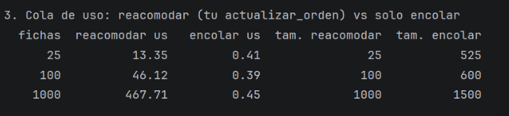

La lista solo gana al insertar (2.5 veces), y ese costo no se paga en el bucle principal, donde lo que domina es consultar y extraer. Al pasar de 10 a 250 eventos, consultar el mínimo cuesta lo mismo en el montículo (×1.0) y 19.4 veces más en la lista. Con muy pocos eventos la lista puede igualar al montículo en algunas operaciones, por lo que la ventaja aparece desde unas decenas de eventos, que es la escala de las pruebas.

### 6. Límites conocidos

> • Los eventos cancelados se quedan en el montículo hasta llegar a la raíz; con muchas muertes la agenda ocupa más memoria de la necesaria por un tiempo.
>
> • Cada cambio de velocidad crea un evento nuevo y deja uno cancelado, en vez de modificar el existente en su sitio.
>
> • siguiente() modifica la agenda (descarta cancelados), por lo que una consulta no es estrictamente de solo lectura.

## §4.7 — El rastro del jugador

### 1. Problema

Un enemigo rastreador debe seguir al jugador, pero la decisión debe costar en proporción al número de salidas de su sala, no al tamaño de la cripta ni a la longitud del recorrido del jugador. Un rastro de 400 unidades o más de antigüedad no sirve, y hay que decidir si se elimina activamente o se detecta su caducidad al consultarlo. Con varios rastreadores, el trabajo por ciclo no debe crecer más que linealmente con los enemigos que actúan.

### 2. Alternativas consideradas

> • **Guardar el recorrido completo del jugador (lista de salas visitadas) y buscar en él:** cada decisión costaría O(longitud del recorrido), justo lo que el enunciado prohíbe; quedó descartada.
>
> • **Buscar el camino más corto hacia el jugador (recorrido por el mapa):** cuesta O(salas) por decisión, depende del tamaño de la cripta y además deja de ser un “rastro”; quedó descartada.
>
> • **Eliminar activamente los rastros viejos con un evento periódico:** exige un evento adicional o recorrer todas las salas para limpiar, con un costo que depende del tamaño de la cripta; quedó descartada.

### 3. Decisión

Cada sala guarda un solo número: el reloj de la última vez que el jugador estuvo en ella (rastro). Se actualiza al entrar a una sala y al inicio de la partida, y el cambio es reversible mediante el historial de retroceso (§4.6, de Persona C). No hay lista de recorrido.

Para decidir, el rastreador (salida_rastro) recorre solo las salidas abiertas de su sala. Para cada una mira el rastro de la sala destino y se queda con la más reciente; en un empate gana la de menor id, para que el resultado sea determinista. Un rastro con reloj - rastro \>= 400 se ignora. Si ninguna salida tiene un rastro vigente, el rastreador no se mueve y espera su siguiente turno.

La caducidad se detecta al consultar, no se elimina activamente. Se justifica así: la comparación reloj - rastro se hace sobre las pocas salas vecinas que de todos modos se están mirando, así que no agrega costo, mientras que eliminar de forma activa requeriría un trabajo extra que depende de la cripta completa.

Para no buscar la sala vecina en la lista de salas en cada decisión, el destino de cada salida se resuelve una vez y se guarda en la propia salida (\_destino). Las salas se mantienen ordenadas por id con el ordenamiento del proyecto (elegir_algoritmo), y buscar_sala hace búsqueda binaria en ellas, O(log n).

### 4. Análisis de complejidad

Una decisión del rastreador es O(s), con s el número de salidas de su sala (como mucho 4 en este juego), porque cada destino se resuelve en O(1) tras la primera vez. La primera resolución de una salida cuesta O(log n) por la búsqueda binaria. Por ciclo, el trabajo de los rastreadores es O(r·s), lineal en la cantidad r de rastreadores que actúan. Espacialmente es un entero por sala, O(n), más un puntero por salida.

### 5. Evidencia empírica

Medido con tests/bench_decisiones.py, tiempo por decisión según el tamaño de la cripta (3000 llamadas por muestra, mediana de las muestras), en el equipo del proyecto:

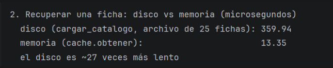

El tiempo de decisión no crece al pasar de 10 a 250 salas (con 250 salas costó 0.56 veces lo de 10 salas; el valor más alto de 10 salas es de calentamiento de la primera medición), que es lo que se pretendía: depende de las salidas, no de la cripta. Buscar una sala sí crece despacio, como corresponde a una búsqueda binaria O(log n), pero solo se paga la primera vez que se usa cada salida. Hay una prueba automática que verifica que el rastreador sigue el rastro más reciente, que desempata por el menor id y que ignora un rastro de 400 unidades o más.

### 6. Límites conocidos

> • Cada sala recuerda solo la última visita: si el jugador pasa por una sala dos veces, la primera se pierde. Es suficiente para elegir la vecina más fresca, pero no reconstruye el camino completo.
>
> • El rastreador es voraz: elige la vecina con el rastro más reciente, así que puede dar vueltas si el jugador retrocede por el mismo pasillo.

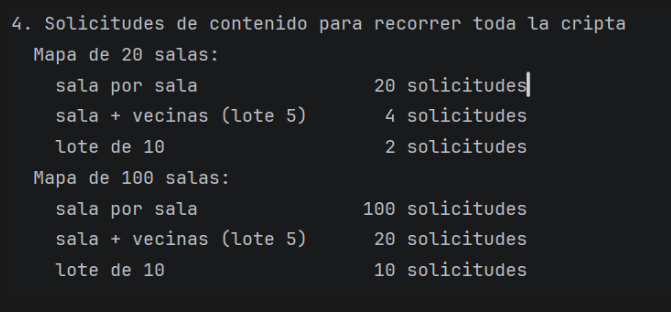

## §4.8 — Bitácora en pantalla

### 1. Problema

La interfaz muestra únicamente los últimos 20 mensajes del juego. El consumo de memoria de esta bitácora debe permanecer constante durante toda la partida, y agregar un mensaje no debe implicar desplazar físicamente los 19 anteriores.

### 2. Alternativas consideradas

> • **Lista que crece y se muestra solo el final:** es lo más simple, pero la memoria crece con la duración de la partida; incumple el requisito de memoria constante.
>
> • **Lista de 20 elementos que se desplaza al llenarse (pop(0) y append):** la memoria es constante, pero cada mensaje nuevo mueve los 19 anteriores, que es justo lo que el enunciado pide evitar; quedó descartada.
>
> • **Cola doblemente enlazada propia:** también evita el desplazamiento, pero cada mensaje reserva un nodo nuevo y agrega complejidad que no hace falta para un tamaño fijo y conocido.

### 3. Decisión

RegistroMensajes es un buffer circular sobre una lista de tamaño fijo (20 posiciones, creada una sola vez). Guarda la posición del mensaje más antiguo (\_inicio) y cuántos hay (\_cantidad). Mientras hay espacio, el mensaje nuevo va a la siguiente posición libre; cuando se llena, el mensaje nuevo sobrescribe al más antiguo y \_inicio avanza una posición (módulo 20). Nunca se mueve un mensaje de lugar.

ultimos() devuelve los mensajes del más antiguo al más reciente leyendo desde \_inicio, listo para mostrar. El motor genera los mensajes con \_mensaje (ataques, muertes, puertas, objetos y errores como una sala sin contenido) y la vista los lee de motor.mensajes.ultimos().

### 4. Análisis de complejidad

Agregar un mensaje es O(1) y no mueve ningún otro. Leer los últimos mensajes es O(k), con k = 20 como máximo. La memoria es O(k), constante, sin importar cuántos mensajes se generen en la partida.

### 5. Evidencia empírica

Medido con tests/bench_decisiones.py: tiempo por mensaje agregado, comparando el buffer circular con una lista que se desplaza, con 20000 mensajes:

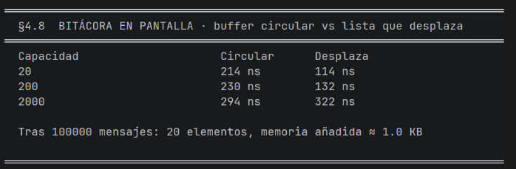

Con la capacidad real de 20 la lista que desplaza es más rápida (114 contra 214 ns), porque mover 19 referencias es muy barato; con 2000 mensajes la diferencia se invierte (294 contra 322 ns a favor del buffer circular). Se eligió el buffer circular por el requisito del enunciado (no desplazar físicamente y memoria constante) y no por velocidad. Tras 100000 mensajes agregados el registro sigue teniendo 20 elementos y ocupa aproximadamente 1 KB.

### 6. Límites conocidos

> • Un mensaje solo vive en el buffer: lo que sale de los 20 últimos se pierde para la pantalla (queda el registro de la partida para reproducción, que es otra bitácora).
>
> • La capacidad es fija y se decide al crear el motor; cambiarla durante la partida no está contemplado.

*Secciones de Persona B*

## §4.2 — Precarga de contenido

### 1. Problema

El problema de este apartado radica en que el jugador nunca puede caer en una sala en donde no se conozca su contenido por lo que el contenido debe estar ya en memoria antes de realizar un movimiento. Además de este requerimiento cada solicitud que se hace para cargar contenido de las salas cuesta unos 400 ms, sin embargo pedir 1 sala cuesta lo mismo que pedir 10 salas en un mismo lote.

### 2. Alternativas consideradas

> • **Precargar solo las 4 vecinas:** la idea era cargar únicamente las 4 salas vecinas de donde el jugador se ubicaba en ese momento por lo que el lote quedaba con 4 de 10 espacios aunque el costo es el mismo con 10 por esta razón de uso ineficiente del presupuesto quedó descartada
>
> • **Pedir todo el contenido al inicio.** En una cripta pequeña puede llegar a ser barato pero en una cripta grande puede superar el presupuesto que se tiene por esta razon queda descartada esta opción.

### 3. Decisión

En el archivo PlanificadorPrecarga se recorre el esqueleto por niveles de distancia con una cola. Desde la sala actual en un orden fijo de direcciones N, S, E, O, saltando las salas ya cargadas, hasta juntar un lote de 10, el límite es un parámetro con 10 por defecto (se piden las vecinas de las vecinas hasta llegar a 10). El GestorDatos expone dos métodos:

- asegurar_sala: se llama antes de confirmar un movimiento y, si la sala no está, pide un lote que empieza por esa sala y se completa con sus vecinas (así el costo de la solicitud no se desperdicia),

- precargar: se llama después de entrar. Las salas cargadas se registran en una lista de ids. La precarga es síncrona: si el contenido no está, el movimiento no se confirma hasta que llega, y esa espera real no mueve el reloj virtual.

### 4. Análisis de complejidad

- Peor Caso O(n²): en mapas grandes si muchas salas adyacentes ya están cargadas. El algoritmo debe explorar muchas salas (V) y, por cada una, realizar dos búsquedas lentas: Buscar la sala dentro de la lista del esqueleto y verificar si la sala de destino ya fue visitada o cargada

- Caso Práctico O(n): el bucle se detiene muy rápido gracias al límite de 10 salas. Como el número de iteraciones es un valor constante y pequeño, el factor que predomina es únicamente la búsqueda de la sala en el esqueleto

- Complejidad Espacial O(V): Es lineal respecto al número de salas exploradas. Ocupa memoria para mantener la cola de exploración, la lista de salas a pedir y el registro de salas visitadas.

### 5. Evidencia empírica

Medido con --bench: solicitudes de contenido necesarias para recorrer toda la cripta. Es un conteo, no un tiempo:

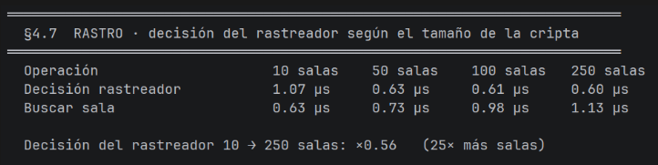

### 6. Límites conocidos

- Al ser síncrona, el jugador espera unos 400 ms cuando pide un lote nuevo, y nunca se ejercita el caso de respuesta pendiente . Pasar a hilos cambiaría quién espera, no el contrato.

- Las puertas cerradas se tratan igual que las abiertas, y el tamaño del lote no se adapta al presupuesto restante.

- La búsqueda de una sala en el esqueleto y las comprobaciones sobre listas son lineales; dejarían de ser apropiadas en criptas con miles de salas.

## §4.3 — Resolución del catálogo

### 1. Problema

Cada tipo que aparece en el contenido (enemigos, objetos y trampas) debe resolverse a una ficha de catálogo antes de mostrarse o simularse. Los ids aparecen en orden no controlado, se repiten entre salas y se reutilizan entre criptas, el catálogo acepta 10 ids por solicitud y un mismo id vigente no debe pedirse dos veces.

### 2. Alternativas consideradas

- **Pedir cada id por separado:** la idea era consultar las fichas una por una mediante la ruta individual (GET /catalogo/id), pero este proceso tarda lo mismo que enviar un lote completo y agota el presupuesto, por lo que fue descartada.

- **Descargar todo el catálogo al inicio:** traer todo el catálogo desde el principio para evitar consultas posteriores, pero el sistema no cuenta con un endpoint que permita listar el catálogo completo por lo que quedó descartada.

### 3. Decisión

Se decide crear un metodo resolver_fichas(ids) que elimina repetidos y resuelve tres partes: caché en memoria, disco, validado contra la versión del catálogo. Todo lo que falte luego de pasar por todos los filtros se pide a través de una sola llamada a la fuente, en esta llamada se parten los ids en bloques de 10. Lo recibido se agrega a la caché y se guarda en disco junto con lo que ya había. Al cargar un lote de contenido, el gestor junta los tipos de enemigos, trampas y objetos de las salas nuevas y los resuelve juntos, por lo que el motor recibe las fichas listas. La versión del catálogo se consulta una sola vez por ejecución.

### 4. Análisis de complejidad

Resolver t tipos nuevos cuesta ⌈t/10⌉ solicitudes en vez de t, ya que, se agrupan las solicitudes en lotes de 10 unidades en lugar de ir una por una. Si k es fichas en memoria entonces consultar la caché es O(log k). Cada consulta a disco lee y convierte el archivo completo, O(m) en las fichas guardadas, y se hace una vez por llamada a resolver_fichas, no una por ficha, en pocas palabras se realiza una sola lectura masiva por llamada completa.

### 5. Evidencia empírica

Medido con --bench: recuperar una ficha desde disco (archivo de 25 fichas) tarda 359.94 microsegundos en el equipo probado y desde memoria 13.35 microsegundos. Se concluye que recupera una ficha desde el disco en aproximadamente 27 veces más lento que hacerlo desde memoria.

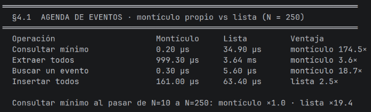

### 6. Límites conocidos

Los objetos de la lista suelta de cada enemigo no se resuelven por adelantado: se resuelven cuando el motor los necesita, al morir el enemigo.

- El archivo del catálogo crece sin desalojo en disco, y cada consulta a disco relee el archivo entero.

- Si cambia la versión del catálogo se descarta todo lo guardado, no solo lo que cambió.

- Si un lote trae más tipos que el tope de la caché, las primeras fichas pueden desalojarse antes de usarse, recuperarlas cuesta una lectura de disco, no una solicitud.

## §4.4 — Caché persistente

### 1. Problema

Las fichas en memoria tienen un tope configurable (--cache-size, 25 por defecto). Al llegar al tope hay que liberar una ficha, sin tocar las que están en uso como lo puede ser un enemigo vivo, un objeto en el inventario del jugador o un objeto en el suelo de la sala actual, una trampa de la sala actual. Preguntar si una ficha está en caché es una de las operaciones más frecuentes, y lo guardado debe sobrevivir al cierre del programa y validarse por versión sin descargarlo todo otra vez.

### 2. Alternativas consideradas

- **Tabla hash propia:** la idea era implementar una tabla hash hecha a mano para agilizar las búsquedas, pero por indicaciones del curso las únicas estructuras permitidas son listas, colas, pilas y colas de prioridad, por lo que fue descartada.

- **Cola de uso con duplicados (borrado perezoso):** la idea era actualizar la cola en tiempo constante O(1) sin eliminar elementos viejos de inmediato, pero esto provocaba que la cola creciera sin límite afectando el uso de memoria, razón por la cual se descartó.

- **Lista doblemente enlazada con referencias directas:** la idea era usar una lista doblemente enlazada con apuntadores directos a cada ficha para reubicarlas en tiempo O(1), pero no se implementó debido a la complejidad adicional que agregaba al código, por lo que se dejó como una posible mejora a futuro.

### 3. Decisión

- **Estructura:** de decide usar una list nativa (permita como almacenamiento contiguo de bajo nivel) de fichas, siempre ordenada por id, con búsqueda binaria. Una única función, \_buscar_posicion, sirve tanto para saber si una ficha existe como para encontrar dónde insertar. Tras desalojar se recalcula la posición, porque la lista pudo cambiar.

- **Política de desalojo LRU (la menos recientemente usada):** Una Queue de ids guarda el orden de uso sin duplicados: cada acceso saca el id viejo y lo vuelve a encolar al final. Se desaloja desde el frente. Si el gestor indica que esa ficha está en uso, se conserva y se prueba la siguiente, el recorrido es de una sola pasada, así que siempre termina.

- **Todo protegido:** Si todas las fichas están en uso, la caché supera su tope por un corto tiempo y vuelve a él cuando se liberan; el motor sigue funcionando.

- **Persistencia:** La carpeta se recibe por parámetro. Hay un archivo JSON por tipo de dato (catálogo, esqueleto y contenido de cada cripta), cada uno con su versión adentro, que solo se usa si coincide con la vigente. Se guardan las respuestas como JSON con el metodo “a_json” y se reconstruyen con “desde_json”. Antes de escribir se arma el texto completo, para no dejar archivos a medias, y un archivo dañado se trata como ausente y se vuelve a pedir.

### 4. Análisis de complejidad

Buscar es O(log k) e insertar O(k), por el desplazamiento de la lista. Actualizar el orden de uso es O(k), porque la cola se recorre y se reconstruye. Una consulta con acierto cuesta O(k): en la práctica domina el mantenimiento de la cola, no la búsqueda. Un recorrido de desalojo es O(q) en el peor caso, con q el tamaño de la cola.

### 5. Evidencia empírica

Medido con --bench, búsqueda en caché (microsegundos por búsqueda):

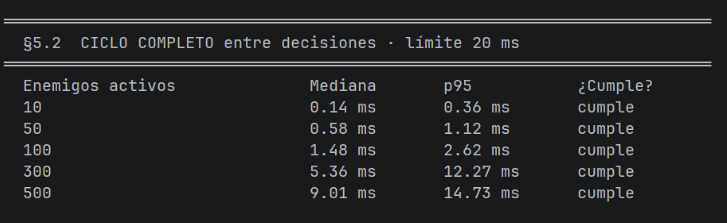

Con 25 fichas, la búsqueda binaria y la lineal casi empatan (1.06 y 1.11 microsegundos); con 100 fichas son 1.17 y 3.11 microsegundos, y con 1000 fichas 2.00 y 26.93 microsegundos, es decir, la lineal es unas 13 veces más lenta. La binaria se justifica por la escala, no por el tamaño por defecto. Además, una consulta con acierto en memoria cuesta unos 13 microsegundos y reacomodar la cola cuesta casi lo mismo, así que prácticamente todo el costo está en mantener el orden de uso y no en la búsqueda. Recuperar una ficha desde disco cuesta 359.94 microsegundos frente a 13.35 microsegundos desde memoria, unas 27 veces más.

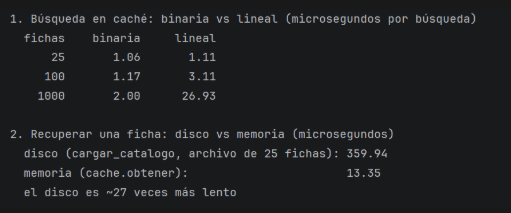

Con 25 fichas, reacomodar la cola cuesta 13.35 microsegundos frente a 0.41 microsegundos de solo encolar; con 100 fichas, 46.12 microsegundos frente a 0.39 microsegundos; y con 1000 fichas, 467.71 microsegundos frente a 0.45 microsegundos. El costo de reacomodar crece aproximadamente en proporción al tamaño de la caché (unas 35 veces más entre 25 y 1000 fichas), mientras que encolar sin reacomodar se mantiene en unos 0.4 microsegundos. A cambio, la cola sin reacomodar crece sin límite: tras 500 operaciones tiene 525, 600 y 1500 elementos, mientras que la que se reacomoda se mantiene exactamente en 25, 100 y 1000, el tamaño de la caché. Con el tamaño por defecto, 13.35 microsegundos es despreciable frente a los unos 400 ms de una solicitud de red, por eso se eligió reacomodar. La alternativa descartada quedó medida: es más barata por operación, pero su memoria no tiene tope.

### 6. Límites conocidos

- Si todas las fichas están en uso, la caché supera temporalmente su tope.

- Cada lectura de disco relee el archivo completo, y el archivo del catálogo no tiene desalojo propio.

- Un archivo dañado se descarta y se vuelve a pedir, pero no se avisa al usuario.

## §5.4 — Resolubilidad

Spec: [specs/002-resolubilidad/spec.md](../specs/002-resolubilidad/spec.md) · Plan: [plan.md](../specs/002-resolubilidad/plan.md) · Alternativas: [research.md](../specs/002-resolubilidad/research.md) (R1 a R8) · Tareas: [tasks.md](../specs/002-resolubilidad/tasks.md)

**¿Coincide con el plan original?** Sí. La versión final es la del plan: vector de salas por id, `Queue` propia, índice de llaves ordenado con búsqueda binaria, un único recorrido por oleadas con puertas en espera, reporte como barrido final, dependencias con zonas selladas y ciclos sobre `depende_de`. Ninguna medición obligó a cambiarla. Lo único que el plan dejaba abierto, el peor caso de las dependencias (P-11), se cerró aceptándolo como excepción documentada de FR-029.

### 1. Problema

AAntes de iniciar una partida hay que decidir Y confirmar si la cripta es resoluble. Una cripta es resoluble si desde la sala inicial se puede conseguir "llave_salida" y llegar a "sala_salida" por una puerta que la pida. Se asume que toda salida abierta se cruza, que una cerrada se cruza si ya se tiene su llave, que las llaves no se gastan, que todo enemigo se vence (la llave que suelta cuenta en la sala donde empieza) y que trampas y cierres automáticos no bloquean.

Si es resoluble se muestra un orden de llaves en el que cada una aparece después de las que hacen falta para alcanzarla. Si una cripta no es resoluble, el reporte muestra las llaves que no se pueden obtener, las puertas de la frontera bloqueada con su llave, dónde está cada llave, las dependencias entre llaves y los ciclos (una llave encerrada detrás de puertas que solo ella misma puede abrir). El resultado debe ser idéntico en cada ejecución (deterministico), sin importar el orden en que la fuente entregue los datos (FR-012, FR-013). Además, la verificación debe tardar menos de 200 ms en la cripta publicada más grande y crecer de forma aproximadamente lineal con salas, salidas y llaves (FR-029). Todo esto sin `dict`, `set`, `sorted()` ni `.sort()`, que el curso no permite.

Notación: S salas, E salidas, K llaves distintas, L ubicaciones de llaves, C salidas cerradas que piden llave y M = L + C + 1 menciones de llaves.

### 2. Alternativas consideradas

- **Recorrer otra vez la cripta completa cada vez que se obtiene una llave (A1):** es la idea más simple, pero cuesta O(K·(S + E)) y crece con el número de llaves. Se midió en `--bench` y se descartó (ver evidencia).

- **Calcular la zona de cada llave por separado, limpiando las marcas y revisando todas las puertas cada vez (A2):** cuesta O(K·(S + E)) en las dependencias. Se midió y se descartó.

- **Buscar el id de una llave recorriendo la lista (A3):** cuesta O(K) por búsqueda, O(M·K) en total. Se midió y se descartó.

- **Tabla hash propia como índice de llaves:** daría búsquedas en O(1) esperado, pero no mejora el costo total: el reporte debe salir ordenado por id (FR-014), así que habría que ordenar las llaves aparte y el O(M log M) seguiría. Además, la búsqueda no es el cuello de botella, el índice no cambia después de armarse, y exigiría una función hash propia para textos, porque `hash()` de Python cambia entre ejecuciones y rompería el determinismo (FR-012). Descartada. 
- **Árbol AVL, rojo-negro o BST como índice de llaves:** misma búsqueda O(log K) con mucho más código, y su ventaja (insertar y borrar en O(log K)) no se usa porque el índice no cambia. Un BST sin balancear sería peor: las llaves llegan ordenadas y el árbol degeneraría en una lista, con búsquedas O(K). Descartados.

- **Revisar todas las puertas cerradas al terminar cada oleada:** O(K·C), en lugar de dejar cada puerta esperando a su llave. Descartada.

### 3. Decisión

- **Vector de salas (R1):** una `list` usada como arreglo de tamaño fijo, indexada por id de sala, de largo `max_id + 1`. Cada sala guarda sus salidas en el orden fijo N, S, E, O y las llaves ubicadas en ella. Se arma una sola vez con un barrido del esqueleto. Los ids de sala de las criptas publicadas son enteros contiguos desde 1, así que llegar a una sala es O(1) sin buscar.

- **Cola del recorrido (R2):** la `Queue` de `Modelo/Estructuras.py` (movida desde `Cache/`, P-12). Solo se usan `enqueue`, `dequeue` e `is_empty`, todas O(1). Una sala se marca al encolarse, así entra a lo sumo una vez.

- **Vectores de marcas (R3):** arreglos de booleanos `visitada`, `obtenida` y `en_ronda`, con consulta y marca en O(1).

- **Índice de llaves (R4):** las M menciones de llaves se ordenan con el `merge_sort` del proyecto, se quitan los repetidos con un barrido y queda un arreglo ordenado `ids_llaves`. Una búsqueda binaria escrita a mano traduce cada id a su número de llave, que indexa todos los demás arreglos. Como el arreglo está ordenado, el orden por número es el orden por id, y todos los órdenes del reporte salen sin volver a comparar textos.

- **Recorrido por oleadas (R5):** un único recorrido en anchura. Una salida cerrada cuya llave aún no se tiene guarda su destino en `espera[llave]`. Al terminar la oleada, las llaves encontradas se ordenan, se marcan obtenidas y sueltan sus puertas en espera; esas salas se procesan en la oleada siguiente. Así una llave encontrada en la oleada *n* solo abre puertas en la *n + 1* (FR-007).

- **Veredicto y reporte (R6):** no tienen estructura propia; son un barrido final sobre lo ya calculado. La frontera sale recorriendo las salas visitadas en orden de id y sus salidas en el orden fijo, así queda ordenada sin ordenar.

- **Dependencias entre llaves (R7):** solo si la cripta no es resoluble. Para cada sala con una llave se recorre su zona hacia atrás con la misma `Queue`. En vez de limpiar las marcas en cada zona (O(S) por zona), un arreglo `sello` guarda el número de la zona que visitó cada sala, y una zona nueva solo usa un sello nuevo. Las puertas internas se descartan y el resto se reduce a *ninguna*, *J* o *conflicto*; con el primer conflicto se corta. Las llaves de la misma sala comparten la zona.

- **Ciclos (R8):** cada llave depende a lo sumo de otra, así que los ciclos son disjuntos y se encuentran siguiendo `depende_de` con una marca por recorrido. Al barrer las llaves en orden de número, la primera de cada ciclo es la de menor id, de modo que cada ciclo empieza por su menor llave y los ciclos salen ordenados sin ordenar nada.

- **Determinismo (R11):** todo orden sale del id de sala, del orden N, S, E, O o del número de llave. Nada depende de la semilla, del orden de las páginas ni de la caché.

### 4. Análisis de complejidad

| Parte | Costo |
|---|---|
| Construir el vector de salas y las entrantes | O(S + E) |
| Construir el índice de llaves (`merge_sort` + repetidos + traducción) | O(M log M) |
| Buscar una llave en el índice | O(log K) |
| Recorrido por oleadas (más ordenar cada oleada) | O(S + E + C) + O(K log K) |
| Barrido del reporte | O(S + E + K + L log L) |
| Dependencias | O(S + E + Σ tamaño de las zonas); peor caso O(L·(S + E)) |
| Ciclos | O(K) |

El total del caso resoluble es **O(S + E + M log M)**. Como cada llave aparece en pocas puertas y ubicaciones, M crece con K y C, y al duplicar la cripta el término M log M se multiplica por algo más que 2. La excepción es el cálculo de dependencias: las zonas de distintas llaves pueden solaparse, y en ese caso el peor caso es O(L·(S + E)) (P-11, aceptado como excepción documentada de FR-029). Memoria: O(max_id + K + L).

### 5. Evidencia empírica

Medido con `python main.py --bench` (`tests/bench_resolubilidad.py`) en un AMD Ryzen (Family 25 Model 80) con Windows 11 y Python 3.14.6. Solo se mide `Resolubilidad.verificar` con los datos ya en memoria, sobre criptas sintéticas con semilla 2026, con 3 corridas de calentamiento y 30 repeticiones por caso.

**Límite de 200 ms (M1, SC-004).** El enunciado (§6.1) fija 200 ms para la verificación en la cripta publicada más grande, medidos en el equipo local, sin red ni renderizado; por eso se mide solo `verificar` con los datos en memoria. En una cripta sintética del tamaño de la publicada más grande (cripta-06: S = 300, E = 760, K = 4):

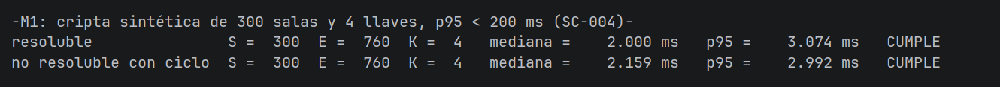

El caso resoluble tarda  2.000 ms de mediana y 3.074 ms de p95; el no resoluble con ciclo, 2.159  ms y 2.992 ms. Los dos cumplen con amplio margen: el p95 es aproximadamente unas 56 veces menor que el límite.

**Crecimiento al duplicar la cripta (M2 y M3, SC-005).** De S = 300 a S = 9600, duplicando salas, salidas y llaves:

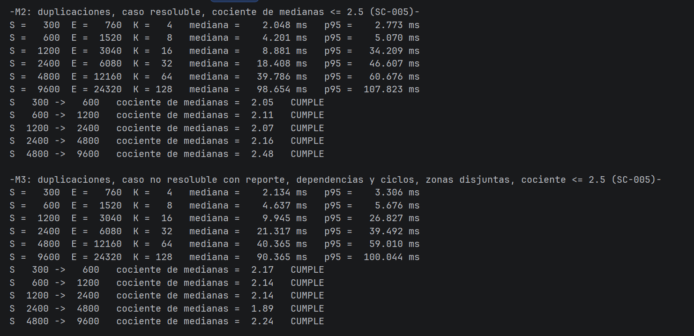
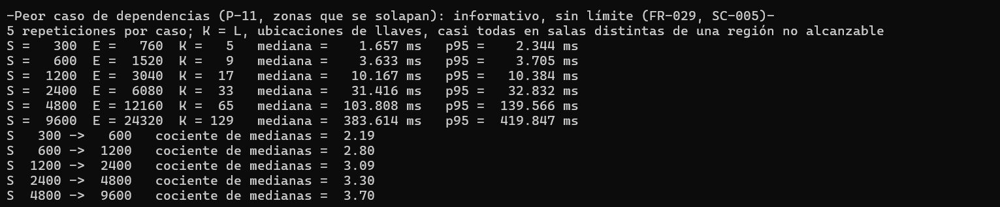

En el caso resoluble, el cociente de medianas en cada duplicación está entre 2.04 y 2.34; en el no resoluble con reporte, dependencias y ciclos (zonas disjuntas), entre 2.04 y 2.33. Todos quedan por debajo de 2.5, lo que respalda el crecimiento aproximadamente lineal. Con 9600 salas el caso resoluble sigue en 99.416 ms de mediana.

**Versión elegida frente a las alternativas (M4).**

- **A1, recorrer todo por cada llave:** es la comparación que exige el enunciado (§6.3): recorrido incremental frente a recorrido repetido por llave. Con S = 1200, la ventaja de la versión elegida crece con K: 1.23 veces con 4 llaves, 1.94 con 16, 4.04 con 64 y 11.45 con 256 (9.581 ms frente a 109.701 ms). En las duplicaciones de M2 llega a 7.26 veces con 9600 salas (66.622 ms frente a 483.917 ms). Es la alternativa que más se aleja, porque su costo crece con K·S.
- **A2, zona de cada llave por separado:** entre 1.09 y 1.16 veces más lenta en el caso no resoluble. La diferencia es pequeña con estas criptas porque sus zonas no se solapan.
- **A3, búsqueda lineal del id:** con pocas llaves casi empata, y en las criptas chicas de M2 fue incluso un poco más rápida (0.93 con S = 300 y 0.87 con S = 600). La búsqueda binaria se justifica por la escala: con 256 llaves la lineal es 1.51 veces más lenta en el caso resoluble y 1.58 en el no resoluble.

**Conteos del índice (M5).** Las comparaciones de `merge_sort` al construir el índice se mantienen en una proporción casi constante de M·log₂ M (entre 0.580 y 0.622, de M = 26 a M = 2340), lo que respalda el O(M log M). En la búsqueda binaria, el máximo de pasos es exactamente floor(log₂ K) + 1 en todos los casos (3 pasos con K = 4, 9 con K = 256), lo que respalda el O(log K).

**Peor caso de las dependencias (P-11, informativo, sin límite).** Con zonas que se solapan y casi todas las llaves en salas distintas de una región no alcanzable:

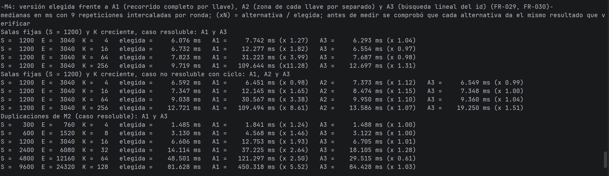

Los cocientes al duplicar suben de 2.06 a 3.82, y con 9600 salas y 129 llaves la mediana es 547.925 ms. Esto confirma el O(L·(S + E)) del análisis: es el único caso que no crece de forma lineal, y por eso queda documentado como excepción.

### 6. Límites conocidos

- **Peor caso de las dependencias:** si las zonas de muchas llaves se solapan, el cálculo de dependencias crece como O(L·(S + E)) y deja de ser lineal (cocientes de hasta 3.82 en el bench). Solo ocurre en criptas no resolubles y con una forma muy particular. **HIPÓTESIS:** las criptas publicadas no tienen esa forma; no se midió con ellas.
- **Criptas sintéticas:** M1 usa una cripta sintética del tamaño de cripta-06, no la cripta-06 real. **HIPÓTESIS:** la real se comporta igual, porque el costo depende de S, E y K, no del contenido.
- **Ids de sala dispersos:** el vector de salas mide `max_id + 1`. Si los ids fueran muy dispersos (por ejemplo, `max_id` mayor que 4·S), la memoria sería O(max_id). No pasa en ninguna cripta publicada. Un id que no sea entero no negativo hace fallar la verificación con `! Error: ...`.
- **Variación del p95:** en las criptas grandes el p95 se separa de la mediana (por ejemplo, 18.983 ms de mediana y 59.423 ms de p95 con S = 2400). Por eso los criterios de crecimiento usan la mediana. **HIPÓTESIS:** se debe a la recolección de basura o a la carga del equipo; no se verificó por separado. Todas las mediciones son de un solo equipo.
- **Caché de llaves:** `datos_locales/llaves_<id>.json` lleva identificador y versión de formato (`CRIPTA-LLAVES`, 1), pero las cachés anteriores del esqueleto y del catálogo no; se dejaron así porque son contrato compartido.
- **El reporte no se mide aparte:** M3 mide la verificación completa del caso no resoluble; no hay una cifra separada de cuánto cuesta solo el reporte.

*Secciones de Persona C*

## §4.5 – Inventario

### 1. Problema

El inventario del jugador debe permitir recorrer hacia adelante y hacia atrás desde la posición actual, soltar el objeto que se está viendo en cualquier posición sin que el costo dependa de dónde esté, equipar un objeto moviéndolo al frente del orden real, y mostrar vistas ordenadas por peso, valor o nombre sin alterar ese orden real. Además, al alcanzar inventario max debe rechazarse cualquier intento de recoger un nuevo objeto.

Las operaciones que realmente ejecuta el programa, con la frecuencia esperada según el diseño del juego, son: recoger, soltar, equipar (decenas de veces por partida, una por acción del jugador que las involucre), y avanzar/retroceder del cursor (potencialmente muchas veces por decisión del jugador, mientras navega el inventario antes de decidir qué hacer)

### 2. Alternativas

> • **Array con índice de posición actual:** Soltar o insertar en una posición intermedia requiere recorrer y desplazar los elementos siguientes, lo que da O(n) en el peor caso, contradice el requisito de que soltar no dependa de la posición.
>
> • **Lista doblemente enlazada con un cursor (puntero al nodo actual):** Al mantener una referencia directa al nodo que se está viendo, soltar o equipar no requiere buscar nada: se opera directamente sobre los punteros anterior/siguiente de ese nodo y sus vecinos.

### 3. Decisiones

Se implementó Inventario como una lista doblemente enlazada de nodos NodoInventario, con **\_\_slots\_\_** para reducir el overhead de memoria por instancia, con un cursor (\_cursor) que apunta siempre al nodo que el jugador está viendo. Las operaciones principales:

> • **avanza() / retrocede():** mueven el cursor siguiendo siguiente/anterior.
>
> • **suelta_actual():** desconecta el nodo apuntado por el cursor.
>
> • **soltar_nodo(nodo):** igual que la anterior, pero opera sobre cualquier nodo recibido por referencia, sin depender de dónde esté el cursor necesaria para que el historial de retroceso (4.6) pueda deshacer una recolección de forma confiable aunque el jugador haya navegado el inventario después.
>
> • **equipar_actual():** desconecta el nodo del cursor y lo reinserta al frente de la lista.
>
> • **vista_ordenada(criterio):** arma un arreglo temporal de referencias a los nodos (vía \_\_iter\_\_, de solo lectura) y lo ordena con el módulo de ordenamiento (4.9), sin tocar el orden real de la lista enlazada.

También, equipar un arma y equipar una armadura no pueden compartir la misma noción de "estar al frente", porque el enunciado (2.7) permite tener ambas equipadas a la vez, y solo sustituye al objeto anterior si es del mismo tipo. Se agregaron dos referencias en Inventario \_armae_quipada y \_armadura_equipada, actualizadas por equipar_actual() según la clase del nodo equipado, sin pisarse entre sí. arma_equipada() y armadura_equipada() exponen esas referencias hacia el motor de simulación, que las necesita para sumar ataque_bonus y defensa_bonus a las estadísticas del jugador.

### 4. Complejidad

| **Operación**               | **Complejidad**                                                          | **Motivo**                                                          |
|-----------------------------|--------------------------------------------------------------------------|---------------------------------------------------------------------|
| avanza / retrocede          | O(1)                                                                     | Seguir un puntero del nodo actual                                   |
| suelta_actual / soltar_nodo | O(1)                                                                     | El nodo ya se tiene por referencia; solo se reconectan 2-3 punteros |
| equipar_actual              | O(1)                                                                     | Misma razón que soltar                                              |
| recoge                      | O(1)                                                                     | Inserción al final, con referencia directa a \_cola                 |
| vista_ordenada              | O(n) para armar el arreglo + costo del algoritmo de ordenamiento elegido |                                                                     |

Se descartó la primera alternativa precisamente por no cumplir el requisito explícito de costo independiente de la posición.

### 5. Evidencias Empíricas

Medido con --bench sobre un inventario de 500 objetos:

-Inventario-

recoger 500 objetos: 0.000215s

avanza 500 veces: 0.000030s

soltar 500 objetos: 0.000098s

Los tiempos se mantienen del orden de microsegundos incluso con 500 objetos, consistente con que todas las operaciones individuales son O(1), no hay degradación apreciable al crecer el inventario dentro de un rango realista para una partida.

### 6. Límites

- La estructura no ofrece acceso O(1) por identificador de instancia (no hay tabla de búsqueda, porque dict como índice está prohibido por el enunciado), si en algún momento se necesitará ubicar un objeto específico del inventario por su id sin recorrer la lista, esta decisión dejaría de ser suficiente y haría falta una estructura adicional.

- El diseño asume que el inventario se mantiene en un rango razonable de tamaño (el inventario_max de la cripta); no fue medido a escalas de miles de objetos, que no son un escenario realista para este campo del juego.

- La separación de \_arma_equipada/\_armadura_equipada depende de que nodo.clase tome exactamente los valores "arma"/"armadura"; un objeto de otra clase que se intente equipar no actualiza ninguna de las dos referencias, pero tampoco se rechaza explícitamente,entonces, sería conveniente que equipar_actual() valide la clase antes de equipar.

## §4.6 – Pergaminos de retroceso e historial reversible

### 1. Problema

El pergamino de retroceso debe revertir el estado completo del juego hasta el instante inmediatamente anterior a la última acción del jugador, incluyendo todo lo ocurrido después (acciones enemigas, efectos, reloj, eventos programados o cancelados, rastro, vida, inventario, objetos del suelo, puertas y trampas). Dos restricciones estructurales son centrales: está prohibido guardar copias completas del estado, y solo pueden deshacerse hasta 5 acciones del jugador hacia atrás. Además, los pergaminos de retroceso quedan excluidos de su propio sistema de reversión: usar un pergamino no se deshace a sí mismo, y recoger o soltar un pergamino durante un intervalo revertido tampoco se deshace.

### 2. Alternativas

- **Copias completas del estado por cada acción del jugador:** Estaba completamente prohibido por el enunciado, y además costoso en memoria si se guardaran hasta 5 estados completos de la partida.

- **Registro de deltas (patrón tipo Command/Memento):** agrupados por intervalo entre una acción del jugador y la siguiente. Cada cambio reversible se guarda como una función de reversión (deshacer) junto con una descripción, no como un dato — evita duplicar el estado y solo almacena lo necesario para invertir cada mutación puntual.

Se descartó la primera por estar prohibida y por su costo; la segunda se adoptó por cumplir ambas restricciones del enunciado.

### 3. Decisión

Se implementó una clase Historial que mantiene una pila limitada a una contaste MAX_INTERVALOS = 5. Cada intervalo es una lista de objetos Cambio (deshacer + descripción). Funciona de la siguiente manera:

- **abrir_intervalo():** se llama una vez por cada acción del jugador que consume tiempo virtual; abre un intervalo nuevo y descarta el más antiguo si se supera el límite.

- **registrar(deshacer, description):** el motor de simulación llama esta función cada vez que muta algo reversible, pasando una función sin argumentos que sepa revertir exactamente ese cambio.

- **deshacer_ultimo():** revierte el intervalo más reciente completo, en orden inverso a como se registraron los cambios.

La función usar_pergamino(inventario, historial, nodo_pergamino) la cual es independiente, no método de ninguna clase, para no acoplar Historial con Inventario, orquesta el uso real: descuenta el pergamino directamente del inventario, esto sin pasar por historial.registrar() y luego llama deshacer_ultimo(). Esa exclusión es lo que impide que el propio pergamino se restaure al deshacer.

Una regla adicional, descubierta al validar los casos del Apéndice B: ningún objeto de clase pergamino_retroceso debe registrarse como Cambio reversible al recogerse o soltarse, si se registrara, su recolección se deshacería junto con el resto del intervalo, lo cual contradice la regla de exclusión del enunciado.

Posteriormente se realizaron tres funciones "puente" en retroceso, recoger_reversible, soltar_reversible y equipar_reversible , las cuales envuelven las operaciones base de Inventario y registran su reversión automáticamente, respetando la exclusión de pergaminos.

A diferencia de recoger (que siempre agrega al final, por lo que deshacerlo es trivial), soltar y equipar remueven un nodo de una posición intermedia; por eso se agregó Inventario.\_reinsertar, la cual reconecta un nodo exactamente entre los vecinos que tenía antes de ser removido, sin este método, deshacer un soltar o un equipar habría devuelto el objeto al final de la lista en vez de a su posición original.

### 4. Análisis de complejidad

| **Operación**   | **Complejidad**                                                                                                                    |
|-----------------|------------------------------------------------------------------------------------------------------------------------------------|
| abrir_intervalo | O(1) amortizado (el descarte del intervalo más viejo con pop(0) es O(k) en el peor caso, pero k ≤ 5, una constante pequeña)        |
| registrar       | O(1) por cambio                                                                                                                    |
| deshacer_ultimo | O(m), donde m es la cantidad de cambios del intervalo a revertir no depende del tamaño total del historial ni del estado del juego |

### 5. Evidencia empírica

Medido con --bench, registrando 5 intervalos de 50 cambios cada uno (250 cambios en total) y deshaciéndolos todos:

-Retroceso-

registrar 250 cambios: 0.000055s

deshacer 5 intervalos: 0.000026s

Se validaron además, con pruebas dedicadas, los dos casos borde más delicados del Apéndice B:

- **Pergamino recogido dentro del intervalo revertido:** al usar un pergamino para deshacer un intervalo en el que también se había recogido otro pergamino, el inventario final refleja únicamente el consumo de la unidad usada, el pergamino recogido durante el intervalo permanece en el inventario, tal como exige la regla.

- **Dos pergaminos consecutivos:** como usar_pergamino nunca llama abrir_intervalo() (usar el pergamino no consume tiempo virtual ni es una acción del jugador), el segundo uso consecutivo revierte automáticamente la acción anterior a la ya revertida comportamiento que surge naturalmente de que \_intervalos sea una pila, sin necesitar lógica especial para este caso.

- **Deshacer sin nada que deshacer:** deshacer_ultimo() devuelve False de forma segura tanto al inicio (historial vacío) como después de agotar todos los intervalos disponibles, sin lanzar excepciones.

### 6. Límites

- El diseño depende por completo de que el motor de simulación reporte **todas** las mutaciones reversibles a través de historial.registrar(). Si el motor omite reportar un cambio (por ejemplo, un rearme de trampa o una reprogramación de velocidad), ese cambio no se revertiría y la reversión quedaría incompleta, este es el punto de mayor riesgo de integración con Persona A y debe acordarse explícitamente qué mutaciones llaman a registrar.

- El límite de 5 intervalos es fijo según el enunciado; si creciera, el costo de abrir_intervalo seguiría siendo pequeño, pero no fue diseñado pensando en límites mayores.

- La integración real de historial.registrar() dentro del motor de simulación (combate, movimiento, cambios de velocidad) sigue pendiente del lado de quien lo implementa; mientras tanto, el diseño fue validado con funciones reversibles equivalentes escritas para pruebas (recoger_reversible, soltar_reversible, equipar_reversible), que sirven como ejemplo directo de cómo integrar las llamadas reales cuando se confirme el contrato.

## §4.9 – Ordenamiento

### 1. Problema

El programa necesita ordenar listas en varios contextos (vistas del inventario, y potencialmente tabla de puntajes, índices de archivo de guardado y listas del catálogo), sin usar list.sort() ni sorted(). Se exige implementar al menos dos algoritmos con características distintas, y que el programa elija automáticamente cuál usar según propiedades medibles de los datos, tamaño, qué tan ordenados están, y si las comparaciones son costosas —, respaldado con mediciones propias.

### 2. Alternativas

- **Un único algoritmo de propósito general (merge sort)**: Cumpliría la correctitud, pero no aprovecha que para listas pequeñas (como el inventario típico de un jugador) un algoritmo más simple es más rápido en la práctica, y no responde al pedido explícito del enunciado de considerar tamaños pequeños, datos casi ordenados y comparaciones costosas como ejes separados.

- **Insertion sort y merge sort únicamente, eligiendo por un umbral de tamaño:** Resuelve el eje de tamaño/overhead, pero no distingue el caso de comparaciones costosas: el peor caso de insertion sort son O(n²) comparaciones, lo cual puede pesar más que su bajo overhead si cada comparación es cara (por ejemplo, comparar nombres como cadenas de texto).

- **Tres algoritmos:** insertion sort, binary insertion sort y merge sort, seleccionados según tamaño y si la comparación se considera costosa. Binary insertion sort usa búsqueda binaria para ubicar la posición de inserción (O(log n) comparaciones por inserción en vez de O(n)), manteniendo bajo overhead para n chico.

Se adoptó la tercera opción porque responde a los tres ejes que pide explícitamente el enunciado (tamaño, orden de los datos, costo de comparación) con evidencia medida, en vez de solo dos.

### 3. Decisión

**S**e implementaron insertion_sort, binary_insertion_sort y merge_sort como funciones genéricas en un módulo ordenamiento.py independiente del inventario, cada una con la firma (items, key) - (lista_ordenada, comparaciones). Esa firma compartida permite que elegir_algoritmo(n, comparacion_costosa, casi_ordenado) devuelva cualquiera de las tres de forma intercambiable, sin que el código que las invoca necesite saber cuál se eligió. La función vista_ordenada del inventario marca como "costosa" la comparación por nombre (cadenas de texto) y como no costosa peso/valor (números). Además, antes de llamar a elegir_algoritmo, calcula casi_ordenado(items, key), que mide con una pasada O(n) qué proporción de pares consecutivos está fuera de orden; si esa proporción es baja, elegir_algoritmo elige insertion_sort sin importar el tamaño, porque su comportamiento adaptativo (se sale del ciclo apenas encuentra la posición correcta) hace que su trabajo real sea cercano a O(n) con datos casi ordenados, superando a merge_sort incluso para n grande, de esta manera cubriendo así el tercer eje que pide el enunciado (datos casi ordenados), que antes no se medía.

### 4. Análisis de complejidad

| **Algoritmo**         | **Comparaciones (peor caso)**                                     | **Cuándo conviene**                                 |
|-----------------------|-------------------------------------------------------------------|-----------------------------------------------------|
| insertion_sort        | O(n²)                                                             | n pequeño, datos casi ordenados, comparación barata |
| binary_insertion_sort | O(n log n) comparaciones (los desplazamientos siguen siendo O(n)) | n pequeño/mediano con comparación costosa           |
| merge_sort            | O(n log n), garantizado siempre                                   | n grande, independientemente del orden de entrada   |

### 5. Evidencia empírica

Medido con --bench sobre datos aleatorios de distintos tamaños:

-Ordenamiento-

n = 10 insertion_sort tiempo = 0.000005s comparaciones = 21

n = 10 binary_insertion_sort tiempo = 0.000007s comparaciones = 22

n = 10 merge_sort tiempo = 0.000016s comparaciones = 22

n = 32 insertion_sort tiempo = 0.000027s comparaciones = 335

n = 32 binary_insertion_sort tiempo = 0.000021s comparaciones = 119

n = 32 merge_sort tiempo = 0.000034s comparaciones = 121

n = 100 insertion_sort tiempo = 0.000200s comparaciones = 2592

n = 100 binary_insertion_sort tiempo = 0.000110s comparaciones = 532

n = 100 merge_sort tiempo = 0.000120s comparaciones = 537

n = 1000 insertion_sort tiempo = 0.020554s comparaciones = 249288

n = 1000 binary_insertion_sort tiempo = 0.008296s comparaciones = 8599

n = 1000 merge_sort tiempo = 0.001651s comparaciones = 8703

n = 10000 insertion_sort tiempo = 2.075939s comparaciones = 24926371

n = 10000 binary_insertion_sort tiempo = 0.774309s comparaciones = 119015

n = 10000 merge_sort tiempo = 0.022851s comparaciones = 120501

Con n=10, insertion sort es el más rápido de los tres pese a tener comparaciones similares, su overhead es mínimo y eso domina a esta escala. Ya en n=32 (el propio UMBRAL_TAMANO), binary insertion sort empieza a ganar en tiempo real (0.000021s contra 0.000027s de insertion sort), aunque la diferencia todavía es mínima. A partir de n=100, insertion sort pierde claramente terreno frente a binary insertion sort en cantidad de comparaciones (2592 contra 532). A partir de n=1000, merge sort pasa a ser la mejor opción en tiempo real, y la brecha se vuelve drástica en n=10000 (insertion sort tarda 91 veces más que merge sort).

Algo sumamente relevante para la justificación del diseño: entre n=1000 y n=10000, binary insertion sort multiplica sus comparaciones por 14x (O(n log n)), pero su tiempo real se multiplica por 93x. Esto evidencia que, a partir de cierto tamaño, el costo de los desplazamientos (mover elementos al insertar) domina por sobre el ahorro en comparaciones, por eso binary insertion sort no es suficiente reemplazo de merge sort para n grande, aunque gane en cantidad de comparaciones.

A partir de esta evidencia se fijó UMBRAL_TAMANO = 32: por debajo de ese tamaño, insertion sort todavía compite de cerca en tiempo real pese a tener más comparaciones; incluido ese mismo punto de corte en la corrida (n=32), binary insertion sort ya empieza a ganar, y la ventaja de binary insertion sort (con comparación costosa) y de merge sort (para n grande) se vuelve consistente a partir de ahí.

Para el tercer eje (datos casi ordenados) se midió por separado, generando listas ya ordenadas con un 5% de pares consecutivos intercambiados al azar (simulando "casi ordenado" de forma controlada y reproducible), comparando insertion_sort contra merge_sort:

-Ordenamiento datos casi ordenados-

n = 100 casi ordenado detecto = True

n = 100 insertion_sort tiempo = 0.000013s comparaciones = 104

n = 100 merge_sort tiempo = 0.000092s comparaciones = 319

n = 1000 casi ordenado detecto = True

n = 1000 insertion_sort tiempo = 0.000116s comparaciones = 1049

n = 1000 merge_sort tiempo = 0.001145s comparaciones = 4952

n = 10000 casi ordenado detecto = True

n = 10000 insertion_sort tiempo = 0.001204s comparaciones = 10487

n = 10000 merge_sort tiempo = 0.013898s comparaciones = 64909

Con datos casi ordenados, insertion_sort le gana a merge_sort en tiempo real en toda la escala medida, y la ventaja crece con n (7x en n=100, 9.9x en n=1000, 11.5x en n=10000), confirmando que su carácter adaptativo lo mantiene cercano a O(n) real mientras el desorden sea bajo, a diferencia de merge_sort, que siempre hace O(n log n) comparaciones sin importar el orden de entrada. A partir de esta evidencia se fijó UMBRAL_PROP_DESORDEN = 0.1 (proporción de pares consecutivos fuera de orden a partir de la cual los datos dejan de considerarse "casi ordenados"), de forma análoga a cómo se fijó UMBRAL_TAMANO.

### 6. Límites

- El criterio de "comparación costosa" se decide de forma declarativa (por ejemplo, ordenar por nombre se marca como costoso) en vez de medirse dinámicamente en tiempo de ejecución, una detección automática se consideró sobre-ingeniería para lo que pide el enunciado, pero es una simplificación a tener presente.

- El valor de UMBRAL_TAMANO se obtuvo empíricamente en una máquina específica; podría variar en hardware distinto y convendría dejarlo documentado como configurable, no como una constante universal.

- La detección de "qué tan ordenados" están los datos (casi_ordenado) ya está implementada y se usa en elegir_algoritmo, pero cuenta pares consecutivos fuera de orden en una sola pasada O(n), no el número exacto de inversiones (que requeriría O(n log n) con un merge sort modificado), es una aproximación barata, no una medida exacta de desorden.

## §4.10 – Guardado Binario

### 1. Problema

El juego debe poder guardarse en un archivo binario de formato propio y recuperarse después, incluyendo el inventario del jugador (objetos, equipo y posición del cursor). El enunciado exige además comparar, con mediciones propias, el tamaño en disco y el tiempo de carga de ese formato binario contra guardar el mismo estado en JSON.

Un problema adicional, no explícito en el enunciado pero que surgió al diseñar esto: Historial guarda sus cambios como funciones deshacer (closures de Python) y una función no se puede convertir a bytes ni reconstruir desde ellos. Había que decidir qué hacer con eso.

### 2. Alternativas consideradas

- Hacer que Inventario persista completo en el guardado, y que Historial no persista, se reinicia vacío al cargar una partida. Evita reescribir código ya validado, y es consistente con lo que realmente pide el enunciado.

### 3. Decisión

Se revisó el enunciado explícitamente para esta decisión. 4.10 Sólo exige guardar "el estado" del juego (inventario, salas, actores, etc.), no menciona el historial de retroceso en ningún punto. Por otro lado, 4.6 y 2.11 describen el retroceso como algo acotado a la partida activa: el pergamino revierte el estado "hasta el punto inmediatamente anterior a la última acción del jugador", y el límite de 5 intervalos se describe siempre en términos de acciones dentro de la misma sesión de juego. Ninguna de las dos secciones pide que el retroceso funcione sobre acciones anteriores a un guardado.

Con esa base, se implementó:

- **Inventario.to_bytes() / Inventario.from_bytes(datos):** serializan y reconstruyen cada nodo completo (identificadores, nombre, peso, valor, clase, ataque_bonus, defensa_bonus), más las referencias de arma equipada, armadura equipada y posición del cursor. Usa struct con un encabezado (capacidad, cantidad) y, por nodo, un bloque de longitudes y campos de tamaño fijo seguido de las cadenas de texto.

- **Historial.to_bytes() / Historial.from_bytes(datos):** Un stub. to_bytes() devuelve un valor mínimo fijo (2 bytes); from_bytes() siempre reconstruye un Historial nuevo y vacío. Al cargar una partida guardada, el jugador puede volver a deshacer acciones que ocurran *después* de cargar, pero no las que ocurrieron antes de guardar.

- **Inventario.to_dict():** una representación equivalente en diccionario, usada únicamente para la comparación de evidencia empírica que pide el enunciado (serializada con json.dumps), D, también las reutiliza en RegistroJugador.py. El guardado real de la partida completa, de todas formas, pasa siempre por to_bytes()/from_bytes(), no por este par.

- 

### 4. Análisis de complejidad

Tanto to_bytes() como from_bytes() son O(n), donde n es la cantidad de objetos en el inventario: cada nodo se escribe/lee exactamente una vez, con trabajo constante por nodo (empaquetar/desempaquetar campos de tamaño fijo más las cadenas de longitud variable). No hay ninguna operación que dependa de buscar o comparar nodos entre sí.

### 5. Evidencia empírica

Medido con --bench, serializando un inventario de 200 objetos:

-Serialización (binario vs JSON)-

tamaño binario: 7186 bytes

tamaño JSON: 41408 bytes

tiempo de carga binario (promedio): 205.30 µs

tiempo de carga JSON (promedio): 316.62 µs

El formato binario resultó 5.8 veces más chico y 1.7 veces más rápido de cargar que el mismo estado en JSON. La diferencia de tamaño es la más marcada: JSON repite el nombre de cada campo ("instancia_id", "ataque_bonus", etc.) por cada objeto del inventario, mientras que el formato binario solo guarda los valores, la ventaja crece con la cantidad de objetos.

### 6. Límites conocidos

- Al cargar una partida guardada, no se puede deshacer ninguna acción anterior al guardado, es una decisión deliberada, respaldada por el enunciado (4.10 no lo exige; 4.6/2.11 describen el retroceso como algo acotado a la sesión activa), pero si en la revisión se interpretara que el guardado debe preservar esa capacidad, haría falta rediseñar Cambio para registrar datos reconstruibles en vez de funciones, el mismo problema que motivó descartar la primera alternativa.

- to_dict()/from_dict() no reciben las mismas pruebas de punta a punta que to_bytes()/from_bytes(), porque el guardado real de la partida completa pasa siempre por estas últimas — to_dict()/from_dict() se validan solo a través de la comparación de evidencia empírica y de su uso en RegistroJugador.py.

*Secciones de Persona D*

## §4.10 Guardado binario de la partida

### 1. Problema

El problema consiste en guardar el estado modificable de una partida en un archivo binario de formato propio y recuperarlo posteriormente. El formato debe permitir identificar la versión con la que se generó el archivo, recuperar una sala específica sin leer el archivo completo y conservar los datos necesarios para continuar la partida. Además, el enunciado exige comparar el tamaño del archivo y los tiempos de guardado y carga con una representación equivalente en JSON.

Las operaciones principales son guardar una partida, cargar el estado del jugador, consultar una sala específica y recuperar todas las salas. La consulta individual es especialmente importante porque permite acceder a una sala sin reconstruir el contenido completo de la partida.

### 2. Alternativas consideradas

- **Guardar la partida completa en JSON:** permite representar los datos de forma legible y facilita inspeccionar el archivo manualmente. Sin embargo, los nombres de las propiedades y la estructura textual agregan información repetida, y recuperar una sola sala puede requerir cargar y procesar el documento completo. Por estas razones, no se eligió como formato principal de guardado.

- **Guardar los datos binarios en un único bloque sin índice:** simplifica la escritura secuencial, pero obliga a recorrer los registros anteriores para encontrar una sala específica. Esta alternativa no cumple adecuadamente el requisito de acceso individual eficiente.

- **Usar un formato binario propio con índice de salas:** permite representar los campos mediante estructuras de tamaño definido y localizar los registros a través de un índice ordenado. Se adoptó esta alternativa porque satisface el acceso individual y permite controlar explícitamente la versión del formato.

### 3. Decisión

Se implementó un formato binario propio en el módulo Persistencia/, distribuido entre FormatoBinario.py, RegistroJugador.py, RegistroSala.py y ArchivoPartida.py

El archivo tiene la siguiente disposición:

\[encabezado\]\[longitud del jugador\]\[bloque del jugador\]\[bloques de salas\]\[índice de salas\]

- **Encabezado:** contiene la marca CRPT, la versión del formato, el identificador y las versiones de la cripta y del catálogo, la semilla, el reloj virtual, la cantidad de salas y la posición del índice.

- **Registro del jugador:** almacena la sala actual, la vida, el contador de acciones, los enemigos derrotados, el estado de la llave de salida y el inventario serializado.

- **Registros de sala:** almacenan el estado modificable de cada sala, incluyendo el rastro, los enemigos, los objetos, las trampas y las puertas.

- **Índice de salas:** contiene el identificador de cada sala, la posición de su bloque y su longitud. Las entradas se escriben ordenadas por identificador para permitir la búsqueda binaria.

La serialización del inventario reutiliza Inventario.to_bytes() y su reconstrucción utiliza Inventario.from_bytes(datos). La persistencia se encarga de incorporar esos bytes al registro del jugador, sin duplicar la lógica interna del inventario.

Para mantener la integridad del archivo, se serializan y validan los registros antes de reemplazar el archivo final. La escritura se realiza primero en un archivo temporal del mismo directorio y, si termina correctamente, se sustituye el destino mediante os.replace(). También se comprueba que los identificadores de sala no estén repetidos.

Al cargar, LectorPartida valida el encabezado y los límites del índice. Si la marca o la versión del formato no coinciden, se genera VersionIncompatible. La consulta de una sala utiliza búsqueda binaria sobre el índice y lee únicamente el bloque correspondiente, mientras que leer_todas_salas() recorre los registros y valida su orden e integridad.

La comparación con JSON se realiza mediante ExportadorJSON.py y las mediciones de tests/bench_personaD.py. El formato JSON se conserva como referencia de comparación, no como formato principal de persistencia.

### 4. Análisis de complejidad

Sea (n) la cantidad de salas y (b) el tamaño en bytes del bloque de la sala solicitada.

- **Ordenamiento previo al guardado:** depende del algoritmo seleccionado por elegir_algoritmo() y de la cantidad de registros. El costo de ordenar debe considerarse por separado del costo de escribir los datos.

- **Guardado:** después de ordenar, la serialización y escritura recorren los registros y sus datos. El costo es lineal respecto al tamaño total de los datos serializados, además del costo del ordenamiento.

- **Búsqueda de una sala:** (O(log n)) consultas al índice mediante búsqueda binaria, más la lectura y deserialización del bloque solicitado, de costo proporcional a (b).

- **Lectura de todas las salas:** (O(n)) registros procesados, además del costo de leer los bytes del índice y de los bloques.

- **Espacio auxiliar:** (O(n)) para las listas de registros, bloques serializados y entradas del índice construidas durante el guardado. La consulta individual no necesita cargar todos los bloques de salas en memoria.

La búsqueda binaria reduce la cantidad de entradas del índice que deben consultarse cuando el archivo contiene muchas salas. No elimina el costo de leer y reconstruir el bloque solicitado.

### 5. Evidencia empírica

Las siguientes mediciones se obtuvieron con tests/bench_personaD.py, utilizando cinco repeticiones y la mediana de los tiempos. Los archivos de prueba incluyen registros de salas generados para distintos tamaños y un jugador con un inventario de diez objetos.

| **Salas** | **Tamaño binario** | **Tamaño JSON** | **Guardar binario** | **Guardar JSON** | **Cargar todo binario** | **Cargar todo JSON** | **Cargar una sala binario** | **Cargar una sala JSON** |
|-----------|--------------------|-----------------|---------------------|------------------|-------------------------|----------------------|-----------------------------|--------------------------|
| 20        | 3.378 B            | 6.174 B         | 0,004155 s          | 0,002314 s       | 0,000857 s              | 0,000510 s           | 0,000256 s                  | 0,000573 s               |
| 200       | 27.555 B           | 41.731 B        | 0,008551 s          | 0,010404 s       | 0,004212 s              | 0,001635 s           | 0,000196 s                  | 0,001013 s               |
| 2.000     | 274.158 B          | 407.417 B       | 0,038631 s          | 0,086672 s       | 0,044563 s              | 0,019471 s           | 0,000195 s                  | 0,013105 s               |

Los resultados muestran que el formato binario ocupa menos espacio en los tres tamaños medidos. Con 2.000 salas, ocupa 274.158 bytes frente a 407.417 bytes de JSON, aproximadamente un 32,7 % menos.

La diferencia más importante aparece al cargar una sola sala. Con 2.000 salas, la consulta binaria tarda 0,000195 segundos, frente a 0,013105 segundos en JSON. Esto equivale a aproximadamente 67 veces menos tiempo en esa medición.

Sin embargo, cargar todas las salas es más lento en binario que en JSON en las tres pruebas. Por tanto, los resultados justifican el formato binario principalmente por su menor tamaño y por el acceso individual indexado, no porque todas sus operaciones sean siempre más rápidas.

### 6. Límites conocidos

- Las mediciones se realizaron con registros sintéticos y en un equipo específico. Los tiempos pueden variar con otros equipos, sistemas de archivos y contenidos de las criptas.

- El guardado mantiene en memoria listas de registros, bloques serializados y entradas del índice. Para partidas mucho más grandes, este uso temporal de memoria debe considerarse.

- La consulta individual recupera los datos modificables de una sala, pero no reconstruye por sí sola el motor completo ni restaura todos los componentes de una partida activa.

- La reconstrucción del jugador y su inventario requiere que las clases y los métodos de deserialización mantengan un contrato compatible.

- El archivo detecta versiones incompatibles, pero no implementa migraciones automáticas entre versiones del formato.

- El historial de retroceso no se conserva al cargar una partida. Según la decisión acordada con Persona C, se inicia un historial vacío y solo pueden deshacerse acciones posteriores a la carga.

- Las mediciones de carga completa indican que JSON puede resultar más rápido en este escenario. La elección del formato binario se justifica por el tamaño y la recuperación individual de salas, y no por una superioridad general de rendimiento.

## §4.11 Bitácora de partida y reproducción

### 1. Problema

Se necesita registrar las acciones aceptadas durante una partida y permitir su reproducción posterior en el mismo orden. La bitácora debe conservar los datos necesarios para identificar la cripta, comprobar la compatibilidad de las versiones y recuperar la semilla utilizada. También debe permitir continuar registrando acciones después de cargar una partida, sin sobrescribir el encabezado existente.

La solución debe separar el registro y la reproducción de la interfaz gráfica, delegando la ejecución de las acciones al motor de simulación.

### 2. Alternativas consideradas

- **Guardar únicamente el estado final:** permite recuperar el estado guardado, pero no conserva la secuencia de acciones necesaria para reproducir la partida.

- **Reescribir el archivo completo después de cada acción:** mantiene el registro actualizado, pero implica volver a escribir acciones anteriores innecesariamente.

- **Utilizar una bitácora de texto con escritura al final del archivo:** conserva el encabezado y agrega una línea por acción, lo que simplifica el registro y facilita inspeccionar el contenido.

### 3. Decisión

Se implementaron BitacoraPartida.py y Reproductor.py dentro del módulo Bitacora.

La bitácora utiliza un formato de texto identificado por CRIPTA-LOG y la versión de formato 1. El encabezado contiene el identificador de la cripta, la versión de la cripta, la versión del catálogo y la semilla. Después del separador ---, cada línea representa una acción y su argumento opcional.

La clase BitacoraPartida crea el encabezado una sola vez y utiliza el modo de apertura "a" para agregar acciones. El método registrar() valida los datos, escribe la acción y ejecuta flush() para vaciar el búfer de escritura. El método continuar() valida una bitácora existente y permite agregar nuevas acciones sin reescribir el encabezado.

La función leer_bitacora() comprueba la marca, la versión del formato, los campos del encabezado y la semilla. Devuelve el encabezado y una lista de acciones representadas mediante tuplas (nombre, argumento).

Por su parte, Reproductor recibe una fábrica de motores y las versiones esperadas de la cripta y el catálogo. Antes de ejecutar las acciones, comprueba la compatibilidad de las versiones y verifica el identificador de la cripta cuando el motor expone ese atributo. Después, entrega las acciones a ejecutar_accion() en el orden registrado y detiene la reproducción si el motor rechaza una acción.

### 4. Análisis de complejidad

Sea (a) la cantidad de acciones de la bitácora y (L) el tamaño total del archivo en caracteres o bytes, según la operación considerada.

- **Registrar una acción:** (O(l)), donde (l) es la longitud de la línea escrita, sin contar posibles variaciones del sistema de archivos.

- **Leer la bitácora:** (O(L)), porque se recorre el archivo completo para validar el encabezado y recuperar las acciones.

- **Reproducir las acciones:** (O(L+a)), más el costo acumulado de ejecutar las acciones del motor. La lectura y validación del archivo se realiza antes de la reproducción.

- **Memoria auxiliar:** (O(a+L)) en el peor caso, porque leer_bitacora() conserva las acciones en una lista antes de entregarlas al reproductor.

Estas complejidades no incluyen el costo interno de la simulación real, que depende del motor y del estado de la partida.

### 5. Evidencia empírica

#### Pruebas funcionales

La implementación cuenta con 16 pruebas aprobadas en test_bitacora.py. Estas comprueban, entre otros comportamientos:

- Escritura y lectura del encabezado y de las acciones.

- Lectura de una bitácora sin acciones.

- Disponibilidad inmediata de los datos escritos mediante flush().

- Continuación de una bitácora existente y creación de una bitácora nueva.

- Rechazo de datos inválidos, encabezados incompletos y versiones incompatibles.

- Reproducción de las acciones en el orden registrado.

- Detención cuando el motor rechaza una acción.

- Rechazo de versiones incompatibles de la cripta o del catálogo antes de crear el motor.

#### Benchmark de reproducción

Se implementó tests/bench_reproduccion.py, que mide la reproducción de bitácoras de 100, 1.000 y 10.000 acciones. Cada tamaño se ejecuta siete veces y se calcula la mediana y el percentil 95.

Los resultados se guardan automáticamente en resultados_bench_reproduccion.txt, en la raíz del proyecto. El benchmark utiliza un motor falso que acepta todas las acciones, por lo que mide el costo de leer, validar y despachar las acciones sin incluir la simulación real.

**Resultados obtenidos:** completar esta tabla con los valores del archivo resultados_bench_reproduccion.txt después de ejecutar el benchmark.

| **Acciones** | **Mediana (ms)**       | **p95 (ms)**           |
|--------------|------------------------|------------------------|
| 100          | Pendiente de ejecución | Pendiente de ejecución |
| 1.000        | Pendiente de ejecución | Pendiente de ejecución |
| 10.000       | Pendiente de ejecución | Pendiente de ejecución |

Como referencia adicional, el benchmark del ciclo de simulación entre decisiones del jugador reportó que el p95 cumple el límite de 20 ms con 10, 50, 100 y 300 enemigos activos, pero no con 500. Esta medición corresponde al ciclo de simulación y no debe interpretarse como una medición directa del tiempo de reproducción de una bitácora.

### 6. Límites conocidos

- La reproducción fiel depende de que el motor mantenga un comportamiento determinista para la misma semilla, las mismas acciones y los mismos datos de partida.

- Comprobar las versiones de la cripta y el catálogo evita reproducir con versiones distintas, pero no recupera automáticamente los datos históricos originales.

- La semilla por sí sola no garantiza resultados idénticos si cambia el algoritmo del motor, el orden de consumo de números aleatorios o la lógica de las acciones.

- La implementación carga todas las acciones en memoria antes de reproducirlas, por lo que el consumo de memoria crece con el tamaño de la bitácora.

- flush() vacía el búfer de escritura, pero no garantiza por sí solo que los datos hayan quedado almacenados físicamente en el dispositivo ante cualquier fallo.

- El formato de bitácora utiliza una versión explícita, pero no implementa migraciones automáticas entre versiones.

- El benchmark con motor falso no representa el costo de ejecutar la simulación real ni permite concluir que la reproducción completa cumple el límite de 20 ms.

- La integración final depende de que el motor proporcionado por Persona A acepte las acciones mediante ejecutar_accion(nombre, argumento) y utilice los datos iniciales compatibles con la bitácora.

# Parte II

Cada sección sigue la estructura de P1 §8 y además enlaza a su spec y su plan, e indica si la decisión final coincide con el `plan.md` original (enunciado §7.1).

## §5.1 — La ruta más barata del cazador

Spec: [specs/003-terreno-cazador/spec.md](../specs/003-terreno-cazador/spec.md) · Plan: [plan.md](../specs/003-terreno-cazador/plan.md) · Alternativas: [research.md](../specs/003-terreno-cazador/research.md) (R1 a R4 y R6) · Tareas: [tasks.md](../specs/003-terreno-cazador/tasks.md)

**¿Coincide con el plan original?** Sí en lo esencial: Dijkstra con cola propia, listas por ordinal con marca de época, corte por rango y dos estrategias detrás de un único punto de decisión. Cambió una cosa: el plan arrancaba con la referencia desde cero y dejaba el campo compartido condicionado a M3 y M4; con las mediciones se eligió el compartido como estrategia por defecto (T070). Además, la hipótesis k* ≈ 2 no se confirmó: se midió k* = 5.

### 1. Problema

El cazador tiene que decidir en cada turno hacia qué sala moverse para llegar al jugador por la ruta de menor costo, usando solo las salidas abiertas y sin pasar de su rango. Cada salida tiene su propio costo (100 si no lo trae), las salidas son dirigidas y las puertas cierran y abren durante la partida. Con decenas de cazadores activos la decisión de todos debe caber en menos de 20 ms por ciclo (FR-030, SC-004), y el costo no debe crecer con el tamaño de la cripta cuando el rango es fijo (FR-033, SC-007). Además, el resultado debe ser determinista: ante rutas de igual costo gana la vecina de menor id y, si hay varias salidas a esa vecina, la de menor costo y luego N, S, E, O (FR-014).

### 2. Alternativas consideradas

> • **Reutilizar `AgendaEventos` como cola de la búsqueda:** funciona (O(log N)), pero acopla dos contratos: el índice intrusivo y `cancelado` son semántica de la agenda, y un cambio en ella (la línea de tiempo la usa) rompería la búsqueda. Además cada entrada crea un `Evento`. Se descartó.
>
> • **Búsqueda lineal del mínimo, sin montículo:** O(R²). Con 10 000 entradas fue 104.1 veces más lenta que la cola propia (M2); solo gana con 10 entradas.
>
> • **`dict` sala → distancia, o una lista nueva `[∞] * n` por búsqueda:** el dict está prohibido (§7 del enunciado) y la lista nueva cuesta O(n) por decisión, lo que rompe FR-033.
>
> • **Cada cazador busca por su cuenta (individual) o una sola búsqueda al revés desde el jugador (compartida):** ver la decisión.
>
> • **Búsqueda incremental (LPA*, D* Lite):** la complejidad de implementar y probar es alta para el alcance del curso, y el campo por ciclo ya da el ahorro principal.

### 3. Decisión

La búsqueda es un Dijkstra propio con un montículo binario aparte (`Modelo/ColaPrioridad.py`), con claves enteras (distancia, ordinal) e inserción perezosa: si una sala mejora se inserta de nuevo y la entrada vieja se descarta al extraerla. Las distancias viven en listas de tamaño n creadas una sola vez, con una marca de época: `epoca[i] == epoca_actual` indica que `dist[i]` es válido en esta búsqueda, y empezar una búsqueda nueva solo incrementa la época, sin recorrer nada. Esas listas están en un `EspacioBusqueda` que guarda el motor, así que el costo O(n) de crearlo no se paga en cada decisión. «Ir a» usa el mismo `primer_paso` y crea un espacio por llamada.

La búsqueda es acotada: una sala cuya distancia tentativa supera la cota nunca entra a la cola. Como todo costo es ≥ 1, Dijkstra fija exactamente las salas con distancia ≤ cota, así que el corte no cambia la distancia cuando esta es ≤ rango. Si la cola se vacía sin llegar al jugador, el cazador espera con costo 100.

Hay dos estrategias detrás de un único punto de decisión (`MotorSimulacion.decidir_cazador`):

> • **Individual:** cada cazador hace su propia búsqueda desde su sala hasta la del jugador. Guarda, para cada sala, la vecina del origen por la que empieza la mejor ruta (la de menor id entre las de costo mínimo). Es la referencia desde cero de las pruebas.
>
> • **Compartida (la del juego):** una sola búsqueda acotada desde la sala del jugador sobre el grafo transpuesto, recorriendo las salidas entrantes `w→x` con el costo y el estado de puerta de esa misma salida. Al terminar, `dist[u]` es la distancia de `u` al jugador. Cada cazador decide en O(deg(u)) aplicando FR-014 literalmente, así que el orden en que la búsqueda fijó las salas no influye en el desempate. La cota es el mayor rango entre los cazadores activos.

Se eligió la compartida como estrategia por defecto (T070) tras medir. La prueba de equivalencia (`tests/test_cazador_equivalencia.py`) compara, turno a turno, cada decisión en partidas reales contra la referencia desde cero, incluidos escenarios con puertas dirigidas, costos distintos por sentido y empates.

### 4. Análisis de complejidad

Con R las salas a distancia ≤ rango y E_R las salidas que salen de ellas, una búsqueda acotada cuesta O((|R| + |E_R|) log |E_R|), independiente de n gracias a la marca de época. Como cada sala tiene grado ≤ 4, |E_R| ≤ 4|R|. Con k cazadores, la individual suma k búsquedas (cada una se detiene al extraer al jugador), y la compartida hace una búsqueda alrededor del jugador con la cota máxima más Σ deg(uᵢ) para las lecturas. Memoria: O(n) una sola vez para el espacio; la construcción inicial (ordinales, entrantes) es O(n + m) y ocurre al iniciar o cargar la partida.

### 5. Evidencia empírica

Medido con `python main.py --bench` (`tests/bench_cazador.py`) en una cripta sintética provisional de 300 salas, en un Intel Core i5-7300U a 2.60 GHz con Python 3.13.13:

> • **Cola propia (M2):** con 1000 entradas, 6.23 ms frente a 15.27 ms de la agenda y 92.14 ms de la búsqueda lineal; con 10 000, 96.50 ms, 260.88 ms y 10 045.28 ms.
>
> • **Individual contra compartida (M3):** con rango 2000 y un cazador, la individual tarda 758.9 µs y la compartida 1.94 ms; con 50 cazadores, 31.63 ms y 2.40 ms (13.16 veces menos). Desde k = 5 la compartida es más rápida con rango 500 y con rango 2000 (k* = 5; la hipótesis inicial era k* ≈ 2 y no se confirmó).
>
> • **Ciclo con 50 cazadores (M4):** con la compartida el p95 es 6.87 ms; recalcular siempre desde cero da 29.48 ms y no cumple los 20 ms. Con la compartida se hacen 100 búsquedas en 100 ciclos, frente a 603 al recalcular.
>
> • **Ciclo completo con 50 cazadores y rangos 500, 1000 y 2000 (M7):** individual, mediana 8.83 ms y p95 19.43 ms (cumple, a 0.57 ms del límite); compartida, mediana 2.01 ms y p95 3.39 ms.
>
> • **Tamaño de la cripta (M5):** con rango 600, la mediana de 5 repeticiones pasa de 82.2 µs (10² salas) a 78.7 µs (10⁵); el cociente es 0.96 ≤ 1.5. Una corrida anterior en frío dio 1.59, y por eso M5 calienta antes de medir. Con un espacio nuevo por llamada, la misma búsqueda con 10⁵ salas tarda 53.5 veces más que reutilizando el espacio.

### 6. Límites conocidos

> • Con uno o dos cazadores activos la individual es más rápida (hasta 1.2 ms por ciclo con rango 2000), porque se detiene al extraer al jugador mientras el campo recorre toda la cota. Si una cripta casi siempre tuviera uno o dos cazadores, la ganancia se invierte.
>
> • Un cazador con rango muy grande eleva la cota de todos, y la compartida explora toda esa región.
>
> • La cripta de las mediciones es sintética y provisional (300 salas); hay que repetir M4 y M7 cuando se publique la de referencia. Las mediciones son medianas en un solo equipo, y entre 10⁴ y 10⁵ salas la mediana sube 1.87 veces, probablemente por efectos de caché (no se verificó por separado).
>
> • Si el rango abarca toda la cripta no hay ahorro por el corte. Con costo 0 el desempate por menor id dejaría de ser correcto; FR-001 rechaza ese caso.

## §5.2 — Rutas que dejan de ser válidas

Spec: [specs/003-terreno-cazador/spec.md](../specs/003-terreno-cazador/spec.md) · Plan: [plan.md](../specs/003-terreno-cazador/plan.md) · Alternativas: [research.md](../specs/003-terreno-cazador/research.md) (R5) · Tareas: [tasks.md](../specs/003-terreno-cazador/tasks.md)

**¿Coincide con el plan original?** Sí en el mecanismo (una llave que invalida el campo y un contador de versión de puertas). Cambió que la llave pasó de cuatro campos (ciclo, sala del jugador, versión de puertas y cota) a cinco, al añadir la época del espacio de búsqueda, porque una búsqueda individual que reutiliza el mismo espacio invalidaba el campo sin que la llave lo detectara.

### 1. Problema

Una ruta calculada puede quedar mal por dos motivos: una puerta de la ruta se cierra, o una puerta que estaba cerrada se abre y aparece una ruta más barata. Reutilizar un cálculo viejo cambiaría la decisión del cazador; recalcular desde cero en cada turno es correcto pero caro (FR-016, FR-031, FR-032). Hay que decidir qué eventos invalidan el cálculo compartido y cómo detectarlo sin recorrer las puertas.

### 2. Alternativas consideradas

> • **Recalcular siempre desde cero:** es la referencia y es correcta, pero con 50 cazadores el p95 del ciclo es 29.48 ms, por encima del límite de 20 ms.
>
> • **Ruta recordada por cada cazador, seguida mientras sus puertas sigan abiertas:** no basta revisar la ruta, porque una puerta que se abre en otro lado puede crear una ruta más barata y el cazador seguiría la vieja (escenario 2 de la US4). Se descartó.
>
> • **Búsqueda incremental (LPA*, D* Lite):** complejidad de implementación y de prueba alta para el alcance del curso.
>
> • **Firma o hash del estado de las puertas:** calcularla recorre las puertas, O(m) por decisión; un contador es O(1).

### 3. Decisión

El campo de distancias compartido (`Modelo/CampoDistancias.py`) guarda una llave de cinco campos: el ciclo, el ordinal de la sala del jugador, la versión de puertas, la cota y la época del espacio de búsqueda. Solo se reutiliza si la llave coincide y la cota guardada es ≥ el rango del cazador que decide.

> • **Ciclo:** contador del motor que sube al empezar cada ciclo de eventos (entre dos decisiones del jugador). El campo vive como máximo un ciclo, así que retroceder, cargar, reproducir con `--replay` o reconstruir un estado pasado de la línea de tiempo siempre ocurren entre ciclos y descartan el campo sin que esos caminos tengan que acordarse de invalidarlo. Por eso no se toca la restauración de puertas de `Persistencia/ConversorPartida.py`.
>
> • **Versión de puertas:** contador del motor que solo crece y sube en cada escritura de `salida.cerrada` (cierre automático, `abrir` y el deshacer de ambos), porque todas pasan por un único método. Cubre los cambios de puertas dentro del ciclo.
>
> • **Sala del jugador y cota:** si el jugador cambia de sala cambia el origen del campo; si se activa un cazador con rango mayor que la cota vigente hay que recalcular con la cota nueva.
>
> • **Época del espacio:** el motor reutiliza un mismo `EspacioBusqueda`; si una búsqueda individual lo usó después de calcular el campo, la época cambió y el campo ya no es válido.

No invalidan el campo: que un cazador se mueva o muera, que otro actor se mueva o muera (FR-015: el contenido de las salas no cuenta) ni un cambio de velocidad (solo cambia cuándo decide, no qué decide).

Reutilizar no cambia la decisión: si la llave coincide, el campo se calculó en este mismo ciclo, con la misma sala del jugador y el mismo estado de todas las puertas (toda escritura pasa por el método único y el contador nunca vuelve a un valor anterior), sobre el mismo esqueleto y costos. Dijkstra es una función de esos datos, así que el campo es idéntico al que daría un cálculo desde cero, y la regla de decisión solo lee celdas con distancia ≤ rango ≤ cota. Esto lo verifica la prueba de equivalencia (T057), con escenarios de puertas que se cierran en la ruta y que se abren entre turnos.

### 4. Análisis de complejidad

Verificar la llave es O(1): cinco comparaciones de enteros. Con puertas estables hay una búsqueda por ciclo en lugar de k. En el peor caso, una escritura de puertas entre cada par de decisiones dentro del ciclo, se recalcula en cada una, igual que sin reutilizar. Memoria: un entero por contador.

### 5. Evidencia empírica

M4 (`resultados_bench_cazador.txt`): 50 cazadores de rango 2000 en una cripta sintética de 300 salas, 100 ciclos, mismo equipo que en §5.1.

> • **Puertas estables, compartida:** mediana 3.95 ms, p95 6.87 ms, 100 búsquedas (1.0 por ciclo). Cumple.
>
> • **Puertas que cambian (2 por ciclo, 398 escrituras), compartida:** mediana 3.82 ms, p95 5.72 ms, 100 búsquedas. Cumple.
>
> • **Recalcular siempre desde cero:** mediana 2.56 ms, p95 29.48 ms, 603 búsquedas (6.0 por ciclo). No cumple. La mediana es baja porque el jugador solo espera y los cazadores terminan atacando sin buscar; los ciclos caros son los de la persecución, que recoge el p95.
>
> La reutilización hace 100 búsquedas frente a 603 y baja el p95 de 29.48 ms a 6.87 ms.

### 6. Límites conocidos

> • **M4 (b) cambia las puertas entre ciclos, no durante uno.** Como el campo vive un solo ciclo, esos cambios no obligan a recalcular más, y (b) hace las mismas 100 búsquedas que (a). El peor caso (una escritura de puertas entre cada par de turnos dentro del ciclo, por ejemplo por el cierre automático) no se midió, así que FR-031 queda respaldado solo para cambios entre ciclos.
>
> • La corrección depende de que toda escritura de `salida.cerrada` en `Modelo/` pase por el método único. Una prueba recorre los caminos del motor y otra lee el código de `Modelo/` y falla si aparece una asignación de `cerrada` fuera de ese método (`.cerrada =`, `setattr(..., "cerrada", ...)` o `_asignar_reversible(..., "cerrada", ...)`). Excluye por nombre `Modelo/prueba_actores.py`, de pruebas manuales de la Parte I.
>
> • Las escrituras fuera de `Modelo/` (restaurar puertas al cargar) quedan cubiertas por el ciclo, no por la versión de puertas; si alguna ocurriera dentro de un ciclo, la prueba de equivalencia lo detectaría como discrepancia.
>
> • Las mediciones usan una cripta sintética provisional y un solo equipo.
>
> • Un cazador activo que está en una sala que el jugador ya visitó, pero donde ya no está, no sobrevive a guardar y cargar: el guardado restaura solo la sala del jugador y las demás se leen perezosas, así que ese cazador no existe ni actúa hasta que el jugador vuelve a esa sala. Se detectó con la prueba de equivalencia de guardado y carga (T058).

## §5.3 — El mapa conocido

*Sección de la capacidad 001: niebla de guerra, mapa conocido y viaje automático «ir a».*

Spec: [specs/001-niebla-mapa-ir-a/spec.md](../specs/001-niebla-mapa-ir-a/spec.md) · Plan: [plan.md](../specs/001-niebla-mapa-ir-a/plan.md) (sección «Decisiones», 1 a 6) · Alternativas: [research.md](../specs/001-niebla-mapa-ir-a/research.md) (R1 a R9) · Tareas: [tasks.md](../specs/001-niebla-mapa-ir-a/tasks.md) (T114).

**Fuente de los datos.** Toda cifra de esta sección sale de [`resultados_bench_niebla.txt`](../resultados_bench_niebla.txt), generado con `python main.py --bench` (medición `tests/bench_niebla.py`, M1 a M6) el 2026-11-16 en el equipo de Lucía: `Windows-11-10.0.26200-SP0 | Intel64 Family 6 Model 154 Stepping 4, GenuineIntel | Python 3.12.10`. Cada dato es la mediana de 7 repeticiones (M6: mediana y p95 de 100 ciclos), sin red ni vista, con **mapas sintéticos** (`tests/mapas_sinteticos.py`), no con una cripta real. Las filas se citan tal cual, en ms. La única excepción es el diagnóstico de M4 (perfil con `cProfile`), que se hizo fuera de `--bench` y se cita como medición puntual.

**Convención (Principio VIII).** Lo que no se midió con `--bench` se marca **HIPÓTESIS**. Las complejidades son análisis, no mediciones.

### Decisión 1 — Representación del conocimiento (R1)

**Problema.** Lo que se muestra y lo que usa «ir a» debe salir de lo que sabe el jugador, no del mapa real (FR-012). Consultar el estado de una sala o el recuerdo de una puerta tiene que ser barato, y explorar no debe costar más a medida que el mapa conocido crece.

**Alternativas.**

- `dict`/`set` por id: prohibido como índice (Principio I).
- Lista ordenada con búsqueda binaria: consultar O(log k), pero insertar desplaza elementos, así que explorar crece con lo ya conocido.
- Tabla hash propia: O(1) promedio, pero agrega redimensionado y colisiones sin necesidad.
- Atributos en `Sala`/`Salida`: igual de rápido, pero mezcla mapa real y conocimiento y facilita violar FR-012; además, listar lo conocido recorre toda la cripta.
- Puerta como par no dirigido: los datos no lo permiten, porque `A→B` y `B→A` pueden tener estados distintos (hallazgo H3).

**Decisión.** Clase `Conocimiento` (`Modelo/Conocimiento.py`) con arreglos densos indexados por ordinales propios, asignados una vez al iniciar: `estado_sala` (desconocida, avistada, explorada) y `recuerdo_puerta` por salida dirigida (sin observar, abierta, cerrada), más las listas `reveladas` y `observadas` para recorrer solo lo conocido. «Avistada» se guarda en vez de recalcularse. Se eligió porque la consulta no depende del tamaño del mapa, explorar solo escribe lo que revela y los ids pueden no ser densos ni numéricos (H7).

**Complejidad.** Consultar O(1); revelar `r` salas O(r + Σd); revertir un cambio O(1); listar lo conocido O(k); memoria O(n + e).

**Evidencia (M1 y M2).** M1: 100 consultas por fila, el tiempo es el de las 100 juntas.

| Fila (`resultados_bench_niebla.txt`) | n = 20 | n = 20000 |
|---|---|---|
| `M1 sala/arreglos` | 0.0037 ms | 0.0035 ms |
| `M1 sala/binaria` | 0.0332 ms | 0.1121 ms |
| `M1 sala/lineal` | 0.0383 ms | 26.1036 ms |
| `M1 puerta/arreglos` | 0.0037 ms | 0.0058 ms |
| `M1 puerta/binaria` | 0.0428 ms | 0.1505 ms |
| `M1 puerta/lineal` | 0.0736 ms | 118.7446 ms |

M2: revelar y deshacer r = 8 salas con k ya conocidas.

| Fila | k = 10 | k = 100 | k = 1000 | k = 10000 |
|---|---|---|---|---|
| `M2 arreglos` | 0.0025 ms | 0.0019 ms | 0.0028 ms | 0.0026 ms |
| `M2 lista ordenada` | 0.0077 ms | 0.0088 ms | 0.0183 ms | 0.1817 ms |

Con n multiplicado por 1000, la consulta de sala con arreglos queda en 0.0037 y 0.0035 ms. La de puerta pasa de 0.0037 a 0.0058 ms; esa subida no se interpreta. Con k de 10 a 10000, revelar con arreglos queda entre 0.0019 y 0.0028 ms, y con lista ordenada sube de 0.0077 a 0.1817 ms.

**Límites.** La memoria es O(n + e) aunque se conozca poco (no medida). Los ordinales se fijan al iniciar: una cripta que agregara salas en plena partida obligaría a rehacerlos.

**¿Coincide con el plan?** Sí: es la decisión 1 del plan.

### Decisión 2 — Registro de cambios en el Historial (R2)

**Problema.** Un pergamino de retroceso debe devolver el conocimiento exactamente al estado anterior a la acción, incluidas las salas exploradas con la antorcha (FR-014), y cada paso de «ir a» es una acción propia (FR-031). El contrato de `Modelo/retroceso.py` no debe cambiar.

**Alternativas.**

- Copiar el estado completo en cada acción: O(n + e) por acción; el Documento de Decisiones ya la descarta para el Historial (§4.6).
- Un cierre (`lambda`) por escritura: es el estilo del motor, pero crea un `Cambio` y una función por sala o puerta.
- Recalcular el conocimiento desde las acciones: no es exacto sin repetir la partida.

**Decisión.** Cada operación pública (`entrar`, `observar_puerta`) acumula en un **lote** solo las escrituras que cambian algo y, si hay alguna, registra un solo `Cambio` con `historial.registrar(deshacer=...)`. Deshacer recorre el lote al revés. Una entrada con antorcha cae en un solo lote, así que FR-014 sale por construcción. Desde T119 cada lote guarda valor anterior y nuevo, y se puede invertir y volver a aplicar (lo usa la línea de tiempo de Persona D).

**Complejidad.** Registrar O(1) por escritura; deshacer O(tamaño del lote). La copia completa es O(n + e).

**Evidencia (M3).** Registrar y deshacer una entrada con antorcha; r es la cantidad de escrituras de esa entrada.

| n | vecinas | r | `M3 lote` | `M3 cierres` | `M3 copia` |
|---|---|---|---|---|---|
| 200 | 4 | 18 | 0.0102 ms | 0.0170 ms | 0.0100 ms |
| 200 | 64 | 258 | 0.1046 ms | 0.2111 ms | 0.0610 ms |
| 2000 | 4 | 18 | 0.0123 ms | 0.0200 ms | 0.0173 ms |
| 2000 | 64 | 258 | 0.1265 ms | 0.2378 ms | 0.0763 ms |
| 20000 | 4 | 18 | 0.0112 ms | 0.0132 ms | 0.0644 ms |
| 20000 | 64 | 258 | 0.0982 ms | 0.1887 ms | 0.1120 ms |

Lo medido, con su salvedad:

- El lote y los cierres crecen con r y no con n: el lote con r = 258 da 0.1046, 0.1265 y 0.0982 ms para n = 200, 2000 y 20000.
- El lote fue más rápido que los cierres en todas las filas de M3 (también en las de 16 vecinas, que no se copian aquí).
- La copia crece con n: con r = 18 pasa de 0.0100 ms (n = 200) a 0.0644 ms (n = 20000).
- Con n = 200 la copia **no pierde** frente al lote (0.0100 frente a 0.0102 ms con r = 18; 0.0610 frente a 0.1046 ms con r = 258). Con n = 20000 **sí pierde** (0.0644 frente a 0.0112 ms con r = 18; 0.1120 frente a 0.0982 ms con r = 258).
- **Salvedad**: las filas de r = 18 están en el orden de 0.01 ms y tienen ruido. Por ejemplo, los cierres dan 0.0170, 0.0200 y 0.0132 ms para n = 200, 2000 y 20000, sin tendencia. Estas comparaciones se presentan como dato medido, no como hipótesis confirmada.

Se mantiene el lote porque su costo depende de lo que cambia y no del tamaño del mapa. La copia solo empata o gana en mapas chicos, y copiar el estado completo ya estaba descartado para el Historial (§4.6). **HIPÓTESIS**: que el lote use menos memoria que los cierres y que la copia (los últimos 5 intervalos) no se midió.

**Límites.** Un lote se invierte solo en orden LIFO; una secuencia inválida lanza `ValueError` y deja todo como estaba.

**¿Coincide con el plan?** Sí: es la decisión 2 del plan; `retroceso.py` no cambió.

### Decisión 3 — Persistencia del conocimiento y replay (R3, R4)

**Problema.** El mapa conocido debe sobrevivir a guardar y cargar (FR-015), una versión anterior del formato debe rechazarse (FR-016) y `--replay` debe reproducir también partidas cargadas y continuadas (FR-017; hallazgo H1: divergía en 20 de 20 semillas).

**Alternativas.**

- Conocimiento dentro de `RegistroSala`: las salas exploradas con antorcha no tienen registro y los bloques de sala se leen de forma perezosa.
- Dentro de `RegistroJugador`: mezcla responsabilidades.
- Mapa de bits por ordinal: tamaño O(n + e) fijo y dependiente del orden interno.
- Para H2, restaurar todas las salas al cargar: rompe la carga perezosa de §4.10.
- Para el replay, guardar azar, agenda y efectos: contradice que «los efectos no se guardan». Guardar solo el azar no resuelve `secuencia` ni efectos.

**Decisión.** Un bloque propio de conocimiento en el `CRPT` 3, con exploradas, puertas recordadas y puertas reales que pueden cambiar (corrige H2), en orden canónico. Va seguido del bloque de línea de tiempo de Persona D, en un solo salto de versión (P-10). Las avistadas no se guardan: se recalculan. `ExportadorJSON` guarda los mismos campos. En la bitácora, la directiva `@cargar` (versión 2) hace que `--replay` repita el mismo guardar y cargar de la partida real (P-07, aceptada por Persona D con cuatro condiciones).

**Complejidad.** Guardar O(n + e) más el orden canónico; cargar lee el bloque una vez, O(tamaño del bloque), sin leer los bloques de sala.

**Evidencia (M5).** Mapa de 4k salas con k exploradas. `bytes` es el tamaño del bloque; `leidos`, lo que lee el cargado.

| k | n | binario `bytes` | binario `leidos` | JSON `bytes` | JSON `leidos` | `binario/cargar` | `json/cargar` |
|---|---|---|---|---|---|---|---|
| 20 | 80 | 1156 | 1298 | 1704 | 8223 | 0.4354 ms | 0.5889 ms |
| 200 | 800 | 12060 | 12202 | 19003 | 83823 | 1.4170 ms | 3.6712 ms |
| 2000 | 8000 | 122292 | 122434 | 208578 | 863599 | 15.6354 ms | 48.2162 ms |

El dato es el de bytes:

- Cargar en binario lee el bloque más 142 bytes (encabezado y campos de largo) en los tres tamaños, sin leer las salas.
- En JSON se lee el archivo entero, porque `json.load` no puede leer una parte.
- El bloque crece con lo conocido, y también con n, porque las puertas reales salen de todas las salas.

Las filas `guardar` (binario 0.8708, 5.0914 y 72.9557 ms; JSON 0.8722, 5.4020 y 80.9970 ms) difieren poco y esas diferencias no se interpretan.

**HIPÓTESIS**: el costo de cada `@cargar` en un replay (un guardado y una carga) y su efecto en el presupuesto de solicitudes con red (Principio VII) no se midieron con `--bench`.

**Límites.** Las partidas `CRPT` 2 y las bitácoras v1 se rechazan (código 2), así que las partidas guardadas de evidencia se regeneran.

**¿Coincide con el plan?** Sí: es la decisión 3 del plan, con el orden de bloques acordado con Persona D (P-10).

### Decisión 4 — Comandos `mapa` e `ir a` (R5)

**Problema.** Ofrecer el mapa conocido (FR-018 a FR-020) y el viaje automático (FR-021 a FR-031) sin cambiar `ejecutar_accion` ni la regla «cada acción aceptada, una línea» de la bitácora.

**Alternativas.**

- Acción `ir_a` en la bitácora: el replay tendría que recalcular rutas, y FR-030 pide movimientos individuales.
- Viaje dentro del controlador: las reglas de parada son reglas del juego.
- Viaje dentro de `ejecutar_accion`: una acción produciría varias líneas.

**Decisión.** `mapa` es una consulta: el controlador pide el DTO `MapaConocido` y la vista lo muestra, sin tocar el reloj ni la bitácora. `ir a <sala>` lo orquesta el controlador con un objeto `Viaje` del modelo, que decide recalcular, detenerse y el motivo; cada paso es un `mover` ordinario. El comentario `# ir a <sala>` se anota solo cuando el motor acepta el primer paso, así que una orden rechazada no deja rastro (FR-022, SC-005).

**Complejidad.** Resolver el destino recorre solo las exploradas, O(k). `mapa` recorre lo revelado y lo observado.

**Evidencia.** No hay medición propia en `--bench`. **HIPÓTESIS**: los tiempos de `mapa` y de resolver el destino de `ir a` no se midieron; solo está el análisis O(k). El paso de ruta se mide en M4 (decisión 5).

**¿Coincide con el plan?** Sí: es la decisión 4 del plan.

### Decisión 5 — Ruta de «ir a» y D-PEND-01 (R6)

**Problema.** Calcular el primer paso de una ruta de costo total mínimo usando solo lo conocido (FR-023), con el mismo desempate que el cazador (FR-024), y recalcularlo antes de cada paso (FR-026).

**Alternativas (D-PEND-01).**

- **Opción A, búsqueda compartida con el cazador** (elegida): una sola definición del desempate, una sola estructura que probar y medir. A cambio, es un contrato compartido entre dos capacidades.
- **Opción B, implementaciones separadas** (descartada): cada una se ajusta a su uso, pero duplica algoritmo, desempate, pruebas y mediciones, con riesgo de que diverjan.
- En la frontera también se descartó devolver la ruta completa (FR-026 la invalida en cada paso), pasar `Conocimiento` directamente y una clase con estado.

**Decisión.** **D-PEND-01 se resolvió con la opción A**: Persona A implementa la búsqueda compartida en `Modelo/BusquedaRuta.py`, con la cola de prioridad en `Modelo/ColaPrioridad.py` (montículo binario propio con inserción perezosa, sin `heapq`). `Modelo/rutas_ir_a.py` solo delega y ofrece la interfaz de una función `primer_paso(grafo, origen, destino, limite=None, espacio=None)` ([contracts/interfaz-ruta.md](../specs/001-niebla-mapa-ir-a/contracts/interfaz-ruta.md)). El grafo es `GrafoConocido`: solo salas exploradas y salidas recordadas abiertas. Desempate: vecina de menor id en el primer paso y, entre salidas a la misma vecina, N, S, E, O. Un `EspacioBusqueda` con época evita limpiar O(n) en cada búsqueda.

**Complejidad** (documentada por Persona A). Con espacio, O((|R| + |E_R|) log |E_R|), donde R son las salas alcanzadas hasta extraer el destino. Sin espacio se suma O(n) para crearlo.

**Evidencia.** M4, en la sección siguiente.

**¿Coincide con el plan?** Sí, con la opción A, que el plan dejó resuelta en D-PEND-01 antes del código.

### Decisión 6 — Costo de cada salida (R7)

**Problema.** La ruta minimiza costos, pero el campo `costo` de `Salida` y su cobro en `mover` son de la capacidad de terreno y costos.

**Alternativas.**

- **`costo=None` en el DTO y omitir la clave en `a_json`** (lo que pedían R7 y T010 del plan de esta capacidad): así se distinguía «sin costo propio» de «cuesta 100». No es lo que quedó: el campo lo agregó la capacidad 003 con valor por defecto 100 (ver Decisión). Ni el plan de esta capacidad ni la spec 003 dejan escrito por qué se eligió 100 en lugar de `None`.
- **Validar que los dos sentidos de una conexión tengan el mismo costo** (T008 y T012 del plan, y la frase «es el mismo en ambos sentidos» de P-02): la spec 003 lo descartó. Su FR-003 trata la igualdad de §3.1 como «supuesto de datos» que el programa no valida, y su FR-001 pide usar el costo de la salida que se atraviesa.
- Constante de costo en `rutas_ir_a`.
- Agregar el campo y cambiar `mover` en esta capacidad: invade otra capacidad y un contrato compartido.

**Decisión.** Lo que hay hoy en el código. La parte de esta capacidad es la lectura; lo demás lo decidió la spec 003 (terreno y cazador).

- **Lectura (esta capacidad, T118).** Un único acceso, `MotorSimulacion.costo_salida(salida)`, que devuelve `getattr(salida, "costo", None)` o `COSTO_MOVER = 100` si eso es `None`. `MapaConocido` y `GrafoConocido` solo usan ese acceso.
- **DTO (spec 003, T030).** `DTOS/Salida.py` tiene `costo` con valor por defecto `COSTO_POR_DEFECTO = 100`, y `a_json` escribe `costo` siempre. `desde_json` rechaza con `ValueError` un costo que no sea entero, que sea menor que 1 o que sea `bool`; sin la clave, usa 100 (FR-001 y FR-002 de la 003). Por eso, en una salida del juego, el respaldo de 100 de `costo_salida` ya no hace falta: solo actúa con objetos sin el atributo o con `costo = None`, como los dobles de prueba.
- **Costos dirigidos (spec 003, T031).** Cada salida tiene su propio costo, y los dos sentidos de una conexión pueden declarar valores distintos sin que nada lo rechace. No existe `validar_costos_salidas`. La ruta de «ir a» suma el costo de cada salida que recorre, en su sentido.
- **Cobro (spec 003, T027 y T028).** `mover_jugador` y los enemigos que se mueven reprograman su acción con `max(1, costo * 100 // velocidad)` (`calcu_inter`), usando `costo_salida` de la salida atravesada. Atacar, esperar y usar objetos conservan su costo de la Parte I.

**Complejidad.** O(1) por salida.

**Evidencia.** No hay afirmación de rendimiento que medir. La corrección la cubren estas pruebas:

- `tests/test_costo_salida.py`: el acceso único (T118 de esta capacidad) y `TestMoverUsaElCosto`, que la spec 003 actualizó en su T027 a la regla `costo * 100 // velocidad`.
- `tests/test_validacion_datos.py` (T030 y T031 de la 003): dominio del costo, 100 sin la clave y sentidos con costos distintos.
- `tests/test_terreno.py` (T019 a T026 de la 003, con la numeración de FR de esa spec): incluye el cobro de cada paso de «ir a».
- `tests/test_costo_salida.py`, con costos que vienen de un paquete offline (T006, T007 y T009 de esta capacidad). Son pruebas de caracterización, escritas después del código de la 003:
  - `TestCostoDesdeElPaquete::test_fr005_el_costo_llega_del_paquete_pasa_por_la_cache_y_mover_lo_cobra`: el costo llega desde `FuenteDatosOffline`, pasa por la caché en disco y `mover` lo cobra.
  - `TestCostoDesdeElPaquete::test_fr005_el_mapa_muestra_el_costo_que_viene_del_paquete`: el comando `mapa` muestra el costo declarado y el 100 de la salida sin costo.
  - `TestIrAConCostosDelPaquete::test_fr024_ir_a_elige_la_ruta_de_menor_suma_aunque_tenga_mas_saltos`: «ir a» elige la ruta de menor suma de costos.

**Límites.**

- El DTO ya no distingue «sin costo propio» de «cuesta 100».
- El recorrido completo del costo ya tiene prueba, pero solo de caracterización, escrita después del código de la 003. T009 de esta capacidad quedó cubierta por `tests/test_costo_salida.py::TestCostoDesdeElPaquete`: el costo llega desde `FuenteDatosOffline`, pasa por la caché en disco y `mover` lo cobra. El comando `mapa` lo muestra (`test_fr005_el_mapa_muestra_el_costo_que_viene_del_paquete`) e «ir a» elige por la suma (`test_fr024_ir_a_elige_la_ruta_de_menor_suma_aunque_tenga_mas_saltos`).

**¿Coincide con el plan?** En parte.

- La lectura por un único acceso coincide con la decisión 6 del plan.
- El DTO con 100 por defecto y los costos sin validación de simetría difieren de lo que suponían P-02, R7, T010 y T012. Lo decidió la spec 003.

### Ciclo completo con conocimiento (M6)

M6 corre el ciclo entre dos decisiones del jugador con el montaje de `tests/bench_ciclo.py` (motor real, cadena de 200 salas, todos los enemigos activos, 100 ciclos), con y sin conocimiento.

| enemigos | con conocimiento: mediana / p95 | sin conocimiento: mediana / p95 |
|---|---|---|
| 10 | 0.0624 / 0.0807 ms | 0.0679 / 0.1051 ms |
| 50 | 0.4116 / 0.6184 ms | 0.3867 / 0.5797 ms |
| 100 | 0.8131 / 1.4077 ms | 0.8311 / 1.4883 ms |
| 300 | 2.8437 / 9.3111 ms | 2.9665 / 9.7693 ms |
| 500 | 5.4285 / 15.7772 ms | 5.5897 / 15.3741 ms |

Todas las filas quedan con el p95 por debajo de 20 ms (§5.2), con y sin conocimiento. Las diferencias entre las dos variantes van en ambos sentidos y no se interpretan. **Salvedad**: M6 usa enemigos genéricos (errante, rastreador, guardián), no los cazadores de la spec 003, así que **no sustituye** al criterio de 20 ms de §6.1, que es con decenas de cazadores activos.

### «ir a» y el límite de §6.1

**Qué dice el enunciado.** El límite de «ir a» es de 5 ms para el cálculo de un paso «con el mapa conocido completo de la cripta de referencia». Cita textual de §6.1: «Los valores pueden ajustarse cuando se publique la cripta de referencia; el ajuste se comunicará como enmienda (§2.7)». Por eso el valor está en una sola constante, `LIMITE_PASO_IR_A_MS = 5` (`tests/bench_niebla.py`).

| Límite de §6.1 | Valor | Condición | ¿De esta capacidad? |
|---|---|---|---|
| Ciclo de eventos | 20 ms | con decenas de cazadores activos | No (M6 mide el ciclo con enemigos genéricos y no lo sustituye) |
| Verificación de resolubilidad | 200 ms | con la cripta publicada más grande | No |
| Consulta `historia` | 50 ms | con una partida de al menos 5000 acciones y K por defecto | No |
| Paso de «ir a» | 5 ms | con el mapa conocido completo de la cripta de referencia | **Sí: es el único del que se ocupa esta capacidad** |

**Veredicto de §6.1 (T110): CUMPLE sobre la cripta sustituta (`cripta-02`, la mayor de las copias locales). El veredicto definitivo sobre la cripta de referencia del enunciado queda pendiente de su publicación.** M4 mide con la `primer_paso` real (la de Persona A), nunca un buscador de prueba, el peor paso de «ir a» en el mapa conocido completo de la cripta sustituta, con cribado de todos los pares alcanzables y confirmación de los más lentos (ver «Método»). Es la fila `M4 referencia/paso` de `resultados_bench_niebla.txt` (`tests/bench_niebla.py::medir_m4_referencia`, commit `70ecfdc`).

| Dato | Valor |
|---|---|
| Cripta | `cripta-02`, 20 salas, leída al correr de `datos_locales/esqueleto_cripta-02.json` |
| Pares medidos | 325: todos los alcanzables de 380 posibles, en el cribado; se confirman los 50 más lentos |
| Peor paso, en cuatro corridas | entre 0.02 y 0.09 ms, por llamada y reutilizado |
| Límite | 5 ms (`LIMITE_PASO_IR_A_MS`) |
| Veredicto | **cumple**, con un margen de al menos 50 veces |

- **Qué cripta se mide (HIPÓTESIS).** La cripta de referencia del enunciado (§6.1) todavía no está publicada. No es la «cripta publicada más grande»: esa es la de la verificación de resolubilidad, no la de «ir a». Como sustituta se usa `cripta-02`, con 20 salas, porque es la mayor de las copias locales de `datos_locales/` (las otras son `cripta-01`, con 6, y `cripta-test`, con 5). La mayor publicada es `cripta-06`, con 300 salas y 760 salidas (según `specs/002-resolubilidad/research.md`). No hay copia local de ella y está **SIN MEDIR**. Por las filas sintéticas de 400 salas (grilla: de 1.0 a 1.7 ms por paso, hasta 3.8 ms con el equipo cargado) se espera que con 300 salas también cumpla, pero es una **HIPÓTESIS**, no una medición.
- **Método: cribado y confirmación.** Cada paso se mide como en las filas sintéticas: `medir_ms` de `primer_paso`.
  1. **Cribado.** Se miden TODOS los pares (origen, destino) alcanzables con 1 repetición cada uno. Los pares se enumeran con las distancias de un Dijkstra completo por origen (`tests/bench_niebla.py::pares_alcanzables`, sobre las listas y la cola de un `EspacioBusqueda`, sin tocar `Modelo/BusquedaRuta.py`), no con un `primer_paso` por par. Los orígenes sin ningún destino alcanzable no aportan pares.
  2. **Confirmación.** Los K pares más lentos del cribado (`CONFIRMADOS_M4_REFERENCIA = 50`) se vuelven a medir con la mediana de 7 repeticiones. Si hay menos de K pares, se confirman todos.
  3. **Fila.** Da el máximo de esas medianas; el veredicto es `veredicto_paso` de ese máximo. Reporta cuántos orígenes aportan pares («origenes»), cuántos pares hay («pares»), cuántos se confirmaron («confirmados») y el par del máximo con su costo acumulado («peor», «costo»).
  - **Por qué no un par por origen (hallazgo).** Se probó medir un solo paso por origen, hacia su destino alcanzable de mayor costo acumulado, con la suposición de que ese era el peor caso del origen. En `cripta-06` no se cumplió. Medidos todos los pares con 1 repetición, el máximo dio 0.89, 0.99 y 1.02 ms en tres corridas, contra 0.15 y 0.17 ms de la fila por origen. En ninguna corrida el peor par era el destino más lejano de su origen. Medir todos los pares es barato (de 1.5 a 2.4 s con 1 repetición para los 22 052 pares de `cripta-06`), así que se mide todo y se confirma con la mediana. En `cripta-02` los pares medidos vuelven a ser los 325 alcanzables.
  - Las dos variantes de la fila: un `EspacioBusqueda` nuevo en cada llamada y uno reutilizado en todos los pares medidos. Equipo: Windows 11, Intel, Python 3.12.10, con la carga normal de PyCharm y otros programas abiertos, así que las cifras varían entre corridas (también cambia el par que da el peor caso).
- **Mapa conocido completo.** Se entra sin antorcha a cada sala, como en las filas sintéticas: todas quedan exploradas y cada puerta queda recordada con su estado real. Hay 2 salidas cerradas con llave (5→19 y 17→18) que el jugador recuerda cerradas, así que no entran al grafo. El grafo es dirigido: desde la sala 1 solo se alcanzan 17 de las 20 salas, y los 55 pares restantes no tienen ruta.
- **Enemigos (confirmado por Persona B el 2026-11-17).** En las salas conocidas de `cripta-02` (1 a 8, 19 y 20) hay 1 enemigo, `ent_rata_gigante` (rastreador), en la sala 7, y 0 cazadores. Las salas 9 a 18 nunca se descargaron, así que no hay garantía para toda la cripta. No cambia la medición, porque el costo de una salida no depende de los enemigos: `MotorSimulacion.costo_salida` (`Modelo/MotorSimulacion.py`) solo lee `salida.costo`, o `COSTO_MOVER` si no lo trae, y `GrafoConocido.aristas` (`Modelo/Conocimiento.py`) solo mira el estado de las salas, el recuerdo de la puerta y ese costo.

**Filas sintéticas: pruebas de estrés (PROVISIONAL).** Miden la misma `primer_paso` sobre el mapa conocido completo de cada mapa sintético. No son el criterio de §6.1: muestran cómo crece el paso con el tamaño del mapa.

- «Paso»: el primer paso de la primera sala a la última, la ruta más larga del mapa.
- «Viaje»: el recorrido completo; su veredicto usa el promedio por paso.
- «Por llamada»: `primer_paso` crea su `EspacioBusqueda` en cada llamada. «Reutilizado»: se crea uno por viaje.

Resultados por paso:

- Hasta 400 salas, cumple. La grilla de 400 da de 1.0 a 1.2 ms por paso en condiciones normales, y hasta 3.8 ms con el equipo cargado.
- La cadena de 2500 cumple: de 2.5 a 3.4 ms por paso en condiciones normales. En una corrida con el equipo cargado llegó a 7.4 ms por paso («no cumple» en esa corrida), así que es un caso en el límite que depende de la carga.
- La grilla de 2500 **no cumple**: de 8 a 26 ms por paso. Es un Dijkstra sin heurística con el destino lejano; A* queda fuera de alcance (confirmación de Persona A, abajo).

Las cifras de la última corrida están en `resultados_bench_niebla.txt`.

**Nota metodológica: orden de las filas.** Medir la cripta sustituta (`cripta-02`) entre los dos bloques sintéticos («por llamada» y «reutilizado») empeoraba las filas que venían después: la cadena de 2500 reutilizada subió de ≈2.9 a 4.4–7.9 ms por paso. Por eso las filas de la cripta sustituta van al final de M4 (`tests/test_bench_niebla.py::test_sc007_pr15_t110_las_filas_de_referencia_van_despues_de_todas_las_sinteticas`). La causa no se investigó.

**Diagnóstico (medición puntual del 2026-11-16, fuera de `--bench`).** Se perfiló con `cProfile` una búsqueda de la sala 1 a la 2500 de la grilla de 2500, en el mismo equipo. Son mediciones puntuales y ruidosas: el mismo paso dio una mediana de 8.6 ms en una corrida y de 20 a 24 ms en otra.

- Se expanden 2498 de las 2500 salas. El destino es la sala más lejana, y la búsqueda se detiene al sacar el destino de la cola (`Modelo/BusquedaRuta.py`, al extraerlo devuelve el paso), así que antes expande casi todo el resto.
- `GrafoConocido.aristas` ocupa cerca del 49 % del tiempo, y la cola de prioridad cerca del 28 %.

**Mejoras pequeñas probadas, no aplicadas.**

- Guardar en `Conocimiento` el destino de cada salida, para no resolverlo en cada arista.
- Leer las funciones del grafo y de la cola una vez antes del bucle de `BusquedaRuta`.

Dieron el mismo primer paso que la versión actual en 2800 casos (grilla y cadena de V = 400, con costos variados y con todos los costos en 1 para forzar empates). Ganaron entre 0 % y 9 %, dentro del ruido. **HIPÓTESIS**: que alguna de ellas mejore de forma consistente. Bajar de verdad exigiría cambiar el algoritmo, con búsqueda bidireccional o A* con una estimación de distancia. Queda como trabajo futuro y corresponde a Persona A, responsable de `Modelo/BusquedaRuta.py`.

**Espacio reutilizado.** Reutilizar el `EspacioBusqueda` no dio una mejora consistente. En la corrida de `resultados_bench_niebla.txt`, el paso de la grilla de 2500 tarda 9.2726 ms por llamada y 21.9315 ms reutilizado, y el de la cadena de 2500, 3.0830 y 8.5576 ms. **HIPÓTESIS no concluyente**.

**Confirmación de Persona A (2026-11-16), responsable de `Modelo/BusquedaRuta.py`.** La búsqueda ya corta al sacar el destino de la cola (`if ordinal == ordinal_destino:` devuelve el paso), así que no hay ahorro por ahí. El costo de la grilla de 2500 es el de un Dijkstra sin heurística con el destino lejano. Un A* lo reduciría, pero cambia el algoritmo y obliga a repetir las pruebas de desempate; por eso no entra antes de la entrega y la grilla de 2500 queda como prueba de estrés documentada, con su veredicto «no cumple». El criterio de §6.1 se mide en la cripta de referencia; según A, si la cripta real tiene 400 salas o menos, debería quedar dentro de los 5 ms. Esa fue la lectura de A antes de T110; la medición de T110 con la cripta sustituta (`cripta-02`, de 20 salas) cumple (arriba).

### Veneno no jugable (límite conocido)

**Qué pasa.** En una partida real el veneno nunca se aplica. `MotorSimulacion.aplicar_veneno` (`Modelo/MotorSimulacion.py`) solo se invoca desde las pruebas, así que la parada de «ir a» por daño de veneno (FR-027c, caso «veneno activo» de SC-001) no se puede producir jugando.

**Causa.** Ningún DTO de `DTOS/` trae un dato de veneno: no hay enemigo, trampa ni objeto de la cripta que diga que envenena, y por eso nada del juego llama a `aplicar_veneno`. (`EFECTO_VENENO` de `DTOS/ResumenHistorico.py` solo describe, para `historia`, un veneno ya aplicado; no es una fuente.)

**Qué sí está probado.** `tests/test_viaje.py::test_fr027c_escenario_us4_6_veneno_activo_desde_antes_de_la_orden` aplica el veneno directamente al motor y comprueba que el viaje se detiene. La parada por daño sí se jugó con una trampa ([evidencia_quickstart.md, 4.8](../specs/001-niebla-mapa-ir-a/evidencia_quickstart.md#esc-4-dano)).

**Confirmación de Persona B (2026-11-17).** El API no manda ningún dato de veneno: ni en enemigos, ni en objetos, ni en trampas. Por eso queda como límite conocido.

**Cuándo se reabre.** Persona B ya confirmó que el API no manda el dato, así que con el API actual no se reabre. Solo se reabriría si el API llegara a mandarlo; entonces habría que leerlo en el DTO, llamar a `aplicar_veneno` desde el juego y correr los pasos de [4.9](../specs/001-niebla-mapa-ir-a/evidencia_quickstart.md#esc-4-veneno).

**De quién es la decisión.** Persona A, autora del motor, votó dejarlo como límite conocido salvo que Persona B confirme que el API manda el dato. Persona B confirmó que no lo manda, así que queda como límite conocido.

### Hipótesis abiertas de esta sección

- Memoria del lote frente a cierres y copia (decisión 2).
- Costo de `@cargar` en el replay y su efecto en el presupuesto con red (decisión 3).
- Tiempos de `mapa` y de resolver el destino de `ir a` (decisión 4).
- Que las mejoras pequeñas de la búsqueda ganen de forma consistente, y que reutilizar el `EspacioBusqueda` mejore (M4).
- Que el veredicto de §6.1 sobre la cripta sustituta (`cripta-02`, 20 salas, la mayor de las copias locales) se mantenga con la cripta de referencia del enunciado, que aún no está publicada. La mayor publicada, `cripta-06` (300 salas, 760 salidas), no tiene copia local y está SIN MEDIR; se espera que cumpla por las sintéticas de 400 salas, pero no se ha medido.

## §5.4 — Resolubilidad

## §5.5 — Línea de tiempo y puntos de control

Documentos de la capacidad: [`specs/004-linea-de-tiempo/spec.md`](../specs/004-linea-de-tiempo/spec.md) y [`specs/004-linea-de-tiempo/plan.md`](../specs/004-linea-de-tiempo/plan.md). **La decisión final coincide con la de `plan.md` original** en el diseño (re-simulación desde puntos de control, `copy.deepcopy` con `memo`, K = 50): las mediciones M1 y M2 confirmaron K = 50, que el plan marcaba **HIPÓTESIS**. Lo que cambió respecto del plan va con la medición que lo motivó: las cifras de copiar y materializar con N grande del plan (consulta de ~69 ms con 2 000 salas, de una exploración previa local, no versionada) se corrigieron con M3 (con N = 2 000, `copiar` 66.938 ms y `materializar` 119.817 ms; ver 5).

Fuente de todas las cifras: `resultados_bench_linea.txt` (corrida completa de `tests/bench_linea.py`, Windows 10, Python 3.12.10, cripta sintética de 20 salas, sin red ni vista). Se cita el bloque (M1 a M10, T113). Las cifras son de esa máquina. Lo no medido está marcado como **HIPÓTESIS**, igual que en ese archivo. Los cambios 1 a 3 que se justifican aquí son los de la tabla «Cambios propuestos a la spec» de `specs/004-linea-de-tiempo/plan.md`.

### 1. Problema

Consultar el pasado (`historia <t>`, `historia #k`, `--replay --hasta`) exige reconstruir el estado de un instante sin alterar el presente.

**Enunciado (§3.6, «Restricción de memoria»).** «Se permite guardar copias completas del estado, llamadas puntos de control, pero no más de una cada K acciones del jugador.» Además: «Fuera de los puntos de control, solo se almacena la información necesaria para reconstruir los cambios. Pueden reconstruir hacia adelante desde un punto de control, re-simulando, o hacia atrás desde el estado actual, invirtiendo cambios. Si re-simulan, el punto de control debe incluir el estado del generador random.Random.» (§5.5: la memoria crece con los cambios más un punto cada K acciones, nunca con «acciones por tamaño del estado».)

### 2. Alternativas consideradas

- **Invertir cambios hacia atrás:** descartada. El motor no emite cambios aplicables y el `Historial` no sirve para ir hacia atrás.
- **Guardar los puntos completos en el archivo:** descartada. Exige un segundo serializador de todo el estado.
- **Reemplazar el punto previo en lugar de agregar uno:** descartada. Sin el punto posterior a un retroceso o a una carga la reconstrucción no es exacta.
- **`copy.deepcopy` a secas del motor:** descartada. Con N = 2 000 salas falla con `RecursionError` y con N = 200 es más lento que la copia estructurada (cifras en 5, M3).

### 3. Decisión

**Cambios 1 a 3.**
1. Lo que se guarda entre puntos de control es la **acción registrada** (el comando aceptado con su sello `(reloj, secuencia)`), no una diferencia de estado. Se reconstruye hacia adelante re-simulando; el punto de control incluye el estado de `random.Random` (`motor.azar`).
2. Se guarda en la partida el **guion** (acciones, retrocesos y cargas) y K; los puntos de control **se reconstruyen al cargar**.
3. Además de un punto cada K acciones, hay un punto extra tras cada retroceso y tras cada carga: la cota es ⌈n/K⌉ + 1 + cargas + usos del pergamino.

**Condición de C (aceptación del 2026-11-12).** Los cambios 1 y 2 están respaldados por el propio enunciado. El cambio 3 es el único que **se aparta de la letra** de «no más de una cada K» y por eso se justifica aquí: cada retroceso y cada carga agregan un punto, que no son «una cada K».

**`copy.deepcopy` con `memo`.** El profesor respondió el 2026-11-12: «Para este proyecto sí pueden usar el dict como caché. No hay problema». La autorización se limita al `memo` de `copy.deepcopy` en `Modelo/CopiaEstado.py`; el resto de las estructuras de la capacidad sigue sin `dict` ni `set` como índice. Está recogida en la constitución v3.0.3 (`fcebe15`, Principio I).

**K por omisión = 50.** Regla (T113): un K cumple si todas las consultas tardan menos de 50 ms (SC-002) y su p95 × 2.5 sigue por debajo de 50 ms. Se conserva el K vigente mientras cumpla; si deja de cumplir, el mayor K que cumpla. El margen va sobre el **p95** y no sobre el máximo porque el máximo de las 200 consultas lo fija un solo valor atípico (T113: «los datos no distinguen entre ellos en el peor caso»). El margen de 2.5 es una elección del grupo, no una medición: **HIPÓTESIS**. Se conserva 50 porque cumple (`K_POR_OMISION` no cambia).

### 4. Análisis de complejidad

`n` acciones vigentes, `K`, `C` puntos de control, `S` tamaño del estado vivo, `N`/`E` salas y salidas, `a` costo de una acción, `V` acciones recortadas, `L` cargas, `P` usos del pergamino. Las mismas complejidades están en `data-model.md`, `contracts/interfaz-linea.md` y los docstrings de `Modelo/LineaTiempo.py`, `Modelo/BusquedaBinaria.py` y `Modelo/CopiaEstado.py`. La memoria de un punto crece con N y E por las fotos de `rastro` y `cerrada`: M3 midió 18.0, 31.4, 76.5 y 666.4 KiB de `copiar` con N = 20, 60, 200 y 2 000.

| Operación | Tiempo | Memoria |
|-----------|--------|---------|
| consulta de la historia (`consultar_instante`) | O(log n + log C + S + K·a) | O(S + N + E) temporal |
| consulta de la historia (`consultar_accion`) | O(log C + S + K·a) | O(S + N + E) temporal |
| iniciar (`iniciar`) | O(S + N + E) | O(S) + O(N + E) |
| registrar una acción (`registrar_accion`) | O(1), más O(S + N + E) cada K | O(1), más O(S) + O(N + E) cada K |
| recorte (`registrar_retroceso`) | O(V + S + N + E); no depende de n (FR-027) | O(S) + O(N + E) |
| registrar carga (`registrar_carga`) | O(S + N + E) | O(S) + O(N + E), más la copia privada |
| copiar (punto) | O(S + N + E) | O(S) + O(N + E) |
| materializar | O(S + N + E) | O(S + N + E) temporal |
| foto de rastros (`foto_rastros`) | O(N) | O(N) |
| foto de salidas cerradas (`foto_cerradas`) | O(N + E) | O(E) |
| búsqueda binaria (`ultimo_menor_o_igual`) | O(log n) por llamada; caso vacío o valor menor O(1) | O(1) |
| serie de pergaminos: registrar | O(capacidad del inventario) | O(1) |
| serie de pergaminos: plegar | O(registros sacados) | O(1) |
| serie de pergaminos: en | O(log longitud) | O(1) |
| guardar (`a_registro`) | O(n_guion) | O(n_guion) |
| cargar (`desde_registro`) | O(n_guion) | O(n_guion) |
| memoria total | - | M(n) = n·b_guion + (P + L)·b_guion + C·(S + N + E) + serie, con C ≤ ⌈n/K⌉ + 1 + L + P; para K fijo crece como n/K |

### 5. Evidencia empírica

**Cambios 1 a 3.**
- M4 (recorte): `retroceder` cuesta, con la línea, una mediana de 1.984 ms (n = 500), 2.641 ms (n = 5 000) y 2.722 ms (n = 50 000); la mediana con n = 50 000 es 1.37 veces la de n = 500 (casi constante). Máximo: 3.868 ms.
- M6 (cargar): reconstruir 5 000 acciones con K = 50 tarda 670.1 ms sin `@cargar` y 584.0 ms con `@cargar`; el bloque pesa 133.0 KiB (27.2 B por acción). Un solo punto completo serializado con pickle pesa 13.1 KiB: guardar los 101 puntos serían unos 1.3 MiB frente a 133.0 KiB del guion.
- M7 (SC-003): los mismos 100 instantes con K = 1, 50 y 500 dan resúmenes idénticos con las semillas 1, 2 y 3 (150 acciones).
- M2 (memoria, K = 50): 1799.7 KiB con n = 2 500, 3599.2 KiB con n = 5 000 y 7197.2 KiB con n = 10 000; crece x2.00 al duplicar n y cumple la cota de puntos en todos los K.

**`copy.deepcopy` con `memo` (M3).** Con N = 2 000 salas `deepcopy` a secas falla con `RecursionError` («no sirve»); la copia estructurada termina: `copiar` 66.938 ms y 666.4 KiB, `materializar` 119.817 ms. Con N = 200, `deepcopy` a secas tarda 32.219 ms y `copiar` 4.695 ms. Con N = 20, 5.037 ms frente a 2.055 ms.

**K por omisión (T113; n = 5 000; «-» = no medido en esa celda).**

| K | p95 consulta (ms) | máx consulta (ms) | memoria (KiB) | registrar p95 (ms) | reconstruir (ms) | resultado |
|---|------|------|------|------|------|-----------|
| 1 | 4.47 | 7.44 | - | 3.914 | - | cumple |
| 10 | 4.42 | 7.14 | 14726.9 | 1.895 | 1764.7 | cumple |
| **50** | 6.37 | 15.56 | 3599.2 | 0.010 | 670.1 | cumple |
| 100 | 11.32 | 19.74 | 2207.4 | - | - | cumple |
| 500 | 39.36 | 53.58 | 1089.7 | 0.008 | 415.0 | NO cumple |
| sin puntos | 296.33 | 341.59 | 794.9 | - | - | NO cumple |

Con K = 1 la memoria solo se midió con n = 2 500 (M2: 69528.2 KiB). Cumplen K = 1, 10, 50 y 100; más K ahorra memoria y menos K da consultas más cortas. M1 con K = 50: mediana 3.085 ms, p95 6.365 ms, máximo 15.557 ms, 100 % por debajo de 50 ms. M5: registrar una acción con K = 50 tiene p95 de 0.0096 ms (máximo 3.6510 ms), por debajo de 20 ms (§5.2).

**M10, antes y después de la línea.** `retroceder` cuesta 0.0539 ms con solo el `Historial` y 2.7017 ms con el `Historial` y la línea (n = 5 000; n = 500: 0.0430 y 2.0266 ms; n = 50 000: 0.0579 y 2.7731 ms). El retroceso entero (`Historial` más línea) tarda a lo sumo 3.929 ms, por debajo de 20 ms. El bench de la Parte I (5 intervalos × 50 cambios, solo `Historial`) registra 250 cambios en 0.0940 ms y deshace en 0.0240 ms. **El `Historial` sigue siendo adecuado y no se cambia.** Umbral de SC-010: **8 ms por recorte** (M4: dos veces el mayor máximo medido, redondeado hacia arriba; a revisar si cambia la medición).

**Costo de K = 1.** `--replay --hasta` con `--checkpoint-cada 1` tarda unas 22 veces más (M8, 1 000 acciones): 2339.7 ms (x21.95) frente a 106.6 ms del replay normal; con K = 10, 204.9 ms; con K = 500, 144.9 ms; sin `--checkpoint-cada`, 191.6 ms. El contrato permite K = 1 y la decisión es de quien lo pide.

### 6. Límites conocidos

Limitaciones (no son defectos):
- **Pergaminos tras retroceder (FR-029).** La serie guarda un valor por posición: en la posición a la que se retrocedió rige la última ocurrencia (el presente); antes de ella, lo que el jugador tenía entonces.
- **`copyfile` al cargar.** `cargar` es atómico hasta reconstruir la línea; después cierra lo anterior, y si `shutil.copyfile` de la copia de bitácora falla (`OSError`), la partida ya quedó cargada, sin bitácora, y se muestra un aviso.
- **Orden de enemigos con el mismo instante tras cargar.** Tras cargar, dos enemigos de salas distintas con el mismo instante pueden ejecutarse en otro orden, porque el archivo no guarda la secuencia de los enemigos (el CRPT 3 guarda el instante de cada enemigo, no su secuencia): no cambia las decisiones, solo su orden, y la historia posterior a la carga se reconstruye desde la partida cargada.
- **Guardar descarta una línea desfasada.** Si el motor avanzó sin avisar a la línea (por ejemplo una acción que lanzó `RuntimeError` a medias), `guardar` avisa, descarta la línea y escribe el archivo con largo de línea 0.

Lo no medido (**HIPÓTESIS**):
- M2 con K = 1 y n > 2 500 (HIPÓTESIS: crece como n · bytes por punto).
- M3 con N > 2 000.
- M4 con n > 50 000.
- El costo de la agenda (P1 §4.1), que esta capacidad no mide (grupo).
- El margen de 2.5 y el efecto de criptas mayores sobre el costo de cada punto (T113; M3: materializar pasa de 2.7 ms con N = 20 a 7.7 ms con N = 200 y a 119.8 ms con N = 2 000).

## §5.6 — Revisión de decisiones de la primera parte

Enunciado de la Parte II, §5.6: repetir las mediciones de la primera parte con la carga nueva; si una decisión deja de ser adecuada se cambia y se documenta el antes y el después, y si sigue siéndolo se muestra con datos. Aquí solo se revisa lo que corresponde al historial de retroceso (P1 §4.6). Cifras: `resultados_bench_linea.txt` (M10), ver §5.5.

### Agenda de eventos (P1 §4.1)

[PENDIENTE: persona A, agenda de eventos P1 §4.1]

### Historial de retroceso (P1 §4.6)

#### 1. Problema

La Parte I eligió el `Historial` (§4.6) para el pergamino de retroceso. La línea de tiempo (§5.5) registra ahora cada acción y recorta al retroceder, y hay que ver si esa carga nueva deja de hacer adecuada la decisión.

#### 2. Alternativas consideradas

Cambiar el `Historial` o reemplazarlo por la línea. No se evaluó otra estructura: M10 muestra que la actual sigue cumpliendo (ver 5).

#### 3. Decisión

El `Historial` se conserva sin cambios. El retroceso hace dos trabajos: el `Historial` deshace los cambios y la línea recorta (§5.5).

#### 4. Análisis de complejidad

El retroceso con la línea cuesta O(V + S + N + E) para el recorte (§5.5, 4), además de lo que ya costaba deshacer en el `Historial` (§4.6); no depende de n.

#### 5. Evidencia empírica

La medición de la Parte I (5 intervalos × 50 cambios) se repitió con la línea registrando (M10).

| | Antes (solo `Historial`) | Después (`Historial` y línea) |
|---|---|---|
| registrar 250 cambios | 0.0940 ms | ver el costo de una acción, abajo |
| deshacer / retroceder | 0.0240 ms (deshacer) | 0.0539 ms con solo el `Historial` y 2.7017 ms con la línea (n = 5 000) |

El retroceso entero tarda a lo sumo 3.929 ms, por debajo de 20 ms. Detalle de M10 en §5.5, 5.

Costo de una acción (M5, n = 5 000), antes y después de la línea:

| | Mediana | p95 | Máximo |
|---|---|---|---|
| sin línea (acción) | 0.0512 ms | 0.0949 ms | 6.2632 ms |
| con línea, K = 50 (acción + registrar) | 0.0661 ms | 0.1420 ms | 6.7263 ms |
| con línea, K = 1 (acción + registrar) | 2.2336 ms | 4.1361 ms | 21.8619 ms |

El costo del retroceso (M10) sigue siendo el de la fila «deshacer / retroceder» de la tabla anterior: la línea lo sube de 0.0539 ms a 2.7017 ms y sigue por debajo de 20 ms. Con K = 50 (el valor por omisión) el costo de una acción apenas cambia; la decisión del `Historial` no cambia.

#### 6. Límites conocidos

Las cifras son de la máquina y la cripta sintética de 20 salas de `resultados_bench_linea.txt`. El costo de la línea al retroceder depende de lo recortado y del tamaño del estado, no de n: ver §5.5, 6. Detalle de la decisión original: §4.6.
