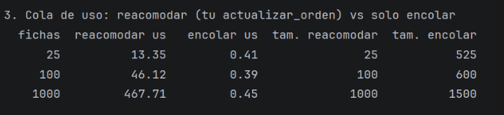

# Proyecto Cripta — Documento de prompts

**Integrantes:** Marielle Céspedes Saborio · Lucía Garay García · Camila González Artavia · Yariela Lanzas Cubero  
Escuela de Informática, Universidad Nacional de Costa Rica · 50560 Estructuras de Datos  
**Profesor:** Jose Pablo Calvo Suarez

# Prompts Parte 1

*Entregada el 18 de octubre de 2026.*

## Prompts Persona A

### [Fecha: 01/10/2026 (aproximada)] — ChatGPT

**Prompt:** "ayúdame a visualizar qué clases son las necesarias para mi implementación".

**Uso:** Identificar las clases necesarias para implementar el motor de simulación, establecer sus responsabilidades y comprender las relaciones entre los componentes del proyecto.

### [Fecha: 01/10/2026 (aproximada)] — ChatGPT

**Prompt:** Texto literal no recuperado; reconstrucción del tema consultado: "Ayúdame a definir qué responsabilidades debe tener el motor de simulación y cómo organizar sus clases".

**Uso:** Delimitar las responsabilidades del motor de simulación y organizar la lógica relacionada con actores, eventos y ejecución de acciones.

### [Fecha: 02/10/2026 (aproximada)] — ChatGPT

**Prompt:** "Ayúdame a entender como implementar el reloj virtual y la agenda de eventos, respetando el orden por tiempo y número de secuencia".

**Uso:** Comprender cómo Debian funcionar los eventos del juego en orden determinista, resolviendo correctamente los empates entre eventos.

### [Fecha: 09/10/2026 (aproximada)] — ChatGPT

**Prompt:** "Ayúdame a  saber como integrar o conectar el historial reversible con el motor de simulación para registrar las acciones y los cambios de estado".

**Uso:** Analizar la integración entre el motor de simulación y el historial reversible, considerando el registro de movimientos, ataques y cambios de velocidad, sin modificar la implementación del pergamino de retroceso asignada a otra integrante.

### [Fecha: 11/10/2026] — ChatGPT

**Prompt:** "Revisa mi implementación de MotorSimulacion.py, AgendaEventos.py y Evento.py e indícame como voy".

**Uso:** Revisar el estado de la implementación del motor y de la agenda de eventos, identificar funcionalidades pendientes y determinar qué pruebas eran necesarias para comprobar su funcionamiento.

### [Fecha: 11/10/2026 (aproximada)] — ChatGPT

**Prompt:** "Ayúdame a saber como funciona integrar los enemigos con las fichas correspondientes del catálogo en el motor de simulación".

**Uso:** Analizar la integración de los datos de los enemigos con sus instancias particulares y sus estadísticas, de manera que el motor pueda procesarlos durante la partida.

### [Fecha: 11/10/2026 (aproximada)] — ChatGPT

**Prompt:** "Ayúdame a comprobar que el motor de simulación y el gestor de eventos se inicialicen correctamente".

**Uso:** Revisar la inicialización de los componentes del motor y detectar posibles errores antes de realizar pruebas más completas de la simulación.

### [Fecha: 11/10/2026 (aproximada)] — ChatGPT

**Prompt:** "Ayúdame a revisar qué pruebas unitarias necesita el motor de simulación para comprobar el orden de los eventos, los empates, la muerte de los actores y los cambios de velocidad".

**Uso:** Definir casos de prueba para comprobar el comportamiento determinista de la agenda de eventos y verificar las reglas principales del motor de simulación.

### [Fecha: 12/10/2026 (aproximada)] — ChatGPT

**Prompt:** "Ayúdame a identificar las funcionalidades pendientes del motor de simulación y a organizar las tareas necesarias para completar mi parte del proyecto".

**Uso:** Identificar los aspectos pendientes de la implementación, incluyendo el ciclo del jugador, los comportamientos de los enemigos, los efectos temporales y la cancelación de eventos.

### [Fecha: 12/10/2026] — Claude (Sonnet)

**Prompt:** "esto es lo que me tocaba en una escala del 1 al 100 cuanto me das, ya esta completo o me falta" [con imagen de mis responsabilidades y el zip del proyecto]

**Uso:** que evaluara mi módulo (motor, agenda, combate, movimiento).

### [Fecha: 12/10/2026] — Claude (Sonnet)

**Prompt:** " Ayúdame a revisar si cumplo con el enunciado" [con el enunciado adjunto]

**Uso:** darle el enunciado para que las decisiones siguieran lo que pide el profesor.

### [Fecha: 12/10/2026] — Claude (Sonnet)

**Prompt:** "segun las responsabilidades que te pase crees que son mias si es así para poder trabajar"

**Uso:** confirmar qué partes del enunciado me tocaban a mí (efectos temporales,
victoria/derrota, botín, rastro) y empezar a implementarlas.

### [Fecha: 13/10/2026] — Claude (Sonnet)

**Prompt:** "Explicame bien el funcionamiento para implementar (puertas, efectos, comportamientos de enemigos)."

**Uso:** continuar la implementación (puertas, efectos, comportamientos de enemigos) con conocimiento de que era.

### [Fecha: 13/10/2026] — Claude (Sonnet)

**Prompt:** [salida del --bench de mi computadora]

**Uso:** revisar las mediciones del bench y verificar el límite de 20 ms por ciclo.

### [Fecha: 13/10/2026] — Claude (Sonnet)

**Prompt:** "Me puedes decir a quien le corresponden los mensajes para saber si lo puedo implementar"

**Uso:** aclarar de quién es la bitácora en pantalla (§4.8). Resultado: buffer circular
de 20 mensajes en el motor; mostrarlo le toca a la Vista (Persona D).

### [Fecha: 13/10/2026] — Claude (Sonnet)

**Prompt:** [responsabilidades de Personas B, C y D pegadas]

**Uso:** separar lo mío de lo de los demás y detectar qué debía coordinar con cada uno.

### [Fecha: 13/10/2026] — Claude (Sonnet)

**Prompt:** [cambios #5 y #6 pedidos por Persona D] "esto me lo mando la persona d queria preguntarte si estos cambio ya los implemente de buena manera o no"

**Uso:** saber si ya estaba hecha la búsqueda de inventario por ID y la conexión del
contenido de la sala con el motor. Resultado: no estaban del todo listos; se implementaron
(acciones por ID y preparar_sala).

### [Fecha: 14/10/2026] — Claude (Sonnet)

**Prompt:** "Verificacion de checklist de persona c" [checklist de integración de Persona C]

**Uso:** verificar contra el código qué puntos del checklist ya estaban cumplidos.

### [Fecha: 14/10/2026] — Claude (Sonnet)

**Prompt:** " Una consulta dime que puntos son los que debería de reforzar"

**Uso:** seguir con mis pendientes. (agenda, historial, rastro, bitácora, rendimiento).

### [Fecha: 14/10/2026 10:37] — Claude (Sonnet)

**Prompt:** "y lo mio ya estaría las implementaciones?"

**Uso:** confirmar si mi parte estaba completa. Resultado: sí; lo pendiente era
integración con D y preguntas al equipo.

### [Fecha: 14/10/2026 10:38] — Claude (Sonnet)

**Prompt:** "VERIFICAR ESTO CON MARI!!! ... def esta_en_uso(self, id_ficha) ... verificar implementación de acuerdo con persona B?"

**Uso:** comprobar que el motor ya tenía es_ficha_activa para la caché de Persona B.
Resultado: sí fué verificado, anotó la duda sobre desalojar() de la caché.

### [Fecha: 14/10/2026 10:43] — Claude (Sonnet)

**Prompt:** " porfavor, revisemos todo que cumpla con el enunciado para que no se me pase nada" [zip del proyecto]

**Uso:** revisar el proyecto contra el enunciado. Resultado: se encontró el archivo
del motor con defectos y se reemplazó sorted() por el ordenamiento propio (§4.9).

### [Fecha: 14/10/2026] — Claude (Sonnet)

**Prompt:** "dime que faltaría"

**Uso:** obtener la lista de lo que faltaba ( motor limpio, justificar la
caducidad del rastro, probar con D, preguntas a B).

### [Fecha: 14/10/2026] — Claude (Sonnet)

**Prompt:** " Confirmame que lo que le voy a explicar a mi compañera sobre la simulación me doy a entender y esta correcto"

**Uso:** responder la pregunta de otra persona del equipo con el código real
(MotorSimulacion(...) e iniciar_partida(...)).

### [Fecha: 14/10/2026 11:34] — Claude (Sonnet)

**Prompt:** "mira ahora me enviaron esto me afecta en algo ..." [respuesta de Persona C sobre no guardar el Historial en el archivo binario]

**Uso:** saber si esa decisión me afectaba. Resultado: no afecta al historial, pero el
motor aún necesita exportar_estado/restaurar_estado para poder cargar partidas.

### [Fecha: 17/10/2026 19:53] — Claude (Sonnet)

**Prompt:** "hagame una bitacora con los prompts del proyecto hasta el día de hoy con formato especifico"

**Uso:** generar esta bitácora.
## Prompts Persona B

### 2026-10-02 — Claude (Sonnet)

**Prompt:** "si yo soy persona b puedo empezar a hacer algo sin tener esto?"

**Uso:** confirmar que podía avanzar en mi módulo sin esperar la reunión de contratos del equipo.

### 2026-10-02 — Claude (Sonnet)

**Prompt:** "estoy leyendo el proyecto pero la mitad de las cosas no se de que me esta hablando, por que habla de http?"

**Uso:** entender por qué el proyecto exige consumir un servicio HTTP.

### 2026-10-02 — Claude (Sonnet)

**Prompt:** "[código de la clase FuenteDatosHTTP con listarCriptas] tipo asi dices tu?"

**Uso:** revisar mi primera versión de la clase y entender que las variables van en __init__ con self.

### 2026-10-02 — Claude (Sonnet)

**Prompt:** "[clase con los métodos de los endpoints] lo ultimo vez hice algo del proyecto quede aqui me puedes recordar que estaba haciendo? no darme codigo"

**Uso:** retomar mi trabajo y detectar los bugs de URL pendientes.

### 2026-10-02 — Claude (Sonnet)

**Prompt:** "ok entonces para ver si entendi. En este codigo de ejemplo que dio el profe [...] BASE_URL= define a donde se van a solicitar los datos? [...]"

**Uso:** verificar línea por línea mi comprensión del ejemplo de cliente HTTP del profesor.

### 2026-10-02 — Claude (Sonnet)

**Prompt:** "especificamente en este caso que es una cripta"

**Uso:** entender qué es una cripta y su relación con el id usado en las URLs.

### 2026-10-02 — Claude (Sonnet)

**Prompt:** "caundo habla de lote a que se refiere con lotes?"

**Uso:** entender el concepto de lotes (batching).

### 2026-10-02 — Claude (Sonnet)

**Prompt:** "ok ya sabiendo estas cosas dame un manual de como trabajar siendo persona b. Entendiedno que es la primera vez que trabajo con APIS [...]"

**Uso:** obtener un plan de trabajo para empezar mi rol sin saber Python ni APIs.

### 2026-10-02 — Claude (Sonnet)

**Prompt:** "tengo una duda, yo vengo de algo en que TODO se lleva por clases entonces digamos en la sesion 2 yo haria como una clase GETTERS [...]"

**Uso:** decidir si organizar el cliente HTTP como una clase y qué nombre darle.

### 2026-10-02 — Claude (Sonnet)

**Prompt:** "mmm y que opinas de hacer un singlenton para que esa clase 'base' [...] esto se llamaria o se crearia solo una vez, me entiendes el punto?"

**Uso:** evaluar Singleton frente a inyección de dependencias para tener un solo client_id.

### 2026-10-02 — Claude (Sonnet)

**Prompt:** "pero tipo el metodo solo le entra UN id, no tiene que haber un ciclo que devuelva tipo de la sala 1 a la sala 6 de la cripta"

**Uso:** aclarar que el método recibe una lista de ids y cuándo se necesita dividir en bloques de 10.

### 2026-10-02 — Claude (Sonnet)

**Prompt:** "como funciona un try catch en python dame un perqueño ejempli"

**Uso:** entender la sintaxis de try/except antes de implementar el manejo de errores HTTP.

### 2026-10-02 — Claude (Sonnet)

**Prompt:** "ok volvamos a mi parrte, me puedes enlistar en total todas las cosas que me tocaria hacer como b”

**Uso:** obtener la lista completa de tareas de Persona B.

### 2026-10-03 — Claude (Sonnet)

**Prompt:** "[código de _hacer_solicitud] esto esta bien?"

**Uso:** revisar el manejo de 429 y de errores.

### 2026-10-03 — Claude (Sonnet)

**Prompt:** "[_hacer_solicitud con except anidado] asi?"

**Uso:** corregir la estructura de los except y usar raise con contexto.

### 2026-10-03 — Claude (Sonnet)

**Prompt:** "[get_cripta_skeleton con params dentro de la URL] asi?"

**Uso:** corregir cómo se pasa el parámetro de página.

### 2026-10-03 — Claude (Sonnet)

**Prompt:** "[solicitud de la página 1] esta bien no? yo se que falta todo lo demas solo me refiero a la solicitud"

**Uso:** validar la primera solicitud de la paginación del esqueleto.

### 2026-10-03 — Claude (Sonnet)

**Prompt:** "[get_cripta_skeleton con while] ok que opinamos"

**Uso:** detectar que el ciclo no pedía las páginas siguientes.

### 2026-10-03 — Claude (Sonnet)

**Prompt:** "[get_cripta_skeleton final] asi ya estaria totalmente bien?"

**Uso:** confirmar que la paginación quedó completa.

### 2026-10-03 — Claude (Sonnet)

**Prompt:** "[obtener_contenido_sala] okay hice mi mejor intento que tan mal estoy"

**Uso:** revisar la lógica de lotes de 10 y corregir sus bugs.

### 2026-10-03 — Claude (Sonnet)

**Prompt:** "de estos metodos a cuales me falta hacerle logiva mas avanzada como estos que acabamos de hacer?"

**Uso:** identificar qué métodos faltaban por completar.

### 2026-10-03 — Claude (Sonnet)

**Prompt:** "[obtener_fichas_catalogo]"

**Uso:** revisar el método de catálogo y corregir su URL.
### 2026-10-04 — Claude (Sonnet)

**Prompt:** "[obtener_detalles_cripta] esto esta bien?"

**Uso:** entender que un endpoint de un solo recurso devuelve un objeto y no una lista.

### 2026-10-04 — Claude (Sonnet)

**Prompt:** "[obtener_esqueleto_cripta] que tan bien essta esto? proque ya salas totales tiene TODAS las salas existentes en la cripta segun las paginas no?"

**Uso:** revisar la conversión del esqueleto a DTOs.

### 2026-10-04 — Claude (Sonnet)

**Prompt:** "[ContenidoSala] quedaria asi entonces?"

**Uso:** revisar ContenidoSala y agregar el atributo de objetos.

### 2026-10-04 — Claude (Sonnet)

**Prompt:** "[list_criptas con error] AttributeError: module 'DTOS.CriptaResumen' has no attribute 'desde_json'"

**Uso:** entender el error de importar el módulo en vez de la clase.

### 2026-10-04 — Claude (Sonnet)

**Prompt:** "[FichaCatalogo] segun mis pensamientos tengo que sacar ese metodo de ahi nO?"

**Uso:** corregir la indentación del método de clase en la fábrica de fichas

### 2026-10-06 — Claude (Sonnet)

**Prompt:** "ok entonces dame un lista completa de pasos a seguir para poder emepzar y concluir con la sesion 9 [...] adicionalmente me puedes explicar lo de --cachesize, es un comando en la terminal?"

**Uso:** ordenar los pasos de las sesiones 6 a 9 y entender qué es --cache-size.

### 2026-10-06 — Claude (Sonnet)

**Prompt:** "[CacheCatalogo] esta logica esta bien? cada vez que lguien consulte si esta en cache entonces que se haga un enqueue en la lista"

**Uso:** revisar la lógica de la cola de uso y detectar bugs de la caché.

### 2026-10-06 — Claude (Sonnet)

**Prompt:** "[CacheCatalogo] mira hice esto"

**Uso:** revisar actualizar_orden y desalojar.

### 2026-10-06 — Claude (Sonnet)

**Prompt:** "[obtener y esta_en_cache] asi esta bien?"

**Uso:** evitar duplicar la lógica entre obtener y esta_en_cache.

### 2026-10-08 — Claude (Sonnet)

**Prompt:** "ok no mejor empecemos un poquito la 7, para hacer algo de aqui a las 12"

**Uso:** empezar la sesión 7 (persistencia) con una meta pequeña.

### 2026-10-08 — Claude (Sonnet)

**Prompt:** "[método de AlmacenamientoLocalApi] algo asi?"

**Uso:** revisar el guardado y la carga del catálogo y corregir sus errores.

### 2026-10-08 — Claude (Sonnet)

**Prompt:** "[traceback JSONDecodeError en cargar_contenido] gestor de datos pasa eso"

**Uso:** entender el error por un archivo guardado a medias y cómo evitarlo.

### 2026-10-11 — Claude (Sonnet)

**Prompt:** "ok voy por la sesion 9, dame una guia para hacerla, me habias dicho que basicamnte es la clase fuente datos http pero desde el disco?"

**Uso:** obtener una guía de la sesión 9: clase base de fuentes con una fuente HTTP y una offline.

### 2026-10-11 — Claude (Sonnet)

**Prompt:** "[Fuentes.py con la clase base] quedaria asi?"

**Uso:** revisar el refactor a clase base con fuentes HTTP y offline.

### 2026-10-11 — Claude (Sonnet)

**Prompt:** "[Fuentes.py con main] o sea pero yo tengo esto"

**Uso:** aclarar qué quedaba por cambiar en Fuentes.py.

### 2026-10-12 — Claude (Sonnet)

**Prompt:** "ok hagamos sesion 10, me das una guia de como hacerla plis, sin codigo, tal vez como las sesionnes que hcimos antes?. Yo pensaba que se hiciera una precarga de las salas con las que esta conectada la sala actual, o sea las salas N S E O"

**Uso:** obtener una guía de la sesión 10 (precarga) y evaluar mi idea de precargar las vecinas.

### 2026-10-12 — Claude (Sonnet)

**Prompt:** “ dame una guia de como empezar con el paso 1 teniedno el contexto, que decisiones tengo que tomar y asi"

**Uso:** definir las decisiones del paso 1 de la sesión 10.

### 2026-10-12 — Claude (Sonnet)

**Prompt:** "suave estoy perdida que se supone que tengo que hacer en esta sesion en general"

**Uso:** entender de forma general qué se hace en la sesión 10..

### 2026-10-12 — Claude (Sonnet)

**Prompt:** "ok que nos falta?  dos metodos en gestor de datos?"

**Uso:** saber qué faltaba en GestorDatos para terminar la sesión 10.

### 2026-10-12 — Claude (Sonnet)

**Prompt:** "[ciclo del planificador] este metodo de aca no se puede hacer de una manera mas eficiente temoralmente hablando? ese ciclo anidado no lo hace ser O(n al 2)"

**Uso:** analizar la complejidad del planificador de precarga.

### 2026-10-12 — Claude (Sonnet)

**Prompt:** “ Estoy intentando correr la prueba del gestor de datos para seguir pero dice que no existe ningun archivo llamado Gestor"

**Uso:** corregir el error de importación del gestor y revisar mis carpetas.

### 2026-10-12 — Claude (Sonnet)

**Prompt:** "ok con los metodos de gestor de datos ya terminamos sesion 10? Si si es asi entonces dame una guia escrita de sesion 11"

**Uso:** confirmar la sesión 10 y obtener una guía simple de la sesión 11 (bench y documento).

### 2026-10-13 — Claude (Sonnet)

**Prompt:** "[DTOs] ok mira hice unos cambios haciendo la prueba porque resulta que cada dto tenia quw tener un metodo a json tambien observa [...]"

**Uso:** revisar los DTOs y obtener los métodos a_json que me faltaban.

## Prompts Persona C

### Entrega 1

#### 2026-09-23 — Claude (Sonnet)

**Prompt:** "mira tenemos este proyecto, es entre 4 personas A,B,C,D, ok primero
quiero que lo analices, ya le preguntamos a otro chat a dividirlo y yo soy
persona C, como lo ves y como que hay q hacer, cual es mi parte y como s
acomoda, es con python se hara en pycharm" [adjunté el enunciado del proyecto
y una captura de la tarjeta de Persona C]

**Uso:** analizar el proyecto CRIPTA completo y entender el alcance de las
tareas asignadas a Persona C (inventario, retroceso, ordenamiento).

#### 2026-09-23 — Claude (Sonnet)

**Prompt:** pegué una propuesta de agenda de reunión de "contratos" entre
A/B/C/D generada por otra IA y pregunté "esto nos sugerio otra IA, q opinamos"

**Uso:** evaluar y corregir la propuesta de reunión de contratos de otra IA
(detectó una confusión de roles B/C en el texto).

#### 2026-09-23 — Claude (Sonnet)

**Prompt:** "pero es que las cosas ya estan divididas entre A,B,C,y D por algo
es que cada una tiene sus cosas, ayer nos leímos el proyecto y ya entendemos
q hace, yo soy la persona C y hago lo de l persona C q no te acuerdas?"

**Uso:** reconfirmar el alcance específico de las tareas de Persona C
(§4.5, §4.6, §4.9 del enunciado).

#### 2026-09-23 — Claude (Sonnet)

**Prompt:** "por cual me recomiendas empezar?"

**Uso:** decidir el orden de implementación (inventario → ordenamiento →
retroceso).

#### 2026-09-23 — Claude (Sonnet)

**Prompt:** pegué mi implementación de `NodoInventario`/`Inventario` con un
`NameError: name 'Inventario' is not defined`

**Uso:** depurar error de import faltante en el script de prueba.

#### 2026-09-23 — Claude (Sonnet)

**Prompt:** pegué traceback `ModuleNotFoundError: No module named 'inventario'`

**Uso:** resolver la ubicación/nombre del archivo del módulo de inventario.

#### 2026-09-23 — Claude (Sonnet)

**Prompt:** pegué la salida de ejecución del inventario (recorrido, equipar,
soltar) para confirmar el comportamiento

**Uso:** verificar que el cursor y las operaciones O(1) del inventario
funcionan correctamente tras equipar y soltar.

#### 2026-09-23 — Claude (Sonnet)

**Prompt:** adjunté captura de la sección 10.3 del enunciado (uso de LLM) y
pregunté "como hago prompts"

**Uso:** entender el formato requerido para la bitácora PROMPTS_LLM.md.

#### 2026-09-23 — Claude (Sonnet)

**Prompt:** "si, si sale lo q tenia q salir, podemos seguir con las vistas
ordenas, ese q punto es? 4.9?"

**Uso:** confirmar la sección del enunciado (§4.5/§4.9) y arrancar el diseño
del módulo de ordenamiento.

#### 2026-09-23 — Claude (Sonnet)

**Prompt:** "pero tipo, el merge no es tanto para tamanos pequenios" / "el
insertion me parece bien, pero digamos es que el mismo enunciado dice
Consideren tamaños pequeños, datos casi ordenados y comparaciones costosas."

**Uso:** discutir cuándo conviene insertion sort vs. merge sort, y ajustar
la estrategia para incluir binary insertion sort por el eje de comparaciones
costosas.

#### 2026-09-23 — Claude (Sonnet)

**Prompt:** "pero eso en que clase va o donde ponemos eso" / "osea,
inventario, ordenamiento y retroceso van en el modelo" / "y en ordenamiento
que va?"

**Uso:** definir la estructura de archivos y confirmar que inventario,
ordenamiento y retroceso pertenecen a la capa Modelo (arquitectura MVC, §6).

#### 2026-09-23 — Claude (Sonnet)

**Prompt:** "esto en donde va y que va en retroceso" [sobre la función
vista_ordenada]

**Uso:** ubicar vista_ordenada en inventario.py y diseñar el módulo
retroceso.py (historial reversible del pergamino, §4.6/§2.11).

#### 2026-09-23 — Claude (Sonnet)

**Prompt:** "ok peri haciendo esto ya lo podemos probar?"

**Uso:** armar una prueba de integración simulando cambios reversibles
(daño y recolección) para validar HistorialRetroceso.

#### 2026-09-23 — Claude (Sonnet)

**Prompt:** pegué mi implementación de `Historial`/`Cambio` para revisión

**Uso:** depurar dos bugs (abrir_intervalo no guardaba el intervalo en la
lista general; deshacer_ultimo sacaba de la lista equivocada).

#### 2026-09-23 — Claude (Sonnet)

**Prompt:** "como queda la prueba?"

**Uso:** ajustar el script de prueba a los nombres reales de la clase
(Historial, parámetro description).

#### 2026-09-23 — Claude (Sonnet)

**Prompt:** adjunté captura del árbol de carpetas del proyecto (Modelo/,
Controlador/, Vista/) junto con `ModuleNotFoundError: No module named
'inventario'`

**Uso:** resolver estructura de paquetes de Python (carpeta Modelo como
paquete, necesidad de __init__.py, imports con prefijo Modelo.).

#### 2026-09-23 — Claude (Sonnet)

**Prompt:** "ya no da error pero no imprime nada, el init py va vacio?"

**Uso:** confirmar que __init__.py debe quedar vacío y diagnosticar por qué
no se ejecutaban los prints (archivo equivocado en ejecución).

#### 2026-09-23 — Claude (Sonnet)

**Prompt:** pegué el contenido completo de prueba_retroceso.py

**Uso:** verificar que el script de prueba estaba correctamente escrito.

#### 2026-09-23 — Claude (Sonnet)

**Prompt:** pegué tracebacks sucesivos `ModuleNotFoundError: No module named
'Modelo.inventario'` y luego `'ordenamiento'`

**Uso:** resolver problema de mayúsculas/minúsculas en nombres de archivo
(Inventario.py vs inventario) y corregir imports internos entre módulos del
paquete Modelo a rutas absolutas (Modelo.ordenamiento).

#### 2026-09-30 — Claude (Sonnet)

**Prompt:** "Hola, sigamos trabajando en mi parte del proyecto, habiamos
quedado en nuestra parte del inventario no?"

**Uso:** retomar el trabajo y repasar el estado de avance de los tres
módulos (inventario, ordenamiento, retroceso).

#### 2026-09-30 — Claude (Sonnet)

**Prompt:** "aun no podemos empezar con el pergamino? nos falta algo de eso
para poder empezar?"

**Uso:** evaluar qué faltaba para completar la funcionalidad del pergamino
de retroceso (soltar_nodo, usar_pergamino, casos de prueba del Apéndice B).

#### 2026-09-30 — Claude (Sonnet)

**Prompt:** "ok en inventario tengo la clase suelta actual y suelta nodo,
son clases muy parecidas, pero no son lo mismo, es correcto?"

**Uso:** confirmar la diferencia entre suelta_actual (opera sobre el cursor)
y soltar_nodo (opera sobre una referencia directa, necesaria para el
retroceso confiable).

#### 2026-09-30 — Claude (Sonnet)

**Prompt:** "me parecia mas espacio si dejabamos las mismas lineas
de codigos en dos metodos, una vez hecho esto puedo proseguir con el usar
pergamino, esta va en la clase retroceso no?"

**Uso:** decidir si reutilizar suelta_actual sobre soltar_nodo, y ubicar
usar_pergamino dentro del módulo retroceso.

#### 2026-09-30 — Claude (Sonnet)

**Prompt:** "No seria mejor hacer una clase que se llame pergamino que
llame todas las cosas, o si es mas recomendable hacerlo en retroceso?"

**Uso:** evaluar si usar_pergamino debía ser una clase propia o una función
suelta; se decidió por función para no comprometer una decisión de
arquitectura que le corresponde a todo el equipo (polimorfismo de objetos
usables).

#### 2026-09-30 — Claude (Sonnet)

**Prompt:** "si, pero este no va en la clase historial, correcto, va afuera
como una funcion aparte"

**Uso:** confirmar que usar_pergamino es una función a nivel de módulo, no
un método de Historial, y armar el caso de prueba del Apéndice B (pergamino
recogido dentro del intervalo revertido).

#### 2026-09-30 — Claude (Sonnet)

**Prompt:** "si, al final registra en el historial sobre el pergamino como lo tengo ahora no?"

**Uso:** corregir recoger_con_historial para excluir objetos de clase
pergamino_retroceso del registro de cambios reversibles (regla del §2.11
y Apéndice B).

#### 2026-09-30 — Claude (Sonnet)

**Prompt:** pegué el texto del Apéndice B sobre pergaminos consecutivos
("El jugador usa dos pergaminos seguidos...")

**Uso:** validar que la estructura de pila del historial ya resuelve
correctamente el caso de usar dos pergaminos seguidos sin lógica adicional,
y armar la prueba correspondiente.

#### 2026-09-30 — Claude (Sonnet)

**Prompt:** "todo perfecto"

**Uso:** cerrar la validación de los tres módulos de Persona C (inventario,
ordenamiento, retroceso) con sus casos borde principales.

#### 2026-09-30 — Claude (Sonnet)

**Prompt:** "no entiendo muy bien eso del --bench, podrias explicarme un
poco mas"

**Uso:** entender qué es el modo --bench, por qué lo exige el enunciado
(§5.3, §8) y cómo implementarlo para medir los algoritmos de ordenamiento.

PS C:\Users\lucig\PycharmProjects\ProyectoDatos> python bench_personaC.py

-Inventario-
recoger 500 objetos: 0.000494s
avanza 500 veces: 0.000092s
soltar 500 objetos: 0.000323s

-Ordenamiento-
n =    10 insertion_sort         tiempo = 0.000020s comparaciones = 31
n =    10 binary_insertion_sort  tiempo = 0.000028s comparaciones = 22
n =    10 merge_sort             tiempo = 0.000056s comparaciones = 23
n =   100 insertion_sort         tiempo = 0.000710s comparaciones = 2408
n =   100 binary_insertion_sort  tiempo = 0.000394s comparaciones = 527
n =   100 merge_sort             tiempo = 0.000484s comparaciones = 547
n =  1000 insertion_sort         tiempo = 0.065587s comparaciones = 251189
n =  1000 binary_insertion_sort  tiempo = 0.025370s comparaciones = 8624
n =  1000 merge_sort             tiempo = 0.009786s comparaciones = 8714
n = 10000 insertion_sort         tiempo = 4.450510s comparaciones = 24976844
n = 10000 binary_insertion_sort  tiempo = 1.589818s comparaciones = 118933
n = 10000 merge_sort             tiempo = 0.058013s comparaciones = 120463

-Retroceso-
registrar 250 cambios: 0.000129s
deshacer 5 intervalos: 0.000081s
PS C:\Users\lucig\PycharmProjects\ProyectoDatos>

PS C:\Users\lucig\PycharmProjects\ProyectoDatos> python bench_personaC.py

-Inventario-
recoger 500 objetos: 0.000413s
avanza 500 veces: 0.000051s
soltar 500 objetos: 0.000159s

-Ordenamiento-
n =    10 insertion_sort         tiempo = 0.000016s comparaciones = 35
n =    10 binary_insertion_sort  tiempo = 0.000023s comparaciones = 24
n =    10 merge_sort             tiempo = 0.000028s comparaciones = 21
n =    20 insertion_sort         tiempo = 0.000017s comparaciones = 108
n =    20 binary_insertion_sort  tiempo = 0.000019s comparaciones = 61
n =    20 merge_sort             tiempo = 0.000035s comparaciones = 59
n =    30 insertion_sort         tiempo = 0.000032s comparaciones = 250
n =    30 binary_insertion_sort  tiempo = 0.000031s comparaciones = 108
n =    30 merge_sort             tiempo = 0.000052s comparaciones = 110
n =    50 insertion_sort         tiempo = 0.000140s comparaciones = 744
n =    50 binary_insertion_sort  tiempo = 0.000102s comparaciones = 216
n =    50 merge_sort             tiempo = 0.000129s comparaciones = 223
n =    75 insertion_sort         tiempo = 0.000326s comparaciones = 1424
n =    75 binary_insertion_sort  tiempo = 0.000167s comparaciones = 364
n =    75 merge_sort             tiempo = 0.000137s comparaciones = 372
n =   100 insertion_sort         tiempo = 0.000352s comparaciones = 2677
n =   100 binary_insertion_sort  tiempo = 0.000472s comparaciones = 529
n =   100 merge_sort             tiempo = 0.000501s comparaciones = 536

-Retroceso-
registrar 250 cambios: 0.000165s
deshacer 5 intervalos: 0.000068s

#### 2026-09-30 — Claude (Sonnet)

**Prompt:** pegué la lista "§2.3 + §2.4 + §2.5 + §2.6 + §2.8 + §2.9 + §2.10 +
§2.12 + §4.1 + §4.7 alguno de esos es mio_"

**Uso:** confirmar que esas secciones corresponden al motor de simulación
(Persona A), no a mi parte.

#### 2026-09-30 — Claude (Sonnet)

**Prompt:** "cuales puntos son los mio y con q me tengo q compartir tambien"

**Uso:** consolidar la lista definitiva de mis secciones (§4.5, §4.6, §4.9,
parte de §2.7) y con quién coordinar cada contrato (A, B, D).

#### 2026-09-30 — Claude (Sonnet)

**Prompt:** "y que llevamos hecho"

**Uso:** repasar el estado de avance de los tres módulos y pendientes.

#### 2026-10-03 — Claude (Sonnet)

**Prompt:** "me podrias explicar de nuevo lo del bench"

**Uso:** reexplicar el concepto de --bench con ejemplos progresivos más
simples.

#### 2026-10-03 — Claude (Sonnet)

**Prompt:** pegué el texto completo de §5.3 del enunciado y comenté que no
lograba comprender cómo o dónde implementarlo

**Uso:** aclarar que --bench se compone de funciones de medición separadas
por persona/subsistema, y que cada quien implementa solo la suya.

#### 2026-10-03 — Claude (Sonnet)

**Prompt:** "pero entonces tengo que esperar que persona D haga el bench
para yo poder excribir mi parte?"

**Uso:** confirmar que el benchmark de mi parte es autocontenido y no
depende de que D arme el main.py primero.

#### 2026-10-03 — Claude (Sonnet)

**Prompt:** "en que parte va el bench, del mvc?"

**Uso:** determinar que --bench no pertenece a ninguna capa de MVC, va como
herramienta de diagnóstico fuera de esa estructura.

#### 2026-10-03 — Claude (Sonnet)

**Prompt:** "pero al final, sin importar que algoritmos use, deberia llamar
igual a los algoritmos no?"

**Uso:** confirmar que los tres algoritmos comparten firma intercambiable,
por diseño, para simplificar elegir_algoritmo y el bench.

#### 2026-10-03 — Claude (Sonnet)

**Prompt:** pegué traceback `AttributeError: 'Inventario' object has no
attribute 'register'`

**Uso:** corregir nombre de método incorrecto (register → recoge) en mi
script de benchmark.

#### 2026-10-03 — Claude (Sonnet)

**Prompt:** pegué salida del benchmark con traceback
`AttributeError: 'Historial' object has no attribute 'deshacer'`

**Uso:** corregir nombre de método incorrecto (deshacer → deshacer_ultimo)
en el benchmark de retroceso.

#### 2026-10-03 — Claude (Sonnet)

**Prompt:** pegué la salida completa y correcta del benchmark (inventario,
ordenamiento, retroceso) y pregunté "que tal lo ves, funcionando
correctamente?"

**Uso:** validar e interpretar los resultados empíricos de los tres
algoritmos de ordenamiento para el Documento de Decisiones.

#### 2026-10-03 — Claude (Sonnet)

**Prompt:** "sigamos con las cosas que faltan"

**Uso:** priorizar pendientes: afinar umbral, guardar evidencia, revisar
Git, bitácora, contratos.

#### 2026-10-03 — Claude (Sonnet)

**Prompt:** adjunté fragmento `tamanos_finos = [10, 20, 30, 50, 75, 100]`
y pregunté "esto va en vez de tamano?"

**Uso:** ajustar bench_ordenamiento para correr tamaños intermedios y
afinar el umbral de cambio de algoritmo.

#### 2026-10-03 — Claude (Sonnet)

**Prompt:** "ok ya cambi[e el umbral,que prosigue?"

**Uso:** repasar lista de pendientes tras ajustar UMBRAL_TAMANO.

#### 2026-10-06 — Claude (Sonnet)

**Prompt:** "quien de el equipo hace algo en la vista y en el controlador?"

**Uso:** inferir qué persona del equipo (probablemente D) se encarga de Vista
y Controlador, aclarando que es una suposición sin confirmación real del equipo.

#### 2026-10-06 — Claude (Sonnet)

**Prompt:** "ok, sigamos con mi parte, en donde habiamos quedado para saber
masomenos en donde continuamos"

**Uso:** repasar el estado completo de avance de los tres módulos y listar
pendientes.

#### 2026-10-06 — Claude (Sonnet)

**Prompt:** pegué el punto 5 de la agenda de reunión ("Persona C presenta su
contrato...") y pregunté "de esto, como ves que vamos a partir de todo lo que
hemos hecho?"

**Uso:** armar el borrador del contrato de Persona C hacia A (formato del
delta) y hacia D (funciones expuestas).

#### 2026-10-06 — Claude (Sonnet)

**Prompt:** pegué la implementación de `suelta_nodo` para revisión

**Uso:** confirmar que el método quedó correctamente integrado en
Inventario.py.

#### 2026-10-06 — Claude (Sonnet)

**Prompt:** "en retroceso sale con el nombre bien, sigamos con el deshacer
ultimo" / "me da la misma salida, por dicha" / "igual, me da el mismo
resultado, divino"

**Uso:** probar y validar los casos borde de deshacer_ultimo() sin nada que
deshacer, y de inventario vacío (actual, avanza, retrocede, suelta_actual,
equipar_actual).

#### 2026-10-06 — Claude (Sonnet)

**Prompt:** pegué el contenido completo de prueba.py con los tres bloques
de prueba integrados y pregunté "esto es lo que tengo en prubea, ahi esta
ya haciendose?"

**Uso:** confirmar que las pruebas de pergaminos consecutivos, historial
vacío e inventario vacío estaban bien integradas; agregar el caso faltante
de inventario lleno.

#### 2026-10-06 — Claude (Sonnet)

**Prompt:** "ok, igual sirve perfecto"

**Uso:** cerrar la validación de los tres casos borde pendientes del
inventario y el historial.

#### 2026-10-06 — Claude (Sonnet)

**Prompt:** "sigamos con el documento de decisiones"

**Uso:** redactar las tres secciones del Documento de Decisiones (§4.5,
§4.6, §4.9) siguiendo la estructura del §8 del enunciado, con evidencia
empírica real de las mediciones hechas.

#### 2026-10-06 — Claude (Sonnet)

**Prompt:** "ok listo, con esto quedaria hacer contratros.MD"

**Uso:** armar el archivo CONTRATOS.md con la propuesta de interfaz de
Persona C hacia A, B y D.

#### 2026-10-06 — Claude (Sonnet)

**Prompt:** "pero eso es una propuesta apenas o solo es lo de mi parte?"

**Uso:** aclarar que el CONTRATOS.md generado cubre solo la parte de
Persona C, no las cuatro partes del equipo.

#### 2026-10-06 — Claude (Sonnet)

**Prompt:** "sip, esto mismo es lo q podria darle a mi equipo para que vean?"

**Uso:** confirmar que CONTRATOS.md es presentable al equipo como propuesta
individual, señalando qué partes son asunciones pendientes de confirmar.

#### 2026-10-06 — Claude (Sonnet)

**Prompt:** "podemos hacer los prompts de hoy, 6/10"

**Uso:** generar la bitácora de prompts del día.

#### 2026-10-06 — Claude (Sonnet)

**Prompt:** "ok y ahora que mas podemos hacer"

**Uso:** repasar estado de avance y listar próximos pasos posibles.

#### 2026-10-06 — Claude (Sonnet)

**Prompt:** "podemos empezar la parte de unir con mis comapañeras, que necesitas
ver de cada una para que puedas tener una idea al unir las cosas?"

**Uso:** listar qué información/código necesitaba de Personas A, B y D para
empezar a validar la integración.

#### 2026-10-06 — Claude (Sonnet)

**Prompt:** adjunté capturas del árbol de archivos de dos proyectos (Modelo/
con Actor.py, MotorSimulacion.py, etc., y otro repo con DTOS/FichaCatalogo.py)
y pregunté "esto es lo que hay, que clase deseas revisar para empezar"

**Uso:** identificar qué archivos revisar primero (Actor.py, MotorSimulacion.py,
FichaCatalogo.py) para validar la integración.

#### 2026-10-06 — Claude (Sonnet)

**Prompt:** pegué el código completo de MotorSimulacion.py, FichaCatalogo.py
y Actor.py (con error de sintaxis en este último)

**Uso:** revisar si el motor de A ya reportaba cambios al historial (no) y si
FichaCatalogo.py de B calzaba con lo asumido en CONTRATOS.md.

#### 2026-10-06 — Claude (Sonnet)

**Prompt:** "esas comas la puse yo ahora sin querer, no tienen eso, entonces
que tengo que cambiar yo o que tiene que poner mi companera en motorsimulacion
para q sirve acorde?? y entones fichacatalogo va alineado bien?"

**Uso:** separar qué debía corregir A en MotorSimulacion.py (llamadas a
historial.registrar en atacar, cambiar_velocidad, mover_enemigo) de qué ya
estaba bien alineado en FichaCatalogo.py de B.

#### 2026-10-06 — Claude (Sonnet)

**Prompt:** "si porfa dime que es cosas tienen que agregar mis companeras
para coordinar con ellas"

**Uso:** actualizar CONTRATOS.md con las correcciones (campo id en vez de
tipo_id, instancia_id viene de /contenido) y los tres puntos de código
sugeridos para A.

#### 2026-10-06 — Claude (Sonnet)

**Prompt:** "ok, ahora aparte de eso, que mas podemos hacer o no puedo hacer
nada sin eso?"

**Uso:** separar tareas autónomas (código, pruebas, documento) de las
bloqueadas por el equipo.

#### 2026-10-06 — Claude (Sonnet)

**Prompt:** "ok empecemos por el punto 1"

**Uso:** diseñar recoger_reversible, soltar_reversible y equipar_reversible
en retroceso.py, más el método _reinsertar en Inventario.

#### 2026-10-06 — Claude (Sonnet)

**Prompt:** "y esos deshacer y description de donde salen?"

**Uso:** explicar el origen de los parámetros deshacer (closure/lambda) y
description (campo de la clase Cambio) en historial.registrar().

#### 2026-10-06 — Claude (Sonnet)

**Prompt:** pegué traceback `AttributeError: 'Inventario' object has no
attribute 'soltar_nodo'. Did you mean: 'suelta_nodo'?`

**Uso:** corregir nombre de método inconsistente (soltar_nodo → suelta_nodo)
en las tres funciones reversibles nuevas.

#### 2026-10-06 — Claude (Sonnet)

**Prompt:** pegué traceback `AttributeError: 'Inventario' object has no
attribute 'equipar_anterior'`

**Uso:** corregir typo (equipar_anterior → equipar_actual) en
equipar_reversible.

#### 2026-10-06 — Claude (Sonnet)

**Prompt:** "ok perfecto, si sirve"

**Uso:** cerrar la validación de las tres funciones reversibles del inventario.

#### 2026-10-06 — Claude (Sonnet)

**Prompt:** pegué el fragmento "2. Revisar si equipar_actual() también
necesita ser reversible..." y pregunté "esto podemos hacerlo, revisar el
equipar actual"

**Uso:** confirmar que equipar_reversible ya cubría ese caso, con evidencia
de la prueba ya corrida.

#### 2026-10-06 — Claude (Sonnet)

**Prompt:** "ok si pero antes de actualizarlo, hay otra cosa que hacer?"

**Uso:** detectar el hueco de diseño sobre sustitución de arma/armadura por
tipo (§2.7), antes de actualizar CONTRATOS.md.

#### 2026-10-06 — Claude (Sonnet)

**Prompt:** "quiero resolverlo ya, entonces, realmente queda guardada en el
inventario, solo que no se usa, solo se usa la que acaba de equipar?"

**Uso:** diseñar la separación de _arma_equipada/_armadura_equipada en
Inventario, y el ajuste correspondiente en equipar_reversible.

#### 2026-10-06 — Claude (Sonnet)

**Prompt:** pegué la implementación de equipar_reversible con las referencias
separadas y pregunté "como lo ves"

**Uso:** revisar y validar el código de equipar_reversible con soporte para
arma/armadura simultáneas.

#### 2026-10-06 — Claude (Sonnet)

**Prompt:** pegué la salida de la prueba ("arma equipada: Daga / armadura
equipada: None / ... / daga sigue en inventario: True")

**Uso:** confirmar que arma y armadura equipadas conviven correctamente y que
la sustitución por tipo funciona según §2.7.

#### 2026-10-06 — Claude (Sonnet)

**Prompt:** "hay otra cosa que podramos hacer, o alguna clase que desees
revisar, que podamos cambiar"

**Uso:** identificar qué otros archivos de A revisar (Jugador.py,
AgendaEventos.py, Evento.py) para resolver el contrato de cambiar_velocidad.

#### 2026-10-06 — Claude (Sonnet)

**Prompt:** pegué el código de Jugador.py, AgendaEventos.py y Evento.py

**Uso:** diseñar cambiar_velocidad_reversible aprovechando la cancelación
perezosa de AgendaEventos, y confirmar que Jugador.py aún no tenía el método
de procesar acciones del jugador.

#### 2026-10-06 — Claude (Sonnet)

**Prompt:** "no puedo seguir con eso, eso si entonces ahi tengo que esperar
a A"

**Uso:** separar lo bloqueado (ubicación de abrir_intervalo) de lo que sí se
podía seguir avanzando.

#### 2026-10-06 — Claude (Sonnet)

**Prompt:** pegué el fragmento sobre validar inventario lleno con
recoger_reversible y pregunté "esto que dijiste?"

**Uso:** retomar y ejecutar la prueba de inventario lleno con la función
reversible nueva.

#### 2026-10-06 — Claude (Sonnet)

**Prompt:** "en efecto, da eso"

**Uso:** confirmar que recoger_reversible se comporta igual que la versión
anterior ante inventario lleno.

#### 2026-10-06 — Claude (Sonnet)

**Prompt:** "si, actualiza contratos"

**Uso:** actualizar CONTRATOS.md con las tres funciones reversibles,
arma_equipada/armadura_equipada y la propuesta de cambiar_velocidad_reversible.

#### 2026-10-06 — Claude (Sonnet)

**Prompt:** "queda actualizar el documento de decisiones no?"

**Uso:** actualizar el Documento de Decisiones (§4.5 y §4.6) con el diseño de
equipo separado y las funciones reversibles.

#### 2026-10-06 — Claude (Sonnet)

**Prompt:** "ahora queda esperar a mi compañera A por que no puedo avanzar o
que sigue?"

**Uso:** repasar qué seguía bloqueado por A y qué tareas autónomas quedaban
pendientes (organizar pruebas, notas de defensa).

#### 2026-10-09 — Claude (Sonnet)

**Prompt:** pegué el mensaje completo que me envió mi compañera A (Integración
del inventario con MotorSimulacion.py, con sus 5 preguntas sobre identificación,
bonificaciones, equipo actual, combate y retroceso) y agregué "Tenemos distintos problemas en unos métodos, ocupare de tu ayuda en cualquier cosa"

**Uso:** redactar una respuesta a A confirmando el contrato real del inventario
(arma_equipada/armadura_equipada, equipar_reversible) frente a sus preguntas
de integración.

#### 2026-10-09 — Claude (Sonnet)

**Prompt:** adjunté captura de PyCharm con errores en rojo (Unresolved
reference 'ataque_bonus', 'Self' object has no attribute 'ataque_bonus') y
pregunté "sale en rojo, es normal por que no se usa o que"

**Uso:** depurar parámetros faltantes en __init__ y nombres faltantes en
__slots__ de NodoInventario.

#### 2026-10-11 — Claude (Sonnet)

**Prompt:** "ok perfecto, tengo otra consulta, cuando mi comapañera haga todo
lo de ella y podamos empezar a juntar, es mucho lo que hay que hacer?"

**Uso:** evaluar el esfuerzo esperado de integración entre los cuatro módulos
del equipo, separando lo que ya estaba resuelto (contratos) de lo que faltaba
probar end-to-end.

#### 2026-10-11 — Claude (Sonnet)

**Prompt:** "el contrato.md es un solo documento no?, y tiene que estar
integrado en el pycharm?"

**Uso:** aclarar que CONTRATOS.md debe ser un único archivo consolidado
(no uno por persona) y que solo necesita vivir en la raíz del repositorio,
sin integración especial.

#### 2026-10-11 — Claude (Sonnet)

**Prompt:** pegué una lista de errores "Unresolved reference" al abrir
CONTRATOS.md en PyCharm

**Uso:** diagnosticar que el archivo se estaba interpretando como código
Python en vez de Markdown.

#### 2026-10-11 — Claude (Sonnet)

**Prompt:** "el readme se hace al final no?"

**Uso:** aclarar que el README debe actualizarse en cada entrega (§10.1),
no escribirse solo al final.

#### 2026-10-11 — Claude (Sonnet)

**Prompt:** "digamos o que cada una haga su parte del README y unirlo todo,
o que necesitamos..." [pegó el texto de §10.1]

**Uso:** explicar por qué el README no conviene dividirlo por persona (a
diferencia de CONTRATOS.md), y proponer que D lo redacte con insumos de
las demás.

#### 2026-10-11 — Claude (Sonnet)

**Prompt:** "pero lo de la documentacion, eso si puede ser cada una y se
une todo?"

**Uso:** confirmar que el Documento de Decisiones sí puede dividirse por
persona (una sección por problema de §4), a diferencia del README.

#### 2026-10-11 — Claude (Sonnet)

**Prompt:** "bueno entonces de mi parte solo quedaria unir las cosas no?"

**Uso:** repasar el estado completo de la parte individual y distinguir
entre "unir documentación" (pasivo) y "unir código" (activo, con integración
real pendiente).

#### 2026-10-11 — Claude (Sonnet)

**Prompt:** "tengo una duda a la hora de mi parte, por que digamos cuando
se guarda, no se puede guardar el estado completo es verdad, se tiene que
guardar distintos datos para que pueda entender el estado"

**Uso:** distinguir la regla de "no copias completas" del pergamino (§2.11,
propia) de la del guardado binario indexado (§4.10, de Persona D).

#### 2026-10-11 — Claude (Sonnet)

**Prompt:** "y consideras que la mejor opción para historial para esto sea una pila?"

**Uso:** justificar la elección de pila frente a alternativas (cola, lista
doblemente enlazada, deque) para el historial de retroceso.

#### 2026-10-12 — Claude (Sonnet)

**Prompt:** pegué los tres puntos que mi compañera A encontró al revisar la
integración (bug en _reinsertar, enlace a sí mismo en equipar_actual,
limpieza de referencias de equipo al soltar, y el caso del pergamino)

**Uso:** diagnosticar y corregir los tres bugs reportados por A en una
revisión cruzada de Inventario.py.

#### 2026-10-12 — Claude (Sonnet)

**Prompt:** pegué el código de _reinsertar, equipar_actual y suelta_nodo
para revisión

**Uso:** detectar que _reinsertar restaba en vez de sumar _cantidad, y que
equipar_actual seguía generando enlace a sí mismo por un guard incompleto.

#### 2026-10-12 — Claude (Sonnet)

**Prompt:** pegué traceback "Cannot run program ... CreateProcess error=3"

**Uso:** diagnosticar que el intérprete de Python configurado en PyCharm
ya no existía, y guiar el cambio de intérprete.

#### 2026-10-12 — Claude (Sonnet)

**Prompt:** adjunté captura de Settings de PyCharm mostrando "Nothing to
show" en Python Interpreter

**Uso:** resolver la configuración rota del intérprete de Python del
proyecto.

#### 2026-10-12 — Claude (Sonnet)

**Prompt:** "realmente en nothing to show lo muevo y no me sale nada..."

**Uso:** proponer alternativas para reconfigurar el intérprete cuando el
panel de Settings no respondía (reinicio de PyCharm, terminal directa).

#### 2026-10-12 — Claude (Sonnet)

**Prompt:** "ok listo pero sale este error al ejecutar..." [TypeError:
NodoInventario.__init__() missing 2 required positional arguments]

**Uso:** corregir falta de valores por defecto (=0) en ataque_bonus/
defensa_bonus del __init__ de NodoInventario.

#### 2026-10-12 — Claude (Sonnet)

**Prompt:** "listo si, ahora me recomiendas actualizar contratos, al final
eso es mas para mis companeras no? y eso cambia mucho en el documento de
decisiones, que me falta para tener todo listo de mi parte?"

**Uso:** repasar el estado completo de la parte individual tras los fixes
y priorizar pendientes (Git, documento, organización de pruebas, defensa).

#### 2026-10-12 — Claude (Sonnet)

**Prompt:** pegué el contenido completo de prueba.py y pregunté si
organizábamos las pruebas antes de subirlo

**Uso:** dividir las pruebas en test_inventario.py y test_retroceso.py,
separados por tema.

#### 2026-10-12 — Claude (Sonnet)

**Prompt:** pegué traceback "ModuleNotFoundError: No module named 'Modelo'"
al correr desde tests/

**Uso:** resolver el problema de import desde una subcarpeta nueva,
proponiendo sys.path.append como solución robusta.

#### 2026-10-12 — Claude (Sonnet)

**Prompt:** adjunté captura del menú contextual de PyCharm sin opción
"Mark Directory as"

**Uso:** confirmar la solución alternativa vía sys.path.append en vez de
depender de la configuración de Sources Root.

#### 2026-10-12 — Claude (Sonnet)

**Prompt:** adjunté captura del árbol de archivos mostrando que el
repositorio se había fusionado con los de A, B y D

**Uso:** confirmar que Modelo/ seguía intacto tras la fusión del repositorio
completo del equipo.

#### 2026-10-12 — Claude (Sonnet)

**Prompt:** adjunté captura del contenido de la carpeta Modelo con todos
los archivos de A y C juntos

**Uso:** verificar que ningún archivo propio se perdió o fue sobrescrito
en la fusión del repositorio.

#### 2026-10-12 — Claude (Sonnet)

**Prompt:** pegué la salida completa de test_inventario.py y
test_retroceso.py ya corriendo desde la carpeta tests/

**Uso:** confirmar que ambos archivos de prueba organizados funcionaban
correctamente tras resolver el import.

#### 2026-10-12 — Claude (Sonnet)

**Prompt:** "1. listo, 2. mandame de texto lo que agregarias y en donde se
agrega ese update 3.no precisa y 4, armemoslo"

**Uso:** redactar el texto a agregar al Documento de Decisiones sobre los
bugs encontrados en la revisión cruzada, y armar notas de defensa para la
revisión del proyecto (§9).

**se borraron algunos prompts debido a que Claude se confundio

#### 2026-10-17 — Claude (Sonnet)

**Prompt:** "hola, a la hora de pullear lo ultimo que hicieron me pide commitear las cosas [...] error: Your local changes to the following files would be overwritten by merge: resultados_bench_personaD.txt [...]"

**Uso:** resolver un conflicto de `git pull` (archivos locales y carpetas `__pycache__` que impedían el merge) para poder sincronizar el repositorio del proyecto.

#### 2026-10-17 — Claude (Sonnet)

**Prompt:** "y si yo hago eso como se conecta con A?"

**Uso:** decidir cómo se conecta `cambiar_velocidad_reversible` con el motor de Persona A, y redactar la nota de diseño que documenta que la integración real de `historial.registrar()` queda pendiente del lado de quien implemente el motor (Documento de Decisiones).

#### 2026-10-17 — Claude (Sonnet)

**Prompt:** "No se implementó detección dinámica de 'qué tan ordenados' están los datos (por ejemplo, contar inversiones), la decisión se basa solo en tamaño y en si la comparación es costosa, declarada de antemano. esto es verdad?"

**Uso:** verificar contra el enunciado si hacía falta detección dinámica del orden de los datos, y decidir agregar `casi_ordenado()` / `UMBRAL_PROP_DESORDEN` a `elegir_algoritmo`.

#### 2026-10-17 — Claude (Sonnet)

**Prompt:** "```def cuenta_desorden(items, key): ... def elegir_algoritmo(n,comparacion_costosa=False, casi_ordenado=False): ... asi se llaman```"

**Uso:** implementar y depurar `insertion_sort`, `binary_insertion_sort`, `merge_sort`, `elegir_algoritmo`, `casi_ordenado` y `cuenta_desorden`, y escribir/corregir las pruebas (`ordenamiento_test.py`) y el bench de ordenamiento correspondientes.

#### 2026-10-17 — Claude (Sonnet)

**Prompt:** "bueno y entonces como queda lo del doc en la parte 4.9"

**Uso:** redactar la sección 4.9 del Documento de Decisiones con la justificación de los umbrales de ordenamiento (`UMBRAL_TAMANO`, `UMBRAL_PROP_DESORDEN`), apoyada en la evidencia empírica del bench.

#### 2026-10-17 — Claude (Sonnet)

**Prompt:** "to_dict() existe solo para la comparación de evidencia empírica; no tiene una contraparte from_dict() usada en el guardado real (el guardado real usa siempre to_bytes()/from_bytes()). esto de 4.10 si hicimos un from dict, te acuerdas?"

**Uso:** confirmar y redactar la aclaración sobre `to_dict()`/`from_dict()` frente a `to_bytes()`/`from_bytes()` para la sección 4.10 del Documento de Decisiones.

#### 2026-10-17 — Claude (Sonnet)

**Prompt:** "Actualmente el archivo del bench actualmente están así 'resultados_bench_persona C.txt' pero tiene todo lo de persona C que seria un nimbre que no comtenga persona a b c o d solo como general de lo mío"

**Uso:** decidir un nombre de archivo de resultados del bench que no incluyera "persona A/B/C/D", para evitar choques con los bench de las demás personas del equipo.

#### 2026-10-17 — Claude (Sonnet)

**Prompt:** "ahora, tengo el bench pero cuando se ejecuta se tiene que crear o regenerar un archivo txt, y si se cree uno pero cuando vuelvo a ejecutarlo no se regenera [...] solo los muestra en consola"

**Uso:** depurar por qué `correr_bench()` no regeneraba el archivo de resultados en ejecuciones posteriores.

#### 2026-10-17 — Claude (Sonnet)

**Prompt:** "antes de hacer eso, estaba pulleando y me pasa lo mismo [...] error: Your local changes to the following files would be overwritten by merge: partida.log [...]"

**Uso:** resolver un segundo conflicto de `git pull`, esta vez por el archivo `partida.log` sobrescrito localmente.

#### 2026-10-17 — Claude (Sonnet)

**Prompt:** "te acuerdas lo del bench de regenerar, mi amiga lo tiene asi [...] y el mio se ve asi, a lo q me diste como se adapata, solo ocupo que se regenere el txt"

**Uso:** adaptar al bench propio el patrón de regeneración de archivo de resultados usado por Persona D, capturando la salida con `io.StringIO`/`contextlib.redirect_stdout` para escribirla siempre al archivo.

#### 2026-10-17 — Claude (Sonnet)

**Prompt:** "el enunciado del proyecto me deja usar ese import? no dice nada q no? para que se usa?" / "ocupo q se cree donde estan los demas txt, afuera, no en la carpeta donde esta el bench.py"

**Uso:** confirmar que el enunciado no prohíbe usar `io`/`contextlib`, y corregir la ruta de `ARCHIVO_RESULTADOS` (usando `RAIZ` con `os.path.join`) para que el `.txt` se genere en la raíz del proyecto junto a los demás resultados, en vez de en la carpeta `tests/`.

## Prompts Persona D

### Semana 1 — Del 21 al 27 de septiembre

**Etapa:** análisis de requisitos, comprensión de la arquitectura y planificación de responsabilidades

#### 21/09/2026 — ChatGPT
**Comprensión inicial del proyecto**

**Prompt:** "Ayúdame a entender las instrucciones del proyecto de Cripta, cuáles son los requisitos principales y qué debo implementar como Persona D"

**Uso:** Revisar las instrucciones y la distribución de tareas para delimitar el alcance individual. Identificar qué funcionalidades corresponden a persistencia, registro de acciones, reproducción de partidas, pruebas y evaluación del rendimiento.

**Prompt:** "Explícame qué diferencia hay entre guardar una partida, guardar el historial de acciones y reproducir una partida, porque no quiero mezclar responsabilidades"

**Uso:** Diferenciar la recuperación del estado de una partida de la reconstrucción de una secuencia de acciones. Establecer que el guardado binario y la bitácora son mecanismos complementarios, pero tienen objetivos distintos.

**Prompt:** "Ayúdame a preparar un checklist de todo lo que le corresponde a Persona D, separado por módulos y pruebas, para no implementar cosas que pertenecen a mis compañeras"

**Uso:** Crear una lista inicial de tareas y relacionarlas con los módulos del proyecto: Persistencia/, Bitacora/, pruebas automatizadas y benchmarks. Separar los elementos que dependen de la implementación de otras personas.

**Prompt:** "Revisa la estructura actual del proyecto y explícame cómo debería encajar mi implementación con las clases que ya existen, sin proponer una arquitectura completamente nueva"

**Uso:** Establecer como criterio de desarrollo la reutilización de la estructura existente, con cambios pequeños y compatibles con las convenciones del grupo.

#### 22/09/2026 — ChatGPT
**Análisis de la arquitectura existente**

**Prompt:** "Explícame la responsabilidad de cada módulo existente y cuáles debería modificar directamente para implementar el guardado binario"

**Uso:** Estudiar la separación entre Modelo, Gestor, Persistencia, API y los demás componentes. Determinar qué parte de la lógica debe mantenerse fuera de la capa encargada de escribir archivos.

**Prompt:** "Ayúdame a definir qué información de una partida necesita persistirse y cuál debería reconstruirse a partir de los datos de la cripta"

**Uso:** Comenzar a distinguir el estado mutable de la partida de los datos que pertenecen a la definición original de la cripta. Esta distinción sirve de base para el diseño posterior de los registros del jugador y las salas.

**Prompt:** "Cómo puedo diseñar las clases de persistencia para que no dependan de la interfaz gráfica ni tengan que ejecutar las reglas del juego?"

**Uso:** Mantener la persistencia como una capa responsable de convertir datos a bytes, escribirlos y recuperarlos, sin asumir responsabilidades del controlador o del motor de simulación.

**Prompt:** "Hazme una lista de las decisiones de diseño que debería justificar después: formato de archivo, índice, complejidad, pruebas y rendimiento"

**Uso:** Preparar la documentación técnica que acompañaría la implementación y relacionar las decisiones de diseño con la rúbrica y la evidencia que se necesitaría para defenderlas.

#### 24/09/2026 — ChatGPT
**Diseño preliminar del formato binario**

**Prompt:** "Explícame cómo organizar un archivo binario para guardar el encabezado de una partida, el jugador y las salas sin perder la posibilidad de leer los datos después"

**Uso:** Estudiar la estructura secuencial de un archivo binario y la necesidad de definir un formato consistente para guardar y recuperar sus componentes.

**Prompt:** "Qué información debería incluir el encabezado de mi archivo para reconocer el formato, la versión y los datos necesarios para recuperar la partida?"

**Uso:** Definir los campos de identificación y control del archivo: marca, versión del formato, identificadores y versiones de la cripta y el catálogo, semilla, reloj virtual, cantidad de salas y posición del índice.

**Prompt:** "Explícame cómo funciona struct en Python y cómo puedo usarlo para empaquetar números y cadenas en un formato binario de tamaño definido"

**Uso:** Comprender el empaquetado y desempaquetado de campos de tamaño conocido, incluyendo el orden de bytes y las validaciones necesarias al leer archivos.

**Prompt:** "Ayúdame a decidir qué validaciones debería realizar al cargar un archivo binario incompleto, corrupto o creado con una versión diferente"

**Uso:** Preparar el tratamiento de archivos inválidos, lecturas parciales y formatos incompatibles, evitando que una partida dañada se interprete como válida.

#### 25/09/2026 — ChatGPT
**Registros de jugador y salas**

**Prompt:** "Ayúdame a identificar qué campos debería guardar en un registro de sala para recuperar su estado mutable sin duplicar toda la definición de la cripta"

**Uso:** Delimitar la información de las salas que cambia durante la partida: estado de enemigos, objetos, trampas, puertas y datos de visita.

**Prompt:** "Explícame cómo representar un registro de jugador con su salud, sala actual, estadísticas de partida, llave de salida e inventario"

**Uso:** Organizar los datos del jugador en un bloque independiente procurando que el formato sea claro y que los campos puedan recuperarse de forma verificable.

**Prompt:** "Cómo debería manejar las cadenas UTF-8 y los valores booleanos en el archivo binario para evitar aceptar datos inválidos?"

**Uso:** Incorporar criterios de validación para texto, longitudes, valores booleanos y campos numéricos al diseñar los métodos de serialización y lectura.

**Prompt:** "Revisa el diseño de mis registros y dime si estoy guardando información innecesaria o mezclando datos persistentes con lógica de negocio"

**Uso:** Revisar la separación de responsabilidades y mantener las clases de persistencia enfocadas en representar y validar los datos que se almacenan.

#### 27/09/2026 — ChatGPT
**Primer checklist técnico**

**Prompt:** "Organiza las tareas de Persona D en un checklist de implementación por orden de dependencia, desde el formato binario hasta las pruebas"

**Uso:** Ordenar el trabajo para comenzar por el encabezado y los registros, continuar con el archivo completo y su índice, y terminar con bitácora, reproducción y evaluación.

**Prompt:** "Qué casos de prueba debería contemplar antes de considerar terminado el guardado binario?"

**Uso:** Planificar pruebas de ida y vuelta, archivos vacíos, registros truncados, identificadores duplicados, índices incorrectos, versiones incompatibles y búsqueda de salas inexistentes.

### Semana 2 — Del 28 de septiembre al 4 de octubre

**Etapa:** implementación progresiva, análisis de complejidad y coordinación inicial entre integrantes

#### 28/09/2026 — ChatGPT
**Implementación del encabezado binario**

**Prompt:** "Ayúdame a implementar el encabezado binario usando el estilo de las clases existentes, con métodos para convertirlo a bytes y reconstruirlo desde bytes"

**Uso:** Orientar la implementación de Persistencia/FormatoBinario.py, incluyendo la representación binaria del encabezado y los métodos de conversión y lectura.

**Prompt:** "Explícame qué debería comprobar from_bytes() antes de construir un encabezado y qué excepción conviene usar cuando la versión no es compatible"

**Uso:** Definir las validaciones de marca, longitud y versión. Mantener una excepción específica para comunicar que el archivo utiliza un formato no compatible.

**Prompt:** "Revisa el tamaño del encabezado y explícame cómo comprobar que el archivo se lee sin consumir bytes de más"

**Uso:** Verificar que el encabezado tenga un tamaño fijo y que pueda recuperarse sin leer el contenido completo de la partida.

**Prompt:** "Ayúdame a crear pruebas para el encabezado: valores correctos, archivo incompleto, versión incompatible, semilla negativa y cadenas demasiado largas"

**Uso:** Convertir los requisitos del formato en pruebas automatizadas que permitan detectar errores tempranamente.

**Prompt:** "Qué datos debo guardar directamente en el archivo y cuáles puedo reconstruir desde la definición de la cripta? Quiero evitar duplicar datos estáticos y conservar correctamente el estado mutable de la partida"

**Uso:** Distinguir entre la definición de una cripta y los cambios ocurridos durante una partida. Preparar los registros del jugador y de las salas para guardar solamente los datos necesarios para recuperar el estado.

#### 29/09/2026 — ChatGPT
**Estructura del archivo y acceso por sala**

**Prompt:** "Explícame cómo guardar varios registros de salas en un único archivo y cómo recuperar sus posiciones para poder leer una sala sin cargar todas las demás"

**Uso:** Diseñar la relación entre los bloques físicos de las salas y un índice que permita localizar cada registro por su identificador.

**Prompt:** "Qué debería almacenar cada entrada del índice y por qué es importante mantenerlo ordenado por el identificador de la sala?"

**Uso:** Definir las entradas del índice con identificador, desplazamiento y longitud. Utilizar el ordenamiento para habilitar la búsqueda binaria.

**Prompt:** "Ayúdame a entender la complejidad de buscar una sala con búsqueda binaria y cómo distinguir el costo de buscarla del costo de leer su registro"

**Uso:** Separar la complejidad de localización del índice, O(□log n), del costo de leer y deserializar el bloque encontrado, que depende de su tamaño.

**Prompt:** "Dame una lista de pruebas para comprobar que el índice funciona incluso si los registros se reciben desordenados o existen identificadores repetidos"

**Uso:** Preparar pruebas de ordenamiento, duplicados, búsquedas inexistentes y consistencia entre los identificadores del índice y los registros almacenados.

#### 30/09/2026 — ChatGPT

**Prompt:** "Cómo puedo evitar que un error durante el guardado deje el archivo anterior de una partida incompleto o destruido?"

**Uso:** Analizar una estrategia de escritura temporal y sustitución del archivo de destino solo cuando la escritura termina correctamente.

**Prompt:** "Explícame cómo usar os.replace() y por qué conviene crear el archivo temporal en el mismo directorio del archivo final"

**Uso:** Incorporar un procedimiento de guardado más seguro que preserve el archivo anterior si ocurre un fallo antes de la sustitución.

**Prompt:** "¿Cómo puedo demostrar mediante una prueba que buscar una sola sala no está leyendo todo el archivo binario?"

**Uso:** Preparar pruebas que contabilicen los bytes leídos y el número de accesos al índice, demostrando el beneficio del acceso selectivo.

**Prompt:** "Revisa los errores que debería detectar LectorPartida: índice truncado, bloques fuera de rango, bytes sobrantes y registros incompletos"

**Uso:** Reforzar la integridad del formato y definir las condiciones para rechazar archivos que no respeten la distribución esperada de sus bloques.

#### 01/10/2026 — ChatGPT
**Coordinación de interfaces con Persona A**

**Prompt:** "Ayúdame a visualizar qué clases son las necesarias para mi implementación"

**Uso:** Identificar las clases necesarias para implementar las responsabilidades de Persona D y comprender las relaciones entre los componentes del proyecto, evitando duplicar las responsabilidades del motor de simulación.

**Prompt:** "Ayúdame a definir qué responsabilidades debe tener la persistencia y cuáles deben quedar en el motor de simulación de Persona A"

**Uso:** Establecer una separación clara: el motor ejecuta acciones y administra la simulación; la persistencia guarda y recupera el estado que recibe.

**Prompt:** "Necesito coordinar con Persona A la interfaz que va a utilizar el reproductor. ¿Qué métodos y parámetros debemos acordar para no depender de una implementación provisional?"

**Uso:** Identificar el contrato de integración necesario para que Reproductor cree un motor mediante una fábrica y le entregue las acciones en orden. Mantener provisionalmente un motor falso para las pruebas independientes.

**Prompt:** "Ayúdame a definir un checklist de integración con Persona A, dejando separados los cambios que puedo terminar ahora de los que dependen del motor real"

**Uso:** Evitar bloqueos en el trabajo de D y reservar las modificaciones que dependen de la interfaz definitiva del motor para la etapa de integración.

#### 02/10/2026 —  ChatGPT
**Comprensión de la simulación y los eventos**

**Prompt:** "Ayúdame a entender cómo implementar el reloj virtual y la agenda de eventos, respetando el orden por tiempo y número de secuencia"

**Uso:** Comprender el comportamiento temporal de la simulación y el orden determinista de los eventos, especialmente cuando varios comparten el mismo instante. Esta consulta ayuda a delimitar qué comportamiento pertenece al motor de Persona A y qué debe considerar D al guardar o reproducir una partida.

**Prompt:** "Por qué la reproducción debe respetar exactamente el orden de las acciones registradas y no intentar ordenarlas por su cuenta?"

**Uso:** Comprender que la bitácora representa una secuencia de decisiones, no una colección de eventos que D pueda reorganizar. El orden de ejecución corresponde al registro original y a la lógica del motor.

**Prompt:** "Explícame qué puede garantizar una semilla en una simulación y qué condiciones adicionales se necesitan para reproducir una partida de forma determinista"

**Uso:** Identificar la importancia de conservar la semilla, la versión de los datos y la compatibilidad de la lógica de simulación.

**Prompt:** "Ayúdame a revisar qué debería incluir el encabezado de una bitácora para que el reproductor detecte una cripta o catálogo incompatible"

**Uso:** Definir los metadatos que permitirán verificar la compatibilidad antes de ejecutar las acciones.

#### 04/10/2026 — ChatGPT
**Primera revisión de responsabilidades compartidas**

**Prompt:** "Revisa las tareas de Persona A, B, C y D y ayúdame a identificar qué interfaces necesito acordar antes de terminar mi implementación"

**Uso:** Actualizar la distribución de responsabilidades y evitar que D implemente adaptadores de datos o serializadores que pertenecen a otros integrantes.

**Prompt:** "¿Qué puedo terminar de la persistencia sin esperar al motor definitivo y qué debería dejar preparado para la integración?"

**Uso:** Priorizar la validación del archivo, el índice, los registros, las pruebas unitarias y la bitácora independiente del motor real.

### Semana 3 — Del 5 al 11 de octubre

**Etapa:** integración de registros, serialización compartida, bitácora, pruebas y primeros resultados de rendimiento.

#### 05/10/2026 — Claude(Sonnet)
**Serialización del inventario e historial**

**Prompt:** "Persona C está implementando la serialización binaria del inventario y del historial. Ayúdame a determinar cómo debería consumir esos métodos desde Persistencia sin duplicar su trabajo"

**Uso:** Delimitar la responsabilidad de D como consumidor de los métodos de serialización de C. Mantener el archivo de partida como una capa que organiza los bloques y delega la conversión de los componentes a sus clases correspondientes.

**Prompt:** "Si mis clases y las de Persona C tienen métodos con nombres diferentes pero realizan lo mismo, ¿deberíamos unificarlos o basta con adaptar la llamada?"

**Uso:** Evaluar la conveniencia de reutilizar métodos existentes y evitar duplicar algoritmos. La prioridad es que las interfaces sean compatibles y que cada clase mantenga una responsabilidad clara.

**Prompt:** "Persona C me indicó que Persistencia debe solicitar bytes al guardar y devolverlos al cargar. Revisa si mi capa está limitada correctamente a esa responsabilidad"

**Uso:** Verificar que D no reimplemente la serialización del inventario o historial, sino que coordine los bloques del archivo y use los métodos acordados.

**Prompt:** "¿Qué debería pasar con el historial cuando se carga una partida si acordamos que no se conserva entre guardados?"

**Uso:** Documentar la decisión de que el historial comienza vacío después de cargar una partida y que solo las acciones posteriores pueden deshacerse. Diferenciar este comportamiento del inventario, que sí se serializa.

#### 06/10/2026 — Claude(Sonnet)
**Ajustes en los registros y sus validaciones**

**Prompt:** "Revisa mi RegistroJugador y dime si estoy guardando únicamente el estado mutable que necesita persistirse"

**Uso:** Verificar la selección de campos persistentes, incluyendo sala actual, salud, contador de acciones, enemigos derrotados, uso de la llave de salida e inventario.

**Prompt:** "Explícame cómo validar los tamaños de los campos y detectar valores fuera de rango al reconstruir un registro de sala"

**Uso:** Reforzar las comprobaciones de integridad al leer registros binarios, evitando construir objetos con longitudes o valores inválidos.

**Prompt:** "Ayúdame a revisar si la información de enemigos y objetos debe almacenarse como estado de cada instancia o como una definición completa del catálogo"

**Uso:** Separar la identidad y el estado de las instancias de los datos estáticos de definición, en coordinación con las responsabilidades del catálogo.

**Prompt:** "Revisa qué casos límite faltan en las pruebas de RegistroJugador y RegistroSala antes de probar el archivo completo"

**Uso:** Completar la cobertura de registros vacíos, campos inválidos, texto Unicode, booleanos, longitudes incorrectas y conversiones de ida y vuelta.

#### 07/10/2026 — Claude(Sonnet)
**Desarrollo de la bitácora**

**Prompt:** "Ayúdame a implementar una bitácora de texto sencilla que tenga encabezado y agregue una línea por cada acción aceptada"

**Uso:** Orientar el diseño de BitacoraPartida.py con un formato legible, una marca de identificación, una versión y un separador entre encabezado y acciones.

**Prompt:** "Cómo puedo abrir la bitácora en modo append para agregar acciones sin reescribir el encabezado cada vez?"

**Uso:** Implementar el registro incremental de acciones y diferenciar la creación de una bitácora nueva de la continuación de una existente.

**Prompt:** "Ayúdame a validar el nombre de las acciones y sus argumentos para impedir que un salto de línea altere la estructura del archivo"

**Uso:** Incorporar validaciones de cadenas, nombres no vacíos y ausencia de saltos de línea, preservando el formato de una acción por línea.

**Prompt:** "Explícame por qué conviene ejecutar flush después de registrar una acción y qué garantía ofrece realmente"

**Uso:** Comprender el vaciado del búfer de escritura y documentar su diferencia frente a una garantía de persistencia física ante cualquier fallo.

#### 08/10/2026 — Claude(Sonnet)
**Desarrollo del reproductor**

**Prompt:** "Ayúdame a diseñar Reproductor para leer la bitácora, crear el motor con una fábrica y ejecutar las acciones en orden sin depender de la interfaz gráfica"

**Uso:** Definir la responsabilidad de Reproductor.py y mantener desacoplada la lectura de la bitácora de la implementación concreta del motor.

**Prompt:** "¿Cómo debería comprobar las versiones de la cripta y el catálogo antes de crear el motor, y qué debería ocurrir si no coinciden?"

**Uso:** Evitar reproducciones con datos incompatibles y detener el proceso antes de ejecutar acciones que podrían producir resultados incorrectos.

**Prompt:** "Ayúdame a manejar el caso en que el motor rechaza una acción durante la reproducción. Debería seguir con las siguientes?"

**Uso:** Establecer que una acción rechazada detiene la reproducción y genera un error explicativo, evitando que el sistema continúe desde un estado posiblemente inconsistente.

**Prompt:** "Diseña pruebas para el reproductor con un motor falso que permita verificar el orden de acciones, la semilla y los errores de compatibilidad"

**Uso:** Crear pruebas aisladas de la simulación real para verificar el comportamiento del reproductor sin depender de que Persona A haya terminado su motor.

#### 09/10/2026 — Pruebas integrales y errores de compatibilidad

**Prompt:** "Ayúdame a organizar las pruebas de persistencia para comprobar el archivo completo y no solamente los métodos de serialización individuales"

**Uso:** Integrar las pruebas del encabezado, jugador, salas e índice para verificar que una partida pueda guardarse y recuperarse correctamente.

**Prompt:** "Tengo pruebas que esperan un mensaje específico al detectar una versión incompatible. Ayúdame a distinguir si falla el comportamiento o solamente el texto de la excepción"

**Uso:** Revisar los fallos de pruebas relacionados con los mensajes de error, sin confundir una discrepancia textual con un problema de lógica. La validación debe seguir siendo consistente con las excepciones esperadas.

**Prompt:** "¿Cómo pruebo que un guardado fallido no destruya una partida anterior y que un índice truncado se detecte correctamente?"

**Uso:** Verificar la seguridad de la escritura temporal y las validaciones de lectura de los datos del índice.

**Prompt:** "Hazme una lista de los casos que deben pasar antes de considerar cerrada la persistencia binaria: archivo inválido, lectura parcial, duplicados, versiones y recuperación de salas"

**Uso:** Consolidar los criterios de aceptación para el módulo de persistencia antes de realizar una revisión global.

#### 10/10/2026 — Claude(Sonnet
**Benchmarks y comparación binario frente a JSON**

**Prompt:** "Necesito comparar el guardado binario con JSON. Ayúdame a definir qué operaciones medir para justificar las decisiones de Persona D"

**Uso:** Diseñar una evaluación que contemple tamaño de archivo, tiempo de guardado, carga completa y lectura selectiva de una sala.

**Prompt:** "Cómo puedo generar partidas sintéticas de distintos tamaños para medir el rendimiento de forma repetible sin depender de datos reales del juego?"

**Uso:** Preparar conjuntos de prueba con diferentes cantidades de salas y utilizar varias repeticiones para reducir el efecto de mediciones aisladas.

**Prompt:** "Explícame cómo interpretar las diferencias entre tamaño, tiempo de guardado, carga completa y lectura de una sola sala sin concluir que un formato es mejor en absolutamente todo"

**Uso:** Aprender a interpretar los resultados con sus límites. El formato binario puede ocupar menos espacio y facilitar lecturas selectivas, aunque la carga completa no necesariamente sea más rápida.

**Prompt:** "Ayúdame a preparar un archivo de resultados de benchmark que pueda incluir en la entrega y actualizar cada vez que vuelva a ejecutar las mediciones"

**Uso:** Centralizar los resultados en resultados_bench_guardado.txt y conservar una evidencia reproducible para la justificación de diseño.

#### 11/10/2026 — Claude(Sonnet)
**Revisión del ZIP y pruebas de Persona D**

**Prompt:** "Revisa el ZIP actualizado del proyecto y dime qué partes de Persona D están implementadas, qué pruebas pasan y qué queda pendiente"

**Uso:** Comparar la implementación real con la lista de responsabilidades, revisar la organización de los módulos y detectar dependencias pendientes con los integrantes del equipo.

**Prompt:** "Ya implementé los cambios independientes de Persona A. Ayúdame a separar lo terminado de lo que depende del motor real para no duplicar su trabajo"

**Uso:** Mantener el alcance de D separado del motor de simulación y preparar una lista de integración para cuando Persona A entregue su interfaz definitiva.

**Prompt:** "Cómo debería quedar Persistencia si Persona C ya tiene los métodos de serialización del inventario y el historial?"

**Uso:** Confirmar que la capa de persistencia reutilice los métodos de C en lugar de duplicar la serialización y que el formato del archivo siga siendo responsabilidad de D.

**Prompt:** "Revisa las pruebas y los pendientes del módulo de bitácora y reproducción. Quiero identificar los casos que todavía no están cubiertos"

**Uso:** Preparar la revisión de errores, compatibilidad, orden de reproducción y comportamiento ante acciones rechazadas.

### Semana 4 — Del 12 al 17 de octubre

**Etapa:** integración final, revisión de responsabilidades, validación de pruebas y preparación de la documentación

#### 12/10/2026 — Claude(Sonnet)
Corrección de errores e integración de cambios y restauración del estado y preparación de la Vista

**Prompt:** "Revisa la última versión del ZIP y confirma qué pruebas pasan después de integrar las validaciones nuevas de persistencia y bitácora"

**Uso:** Verificar que los cambios recientes no rompan la implementación previa y distinguir los errores funcionales de los problemas de compatibilidad con las pruebas.

**Prompt:** "Algunas pruebas de incompatibilidad fallaron porque el mensaje esperado no coincide. Ayúdame a revisar qué texto debería mantenerse y cómo evitar cambiar el comportamiento correcto"

**Uso:** Revisar las excepciones y sus mensajes, manteniendo coherencia entre la implementación y las expectativas de las pruebas.

**Prompt:** "Ayúdame a revisar las pruebas de lectura parcial y búsqueda de salas para asegurarme de que el índice realmente aporta una ventaja"

**Uso:** Confirmar que la búsqueda binaria se aapoya en el índice ordenado y que la lectura de una sala no obliga a cargar todas las demás.

**Prompt:** "Mira esta clase ControladorJuego.py que integra el Motor de Simulación (Persona A), la Caché/Inventario (Persona B) y el Cargador de Datos (Persona C). Tengo un problema al cargar una partida binaria: el inventario no restaura los bonus de ataque/defensa de los objetos equipados. Dónde debería estar esa responsabilidad?"

**Uso:** Investigar la separación entre la persistencia del inventario y el cálculo de atributos derivados. Determinar si el problema está en la deserialización, en la reconstrucción del estado del Modelo o en la coordinación del Controlador, evitando introducir lógica de combate en la capa de archivos.

**Prompt:** "Ayúdame a definir las responsabilidades de VistaConsola y ControladorJuego: la Vista debe mostrar el estado, las salas, los mensajes y las opciones; el Controlador debe recibir las elecciones del jugador y traducirlas en acciones para el motor"

**Uso:** Preparar la interfaz interactiva sin mezclar lectura de teclado, presentación y reglas de simulación. Establecer un flujo que permita cambiar la forma de interacción sin modificar el Modelo.

**Prompt:** "Necesito que la carga de una partida binaria actualice correctamente el estado que muestra la Vista cómo debería organizar el flujo de lectura, restauración del Modelo y actualización de la pantalla para evitar mostrar datos antiguos?"

**Uso:** Definir el orden de integración entre persistencia, estado del juego y presentación. Evitar que la Vista mantenga una copia desactualizada de la información recuperada del archivo.

#### 13/10/2026 — Claude(Sonnet)
**Coordinación final con Personas A, B y C**

**Prompt:** "Persona A me indicó que el motor se crea con MotorSimulacion(semilla, gestor_datos) y se inicia con iniciar_partida(...). Explícame cómo debo adaptar mi integración sin asumir la responsabilidad del motor"

**Uso:** Preparar la conexión de D con el motor real, manteniendo la creación del motor y la ejecución de la simulación como responsabilidades de A.

**Prompt:** "Ayúdame a identificar qué parámetros de iniciar_partida son importantes para la integración y cuáles necesito conservar para reproducir una partida"

**Uso:** Analizar el identificador de la cripta, la semilla y los datos iniciales necesarios para reconstruir el contexto de la partida. Mantener el uso de las interfaces definitivas sujeto al contrato de A.

**Prompt:** "Persona B se encargará de las fuentes de datos y del catálogo. Revisa qué llamadas debe consumir mi código y cuáles no debo implementar yo"

**Uso:** Evitar duplicar la lógica de carga de datos y los adaptadores de HTTP, caché y modo offline. Mantener a D enfocado en persistencia, bitácora, reproducción y evaluación.

**Prompt:** "Persona C ya terminó la serialización. Ayúdame a preparar una lista de comprobación para verificar que Persistencia utiliza correctamente sus métodos y que no hay dos implementaciones del mismo proceso"

**Uso:** Revisar la integración de los métodos de serialización del inventario y el historial, documentar la política de persistencia del historial y evitar duplicaciones.

**Prompt:** "Revisa los resultados de bench_personaD.py y ayúdame a interpretar por qué el archivo binario ocupa menos espacio y permite cargar una sala individual más rápido, pero no siempre carga todo más rápido"

**Uso:** Explicar los resultados sin generalizaciones. Para 2.000 salas, el archivo binario ocupa 274.158 bytes frente a 407.417 bytes en JSON; la carga de una sala tarda 0,000195 s frente a 0,013105 s, mientras que la carga completa tarda más en binario en las mediciones disponibles.

**Prompt:** "Ayúdame a documentar los límites de mis benchmarks para dejar claro qué se midió, qué depende del equipo y qué operaciones no fueron medidas"

**Uso:** Aclarar que los datos sintéticos y el hardware afectan los resultados, que las mediciones son específicas de las operaciones probadas y que el rendimiento de una carga selectiva no demuestra superioridad en todas las operaciones.

**Prompt:** "Revisa la justificación de la bitácora y el reproductor. Qué evidencia puedo afirmar que tengo y qué debería dejar como pendiente porque no lo medí directamente?"

**Uso:** Separar la evidencia funcional de las mediciones de rendimiento. Registrar las pruebas aprobadas como evidencia de comportamiento y evitar afirmar que la reproducción cumple un límite temporal sin un benchmark específico.

#### 14/10/2026 — Claude(Sonnet)
**Inicio de la implementación jugable de Vista y Controlador**

**Prompt:** "Ya tengo varias clases del Modelo, el motor de simulación y los componentes de persistencia, pero necesito conectarlos para poder jugar. Ayúdame a definir el flujo completo de main.py a ControladorJuego y VistaConsola, desde la selección del modo hasta el inicio de la partida"

**Uso:** Diseñar la secuencia de inicialización del juego, identificando qué componentes deben construirse, qué datos necesita el motor y en qué momento se entrega el control a la interfaz interactiva.

**Prompt:** "Quiero implementar el Controlador sin duplicar la lógica de MotorSimulacion. Cómo debería recibir un comando de movimiento, comprobar que la entrada tiene el formato esperado, invocar ejecutar_accion() y después actualizar la información que se muestra?"

**Uso:** Separar la interpretación de comandos de la ejecución de las reglas. El Controlador coordina la operación, el motor decide el resultado de la acción y la Vista presenta el nuevo estado.

**Prompt:** "Ayúdame a diseñar un ciclo de juego sencillo: mostrar el estado actual, presentar las acciones disponibles, leer la elección del jugador, ejecutar la acción y volver a mostrar el resultado. Quiero evitar un bucle con demasiados if y mantener el código fácil de seguir"

**Uso:** Organizar el ciclo interactivo en pasos claros, evitando que la Vista ejecute directamente las reglas del juego o que el Controlador contenga la lógica interna de combate y movimiento

**Prompt:** "Estoy integrando las clases existentes y quiero preparar un checklist para probar una partida completa: inicialización, entrada del jugador, movimiento entre salas, actualización del estado, derrota y condición de victoria. Qué debería verificar en cada paso?"

**Uso:** Convertir la integración en escenarios observables y comprobar que el flujo jugable funcione más allá de las pruebas aisladas de persistencia y reproducción.

#### 15/10/2026 — Claude(Sonnet)
**Integración de la Vista, el Controlador y el modo offline**

**Prompt:** "Revisa el flujo de ControladorJuego.py: necesito que el jugador pueda iniciar una partida, consultar el estado, seleccionar una acción y continuar jugando hasta ganar, perder o salir. Ayúdame a identificar qué métodos deben coordinarse y cuáles no deberían llamarse directamente desde la Vista."

**Uso:** Revisar el flujo de juego y delimitar las llamadas entre Vista, Controlador y motor. Evitar que la interfaz tenga que conocer detalles internos de la simulación.

**Prompt:** "Estoy conectando el modo --offline. Quiero que el Controlador seleccione la fuente local cuando se active la bandera y que el resto del juego siga utilizando el mismo contrato de acceso a datos. Cómo puedo hacerlo sin agregar comprobaciones if offline por todas las clases?"

**Uso:** Aplicar la selección de dependencias en un único punto de la inicialización. Mantener la misma interfaz de acceso a datos para que el Modelo y el motor no necesiten distinguir si los datos proceden de HTTP o del almacenamiento local.

**Prompt:** "Ayúdame a depurar un caso en el que el juego inicia, pero al entrar a una sala no se muestran correctamente sus enemigos u objetos en modo offline cómo puedo separar un problema de carga de datos de un problema del Controlador o de la Vista?"

**Uso:** Establecer un procedimiento de depuración por capas: comprobar primero que la fuente entrega los datos esperados, después que el motor actualiza el estado y finalmente que la Vista representa ese estado correctamente.

**Prompt:** "Necesito comprobar que el modo offline no dependa accidentalmente de una conexión de red. Cuales pruebas puedo realizar para verificar que la fuente local se selecciona correctamente y que un archivo inexistente genera un error claro?"

**Uso:** Preparar pruebas de integración para comprobar la selección de la fuente local y el manejo de errores de datos faltantes, sin atribuir al Controlador las responsabilidades internas del adaptador.

**Prompt:** "Ayúdame a revisar cómo debe comportarse main.py cuando recibe distintas combinaciones de banderas: ejecución normal, --offline, --replay y --bench. Quiero evitar que se inicie la Vista interactiva en modos que no la necesitan"

**Uso:** Consolidar el despacho de modos desde el punto de entrada. Asegurar que el modo interactivo utilice la Vista, mientras que reproducción y benchmarks puedan ejecutarse sin solicitar entrada al jugador.

**Prompt:** "Ayúdame a dejar una lista final de lo que está implementado, lo que se comprobó con pruebas, lo que se midió con benchmarks y las limitaciones que debo reconocer en la entrega de Persona D"

**Uso:** Preparar el cierre técnico de la contribución individual, diferenciando funcionalidades implementadas, pruebas ejecutadas, resultados experimentales y dependencias de integración con el resto del equipo.

#### 16/10/2026 — Claude(Sonnet)
**Pruebas de integración y correcciones del flujo jugable**

**Objetivos finales del día:** Validar el comportamiento de la aplicación completa, resolver errores de coordinación y comprobar que las diferentes formas de ejecución no interfieran entre sí.

**Prompt:** "Ayúdame a preparar una prueba manual completa de la aplicación: iniciar el juego, entrar a una sala, ejecutar movimientos y acciones, consultar el estado y comprobar el final de la partida. Quiero registrar qué debería ocurrir en cada paso y cómo identificar la capa responsable si algo falla."

**Uso:** Validar el flujo de usuario de extremo a extremo y distinguir fallos de interfaz, coordinación y simulación.

**Prompt:** "Revisa los errores que aparecen al conectar la Vista con el motor. Si el motor acepta una acción, pero la pantalla sigue mostrando el estado anterior cómo debería organizar la actualización del estado y de los mensajes?"

**Uso:** Investigar problemas de actualización de la interfaz y definir una secuencia coherente entre la ejecución de la acción y la consulta del nuevo estado.

**Prompt:** "Ayúdame a comprobar que la opción --offline funciona desde el punto de entrada real del programa y no solamente cuando instancio directamente el adaptador local en una prueba"

**Uso:** Validar el cableado de dependencias en el arranque de la aplicación, comprobando que la bandera CLI selecciona realmente la fuente local durante una ejecución normal.

**Prompt:** "Quiero revisar la interacción entre el Controlador, el motor y la persistencia. Cómo puedo comprobar que guardar y volver a cargar una partida recupera el estado esperado sin que la Vista oculte un error de restauración?"

**Uso:** Preparar una prueba integrada de guardado y carga, verificando el estado recuperado independientemente de su representación visual.

**Prompt:** "Hazme un checklist de regresión para ejecutar después de los cambios de Vista y Controlador: inicio de partida, acciones, modo offline, guardado, carga, reproducción y benchmark. Indica cuáles necesitan interacción del usuario y cuáles deberían ejecutarse automáticamente."

**Uso:** Consolidar las pruebas de regresión para comprobar que la incorporación de la interfaz no rompe las funciones ya desarrolladas.

#### 17/10/2026 — Claude(Sonnet)
**Cierre de integración y revisión final**

**Objetivo del día:** Completar la revisión del flujo jugable, verificar las responsabilidades de cada capa y documentar qué se ha probado realmente

**Prompt:** "Haz una revisión final del flujo MVC de ProyectoCripta. Quiero comprobar que main.py seleccione el modo correcto, el Controlador coordine la partida, la Vista solo gestione la interacción y el Modelo no dependa de la interfaz ni de los adaptadores de datos"

**Uso:** Auditar la arquitectura y detectar dependencias que contradigan la separación de responsabilidades. Confirmar que el flujo interactivo y los modos automatizados utilicen los componentes apropiados.

**Prompt:** "Revisa la integración de Persona D con los componentes de A, B y C. Necesito separar mis responsabilidades finales de las de los demás: motor de simulación, fuentes de datos, serialización compartida, persistencia, bitácora, reproducción, Vista y Controlador"

**Uso:** Cerrar la distribución de responsabilidades y dejar documentados los puntos de integración. La propiedad de Vista, Controlador y modo offline debe coincidir con la distribución final acordada por el equipo.

**Prompt:** "Ayúdame a revisar los resultados de rendimiento que ya tengo. Quiero explicar qué demuestra la comparación entre binario y JSON, qué mide el benchmark del ciclo de simulación y qué no puedo concluir sobre el tiempo de reproducción porque no tengo una medición específica"

**Uso:** Distinguir la evidencia empírica disponible de las operaciones no medidas. Evitar presentar el benchmark del ciclo de simulación como si midiera directamente el rendimiento del reproductor.

**Prompt:** "Ayúdame a organizar el cierre de Persona D en un checklist final: implementación, integración MVC, modo offline, pruebas automatizadas, benchmarks y documentación de decisiones. Quiero identificar qué está terminado y qué necesita evidencia adicional antes de entregar"

**Uso:** Preparar la entrega final de la contribución individual, dejando claro el estado de implementación, las pruebas ejecutadas, los resultados medidos y las limitaciones conocidas.

---

*Fin de los prompts de la Parte 1.*

---

# Prompts Parte 2

# PROMPTS_LLM.md

Registro de los prompts usados con el agente de IA durante la Parte 2 (Principio XI de la constitución). Las fechas y horas son las de Costa Rica (UTC−6) y pueden diferir unos minutos de la hora real de envío; el texto de cada prompt es el enviado.

# Persona A — capacidad 003 (terreno y cazador)

## 2026-11-09 19:32 · Especificación de la capacidad 003: costo de las salidas y cazador (/speckit.specify).

- **Fecha**: 2026-11-09 19:32
- **Modelo**: Opus 5.5 (Claude Code)
- **Para qué se usó**: Especificación de la capacidad 003: costo de las salidas y cazador (/speckit.specify).

**Prompt**

````text
/speckit.specify Capacidad "Terreno, cazador e invalidación de rutas" (carpeta 003-terreno-cazador).

Contexto: juego de consola CRIPTA, Python 3.11, motor de eventos con reloj virtual. Escribe solo QUÉ debe hacer el programa y por qué desde el punto de vista del juego. No nombres estructuras de datos, clases ni módulos.

Reglas (Parte II §3.1 y §3.2):
- Cada salida puede declarar costo, entero >= 1; si no lo declara vale 100; es igual en ambos sentidos.
- Moverse por una salida es una acción cuyo costo base es el costo de esa salida. intervalo = max(1, costo_salida*100 // velocidad). Aplica a todos los actores. Atacar, esperar y demás acciones no cambian. Errantes y rastreadores conservan su comportamiento.
- Nuevo comportamiento de enemigo "cazador" con campo rango (entero en unidades de costo). En su turno: (1) si comparte sala con el jugador, ataca; (2) si no, considera el costo mínimo d desde su sala hasta la sala del jugador sumando el costo de cada salida y usando solo salidas abiertas en ese instante; (3) si no hay ruta o d > rango, espera con costo 100; (4) si hay, se mueve un paso por una ruta de costo d; el costo de la acción es el de la salida que atraviesa.
- Desempate: entre las vecinas v tales que costo(u,v)+dist(v,jugador)=d, va a la de menor id.
- El cazador conoce el esqueleto completo y el estado actual de las puertas; no le afecta la niebla; no abre puertas cerradas; su decisión no depende del contenido de ninguna sala.
- Equivalencia observable: la decisión debe ser idéntica a la de calcular la ruta desde cero en ese instante, aunque las puertas, el jugador o los demás actores hayan cambiado entre turnos. Se pueden reutilizar cálculos solo si nunca cambia la decisión.

Escenarios de aceptación obligatorios (Apéndice B, "Terreno y cazador"), uno por viñeta:
1) sin ruta abierta: espera con costo 100; 2) ruta más barata cuesta más que rango: espera con costo 100; 3) ruta de menos salas pero mayor costo vs. más salas y menor costo: sigue la de menor costo; 4) dos vecinas con rutas de costo mínimo: va a la de menor id; 5) una puerta de su ruta se cierra entre dos turnos: decide como si calculara desde cero; 6) actor de velocidad alta cruza salida de costo 1: intervalo al menos 1; 7) cambia la velocidad de un actor que cruza una salida costosa: tiempo restante escalado según P1 §2.3.

Requisitos: FR-### estables y numerados; requisitos de rendimiento numerados (ciclo de eventos < 20 ms con decenas de cazadores activos, §6.1). Incluye historias de usuario con prioridades y casos borde (jugador y cazador en la misma sala, cazador muerto, salida con costo ausente, velocidad cambiada a mitad de movimiento, varios cazadores con el mismo objetivo).
Deja las dudas reales como [NEEDS CLARIFICATION]. Respeta la constitución del repo.
````

## 2026-11-09 19:42 · Correcciones de spec.md: rendimiento del cazador (FR-033), activación, costos y rangos inválidos, ids de sala, bench y caché.

- **Fecha**: 2026-11-09 19:42
- **Modelo**: Opus 5.5 (Claude Code)
- **Para qué se usó**: Correcciones de spec.md: rendimiento del cazador (FR-033), activación, costos y rangos inválidos, ids de sala, bench y caché.

**Prompt**

````text
Edita specs/003-terreno-cazador/spec.md (no crees archivos nuevos). No inventes nada que yo no haya dicho.

1) Agrega un requisito de rendimiento FR-033: "El costo de decidir de un cazador MUST depender de las salas que quedan dentro de su rango, no del total de salas de la cripta: con un rango fijo, agrandar la cripta no debe aumentar el tiempo de decisión. Se mide con --bench con criptas sintéticas de tamaños crecientes y el mismo rango (enunciado §5.1)." Agrega su escenario en la User Story 5 y un criterio SC.

2) Activación del cazador: el cazador actúa desde el inicio de la partida, sin esperar a que el jugador entre en su sala, porque su rango solo tiene sentido si persigue desde lejos. Agrega un FR que lo diga, un escenario de aceptación (cazador a distancia dentro de su rango se mueve sin que el jugador haya entrado a su sala) y regístralo en Assumptions como "pendiente de confirmar con P1 §2.4".

3) FR-001: resuelve el [NEEDS CLARIFICATION] así: un costo inválido (0, negativo o no entero) hace que la cripta se rechace con un mensaje claro y no se asume ningún valor. Si los dos sentidos de una misma conexión declaran costos distintos (incluido uno declarado y el otro ausente), el programa usa el costo de la salida que se atraviesa y no valida simetría; queda como supuesto sobre los datos del servicio. Quita la marca [NEEDS CLARIFICATION] y registra pregunta y respuesta en Clarifications.

4) FR-009: resuelve el [NEEDS CLARIFICATION] así: un cazador sin rango, con rango negativo o no entero hace que la cripta se rechace con un mensaje claro. Registra pregunta y respuesta en Clarifications.

5) Agrega a Clarifications y a Assumptions: los ids de sala son opacos y se comparan con el mismo criterio que usa la capacidad 001 en FR-024; si ese criterio cambia, el de esta capacidad cambia igual.

6) FR-031 y FR-032: haz explícito que el bench incluye dos escenarios (puertas que cambian con frecuencia y puertas que casi nunca cambian) y la alternativa de recalcular siempre desde cero, y que cualquier reutilización se justifica con esa comparación.

7) En FR-008 agrega al final: "Esta capacidad verifica que el costo se conserve en la caché; el cambio de los datos del servicio y de la caché lo implementa la capacidad de datos."

No cambies nada más. Al terminar, lista los cambios que hiciste.
````

## 2026-11-09 19:46 · Ajuste de spec.md sobre el costo de una salida en los dos sentidos (FR-003, casos borde y checklist).

- **Fecha**: 2026-11-09 19:46
- **Modelo**: Opus 5.5 (Claude Code)
- **Para qué se usó**: Ajuste de spec.md sobre el costo de una salida en los dos sentidos (FR-003, casos borde y checklist).

**Prompt**

````text
Sí, ajusta FR-003, la definición de "Costo de una salida", los casos borde y el checklist, con este criterio: el enunciado §3.1 dice que el costo es el mismo en ambos sentidos, así que eso se mantiene como regla sobre los datos de la cripta (supuesto de datos), pero el programa no lo valida: cada actor usa el costo de la salida que atraviesa. El escenario 3 de la User Story 1 se queda, planteado como una cripta cuyos datos traen el mismo costo en ambos sentidos. En los casos borde, quita "pendiente de aclaración" y apunta a la respuesta ya registrada en Clarifications. En el checklist, marca como resueltos los dos pendientes. Al terminar, confirma que no queda ningún [NEEDS CLARIFICATION] en la spec.
````

## 2026-11-09 19:55 · Hacer medibles FR-033, SC-007 y el escenario 3 de la User Story 5.

- **Fecha**: 2026-11-09 19:55
- **Modelo**: Opus 5.5 (Claude Code)
- **Para qué se usó**: Hacer medibles FR-033, SC-007 y el escenario 3 de la User Story 5.

**Prompt**

````text
Edita specs/003-terreno-cazador/spec.md (no crees archivos nuevos). Solo estos dos cambios, nada más.

1) Haz medibles FR-033, SC-007 y el escenario 3 de la User Story 5: en lugar de "agrandar la cripta no aumenta el tiempo de decisión", di "con la cripta más grande medida, el tiempo de decisión del cazador no supera 1,5 veces el tiempo con la cripta más pequeña, con el mismo rango". Mantén las referencias cruzadas entre FR-033, SC-007 y el escenario.

2) En "Fuera de alcance", reemplaza la línea "Costos distintos en cada sentido de una misma salida" por "Validar que los costos de los dos sentidos de una conexión coincidan (el programa no lo comprueba; FR-001, FR-003)".

Al terminar, lista exactamente las líneas que cambiaste.
````

## 2026-11-09 19:58 · Quitar una repetición en SC-007.

- **Fecha**: 2026-11-09 19:58
- **Modelo**: Opus 5.5 (Claude Code)
- **Para qué se usó**: Quitar una repetición en SC-007.

**Prompt**

````text
Sí, quita el "con el mismo rango" repetido en SC-007
````

## 2026-11-09 22:47 · Plan de implementación de la capacidad 003 (/speckit.plan).

- **Fecha**: 2026-11-09 22:47
- **Modelo**: Opus 5.5 (Claude Code)
- **Para qué se usó**: Plan de implementación de la capacidad 003 (/speckit.plan).

**Prompt**

````text
/speckit.plan Capacidad 003-terreno-cazador. Python 3.11, solo biblioteca estándar más requests. Prohibido (constitución y enunciado §6.2): dict o set como índice o caché, heapq, bisect, collections (deque, OrderedDict, defaultdict, Counter), networkx, cualquier biblioteca de grafos o de búsqueda de rutas, y sorted()/list.sort() para los ordenamientos evaluados. Toda estructura auxiliar es propia. Puedo reutilizar estructuras de la Parte I si son adecuadas (la agenda de eventos tiene un montículo mínimo propio con índice intrusivo).

Produce plan.md, research.md y data-model.md. No agregues reglas que no estén en spec.md. Para cada decisión da: alternativas, elección, complejidad esperada, evidencia a medir y límites.

Contexto ya decidido por el grupo:
- La búsqueda de ruta es compartida con «ir a» (capacidad 001, decisión D-PEND-01, opción A). Vive en Modelo/BusquedaRuta.py y la cola de prioridad propia en Modelo/ColaPrioridad.py. Debe cumplir la interfaz primer_paso(grafo, origen, destino) de specs/001-niebla-mapa-ir-a/contracts/interfaz-ruta.md, con sus 7 obligaciones (primer paso de una ruta de costo mínimo; desempate por menor id; empate entre salidas a la misma vecina por el orden N, S, E, O; None si no hay ruta; solo usa el grafo; determinista; sin estructuras prohibidas).
- Las salidas son dirigidas (A→B cerrada no implica B→A cerrada).
- FR-034: los cazadores siguen P1 §2.4 (duermen hasta que el jugador entra a su sala, luego quedan activos y su primera acción usa costo base 100).
- Hoy el motor reprograma a todo enemigo con costo fijo 100 después de actuar; el plan debe indicar dónde y cómo ese costo pasa a ser el de la salida que atraviesa para los movimientos (FR-004, FR-005), sin cambiar atacar ni esperar.

Decisiones a evaluar, con complejidad y mediciones planificadas:
1) Cola de prioridad: montículo binario propio; ¿reutilizar el de la agenda o uno aparte (Modelo/ColaPrioridad.py)?
2) Distancias en arreglos densos por ordinal de sala, sin dict.
3) FR-033: costo proporcional a la región dentro del rango, no al tamaño de la cripta (corte de la búsqueda cuando la distancia supera el rango; no reinicializar arreglos de tamaño n en cada decisión).
4) Un cálculo por cazador frente a un cálculo compartido desde el jugador. Las salidas son dirigidas, así que el cálculo compartido desde el jugador debe recorrer las salidas al revés; analiza si es correcto, cuándo cambia la respuesta y el punto de quiebre (cuántos cazadores, qué rango).
5) Invalidación (FR-016, FR-031, FR-032): qué eventos invalidan qué información (apertura o cierre de puerta, movimiento del jugador, muerte o cambio de sala de otros actores, cambio de velocidad) y cuánto trabajo se ahorra. Demostrar que reutilizar no cambia la decisión; la referencia es siempre el cálculo desde cero. Contadores de versión como alternativa a recalcular siempre.
6) El desempate por menor id debe cumplirse siempre, aunque el algoritmo recorra en otro orden.
7) Mediciones con python main.py --bench: cazador frente a muchos; rango pequeño frente a rango grande; compartido frente a individual; puertas estables frente a inestables frente a recalcular siempre; criptas sintéticas de tamaños crecientes (umbral 1,5× de FR-033); 50 cazadores activos con ciclo < 20 ms; repetición de las mediciones de la agenda de la Parte I §4.1 con la carga nueva (enunciado §5.6, con antes y después).
8) Coordinación: el campo costo en Salida y rango en la ficha del enemigo los agrega la capacidad de datos; este plan solo los lee (motor.costo_salida da 100 si falta).

Incluye una tabla de Constitution Check y una tabla de trazabilidad FR → decisión del plan. El plan es el borrador de la sección del Documento de Decisiones (§7.1).
````

## 2026-11-09 23:09 · Correcciones de plan.md, research.md y data-model.md (entre ellas, que GrafoCripta no dependa de Conocimiento, FR-015).

- **Fecha**: 2026-11-09 23:09
- **Modelo**: Opus 5.5 (Claude Code)
- **Para qué se usó**: Correcciones de plan.md, research.md y data-model.md (entre ellas, que GrafoCripta no dependa de Conocimiento, FR-015).

**Prompt**

````text
Edita specs/003-terreno-cazador/plan.md, research.md y data-model.md. Solo estos cambios, sin confirmar nada:

1) GrafoCripta no debe depender de Conocimiento (FR-015; los motores armados a mano no lo tienen). Que asigne sus propios ordinales a las salas y construya sus propias listas de salidas entrantes al iniciar o cargar la partida (O(n+m), una vez), sin usar `_ordinal`, `_origen` ni `entrantes` de Conocimiento. Corrige data-model §1 y §2, research.md ("Hechos del código actual" y R2), la fila de Principio I del Constitution Check y cualquier otra mención.

2) Aclara dónde viven `dist`, `primero` y `epoca` cuando `primer_paso` recibe un grafo que no es GrafoCripta (por ejemplo GrafoConocido de «ir a»). Propón un objeto de espacio de trabajo propio de BusquedaRuta, que la función recibe de forma opcional (`espacio=None`) y que crea por llamada si no se le da; el motor guarda uno persistente para los cazadores. Documenta el costo O(n) de crear uno por llamada y que no aplica al cazador.

3) Simplifica D5/R5: la validez del campo compartido entre ciclos descansa en `ciclo`; retroceder, cargar, reproducir y reconstruir ocurren entre ciclos. El método único de puertas con `version_puertas` solo es indispensable para escrituras dentro de un ciclo (cierre automático); mantenlo para todas las escrituras del motor, pero quita de la lista de cambios obligatorios la «restauración de puertas al cargar» si ese código vive en persistencia o en el controlador (no se toca; basta con que `ciclo` avance). Ajusta data-model §1 y §6, la tabla «Dónde cambia el costo» y los Límites de R5.

4) P-01: se acepta `limite=None` como parámetro opcional al final de `primer_paso`; `entrantes` solo lo ofrece GrafoCripta (para `campo_hacia`) y no se exige a GrafoConocido. Ajusta P-01, la fila «Contratos compartidos» del Constitution Check y Project Structure: no cambia ninguna llamada existente de «ir a».

5) P-02: propón que la validación (rechazo de costo o rango inválidos) la haga la capacidad de datos al convertir el JSON (Salida.desde_json y FichaEnemigo.desde_json), y que esta capacidad aporte las pruebas. Déjalo como propuesta pendiente de acuerdo.

6) En tests/test_invalidacion_puertas.py (en la lista de pruebas del plan) agrega una prueba que lea el código fuente de Modelo/ y falle si aparece una asignación `.cerrada =` fuera del método único.

No cambies nada más. Lista al final qué cambiaste en cada archivo.
````

## 2026-11-09 23:17 · Tres ajustes de la documentación de 003, el primero sobre la prueba de código fuente de test_invalidacion_puertas.py.

- **Fecha**: 2026-11-09 23:17
- **Modelo**: Opus 5.5 (Claude Code)
- **Para qué se usó**: Tres ajustes de la documentación de 003, el primero sobre la prueba de código fuente de test_invalidacion_puertas.py.

**Prompt**

````text
Haz estos tres ajustes en specs/003-terreno-cazador (sin confirmar nada):

1) En plan.md y research.md, la prueba de código fuente de test_invalidacion_puertas.py debe excluir Modelo/prueba_actores.py por nombre y documentarlo.

2) La misma prueba debe detectar también asignaciones de "cerrada" hechas con setattr(..., "cerrada", ...) y con _asignar_reversible(..., "cerrada", ...), además de `.cerrada =`. Los deshacer del cierre automático y de abrir_salida deben ir por el método único.

3) En P-02 y R8, nombra la clase como FichaEnemigo (definida en DTOS/FichaCatalogo.py) y Salida (DTOS/Salida.py).

Lista qué cambiaste.
````

## 2026-11-09 23:24 · Descomposición del plan en tareas (/speckit.tasks).

- **Fecha**: 2026-11-09 23:24
- **Modelo**: Opus 5.5 (Claude Code)
- **Para qué se usó**: Descomposición del plan en tareas (/speckit.tasks).

**Prompt**

````text
/speckit.tasks Descompón specs/003-terreno-cazador/plan.md en tareas pequeñas y verificables, en orden y con dependencias. Cada tarea cita el FR que atiende y cada escenario del Apéndice B (los 7 de «Terreno y cazador») tiene su tarea de prueba que cita su FR. Incluye: ColaPrioridad con pruebas propias; EspacioBusqueda; GrafoCripta con ordinales y entrantes propios; BusquedaRuta (primer_paso con limite y espacio, campo_hacia) cumpliendo tests/test_ruta_contrato.py; método único de escritura de puertas y la prueba de código fuente; contadores ciclo y version_puertas; costo del movimiento en ejecutar_evento y mover_jugador; decisión del cazador (ATACAR, ESPERAR, MOVER) y su activación según P1 §2.4; pruebas de equivalencia contra la referencia desde cero con al menos 1 000 turnos; pruebas de rechazo de costo y rango inválidos (FR-001, FR-009); prueba de conservación del costo en la caché (FR-008); M1 a M8 en --bench; repetición de la agenda de §4.1 con antes y después; ayuda y README (FR-029). Marca qué tareas bloquean a otra persona (BusquedaRuta bloquea a «ir a»). Ninguna tarea sin requisito. No cambies spec.md ni plan.md.
````

## 2026-11-09 23:31 · Ajustes de tasks.md sobre el generador de criptas sintéticas (T003 y T066).

- **Fecha**: 2026-11-09 23:31
- **Modelo**: Opus 5.5 (Claude Code)
- **Para qué se usó**: Ajustes de tasks.md sobre el generador de criptas sintéticas (T003 y T066).

**Prompt**

````text
Edita specs/003-terreno-cazador/tasks.md. Solo estos cambios:
1) T003 y T066: usar el generador de criptas sintéticas de la capacidad de datos (Persona B) cuando exista; mientras tanto, un generador mínimo propio en tests/utiles_terreno.py; las criptas deben ser deterministas por semilla (enunciado §6.3). Agrega esa dependencia a la tabla "Bloqueos con otras personas".
2) T014: aclarar que el archivo specs/001-niebla-mapa-ir-a/contracts/interfaz-ruta.md es de Persona C y que el cambio lo hace ella o con su aprobación.
3) T058: marcarla ⏳ bloqueada parcialmente por la capacidad 004 (formato de guardado) y agregarla a la tabla de bloqueos.
4) Sustituye "Esta capacidad" por "Persona A" donde se reparte trabajo (Parallel Example y Parallel Team Strategy).
No cambies spec.md ni plan.md. Lista los cambios.
````

## 2026-11-09 23:33 · Análisis de consistencia de los documentos de la capacidad (/speckit.analyze).

- **Fecha**: 2026-11-09 23:33
- **Modelo**: Opus 5.5 (Claude Code)
- **Para qué se usó**: Análisis de consistencia de los documentos de la capacidad (/speckit.analyze).

**Prompt**

````text
/speckit.analyze Revisa la consistencia entre spec.md, plan.md, research.md, data-model.md y tasks.md de specs/003-terreno-cazador. Marca: requisitos FR-001 a FR-034 sin tarea; tareas sin requisito; escenarios del Apéndice B (los 7 de «Terreno y cazador») sin prueba que cite su FR; algo en el plan o las tareas que contradiga la constitución (heapq, bisect, collections, networkx, dict o set como índice, sorted o list.sort en ordenamientos evaluados); reglas en plan.md o tasks.md que no estén en spec.md; contradicciones entre documentos (por ejemplo entre la activación de P1 §2.4 y cualquier mención de «desde el inicio»); y dependencias de tareas en orden incorrecto. No modifiques ningún archivo: solo reporta.
````

## 2026-11-09 23:41 · Correcciones de tasks.md tras el análisis.

- **Fecha**: 2026-11-09 23:41
- **Modelo**: Opus 5.5 (Claude Code)
- **Para qué se usó**: Correcciones de tasks.md tras el análisis.

**Prompt**

````text
Aplica estas ediciones SOLO a specs/003-terreno-cazador/tasks.md. No toques plan.md ni ningún otro archivo.

1. C1: en T010, agrega una clase de pruebas nueva que llame directamente a Modelo.BusquedaRuta.primer_paso (no a buscador_prueba ni a rutas_ir_a). Pon los casos de `limite` en una clase aparte para que no corran contra buscador_prueba. En T011, escribe qué clase exacta debe pasar. Antes verifica en tests/test_ruta_contrato.py cómo está armado el conjunto compartido, para que lo que escribas sea cierto.
2. D1: en "Phase Dependencies" cambia "T009 → T018" por "T007, T009 → T018".
3. D2: haz que T011 dependa de T014 (avisar a Persona C del cambio de contrato antes de implementar limite/espacio). Actualiza la sección de dependencias y el orden de las tareas si hace falta.
4. I1: en T068, cambia tests/bench_ciclo.py por tests/bench_cazador.py para que coincida con el plan.
5. I3: en T048, escribe que la estrategia inicial es la referencia desde cero (búsqueda individual acotada) y que el campo compartido solo se activa si T070 lo decide con M3 y M4.
6. G1: en Notes, agrega: "FR-008 (versión de caché y paquete) depende de la capacidad de datos; aquí solo se verifica en T032 que el costo se conserve."

Al terminar, muéstrame el diff de tasks.md (git diff specs/003-terreno-cazador/tasks.md) y no hagas commit.
````

## 2026-11-10 16:58 · T001 y T002: línea base de la suite y medición «antes» de la agenda.

- **Fecha**: 2026-11-10 16:58
- **Modelo**: Opus 5.5 (Claude Code)
- **Para qué se usó**: T001 y T002: línea base de la suite y medición «antes» de la agenda.

**Prompt**

````text
Vamos a ejecutar SOLO T001 y T002 de specs/003-terreno-cazador/tasks.md. No modifiques ningún archivo de Modelo/, Vista/, DTOS/ ni de tests existentes.

T001: corre `python -m unittest discover -s tests -v` y dime cuántas pruebas corren, cuántas pasan, cuántas fallan y cuántas se omiten (skip). Anota ese resultado en la línea «Línea base de T001» de la sección Notes de tasks.md (solo esa línea).

T002: antes de cualquier cambio del motor, localiza `bench_agenda` en tests/bench_motor.py y corre esa medición de la agenda de la Parte I §4.1 con el código actual. Guarda la salida completa en `resultados_bench_agenda_antes.txt` en la raíz, con el equipo (sistema operativo, CPU) y la versión de Python al inicio. Si bench_motor.py ya escribe su propio archivo de resultados, dime cuál es y cópialo, sin sobrescribir nada existente. Si hace falta un comando distinto de `python main.py --bench` para correr solo esa medición, dime cuál usaste.

No hagas commit. Al terminar, muéstrame: la salida de T001, el contenido de resultados_bench_agenda_antes.txt y `git status`.
````

## 2026-11-10 17:03 · Copia del script de medición de la agenda a tests/bench_agenda_solo.py.

- **Fecha**: 2026-11-10 17:03
- **Modelo**: Opus 5.5 (Claude Code)
- **Para qué se usó**: Copia del script de medición de la agenda a tests/bench_agenda_solo.py.

**Prompt**

````text
Haz solo esto, sin tocar Modelo/, Vista/, DTOS/ ni pruebas existentes:
1. Copia el script solo_agenda.py (el que usaste para T002) a tests/bench_agenda_solo.py.
2. Corre otra vez la medición con esa copia y dime si las tendencias de la tabla coinciden con resultados_bench_agenda_antes.txt (no sobrescribas ese archivo).
3. En el encabezado de resultados_bench_agenda_antes.txt agrega una línea con el comando exacto para repetirla con tests/bench_agenda_solo.py.
No hagas commit. Muéstrame git status.
````

## 2026-11-10 20:06 · T003: tests/utiles_terreno.py y sus pruebas.

- **Fecha**: 2026-11-10 20:06
- **Modelo**: Opus 5.5 (Claude Code)
- **Para qué se usó**: T003: tests/utiles_terreno.py y sus pruebas.

**Prompt**

````text
Vamos a hacer T003 de specs/003-terreno-cazador/tasks.md. NO modifiques tests/generador_criptas.py (es de Persona B), ni Modelo/, Vista/, DTOS/, ni pruebas existentes.

Crea tests/utiles_terreno.py como adaptador sobre generar_cripta de tests/generador_criptas.py (léelo primero). Antes de escribir, investiga y dime: cómo arman hoy un MotorSimulacion las pruebas sin red (tests/test_costo_salida.py `preparar`, Modelo/prueba_actores.py, tests/utiles_niebla.py) y cómo se convierte una SalaEsqueleto en las salas que recibe motor.iniciar_partida.

Datos que ya existen: Salida.desde_json ya lee `costo` y FichaEnemigo ya lee `rango`. Úsalos tal cual. NO asignes costo ni rango como atributos a mano. `Enemigo` todavía no guarda `rango` (eso es T045): construye las fichas con rango y los enemigos con motor.crear_enemigo; hasta T045 las pruebas del cazador fallarán, y es lo esperado.

Debe ofrecer, sin dict/set como índice, sin heapq/bisect/collections, sin sorted ni list.sort, sin datos de criptas reales y sin tocar el random global:
1. cripta_terreno(semilla, salas, costo_ida=100, costo_vuelta=100, variacion=None): usa generar_cripta con llaves=1 (cripta casi abierta); si variacion no es None, reasigna el costo de cada salida de salas_json con un random.Random(semilla) local, de forma determinista (costos distintos por salida y por sentido, siempre enteros ≥ 1).
2. armar_motor(cripta, sala_jugador, cazadores): cazadores es una lista de (sala, rango); construye el motor sin red con el jugador y los cazadores (comportamiento "cazador", ficha con su rango).
3. mapa_a_mano(...): construye un motor pequeño desde una descripción explícita de salas, salidas (con costo y cerrada), para los casos del Apéndice B (por ejemplo, 2 salidas con costo 500 frente a 4 con costo 400).

Crea también tests/test_utiles_terreno.py con pocas pruebas (cita FR-028 o FR-033): misma semilla da los mismos costos; costos distintos por sentido; 10 000 salas se generan sin error; armar_motor deja al jugador y a k cazadores en las salas pedidas; el estado del random global no cambia.

Al terminar corre `python -m unittest discover -s tests 2>&1 | Select-String -Pattern "^Ran |^OK|^FAILED|^ERROR:|^FAIL:"` y muéstrame el resultado, la respuesta a lo que investigaste y `git status`. No hagas commit.
````

## 2026-11-11 00:08 · Documentación de 003: quickstart.md, contrato interfaz-cazador-linea.md, plan.md y T077.

- **Fecha**: 2026-11-11 00:08
- **Modelo**: Opus 5.5 (Claude Code)
- **Para qué se usó**: Documentación de 003: quickstart.md, contrato interfaz-cazador-linea.md, plan.md y T077.

**Prompt**

````text
Vamos a completar la documentación de specs/003-terreno-cazador sin tocar código ni spec.md.

1. Crea specs/003-terreno-cazador/quickstart.md con el formato de specs/001-niebla-mapa-ir-a/quickstart.md: requisitos, comando de pruebas y escenarios para validar la capacidad de punta a punta cuando esté implementada (terreno con costo, cazador que persigue, cazador que espera, equivalencia con el cálculo desde cero, bench con `python main.py --bench`), cada uno citando sus FR. Sin código de implementación.
2. Crea specs/003-terreno-cazador/contracts/interfaz-cazador-linea.md con lo que la capacidad 004 necesita de ésta, tomándolo de specs/004-linea-de-tiempo/contracts/interfaz-linea.md: todo el estado cuelga del motor; ciclo, version_puertas, GrafoCripta, EspacioBusqueda y campo compartido cuelgan del motor; el cazador no consume azar; el registro de decisiones colgado del motor (reversible con la historia, activable, fuera del guardado salvo decisión de 004); y la exclusión por nombre de Modelo/CopiaEstado.py de la prueba de T015.
3. En plan.md, cambia la frase «No se generan contracts/ ni quickstart.md en esta pasada...» y el árbol de la estructura para que incluyan los dos archivos nuevos.
4. En tasks.md agrega T077 «Validar quickstart.md: recorrer sus escenarios cuando la capacidad esté implementada (FR-027)», sin renumerar nada.

No hagas commit. Muéstrame el resumen de lo creado y git status.
````

## 2026-11-11 00:23 · T004 y T005: pruebas y código de la cola de prioridad (Modelo/ColaPrioridad.py).

- **Fecha**: 2026-11-11 00:23
- **Modelo**: Opus 5.5 (Claude Code)
- **Para qué se usó**: T004 y T005: pruebas y código de la cola de prioridad (Modelo/ColaPrioridad.py).

**Prompt**

````text
Vamos a hacer SOLO T004 y T005 de specs/003-terreno-cazador/tasks.md (la cola de prioridad). No toques Modelo/MotorSimulacion.py, DTOS/, Vista/ ni pruebas existentes. Primero lee la sección de ColaPrioridad en specs/003-terreno-cazador/data-model.md, research.md (R2) y plan.md, y sigue exactamente esa interfaz.

Orden obligatorio (pruebas primero):
1. Crea tests/test_cola_prioridad.py (T004). Cada prueba cita su FR (FR-011, FR-021, FR-033) y el Principio I. Debe cubrir: extrae en orden de (distancia, ordinal); entradas repetidas del mismo ordinal (inserción perezosa: se extraen todas, en orden); vacia() en cola nueva, con elementos y después de extraer todo; vaciar() deja la cola vacía y usable; orden determinista ante claves iguales (mismo resultado en dos corridas con las mismas inserciones); extraer_minimo() sobre una cola vacía se comporta como define el data-model; una prueba con unos 1 000 elementos insertados en orden pseudoaleatorio con un random.Random(semilla) local, que se extraen ordenados; y una que lee el código fuente de Modelo/ColaPrioridad.py y falla si importa heapq, bisect o collections.
2. Corre las pruebas y muéstrame que fallan (el módulo aún no existe).
3. Implementa Modelo/ColaPrioridad.py (T005): montículo binario mínimo en lista, con insertar(distancia, ordinal), extraer_minimo(), vacia() y vaciar(). Restricciones del proyecto: sin heapq, bisect, collections ni networkx; sin sorted ni list.sort; sin dict ni set como índice; sin estado a nivel de módulo ni atributos de clase mutables; sin usar el random global. vaciar() debe ser O(1). Docstrings con la complejidad de cada operación (O(log t) insertar y extraer, O(1) vacia y vaciar), copiando el estilo de las tablas de data-model.md.
4. Corre las pruebas de la cola, y después la suite completa con: python -m unittest discover -s tests 2>&1 | Select-String -Pattern "^Ran |^OK|^FAILED|^ERROR:|^FAIL:"

No marques casillas en tasks.md ni hagas commit. Al terminar muéstrame: la salida de las pruebas fallando, la de pasando, la suite completa, el contenido de Modelo/ColaPrioridad.py y git status.
````

## 2026-11-11 15:19 · T006: pruebas de EspacioBusqueda.

- **Fecha**: 2026-11-11 15:19
- **Modelo**: Opus 5.5 (Claude Code)
- **Para qué se usó**: T006: pruebas de EspacioBusqueda.

**Prompt**

````text
Vamos a hacer SOLO T006 de specs/003-terreno-cazador/tasks.md (las pruebas de EspacioBusqueda). NO implementes EspacioBusqueda ni crees Modelo/BusquedaRuta.py, y no toques Modelo/, DTOS/, Vista/ ni pruebas existentes.

Primero lee data-model.md §4.3, research.md (R3 y R6) y plan.md, y usa exactamente los nombres de atributos y métodos que ahí se definen (dist, primero, epoca, epoca_actual y la cola).

Crea tests/test_espacio_busqueda.py. Cada prueba cita su FR (FR-033) y el Principio I. Debe cubrir:
- las listas dist, primero y epoca tienen tamaño n (la cantidad de salas con que se creó);
- incrementar epoca_actual invalida todo en O(1), sin recorrer las listas (una prueba que lo demuestre, por ejemplo comprobando que las listas no se tocan);
- una entrada solo vale si su época coincide con epoca_actual;
- un espacio creado para n salas se rechaza con otro cantidad_salas, como define el data-model (qué método o excepción);
- la cola que trae es una ColaPrioridad, se puede reutilizar entre búsquedas y se vacía en el reinicio;
- que el módulo no importe heapq, bisect ni collections ni tenga estado a nivel de módulo.
Importa Modelo.BusquedaRuta dentro de cada prueba o en setUpClass (no al principio del archivo), para que solo falle este archivo mientras el módulo no exista.

Corre las pruebas, muéstrame que fallan por la importación, y no hagas commit. Al terminar muéstrame el archivo de pruebas y git status.
````

## 2026-11-11 16:43 · T019 a T026: pruebas de la historia US1 (el terreno determina cuánto tarda moverse).

- **Fecha**: 2026-11-11 16:43
- **Modelo**: Opus 5.5 (Claude Code)
- **Para qué se usó**: T019 a T026: pruebas de la historia US1 (el terreno determina cuánto tarda moverse).

**Prompt**

````text
Vamos a hacer SOLO T019 a T026 de specs/003-terreno-cazador/tasks.md: las pruebas de la historia US1 (el terreno determina cuánto tarda moverse) en tests/test_terreno.py. NO modifiques Modelo/MotorSimulacion.py ni ningún archivo de Modelo/, DTOS/, Vista/, ni pruebas existentes (tampoco tests/test_costo_salida.py: se actualiza en T027).

Primero lee: spec.md (US1 y FR-001 a FR-007), research.md, tests/utiles_terreno.py (mapa_a_mano y armar_motor), el patrón `preparar` de tests/test_costo_salida.py, y de Modelo/MotorSimulacion.py calcu_inter, proxima_accion, mover_jugador, ejecutar_evento y activar_enemigo. Usa tests/utiles_terreno.py para armar los motores.

Cada prueba cita su FR y su escenario o caso del Apéndice B en el docstring. Pruebas:
- T019: jugador de velocidad 100 cruza una salida de costo 300; su siguiente turno es 300 después (FR-004, FR-005).
- T020: salida sin costo declarado, velocidad 100; siguiente turno 100 después (FR-002).
- T021: 250 en ambos sentidos de A–B; un actor cruza A→B y otro B→A, los dos tardan 250 (FR-003).
- T022 (Apéndice B): velocidad 1 000 y costo 1 dan intervalo 1, nunca 0 (FR-005).
- T023 (Apéndice B): velocidad 100 cruza costo 400 en t = 1 000; en t = 1 100 la velocidad pasa a 200; su próximo turno queda en 1 250 (FR-007).
- T024: un errante y un rastreador eligen su destino igual que en la Parte I (misma semilla) y su siguiente turno ocurre según el costo de la salida atravesada (FR-006).
- T025: atacar, esperar y usar un objeto conservan su costo de la Parte I en una sala cuyas salidas cuestan 300 (FR-005).
- T026: cada paso de un viaje «ir a» avanza el reloj según el costo de la salida de ese paso (FR-004, FR-026), usando el buscador inyectado de Viaje porque primer_paso aún no existe.

Corre las pruebas y muéstrame que fallan por la razón correcta (porque mover aún cobra 100, no por errores de importación o de armado). No implementes nada. No hagas commit. Muéstrame el archivo, la salida de las pruebas y git status.
````

## 2026-11-11 18:22 · T030 y T031: pruebas de validación de los datos de costo (tests/test_validacion_datos.py).

- **Fecha**: 2026-11-11 18:22
- **Modelo**: Opus 5.5 (Claude Code)
- **Para qué se usó**: T030 y T031: pruebas de validación de los datos de costo (tests/test_validacion_datos.py).

**Prompt**

````text
Vamos a hacer SOLO T030 y T031 de specs/003-terreno-cazador/tasks.md en un archivo nuevo, tests/test_validacion_datos.py. NO modifiques Modelo/, DTOS/, Vista/, tests/utiles_terreno.py, ni pruebas existentes. Si alguna prueba falla porque el código de B se comporta distinto de lo que dice la spec, NO lo arregles: dime qué falla y por qué.

Primero lee spec.md (FR-001, FR-002, FR-003 y sus escenarios), DTOS/Salida.py (Salida.desde_json), DTOS/SalaEsqueleto.py y tests/utiles_terreno.py (mapa_a_mano). Cada prueba cita su FR en el docstring.

T030 (FR-001): Salida.desde_json rechaza con ValueError y mensaje claro un costo inválido. Casos: 0, -5, 2.5, "100" (texto) y True (booleano). El mensaje debe mencionar la sala destino y el valor rechazado. Un costo válido (1, 100, 250, 1000) se acepta y se conserva tal cual, y una salida sin la clave `costo` se acepta con el valor por defecto 100 (FR-002). Una prueba más: una sala del esqueleto (SalaEsqueleto.desde_json) con una salida de costo inválido también se rechaza, para que la cripta no se cargue. No asumas ningún valor ni pruebes el caso `null` salvo que la spec lo diga.

T031 (FR-001, FR-003): una conexión cuyos sentidos declaran costos distintos no se rechaza. Casos: A→B con 300 y B→A con 100; y A→B con 300 y B→A sin costo declarado (vale 100). Con un motor armado con tests/utiles_terreno.mapa_a_mano, cruzar A→B tarda 300 y cruzar B→A tarda 100, cada actor lo de la salida que atraviesa. Hoy la cripta con costos distintos por sentido debe cargarse sin error.

Sin red, sin datos de criptas reales, sin heapq/bisect/collections, sin sorted ni list.sort, sin random global.

Corre `python -m unittest tests.test_validacion_datos -v` y muéstrame el resultado, el archivo y git status. No hagas commit.
````

## 2026-11-11 20:03 · Cierre de US1 (primera versión, con pasos de commit; reemplazada por la siguiente).

- **Fecha**: 2026-11-11 20:03
- **Modelo**: Opus 5.5 (Claude Code)
- **Para qué se usó**: Cierre de US1 (primera versión, con pasos de commit; reemplazada por la siguiente).

**Prompt**

````text
Trabajo en la capacidad 003, cierre de US1. Haz solo lo siguiente, en este orden, sin tocar ningún otro archivo ni hacer git push.

1. Contrato (T014). Edita specs/001-niebla-mapa-ir-a/contracts/interfaz-ruta.md. Persona C, dueña del archivo, autorizó el cambio por escrito. Lee el archivo completo antes y conserva su estilo y estructura. Agrega:
   - La firma queda primer_paso(grafo, origen, destino, limite=None, espacio=None).
   - limite: entero >= 0 o None. Con None no hay cota (comportamiento anterior). Con valor: si el costo mínimo d == limite devuelve el paso; si d > limite devuelve None.
   - espacio: EspacioBusqueda opcional y reutilizable; si es None se crea uno por llamada; el resultado es idéntico con o sin espacio.
   - Nota: `entrantes` solo lo ofrece GrafoCripta; GrafoConocido no lo ofrece y no se le exige; primer_paso no lo usa (solo campo_hacia).
   No cambies ninguna de las 7 obligaciones existentes.

2. tests/test_costo_salida.py (archivo de Persona C, autorizó estos cambios y solo estos):
   - En test_fr005_mover_ignora_el_costo_de_la_salida: el valor esperado del reloj pasa a 250.
   - En test_fr005_mover_ignora_el_costo_con_otra_velocidad (velocidad 50, costo 250): el valor esperado pasa a 500.
   - Renombra la clase TestMoverNoCambia a TestMoverUsaElCosto y los dos métodos a test_fr005_mover_usa_el_costo_de_la_salida y test_fr005_mover_usa_el_costo_con_otra_velocidad.
   - Actualiza el comentario de la clase y el del encabezado del archivo que digan que mover ignora el costo: ahora mover usa el costo (costo * 100 // velocidad).
   No modifiques nada más del archivo.

3. Corre `python -m unittest discover -s tests`. Debe dar OK con skipped=10. Si falla algo, detente y repórtalo sin arreglar nada fuera de lo indicado.

4. specs/003-terreno-cazador/tasks.md: marca [x] T006, T007, T014, T019 a T029. Corrige la línea del final de Dependencies (US4 y US5 están pegados en una sola línea; separa "- **US5 (T061–T070)**" en su propia línea). En Notes agrega una línea con el total de pruebas de la suite al cierre de US1 (el número real de la corrida del paso 3). No cambies nada más.

5. Dos commits, sin push:
   a) git add specs/001-niebla-mapa-ir-a/contracts/interfaz-ruta.md
      commit: "docs(001): contrato de primer_paso con limite y espacio opcionales (T014)"
   b) git add Modelo/MotorSimulacion.py tests/test_terreno.py tests/test_validacion_datos.py tests/test_costo_salida.py specs/003-terreno-cazador/tasks.md
      commit: "feat(003): costo de las salidas en el movimiento (T019-T031)"
   Antes de cada commit muestra `git status` y confirma que solo están esos archivos.

Termina mostrando `git log --oneline -3` y `git status`.
````

## 2026-11-11 20:04 · Cierre de US1: contrato de primer_paso (T014), ajuste de tests/test_costo_salida.py, suite y tasks.md.

- **Fecha**: 2026-11-11 20:04
- **Modelo**: Opus 5.5 (Claude Code)
- **Para qué se usó**: Cierre de US1: contrato de primer_paso (T014), ajuste de tests/test_costo_salida.py, suite y tasks.md.

**Prompt**

````text
Trabajo en la capacidad 003, cierre de US1. Haz solo lo siguiente, en este orden, sin tocar ningún otro archivo ni hacer git push.

1. Contrato (T014). Edita specs/001-niebla-mapa-ir-a/contracts/interfaz-ruta.md. Persona C, dueña del archivo, autorizó el cambio por escrito. Lee el archivo completo antes y conserva su estilo y estructura. Agrega:
   - La firma queda primer_paso(grafo, origen, destino, limite=None, espacio=None).
   - limite: entero >= 0 o None. Con None no hay cota (comportamiento anterior). Con valor: si el costo mínimo d == limite devuelve el paso; si d > limite devuelve None.
   - espacio: EspacioBusqueda opcional y reutilizable; si es None se crea uno por llamada; el resultado es idéntico con o sin espacio.
   - Nota: `entrantes` solo lo ofrece GrafoCripta; GrafoConocido no lo ofrece y no se le exige; primer_paso no lo usa (solo campo_hacia).
   No cambies ninguna de las 7 obligaciones existentes.

2. tests/test_costo_salida.py (archivo de Persona C, autorizó estos cambios y solo estos):
   - En test_fr005_mover_ignora_el_costo_de_la_salida: el valor esperado del reloj pasa a 250.
   - En test_fr005_mover_ignora_el_costo_con_otra_velocidad (velocidad 50, costo 250): el valor esperado pasa a 500.
   - Renombra la clase TestMoverNoCambia a TestMoverUsaElCosto y los dos métodos a test_fr005_mover_usa_el_costo_de_la_salida y test_fr005_mover_usa_el_costo_con_otra_velocidad.
   - Actualiza el comentario de la clase y el del encabezado del archivo que digan que mover ignora el costo: ahora mover usa el costo (costo * 100 // velocidad).
   No modifiques nada más del archivo.

3. Corre `python -m unittest discover -s tests`. Debe dar OK con skipped=10. Si falla algo, detente y repórtalo sin arreglar nada fuera de lo indicado.

4. specs/003-terreno-cazador/tasks.md: marca [x] T006, T007, T014, T019 a T029. Corrige la línea del final de Dependencies (US4 y US5 están pegados en una sola línea; separa "- **US5 (T061–T070)**" en su propia línea). En Notes agrega una línea con el total de pruebas de la suite al cierre de US1 (el número real de la corrida del paso 3). No cambies nada más.
````

## 2026-11-11 20:23 · T010: pruebas del contrato de primer_paso sobre Modelo.BusquedaRuta.

- **Fecha**: 2026-11-11 20:23
- **Modelo**: Opus 5.5 (Claude Code)
- **Para qué se usó**: T010: pruebas del contrato de primer_paso sobre Modelo.BusquedaRuta.

**Prompt**

````text
Capacidad 003, tarea T010. Haz solo esto, sin tocar ningún otro archivo, sin crear Modelo/BusquedaRuta.primer_paso y sin hacer commit ni push.

Contexto: lee specs/003-terreno-cazador/tasks.md (T010 y T011), specs/001-niebla-mapa-ir-a/contracts/interfaz-ruta.md y tests/test_ruta_contrato.py completo antes de escribir nada. Hoy ese archivo tiene el mixin `ContratoRuta` (casos del contrato, con `buscar` como atributo de clase), `GrafoPrueba`, y las subclases `TestContratoBuscadorPrueba` y `TestContratoPrimerPaso` (esta última con @unittest.skip). No cambies nada de lo existente.

Agrega al final de tests/test_ruta_contrato.py dos clases nuevas:

(a) `TestContratoBusquedaRuta(ContratoRuta, unittest.TestCase)`: corre los casos existentes del mixin llamando directamente a `Modelo.BusquedaRuta.primer_paso`, no a `buscador_prueba` ni a `rutas_ir_a`.

(b) `TestLimiteBusquedaRuta(unittest.TestCase)`: NO hereda de ContratoRuta. Casos, cada uno con su docstring que cita el FR:
   - `d == limite` devuelve el paso (FR-012).
   - `d > limite` devuelve None (FR-012).
   - `limite=0` con origen distinto de destino devuelve None (FR-012).
   - mismo resultado con y sin `espacio` dado, comparando acción, destino y costo_total (FR-033).
   - dos llamadas seguidas con el mismo `espacio` no se contaminan: la segunda da lo mismo que con un espacio nuevo, incluso cuando la primera llamada exploró salas que la segunda no debería ver (FR-033).
   - la tabla de desempates del contrato sigue pasando con `limite` grande (FR-014).
   - `limite=None` equivale a no pasarlo.
   Usa los grafos de prueba existentes (GrafoPrueba) y arma el espacio con `EspacioBusqueda(grafo.cantidad_salas)`.

Reglas importantes:
- `Modelo.BusquedaRuta` se importa DENTRO de las clases nuevas (en `setUpClass`), con un alias distinto de `primer_paso` (por ejemplo `primer_paso_busqueda`), y NO al principio del archivo. Así, mientras `primer_paso` no exista en BusquedaRuta.py, fallan solo las clases nuevas y no las existentes, y no se pisa el `primer_paso` de `Modelo.rutas_ir_a` que ya importa el archivo.
- Fíjate cómo `TestContratoBuscadorPrueba` asigna `buscar` (una función como atributo de clase se convierte en método ligado si no se protege) y haz lo mismo en `TestContratoBusquedaRuta` con el alias, por ejemplo con `staticmethod`.
- No uses heapq, bisect, collections, dict ni set como índice en el código de pruebas nuevo, solo para ser coherente con el proyecto.

Al terminar corre:
  python -m unittest tests.test_ruta_contrato -v
Debe pasar todo lo que pasaba antes (TestContratoBuscadorPrueba) y las clases existentes deben seguir igual (la omitida sigue omitida), y las dos clases nuevas deben fallar, todas, por no existir `primer_paso` en Modelo.BusquedaRuta (ImportError al importarlo). Pégame la salida completa y lista cuántas pruebas tiene cada clase nueva. No intentes hacer que pasen.
````

## 2026-11-12 19:34 · T008: pruebas de Modelo.GrafoCripta.

- **Fecha**: 2026-11-12 19:34
- **Modelo**: Opus 5.5 (Claude Code)
- **Para qué se usó**: T008: pruebas de Modelo.GrafoCripta.

**Prompt**

````text
Capacidad 003, tarea T008. Haz solo esto, sin tocar ningún otro archivo, sin crear Modelo/GrafoCripta.py y sin hacer commit ni push.

Contexto: lee specs/003-terreno-cazador/tasks.md (T008 y T009), specs/003-terreno-cazador/data-model.md §2 y tests/utiles_terreno.py (mapa_a_mano, armar_motor, cripta_terreno) antes de escribir nada.

Crea tests/test_grafo_cripta.py para la clase Modelo.GrafoCripta.GrafoCripta, con esta interfaz:
  GrafoCripta(salas, destino_de, costo_de)   # en el juego: GrafoCripta(motor.salas, motor._destino, motor.costo_salida)
  .cantidad_salas   (atributo entero)
  .ordinal(sala)    -> entero en [0, cantidad_salas)
  .aristas(sala)    -> lista de (direccion, sala_destino, costo), solo salidas ABIERTAS, en el orden de sala.salidas
  .entrantes(sala)  -> lista de (direccion, sala_origen, costo), una por cada salida ABIERTA w->sala, con el costo y el estado de ESA salida
Importa Modelo.GrafoCripta dentro de setUpClass (no al inicio del archivo), con un alias.

Casos, cada uno con docstring que cite su FR (FR-003, FR-011, FR-015, FR-017):
1. Funciona en un motor armado a mano (mapa_a_mano) con motor.conocimiento = None antes de construir el grafo: sin Conocimiento (FR-015).
2. Ordinales propios: son 0..n-1, distintos, y no tocan el `_ordinal` de Conocimiento. Para probarlo, arma el motor (que sí crea Conocimiento en iniciar_partida), guarda [sala._ordinal for sala in motor.salas], construye el grafo pasando `list(reversed(motor.salas))` para que sus ordinales sean distintos de los de Conocimiento, y comprueba que los `_ordinal` no cambiaron y que `ordinal` sigue el orden de la lista pasada (FR-011, FR-015).
3. aristas(sala) entrega solo salidas abiertas, con el costo de costo_salida; una salida sin costo declarado vale 100 (FR-003, FR-017).
4. entrantes(sala) entrega cada salida abierta w->sala con el costo y la puerta de esa salida. Con A->B cerrada y B->A abierta: entrantes(A) incluye B->A y entrantes(B) no incluye A->B (FR-017).
5. Con costos distintos por sentido (A->B 250, B->A 100): cada entrante lleva su propio costo (FR-003).
6. El estado de las puertas se lee en vivo: abrir o cerrar una salida después de construir el grafo cambia al instante lo que devuelven aristas y entrantes (FR-015, FR-017).
7. Consistencia en una cripta sintética (cripta_terreno + armar_motor, varias semillas): con algunas puertas cerradas al azar después de construir, el conjunto de (origen, direccion, destino, costo) de aristas es igual al conjunto de entrantes (FR-011, FR-017).
8. Determinista: dos grafos construidos sobre las mismas salas dan los mismos ordinales y las mismas listas (FR-011).
9. Estructuras propias: leyendo el código fuente de Modelo/GrafoCripta.py con ast, comprueba que no importa Modelo.Conocimiento, heapq, bisect ni collections; que no accede a los atributos `_ordinal` ni `_origen` (nombre exacto) ni usa un `entrantes` de Conocimiento; que no hay literales ni comprensiones de dict/set ni llamadas a dict() o set(); y que no hay variables mutables a nivel de módulo (Principio I).

Al terminar corre:
  python -m unittest tests.test_grafo_cripta -v
Deben fallar todas por no existir Modelo/GrafoCripta.py (ImportError en setUpClass). Pégame la salida completa y la lista de pruebas por caso. No intentes hacer que pasen.
````

## 2026-11-12 23:45 · T008: pruebas de Modelo.GrafoCripta (mismo texto que el anterior).

- **Fecha**: 2026-11-12 23:45
- **Modelo**: Opus 5.5 (Claude Code)
- **Para qué se usó**: T008: pruebas de Modelo.GrafoCripta (mismo texto que el anterior).

**Prompt**

````text
Capacidad 003, tarea T008. Haz solo esto, sin tocar ningún otro archivo, sin crear Modelo/GrafoCripta.py y sin hacer commit ni push.

Contexto: lee specs/003-terreno-cazador/tasks.md (T008 y T009), specs/003-terreno-cazador/data-model.md §2 y tests/utiles_terreno.py (mapa_a_mano, armar_motor, cripta_terreno) antes de escribir nada.

Crea tests/test_grafo_cripta.py para la clase Modelo.GrafoCripta.GrafoCripta, con esta interfaz:
  GrafoCripta(salas, destino_de, costo_de)   # en el juego: GrafoCripta(motor.salas, motor._destino, motor.costo_salida)
  .cantidad_salas   (atributo entero)
  .ordinal(sala)    -> entero en [0, cantidad_salas)
  .aristas(sala)    -> lista de (direccion, sala_destino, costo), solo salidas ABIERTAS, en el orden de sala.salidas
  .entrantes(sala)  -> lista de (direccion, sala_origen, costo), una por cada salida ABIERTA w->sala, con el costo y el estado de ESA salida
Importa Modelo.GrafoCripta dentro de setUpClass (no al inicio del archivo), con un alias.

Casos, cada uno con docstring que cite su FR (FR-003, FR-011, FR-015, FR-017):
1. Funciona en un motor armado a mano (mapa_a_mano) con motor.conocimiento = None antes de construir el grafo: sin Conocimiento (FR-015).
2. Ordinales propios: son 0..n-1, distintos, y no tocan el `_ordinal` de Conocimiento. Para probarlo, arma el motor (que sí crea Conocimiento en iniciar_partida), guarda [sala._ordinal for sala in motor.salas], construye el grafo pasando `list(reversed(motor.salas))` para que sus ordinales sean distintos de los de Conocimiento, y comprueba que los `_ordinal` no cambiaron y que `ordinal` sigue el orden de la lista pasada (FR-011, FR-015).
3. aristas(sala) entrega solo salidas abiertas, con el costo de costo_salida; una salida sin costo declarado vale 100 (FR-003, FR-017).
4. entrantes(sala) entrega cada salida abierta w->sala con el costo y la puerta de esa salida. Con A->B cerrada y B->A abierta: entrantes(A) incluye B->A y entrantes(B) no incluye A->B (FR-017).
5. Con costos distintos por sentido (A->B 250, B->A 100): cada entrante lleva su propio costo (FR-003).
6. El estado de las puertas se lee en vivo: abrir o cerrar una salida después de construir el grafo cambia al instante lo que devuelven aristas y entrantes (FR-015, FR-017).
7. Consistencia en una cripta sintética (cripta_terreno + armar_motor, varias semillas): con algunas puertas cerradas al azar después de construir, el conjunto de (origen, direccion, destino, costo) de aristas es igual al conjunto de entrantes (FR-011, FR-017).
8. Determinista: dos grafos construidos sobre las mismas salas dan los mismos ordinales y las mismas listas (FR-011).
9. Estructuras propias: leyendo el código fuente de Modelo/GrafoCripta.py con ast, comprueba que no importa Modelo.Conocimiento, heapq, bisect ni collections; que no accede a los atributos `_ordinal` ni `_origen` (nombre exacto) ni usa un `entrantes` de Conocimiento; que no hay literales ni comprensiones de dict/set ni llamadas a dict() o set(); y que no hay variables mutables a nivel de módulo (Principio I).

Al terminar corre:
  python -m unittest tests.test_grafo_cripta -v
Deben fallar todas por no existir Modelo/GrafoCripta.py (ImportError en setUpClass). Pégame la salida completa y la lista de pruebas por caso. No intentes hacer que pasen.
````

## 2026-11-13 00:20 · T015 y pruebas de T018: invalidación de rutas al cambiar las puertas (tests/test_invalidacion_puertas.py).

- **Fecha**: 2026-11-13 00:20
- **Modelo**: Opus 5.5 (Claude Code)
- **Para qué se usó**: T015 y pruebas de T018: invalidación de rutas al cambiar las puertas (tests/test_invalidacion_puertas.py).

**Prompt**

````text
Capacidad 003, tareas T015 y pruebas de T018. Haz solo esto, sin tocar Modelo/ ni ningún otro archivo, sin hacer commit ni push.

Contexto: lee specs/003-terreno-cazador/tasks.md (T015 a T018), specs/003-terreno-cazador/contracts/interfaz-cazador-linea.md §5, tests/utiles_terreno.py (mapa_a_mano) y tests/test_grafo_cripta.py antes de escribir nada.

Parte A. Crea tests/test_invalidacion_puertas.py. Contadores del motor: `motor.version_puertas` y `motor.ciclo`, enteros que empiezan en 0 al construir el MotorSimulacion y solo crecen. El único lugar que escribe Salida.cerrada será el método `MotorSimulacion._escribir_cerrada(salida, cerrada, descripcion="puerta", registrar=True)`. Casos, cada uno con docstring que cite su FR (FR-016, FR-024, FR-031):
1. Puerta cerrada que se abre con `motor.ejecutar_accion("abrir", "E")` (mapa_a_mano, sala_jugador 1, salida E cerrada=True sin llave): `version_puertas` sube en 1 y la puerta queda abierta.
2. Cierre automático: puerta abierta, `motor.programar_evento(motor.reloj + 100, "CERRAR_PUERTA", salida)` y luego `motor.ejecutar_accion("esperar", None)`: la puerta queda cerrada y `version_puertas` sube en 1.
3. Un evento CERRAR_PUERTA sobre una puerta que ya estaba cerrada no cambia `version_puertas`.
4. Deshacer cada uno: después de (1) y de (2), `motor.historial.deshacer_ultimo()` restaura la puerta a su valor anterior y `version_puertas` sube otra vez en 1 (nunca baja). Verifica en cada paso que el valor nunca es menor que el anterior en toda la secuencia.
5. `ciclo` crece al empezar cada ciclo de eventos: crece en 1 con cada acción del jugador que avanza el reloj, y `deshacer_ultimo()` no lo cambia. Un comando rechazado (por ejemplo mover contra una pared) no cambia `ciclo` ni `version_puertas`.
6. Prueba de código fuente: lee con ast todos los .py de Modelo/ y falla si encuentra, fuera del método `_escribir_cerrada` de MotorSimulacion: (a) una asignación a un atributo `.cerrada` cuyo objeto no sea `self`; (b) una llamada setattr(..., "cerrada", ...) ; (c) una llamada `_asignar_reversible(..., "cerrada", ...)`. Excluye por nombre de archivo, escribiendo el motivo en un comentario de la prueba: `Modelo/prueba_actores.py` (pruebas manuales de la Parte I que arman salas a mano) y `Modelo/CopiaEstado.py` (la capacidad 004 restaura `Salida.cerrada` desde una foto en un clon desechable; motivo en contracts/interfaz-cazador-linea.md §5). Las asignaciones `self.cerrada = ...` están permitidas porque son el atributo propio de otras clases (por ejemplo `SalidaVerif` en Modelo/Resolubilidad.py), no de una Salida; deja ese motivo escrito. Comprueba además que el método `_escribir_cerrada` existe en MotorSimulacion, para que la prueba no pase en vacío.

Parte B. Agrega a tests/test_grafo_cripta.py una clase nueva `TestGrafoYEspacioDelMotor` (FR-015, FR-033) con: (1) tras iniciar_partida (usa armar_motor/mapa_a_mano), `motor.grafo_cripta` es un GrafoCripta con cantidad_salas igual a len(motor.salas) y `motor.espacio_busqueda` es un EspacioBusqueda con ese mismo cantidad_salas; (2) el grafo del motor lee el estado de las puertas en vivo (abrir una puerta con ejecutar_accion cambia lo que devuelve motor.grafo_cripta.aristas); (3) un MotorSimulacion que no ha pasado por iniciar_partida tiene grafo_cripta y espacio_busqueda en None; (4) volver a llamar iniciar_partida con otras salas crea un grafo nuevo con la cantidad de salas nueva. Importa GrafoCripta y EspacioBusqueda en la clase (setUpClass) para no afectar las demás.

Al terminar corre `python -m unittest tests.test_invalidacion_puertas tests.test_grafo_cripta -v`. Deben fallar solo las pruebas nuevas, por no existir todavía version_puertas, ciclo, _escribir_cerrada, grafo_cripta ni espacio_busqueda, y la prueba de fuente por las asignaciones directas que hoy hay en Modelo/MotorSimulacion.py. Las 15 pruebas de GrafoCripta que ya existen deben seguir pasando. Pégame la salida completa. No intentes hacer que pasen.
````

## 2026-11-14 00:42 · T012: pruebas de campo_hacia (tests/test_campo_hacia.py).

- **Fecha**: 2026-11-14 00:42
- **Modelo**: Opus 5.5 (Claude Code)
- **Para qué se usó**: T012: pruebas de campo_hacia (tests/test_campo_hacia.py).

**Prompt**

````text
Capacidad 003, tarea T012. Haz solo esto: crea tests/test_campo_hacia.py. No toques Modelo/ ni otro archivo, sin commit ni push.

Contexto: lee antes specs/003-terreno-cazador/data-model.md §4.2 y §4.3, tasks.md (T012 y T013), tests/utiles_terreno.py, tests/test_grafo_cripta.py (cómo construye aristas con costos distintos por sentido) y Modelo/BusquedaRuta.py (primer_paso y EspacioBusqueda).

Función bajo prueba (aún no existe): `from Modelo.BusquedaRuta import campo_hacia`; `campo_hacia(grafo, destino, cota, espacio=None)` devuelve el espacio usado. Al terminar, para toda sala u con `espacio.epoca[grafo.ordinal(u)] == espacio.epoca_actual`, `espacio.dist[grafo.ordinal(u)]` es la distancia de costo mínimo de u a destino (destino vale 0); cualquier otra sala se trata como infinito. La cota es inclusiva (distancia <= cota). Usa la salida w→x con el costo de esa salida, no el de la vuelta x→w. Solo cuentan salidas abiertas. Cada llamada sube epoca_actual en 1. No llena `primero`. Si el espacio es de otra cantidad_salas lanza ValueError.

Importa campo_hacia dentro de setUpClass de cada clase (no a nivel de módulo), para que, mientras no exista, fallen las clases por separado y no todo el archivo de golpe. Cada prueba lleva docstring con su FR (FR-003, FR-011, FR-016, FR-033). Casos:
1. Coincide con primer_paso: con cripta_terreno y armar_motor (varias semillas y tamaños, con y sin `variacion`; cierra algunas puertas al azar con una instancia local de random con semilla fija), para varios destinos y cotas (0, 100, 250, 900, 5000): cada sala u distinta de destino tiene época vigente y dist == primer_paso(grafo, u, destino).costo_total si hay ruta y su costo es <= cota; si no hay ruta o cuesta más que la cota, su época NO es la vigente.
2. cota 0: solo el destino queda vigente.
3. Cota exacta: en una cadena a mano, la sala cuya distancia es justo la cota entra; con cota - 1 no entra.
4. Dirigidas: con A→B de costo 100 y B→A de costo 500 (construido como en test_grafo_cripta), campo_hacia hacia A da dist[B] = 500 y hacia B da dist[A] = 100. Y con dos salidas de una sala w hacia la misma x con costos distintos, gana la barata.
5. Puertas cerradas: una sala alcanzable solo por una puerta cerrada no queda vigente; al abrir la puerta (con `salida.cerrada = False`, el grafo lee en vivo) y repetir, sí queda.
6. Espacio persistente: el resultado con un EspacioBusqueda propio es igual al de sin espacio; la época sube en 1 por llamada; dos campos seguidos sobre el mismo espacio con destinos distintos no se mezclan (el segundo manda); la función devuelve el mismo espacio que recibió.
7. Un espacio creado para otra cantidad de salas lanza ValueError.
8. Determinista: dos llamadas idénticas dan las mismas distancias vigentes.

Al terminar corre `python -m unittest tests.test_campo_hacia -v` y pégame la salida completa. Deben fallar todas por no existir campo_hacia. No intentes hacer que pasen.
````

## 2026-11-14 00:59 · Pruebas de la historia US2 (T033 a T044) y de la lectura del rango (T045), en tests/test_cazador.py.

- **Fecha**: 2026-11-14 00:59
- **Modelo**: Opus 5.5 (Claude Code)
- **Para qué se usó**: Pruebas de la historia US2 (T033 a T044) y de la lectura del rango (T045), en tests/test_cazador.py.

**Prompt**

````text
Capacidad 003, pruebas de la historia US2 (T033 a T044) y una prueba de la lectura del rango (T045). Haz solo esto: crea tests/test_cazador.py. No toques Modelo/ ni ningún otro archivo, sin commit ni push.

Lee antes, completos: specs/003-terreno-cazador/tasks.md (T033 a T049), data-model.md §7 y §8, spec.md (FR-009 a FR-021, FR-034 y los escenarios de la US2), tests/utiles_terreno.py (mapa_a_mano y armar_motor, con su docstring), tests/test_terreno.py (cómo observa tiempos y posiciones), Modelo/MotorSimulacion.py (activar_enemigo, activar_enemigos_de_sala, ejecutar_evento rama Enemigo, mover_enemigo, atacar, proxima_accion, costo_salida) y Modelo/AgendaEventos.py (orden de eventos con el mismo tiempo).

Situación: hoy accion_enemigo devuelve ESPERAR para comportamiento "cazador", y el cazador todavía no tiene `rango` (T045). Las pruebas deben describir el comportamiento final y fallar hoy por eso. Reglas de la decisión (data-model §8), en este orden: 1) misma sala que el jugador → atacar; 2) sin ruta abierta, o distancia mínima de costo d > rango → esperar con costo 100; 3) si no, un paso por una ruta de costo mínimo hacia la sala del jugador, a la vecina de menor id entre las que dan el mínimo y, entre salidas a esa vecina, la de menor costo y luego el orden N, S, E, O. La distancia cuenta solo salidas abiertas, con el costo de cada salida (100 si no se declara). El cazador ignora la niebla del jugador, no abre puertas y no guarda memoria. El paso por una salida de costo c con velocidad v tarda max(1, c*100 // v).

Cómo observar (no dependas de nombres de métodos que aún no existen: la decisión no tiene método fijo todavía): maneja la partida con motor.ejecutar_accion("esperar", None) y similares, y observa cazador.sala, cazador.tiempo_siguiente, motor.reloj y los mensajes del motor. Para tener un cazador activo y lejos del jugador usa motor.activar_enemigo(cazador) después de armar el motor (programa su primera acción a reloj + 100); para las pruebas de activación (T039) usa el camino real (el jugador entra a su sala). Cuando necesites el orden entre la acción del jugador y la del cazador en el mismo instante, léelo del código de la agenda, y escribe en un comentario qué orden supusiste. Para comprobar «no busca» cuenta las llamadas a motor.grafo_cripta.aristas y motor.grafo_cripta.entrantes reemplazándolas por una envoltura contadora en la instancia (así no depende de la estrategia).

Cada prueba lleva docstring con su tarea y su FR, y los casos del Apéndice B llevan el nombre del caso entre comillas. Casos:
- T033: cazador en la sala del jugador ataca con el costo de ataque de la Parte I, también con rango 0 (FR-010).
- T034: Apéndice B «ruta de menos salas pero mayor costo vs. más salas y menor costo»: usa el mapa del docstring de mapa_a_mano (cazador en 1 con rango 400, jugador en 3): da su primer paso hacia 4 por la ruta de costo 400, no por la de costo 500 (FR-011, FR-013).
- T035: Apéndice B «dos vecinas con rutas de costo mínimo»: va a la vecina de menor id; y con dos salidas hacia esa vecina del mismo costo (por ejemplo N y S) usa la primera en el orden N, S, E, O. Cubre también el caso en que la salida de menor id sea la de mayor costo y no se elija (FR-014).
- T036: paso por una salida de costo 150 con velocidad 100; su siguiente turno ocurre 150 después (FR-013).
- T037: distancia exactamente igual al rango: se mueve; con distancia = rango + 1: espera con costo 100 (FR-012).
- T038: el jugador cambia de sala entre dos turnos del cazador y este decide con la sala nueva (FR-016).
- T039: dormido dentro del rango no actúa ni busca (cuenta de llamadas = 0); tras entrar el jugador a su sala queda activo y su primera acción se programa con costo base 100; persigue cuando el jugador sale dentro del rango; un cazador activo que cambia de sala sigue activo (FR-034).
- T040: la decisión no cambia al agregar enemigos dormidos, objetos, trampas o rastro en las salas de la ruta, ni con la niebla del jugador (sala nunca vista): compara, en dos motores iguales, la secuencia de salas y de tiempos del cazador durante varios ciclos (FR-015). Averigua en el código cómo se agregan objetos, trampas y rastro.
- T041: varios cazadores con el mismo objetivo deciden cada uno con su sala y su rango, y pueden terminar en la misma sala (FR-018).
- T042: un cazador muerto no vuelve a actuar y su turno pendiente se descarta sin efecto (FR-019).
- T043: al entrar o salir de la sala del jugador y al atacar, el cazador produce los mismos mensajes que los demás enemigos (compara con lo que produce un guardián o un errante en la misma situación, con su id cambiado) (FR-020).
- T044: el estado del generador de azar (motor.azar.getstate()) es el mismo antes y después de cualquier decisión del cazador: moverse, esperar y atacar (FR-021). Si atacar usa el azar en el código actual de la Parte I, prueba solo mover y esperar y deja escrito el motivo.
- T045 (una prueba): el enemigo creado desde una ficha de cazador con rango R guarda `enemigo.rango == R`, incluido R = 0 (FR-009).

Al terminar corre `python -m unittest tests.test_cazador -v` y pégame la salida completa. Deben fallar casi todas. Dime, una por una, cuáles pasan hoy y por qué (si pasan porque son vacías o triviales, dilo: las pruebas que pasan sin cazador son sospechosas). No intentes hacer que pasen ni modifiques nada fuera de tests/test_cazador.py.
````

## 2026-11-14 01:43 · Más pruebas de tests/test_cazador.py (T047 a T054): decisión individual y compartida del cazador.

- **Fecha**: 2026-11-14 01:43
- **Modelo**: Opus 5.5 (Claude Code)
- **Para qué se usó**: Más pruebas de tests/test_cazador.py (T047 a T054): decisión individual y compartida del cazador.

**Prompt**

````text
Capacidad 003. Agrega pruebas a tests/test_cazador.py (no crees archivo nuevo, no toques Modelo/ ni otro archivo, sin commit ni push). Conserva todo lo que ya hay en el archivo.

Lee antes: specs/003-terreno-cazador/tasks.md (T047 a T054), data-model.md §5 y §8, specs/001-niebla-mapa-ir-a/contracts/interfaz-ruta.md (tabla de desempates), tests/test_ruta_contrato.py (DESEMPATES, GrafoPrueba, invertido y resumen) y tests/utiles_terreno.py (mapa_a_mano).

Interfaz nueva que las pruebas usan (aún no existe; escríbelas como si existiera):
- motor.decidir_cazador_individual(cazador) y motor.decidir_cazador_compartida(cazador): devuelven un DecisionCazador (Modelo/DecisionCazador.py) con accion ("ATACAR", "ESPERAR" o "MOVER"), salida (la Salida del motor que se cruza, o None) y costo_base. Se llaman directamente, sin pasar por la agenda.
- motor.decidir_cazador(cazador): elige entre las dos según motor.estrategia_cazador, que vale "individual" por defecto y puede valer "compartida".

Parte A, T049 (FR-014, FR-021): importa DESEMPATES e invertido de tests.test_ruta_contrato y corre cada caso de la tabla contra la decisión del cazador con las DOS estrategias, permutando el orden de las salidas (el orden dado y el invertido). Cada caso es (ids, aristas, origen, destino, esperado) con aristas (sala origen, dirección, sala destino, costo): arma el motor con mapa_a_mano (un cazador en `origen` con rango 10**9, jugador en `destino`), llama a las dos estrategias y comprueba que cada una elige la dirección y la vecina que dice `esperado`, y que las dos coinciden entre sí en accion, salida (misma Salida) y costo_base. Usa subTest. Cuida que las salas del caso tengan sus salidas en mapa_a_mano aunque no salga ninguna (lista vacía).

Parte B, campo compartido (T047; FR-016, FR-018, FR-033):
1. Mismo resultado en un mapa con rangos y puertas variados: en el mapa de T034 (MAPA_DOS_RUTAS) y en una cripta de cripta_terreno con puertas cerradas al azar (instancia local de random con semilla fija, cerrando después de armar el motor), con varios cazadores de rangos distintos incluidos 0 y menores que la distancia: para cada cazador, decidir_cazador_individual y decidir_cazador_compartida dan la misma decisión.
2. Un campo por ciclo: con cuatro cazadores y el motor en un mismo ciclo, la primera decisión compartida consulta motor.grafo_cripta.entrantes (cuenta > 0, con una envoltura contadora en la instancia como en las pruebas de T039) y las siguientes decisiones compartidas del mismo ciclo no la consultan (la cuenta no crece).
3. Se recalcula cuando debe: tras motor.ejecutar_accion("esperar", None) (empieza otro ciclo) la cuenta de entrantes vuelve a crecer; y si la puerta de una salida cambia entre dos decisiones del mismo ciclo (usa motor._escribir_cerrada(salida, nuevo_valor), el único método que escribe Salida.cerrada), la cuenta también crece y la decisión refleja la puerta nueva.
4. Un cazador con rango mayor que la cota del campo calculado fuerza un recálculo: calcula el campo decidiendo con un cazador de rango pequeño y luego decide con uno de rango mayor, y comprueba que el segundo obtiene la misma decisión que con la estrategia individual.
5. Una búsqueda individual intercalada nunca deja un campo viejo: decide con la compartida, luego con la individual, luego con la compartida otra vez; las tres coinciden.
6. Despacho: por defecto motor.estrategia_cazador == "individual" y decidir_cazador no consulta entrantes; con motor.estrategia_cazador = "compartida", decidir_cazador sí lo hace (cuenta > 0) y da la misma decisión.

Parte C, US3, T050 a T054 (cada prueba con docstring con su tarea y su FR, como las de US2; los casos del Apéndice B con el nombre entre comillas). Se observan con la partida real (motor.ejecutar_accion("esperar", None), cazador.sala, cazador.tiempo_siguiente), igual que las pruebas de US2:
- T050 «sin ruta abierta» (FR-012, FR-017): todas las rutas del cazador al jugador pasan por puertas cerradas; el cazador espera con costo 100 turno tras turno y ninguna puerta cambia (comprueba cerrada de cada salida y motor.version_puertas antes y después).
- T051 «ruta más barata cuesta más que el rango» (FR-012): ruta de costo 600 y rango 500; espera con costo 100. Añade el contraste: con rango 600 se mueve.
- T052 (escenario 3; FR-016): un cazador que esperaba por una puerta cerrada de su ruta persigue en su siguiente turno cuando la puerta se abre y la nueva ruta no supera el rango (abre la puerta con motor._escribir_cerrada(salida, False) entre dos de sus turnos). Y una variante: la puerta se abre pero la nueva ruta supera el rango; sigue esperando.
- T053 (escenario 4; FR-012): rango 0 en otra sala; espera con costo 100.
- T054 (FR-017): un cazador que porta la llave de una puerta cerrada de su única ruta no la abre ni la usa, y espera. Lee en el código cómo se modelan las llaves (clase Salida, llave_salida, botin del enemigo, objetos de llave) y construye el caso con lo que ya existe. Si mapa_a_mano no deja poner una llave en una salida, arma la salida cerrada por el camino público que haya sin cambiar utiles_terreno.py y dímelo. Si no hay forma de construirlo sin tocar otro archivo, NO lo inventes: deja la prueba con unittest.skip y el motivo, y avísame.

Al terminar corre `python -m unittest tests.test_cazador -v` y pégame la salida completa. Deben fallar las de la Parte A y la Parte B (por no existir decidir_cazador_individual ni decidir_cazador_compartida). Las de la Parte C deberían pasar ya con lo que existe: dime cuáles pasan y cuáles no, y si alguna pasa por ser trivial. No intentes hacer que pasen las que fallan.
````

## 2026-11-14 17:45 · Historia US4: pruebas de T055 a T060 y de equivalencia con el cálculo desde cero (T057).

- **Fecha**: 2026-11-14 17:45
- **Modelo**: Opus 5.5 (Claude Code)
- **Para qué se usó**: Historia US4: pruebas de T055 a T060 y de equivalencia con el cálculo desde cero (T057).

**Prompt**

````text
Capacidad 003, historia US4. Haz solo esto, sin tocar Modelo/ ni otros archivos existentes salvo agregar pruebas a tests/test_cazador.py, sin commit ni push.

Lee antes: specs/003-terreno-cazador/tasks.md (T055 a T060), spec.md (FR-016, FR-023, FR-028, SC-003 y los escenarios de US4), data-model.md §5 y §8, tests/utiles_terreno.py (mapa_a_mano, armar_motor, cripta_terreno) y tests/test_cazador.py completo (sus helpers: cazadores_de, registrar_movimientos, contar_entrantes, firma, ConDecision, MAPA_DOS_RUTAS, etc.; reutilízalos, no los dupliques).

Interfaz que existe: motor.decidir_cazador_individual(cazador) y motor.decidir_cazador_compartida(cazador) devuelven DecisionCazador (accion "ATACAR"/"ESPERAR"/"MOVER", salida, costo_base); motor.decidir_cazador(cazador) elige según motor.estrategia_cazador ("individual" por defecto o "compartida"); motor._escribir_cerrada(salida, cerrada) es el único método que escribe Salida.cerrada; motor.ciclo y motor.version_puertas son contadores; el cierre automático se programa con motor.programar_evento(tiempo, "CERRAR_PUERTA", salida).

Parte A, en tests/test_cazador.py (agrega una clase por tarea, con docstring con tarea y FR; los casos del Apéndice B llevan el nombre entre comillas):
- T055 Apéndice B «una puerta de su ruta se cierra entre dos turnos» (FR-016): un cazador activo que ya va por su ruta de costo mínimo; un evento CERRAR_PUERTA sobre una salida de esa ruta ocurre entre dos de sus turnos. Dos casos: (a) hay otra ruta mínima dentro del rango: en su siguiente turno decide con esa otra ruta, igual que la decisión desde cero; (b) no hay otra ruta, o la otra cuesta más que su rango: espera con costo 100. Para cada caso comprueba el movimiento real (registrar_movimientos y cazador.tiempo_siguiente) y que decidir_cazador_individual y decidir_cazador_compartida coinciden.
- T056 escenario 2 de US4 (FR-016): una puerta cerrada se abre entre dos turnos del cazador (con motor._escribir_cerrada(salida, False)) y crea una ruta más barata que la que tenía o una que antes no existía; en su siguiente turno la sigue. Mismo estilo de comprobación.
- T060 (FR-023): comandos rechazados del jugador (mover contra una pared, mover por una puerta cerrada, abrir una puerta sin la llave necesaria, abrir una salida que no existe, atacar a un enemigo que no está en la sala o no existe, recoger un objeto que no existe) devuelven False y no cambian version_puertas, ciclo, reloj, la sala del jugador, el tamaño de la agenda, ni la decisión (decidir_cazador_individual y decidir_cazador_compartida) de ningún cazador del motor, comparada antes y después. Lee en el código cuáles de esos comandos se rechazan hoy y cómo; si alguno hoy se acepta, no lo uses y dímelo.

Parte B, archivo nuevo tests/test_cazador_equivalencia.py (T057; FR-016, FR-028, SC-003):
Partidas sintéticas jugadas de verdad con motor.ejecutar_accion, donde en CADA turno de cada cazador la decisión de la estrategia compartida se compara con una referencia desde cero. Cómo:
1. La referencia la escribe la prueba (no uses decidir_cazador_individual, porque comparte el espacio del motor): `primer_paso(motor.grafo_cripta, cazador.sala, jugador.sala, limite=cazador.rango)` de Modelo.BusquedaRuta, SIN pasar espacio, y la traduce a (accion, dirección, id de la sala destino, costo de esa salida); si es la misma sala, "ATACAR"; si primer_paso da None, "ESPERAR" con 100. Antes de buscar, no hace falta que el cazador esté activo: la prueba solo compara en los turnos en que el motor llama a decidir_cazador.
2. Pon motor.estrategia_cazador = "compartida" y envuelve motor.decidir_cazador en la instancia con una función que calcula la referencia ANTES de llamar al original, llama al original (que usa la compartida), compara accion, dirección, sala destino y costo, acumula contadores y devuelve el resultado original. Si hay una diferencia, falla con un mensaje que diga ciclo, id del cazador, sala, rango y las dos decisiones.
3. El jugador actúa con un random.Random de semilla fija propio de la prueba (nunca el azar del motor): mover por una salida abierta al azar, esperar, abrir una puerta cerrada contigua. Además, entre acciones del jugador la prueba cierra y abre puertas de la cripta con motor._escribir_cerrada y programa cierres automáticos con programar_evento, de modo que cambian durante el ciclo.
4. Escenarios, todos con cripta_terreno (lee su firma): costos distintos por sentido (puertas dirigidas con costo_ida distinto de costo_vuelta y variacion > 0), criptas de varios tamaños (por ejemplo 8, 25 y 60 salas), varios cazadores en la misma partida con rangos distintos (0, rangos cortos, medios y muy grandes), cazadores activados con motor.activar_enemigo, y el jugador cambiando de sala. Varias semillas.
5. Total: al menos 1 000 turnos de cazadores comparados entre todos los escenarios (cuenta turnos con un contador y exígelo con assertGreaterEqual). Exige además cobertura mínima, para que la prueba no sea trivial: al menos 100 turnos con MOVER, 100 con ESPERAR y 30 con ATACAR; al menos 50 cierres y 50 aperturas de puerta durante la partida; el jugador cambió de sala al menos 100 veces. Si la cobertura no se alcanza con la semilla elegida, ajusta los parámetros de la propia prueba, no los umbrales.
6. Comprueba también que la partida avanzó con la estrategia compartida: la posición de cada cazador después del turno es la sala de destino de la decisión, y la prueba termina con la partida sin excepciones. Que corra en pocos segundos.
Deja un comentario al inicio del archivo explicando que T058 y T059 (guardar y cargar, reproducir y reconstruir) se agregan aquí después y dependen de la capacidad 004; no las escribas.

Al terminar corre `python -m unittest tests.test_cazador tests.test_cazador_equivalencia -v` y pégame la salida completa, y dime cuántos turnos comparó cada escenario y la cobertura obtenida (MOVER, ESPERAR, ATACAR, cierres, aperturas, cambios de sala). Con lo que existe hoy deberían pasar casi todas, porque US4 no pide código nuevo; si alguna falla, dime cuál y por qué, no la arregles tocando Modelo/.
````

## 2026-11-16 22:55 · Historia US5: benchmarks T061 a T068 (tests/bench_cazador.py).

- **Fecha**: 2026-11-16 22:55
- **Modelo**: Opus 5.5 (Claude Code)
- **Para qué se usó**: Historia US5: benchmarks T061 a T068 (tests/bench_cazador.py).

**Prompt**

````text
Capacidad 003, historia US5, benchmarks. Haz T061 a T068 de specs/003-terreno-cazador/tasks.md. Solo archivos nuevos o con cambios mínimos: tests/bench_cazador.py (nuevo) y el registro en main.py. No toques Modelo/, no cambies la estrategia por defecto del motor ("individual"), sin commit ni push.

Lee antes: tasks.md (T061 a T070 completos), spec.md (FR-030, FR-031, FR-032, FR-033, SC-004, SC-007), research.md (R4 y R5), tests/bench_ciclo.py y tests/bench_motor.py (cómo miden, bench_ciclo_real, fmt_t, titulo), tests/utiles_terreno.py (cripta_terreno, armar_motor), tests/generador_criptas.py, Modelo/BusquedaRuta.py (primer_paso, campo_hacia, EspacioBusqueda), Modelo/ColaPrioridad.py y Modelo/MotorSimulacion.py (decidir_cazador_individual, decidir_cazador_compartida, estrategia_cazador, ciclo, version_puertas).

T061: crea tests/bench_cazador.py con la misma estructura de bench_ciclo.py: función correr_bench(), escribe resultados_bench_cazador.txt (en la raíz, igual que los otros), con cabecera de equipo y versión de Python, y reporta mediana y p95 con time.perf_counter. Todo con semillas fijas, sin red ni vista. Regístralo en main.py dentro de --bench (junto a bench_ciclo), sin instanciar la vista. Cada medición debe poder correrse sola (una función por M) y el módulo debe poder correr con `python -m tests.bench_cazador`. Agrega un parámetro o variable de entorno BENCH_CAZADOR_RAPIDO=1 que reduzca repeticiones y tamaños para probar que el script funciona en menos de 20 segundos; la corrida completa debe durar como máximo 3 minutos.

Mediciones (cada una imprime una tabla y agrega sus líneas al archivo, con el FR que respalda):
- T062 M1: costo de decidir un cazador frente a 50 en la misma cripta (FR-030). Estrategia individual.
- T063 M2: ColaPrioridad frente a la agenda del motor y frente a la búsqueda lineal del mínimo, regiones de 10 a 10 000 salas (FR-033).
- T064 M3: campo compartido frente a individual con k en {1, 2, 5, 10, 25, 50} cazadores, con rango pequeño y rango grande, puertas estables. Reporta el k* medido: el menor k desde el que la compartida es más rápida que la individual (o "no se alcanza" si nunca) (FR-030, FR-032).
- T065 M4: 50 cazadores activados antes de medir (motor.activar_enemigo), tres escenarios: (a) puertas estables con la compartida, (b) puertas que cambian con frecuencia (cambia puertas con motor._escribir_cerrada entre ciclos) con la compartida, (c) recalcular siempre desde cero (individual). Por escenario: mediana, p95, número de búsquedas hechas (cuéntalas envolviendo primer_paso y campo_hacia en la instancia, sin modificar Modelo/) y si cumple < 20 ms (FR-030, FR-031, FR-032).
- T066 M5: criptas sintéticas deterministas por semilla de 10², 10³, 10⁴ y 10⁵ salas, mismo rango y misma posición relativa del cazador y el jugador (usa cripta_terreno/armar_motor, no el generador directo). Reporta el cociente tiempo(10⁵)/tiempo(10²) y si es ≤ 1,5 (SC-007, FR-033). Incluye el control: la misma búsqueda creando listas nuevas por búsqueda (un espacio nuevo por llamada, espacio=None) frente a reutilizar el EspacioBusqueda. Si la cripta de 10⁵ salas tarda demasiado en generarse, dime cuánto tarda y no cambies el tamaño sin avisar.
- T067 M6: rango pequeño frente a grande en la misma cripta (FR-033).
- T068 M7: 50 cazadores activos en la cripta de referencia; ciclo completo (avanzar hasta la siguiente decisión del jugador, como bench_ciclo_real), mediana y p95, y si cumple < 20 ms (FR-030, SC-004).

Reglas: las mediciones no deben cambiar el estado compartido de otras (cada una arma su motor), el resultado no debe depender del orden, y las salidas del archivo en español con el formato de bench_ciclo.py. No escribas conclusiones inventadas: cada línea "cumple/NO cumple" se calcula. No sobrescribas resultados_bench_agenda_antes.txt.

Al terminar: corre BENCH_CAZADOR_RAPIDO=1 python -m tests.bench_cazador (en PowerShell: $env:BENCH_CAZADOR_RAPIDO=1; python -m tests.bench_cazador), luego la corrida completa, y pégame el contenido completo de resultados_bench_cazador.txt, el tiempo total de la corrida completa, y la salida de `python -m unittest discover -s tests -t .` (no debe haber cambiado). Dime qué M no cumplió su umbral y cuál fue el k* medido.
````

## 2026-11-16 23:18 · Historia US5: ajuste de la medición M5 (T066) y otras dos correcciones del bench.

- **Fecha**: 2026-11-16 23:18
- **Modelo**: Opus 5.5 (Claude Code)
- **Para qué se usó**: Historia US5: ajuste de la medición M5 (T066) y otras dos correcciones del bench.

**Prompt**

````text
Capacidad 003, historia US5. Tres cosas, en este orden. Sin commit ni push.

1) M5 (T066) en tests/bench_cazador.py. En resultados_bench_cazador.txt salió cociente tiempo(100000)/tiempo(100) = 1.59 (máximo 1.5), con decisiones de 90.6, 81.0, 46.7 y 143.8 µs: el tamaño 100 parece medido en frío (10^4 sale más rápido que 10^2). No cambies COCIENTE_MAXIMO ni quites tamaños. Agrega a medir_m5 un calentamiento sin medir (por ejemplo 500 llamadas a decidir() por tamaño antes de cronometrar, con la cripta de 100 también) y repite la medición de todos los tamaños 5 veces, reportando en el archivo la mediana de decidir() de cada tamaño en cada repetición y el cociente de cada repetición, más el cociente de la mediana de las 5. Deja el veredicto calculado, no escrito a mano. Corre solo M5 (python -m tests.bench_cazador M5) y pégame la salida completa. Si después del calentamiento sigue por encima de 1.5, no lo arregles: dímelo.

2) T069, M8 «después». Lee T069 en tasks.md y la cabecera de resultados_bench_agenda_antes.txt (trae el comando exacto para repetir). Repite la medición idéntica con tests/bench_agenda_solo.py, mismos parámetros y la misma CPU del archivo «antes», y guarda la salida en resultados_bench_agenda_despues.txt (nunca redirigir sobre el «antes»), con una comparación al final (antes, después y razón por operación y tamaño). Si T069 pide una carga nueva con intervalos variables por costo que bench_agenda de bench_motor.py no puede generar tal cual, no la inventes: dime qué falta y qué propones.

3) T070. Decisión (con M3 y M4 de resultados_bench_cazador.txt): la estrategia por defecto pasa a "compartida". Cambia solo el valor inicial en MotorSimulacion.__init__ (estrategia_cazador) y el texto del docstring/comentario que diga "individual por defecto"; no toques decidir_cazador ni nada más de Modelo/. Actualiza las dos pruebas que asumían el valor anterior (tests/test_cazador.py: TestCampoCompartido.test_fr016_despacho_segun_estrategia y test_fr016_nuevo_ciclo_recalcula, y el comentario de la línea ~698 y la prueba de la línea ~993 si afirman que el valor por defecto es "individual"): que ahora comprueben que el valor por defecto es "compartida", y que las pruebas de la individual la fijen explícitamente. Escribe en specs/003-terreno-cazador/research.md las secciones R4 y R5 con los números exactos del archivo de resultados (M3: k* = 5 con rango pequeño y grande; M4 (a) p95 6.87 ms, (b) 5.72 ms, (c) 29.48 ms con 603 búsquedas frente a 100; M7: individual 19.43 ms de p95; M2, M5 con el cociente final que quede), la conclusión (activar la compartida por defecto, equivalencia por T057) y las limitaciones: cripta sintética provisional de 300 salas, equipo de las mediciones, y que M4 (b) cambia las puertas entre ciclos, no durante un ciclo, y eso no se midió. No toques spec.md ni plan.md.

Al final corre `python -m unittest discover -s tests -t .` (debe quedar OK, mismo número de pruebas) y dime qué archivos cambiaste.
````

## 2026-11-16 23:33 · Cierre de US5: estado de T070 y repetición de M7 con la estrategia por defecto nueva.

- **Fecha**: 2026-11-16 23:33
- **Modelo**: Opus 5.5 (Claude Code)
- **Para qué se usó**: Cierre de US5: estado de T070 y repetición de M7 con la estrategia por defecto nueva.

**Prompt**

````text
Capacidad 003, cierre de US5. Sin commit ni push.

1) Confirma el estado de T070: dime el valor actual de estrategia_cazador en MotorSimulacion.__init__ y pega el resultado de `python -m unittest discover -s tests -t .` con el tiempo total. Si la prueba de tests/test_bench_niebla.py (main.py --bench) todavía corre el bench del cazador real, arréglala como te dije (mock de bench_cazador.correr_bench, assert_called_once_with()).
2) Repite M7 con la estrategia por defecto nueva: `python -m tests.bench_cazador M7` y pégame el bloque.
3) En specs/003-terreno-cazador/research.md haz solo estas ediciones: (a) en R4 y R5, donde se describe la llave del campo (ciclo, sala del jugador, versión de puertas, cota), agrega la época del espacio de búsqueda como quinto campo, tal como está en Modelo/CampoDistancias.py; (b) en R4, M5: cambia «se atribuyó a una medición en frío» por que es una hipótesis no verificada por separado, y agrega que la mediana de 10^4 a 10^5 salas sube de 42.2 a 78.7 µs (1.87 veces; el cociente 0.96 es contra 10^2, cuya mediana es 82.2 µs) y que probablemente es efecto de caché de memoria (ver R2, Límites); (c) en R5, tras el M7 individual (19.43 ms), agrega el M7 con la compartida con los números del paso 2, y que el de la individual se midió antes del cambio de estrategia. No cambies nada más.
4) Termina T069 (M8 «después») como te indiqué y pégame resultados_bench_agenda_despues.txt con su comparación, o dime qué falta.
````

## 2026-11-16 23:41 · T069 (M8): medición de la agenda con la carga nueva (tests/bench_agenda_costos.py).

- **Fecha**: 2026-11-16 23:41
- **Modelo**: Opus 5.5 (Claude Code)
- **Para qué se usó**: T069 (M8): medición de la agenda con la carga nueva (tests/bench_agenda_costos.py).

**Prompt**

````text
T069 (M8), parte pendiente. Sin commit ni push. No toques resultados_bench_agenda_antes.txt ni Modelo/.

Crea tests/bench_agenda_costos.py (o agrega una función nueva a tests/bench_agenda_solo.py, sin cambiar lo que ya hace) con la carga nueva de bench_agenda: en vez de insertar Evento(i, i, ...) con tiempos consecutivos, los tiempos siguen el intervalo del motor para una acción de movimiento, max(1, costo * 100 // velocidad), acumulado como reloj + intervalo. Costos de salida variados con random.Random de semilla fija (por ejemplo costos 50 a 300 en pasos de 10, y velocidades 50, 100 y 200), con los mismos N = 10, 50, 100, 250 y las mismas 4 operaciones (insertar todos, consultar mínimo, extraer todos, buscar un evento), heap propio (AgendaEventos) frente a lista, 5 repeticiones, mediana, mismo formato de tabla que bench_agenda_solo.py.
En la MISMA corrida y en la misma máquina, mide también la carga antigua (tiempos consecutivos) para tener una comparación válida: tabla final con razón carga nueva / carga antigua por operación, estructura y N. Agrega esta sección al final de resultados_bench_agenda_despues.txt (sin borrar lo que ya tiene), con una nota que diga que la comparación válida de esta sección es entre cargas en la misma corrida y que la comparación «antes/después» de arriba solo muestra variación del equipo.
Pégame la sección nueva completa y dime si alguna razón carga nueva / carga antigua pasa de 1.5.
````

## 2026-11-16 23:47 · Ayuda de --bench en main.py y resultados de T069 en research.md (R7).

- **Fecha**: 2026-11-16 23:47
- **Modelo**: Opus 5.5 (Claude Code)
- **Para qué se usó**: Ayuda de --bench en main.py y resultados de T069 en research.md (R7).

**Prompt**

````text
Dos ediciones pequeñas, sin commit ni push.
1) main.py: en el help de --bench agrega el cazador (por ejemplo «persistencia, ciclo de eventos, cazador, resolubilidad y niebla de guerra / «ir a»»). No cambies nada más.
2) specs/003-terreno-cazador/research.md, R7: tras «Evidencia a medir», agrega un párrafo «Resultados medidos (T069)» con los números de resultados_bench_agenda_despues.txt: la comparación antes/después de la misma carga (razón mediana heap 1.20, lista 1.21, AgendaEventos.py y Evento.py sin cambios desde a4d6299: variación del equipo) y la comparación carga nueva/carga antigua en la misma corrida (30 de 32 razones ≤ 1.5; las dos mayores son «Buscar un evento», lista N=50 = 2.67 y heap N=50 = 1.75, con lecturas por debajo de 5 µs; insertar heap N=250 = 1.46; extraer heap N=250 = 0.84), y la conclusión de que la agenda no se degrada con intervalos variables por costo. Dilo con esa cautela: son medianas de 5 repeticiones en un equipo, no una demostración.
Corre `python -m unittest discover -s tests -t .` y confirma OK.
````

## 2026-11-17 00:00 · T076: registro de decisiones de los cazadores (Modelo/MotorSimulacion.py).

- **Fecha**: 2026-11-17 00:00
- **Modelo**: Opus 5.5 (Claude Code)
- **Para qué se usó**: T076: registro de decisiones de los cazadores (Modelo/MotorSimulacion.py).

**Prompt**

````text
Capacidad 003, T076: registro de decisiones de los cazadores. Lee antes specs/003-terreno-cazador/contracts/interfaz-cazador-linea.md (§1 a §4), data-model.md §8, y Modelo/MotorSimulacion.py (ejecutar_evento, rama Enemigo, y decidir_cazador). Primero las pruebas, luego el código; no hagas commit ni push.

Diseño (del contrato §4):
- Colgado del motor, no de un módulo: atributo motor.registro_decisiones, que vale None cuando está apagado (por defecto) y una lista cuando está encendido. Un método motor.activar_registro_decisiones() lo pone en []; no hace falta uno para apagar.
- Qué anota, por cada turno de un cazador: una tupla (ciclo, reloj, id del cazador, acción "ATACAR"/"ESPERAR"/"MOVER", id de la sala de destino (la propia si no se movió), dirección de la salida (None si no hay), costo base). Anota también los turnos en que el cazador comparte sala con el jugador (accion_enemigo devuelve "ATACAR" y no llama a decidir_cazador): registra en ejecutar_evento, en un solo punto de la rama Enemigo con comportamiento "cazador", con la acción y el costo base efectivamente aplicados (si mover_enemigo falla, el costo base real es 100). Tuplas, sin collections, sin dict como índice (Constitución I).
- Reversible: cada anotación se registra en self.historial.registrar con un deshacer que quita esa entrada (siguiendo el patrón de _escribir_cerrada y _mensaje), de modo que un retroceso quita las decisiones del intervalo revertido y el registro coincide con la historia vigente.
- Apagado no cambia nada: ni decisiones, ni reloj, ni secuencia, ni estado del azar, ni historial, ni bitácora. Encendido no consume azar ni cambia las decisiones. Fuera del guardado, de la bitácora y de la línea de tiempo: no toques Persistencia/ ni Bitacora/ ni nada de 004.
- iniciar_partida: si el registro está encendido, lo reinicia a lista vacía; si está apagado, lo deja apagado.

Pruebas, en tests/test_registro_decisiones.py (nuevo), con partidas de tests/utiles_terreno.py y varios cazadores con distintos rangos, y la estrategia por defecto:
1. Apagado por defecto (registro_decisiones es None) y, apagado frente a encendido con la misma semilla y las mismas acciones, motor.obtener_estado_resumen() es idéntico (reloj, secuencia, azar, enemigos, puertas) después de N acciones.
2. Encendido: cada entrada coincide con lo que el motor hizo (compara con una envoltura de decidir_cazador y con el movimiento real de cada cazador), incluidos los turnos de ATACAR resueltos por accion_enemigo; ciclo y reloj crecen de forma coherente.
3. Reversible: tras un retroceso (busca cómo lo hacen las pruebas existentes: pergamino de retroceso con ejecutar_accion("retroceder") o Historial directamente), el registro es el mismo que tenía en el estado al que se volvió.
4. Clon: copy.deepcopy(motor) con el registro encendido da un registro propio del clon (agregar entradas al clon no cambia el del original) y, continuando el original y el clon con las mismas acciones, los dos registros coinciden entrada por entrada. Si el deshacer del historial del clon apunta al motor original (por ser una clausura), dímelo y explica cómo lo trata Modelo/CopiaEstado.py de 004; no lo arregles tocando 004.
5. No consume azar: motor.azar.getstate() es el mismo con el registro apagado y encendido.

Al terminar corre `python -m unittest tests.test_registro_decisiones -v` y la suite completa (`python -m unittest discover -s tests -t .`, que hoy da 955 OK) y pégame las dos salidas, más qué archivos cambiaste. No marques tareas en tasks.md.
````

## 2026-11-17 00:12 · T076: dos pruebas más de tests/test_registro_decisiones.py (costos distintos).

- **Fecha**: 2026-11-17 00:12
- **Modelo**: Opus 5.5 (Claude Code)
- **Para qué se usó**: T076: dos pruebas más de tests/test_registro_decisiones.py (costos distintos).

**Prompt**

````text
Dos pruebas más en tests/test_registro_decisiones.py (no cambies el código de Modelo/). Sin commit ni push.
1) Costos distintos: una partida como la de test_fr025_cada_entrada_coincide_con_lo_que_hizo_el_motor pero con cripta_terreno(SEMILLA, SALAS, costo_ida=120, costo_vuelta=80, variacion=40) (mira la firma en tests/utiles_terreno.py). La comparación con los turnos observados debe seguir cerrando, y exige que al menos un MOVER del registro tenga costo base distinto de 100 y que haya al menos dos costos distintos entre los MOVER. (Hoy todas las salidas cuestan 100, así que un registro que anotara siempre 100 pasaría.)
2) Solo cazadores: a una partida con los cazadores de CAZADORES, cámbiale el comportamiento a uno o dos enemigos extra (por ejemplo "errante" y "guardian", asignando enemigo.comportamiento tras armar el motor, o agregando enemigos con armar_motor como indique utiles_terreno) y activa los enemigos; juega ACCIONES y exige que todos los ids del registro sean de enemigos con comportamiento "cazador", que los no cazadores hayan actuado (que existan turnos suyos) y que el registro tenga entradas de los cazadores. El azar del motor lo consumen los errantes; compara con un motor sin registro para ver que el estado (obtener_estado_resumen) es el mismo apagado y encendido.
Corre `python -m unittest tests.test_registro_decisiones -v` y la suite completa y pégame las salidas.
````

## 2026-11-17 14:22 · Cierre de 003 con T076 hecha: correcciones de tasks.md y pruebas del registro de decisiones y del retroceso.

- **Fecha**: 2026-11-17 14:22
- **Modelo**: Opus 5.5 (Claude Code)
- **Para qué se usó**: Cierre de 003 con T076 hecha: correcciones de tasks.md y pruebas del registro de decisiones y del retroceso.

**Prompt**

````text
Contexto: capacidad 003-terreno-cazador, T076 ya hecha. Tres cosas, en este orden, sin tocar código de producción salvo que una prueba revele un bug real (si lo revela, avísame antes de cambiarlo):

1) specs/003-terreno-cazador/tasks.md: T058 y T059 están escritas "- []"; corrígelas a "- [ ]".

2) tests/test_registro_decisiones.py: agrega una prueba
   test_fr024_retroceso_quita_la_ultima_decision_y_conserva_las_anteriores:
   partida con cazador, registro encendido, avanza hasta tener al menos 3 entradas
   registradas, retrocede UNA sola acción con el historial y comprueba que la lista
   completa de registro_decisiones es igual a la lista que había justo antes de esa
   última acción (comparar la lista entera, en orden, no solo len). Hazla fallar
   a propósito (mutación: _quitar_decision quita la primera en vez de la última)
   para confirmar que detecta el cambio, y revierte la mutación.

3) tests/test_cazador_equivalencia.py: implementa T058 y T059 con las interfaces reales
   de la capacidad 004 (CRPT 3 en Persistencia, LineaTiempo.clon_antes_de(k, motor),
   main.ejecutar_replay(ruta_bitacora, gestor)). Lee primero esas firmas y los tests
   existentes de 004 (tests/test_linea_registro.py) y reutiliza sus ayudas.
   - T058 (a): partida con cazadores jugada, guardada, cargada y continuada: las decisiones
     (usa motor.registro_decisiones) coinciden en el 100 % de los turnos con la partida
     original sin guardar.
   - T058 (b): la misma partida retrocedida con un pergamino y vuelta a jugar con las
     mismas acciones: decisiones idénticas.
   - T058 (c): la partida reproducida con --replay (ejecutar_replay) da las mismas decisiones.
   - T059: el estado reconstruido con clon_antes_de(k, motor) da, al avanzar, las mismas
     decisiones de los cazadores que la partida jugada desde k.
   Usa al menos 2 escenarios de los que ya hay en ESCENARIOS (uno con rango pequeño y
   uno con empate de costos), y exige que haya al menos un movimiento y un ataque
   comparados, para que la prueba no pase vacía.
   Al terminar marca T058 y T059 como [x] en tasks.md, quita la nota "bloqueada" de
   esas dos líneas y de la tabla de dependencias, y corre la suite completa.
   No hagas commits. Repórtame: pruebas nuevas, tiempo de la suite, y cualquier bug.
````

## 2026-11-17 14:56 · Cierre de 003: T071 (ayuda del juego) y otras tareas pendientes tras el defecto de carga.

- **Fecha**: 2026-11-17 14:56
- **Modelo**: Opus 5.5 (Claude Code)
- **Para qué se usó**: Cierre de 003: T071 (ayuda del juego) y otras tareas pendientes tras el defecto de carga.

**Prompt**

````text
Contexto: capacidad 003-terreno-cazador. T076 está hecho y subido. T058 y T059 ya tienen sus pruebas escritas en tests/test_cazador_equivalencia.py, pero NO las marques [x] todavía: fallan por un bug de carga en Persistencia/ConversorPartida.py (lo arregla D). No toques Persistencia ni ese archivo de pruebas.

Haz estas tareas en este orden, una por una, y al terminar cada una corre la suite completa:

1) specs/003-terreno-cazador/tasks.md: si T058/T059 siguen escritas "- []", corrígelas a "- [ ]". No cambies su estado ni sus notas.

2) T071: ayuda del juego en Vista/VistaConsola.py (AYUDA): explicar que cada salida tiene un costo que define cuánto se tarda en cruzarla (100 si no lo trae) y que el cazador persigue por la ruta más barata dentro de su rango, espera si no hay ruta abierta o es más cara que su rango, y ataca si comparte sala con el jugador. Si hay una prueba de la ayuda, actualízala; si no, agrega una mínima que compruebe que el texto menciona costo y cazador. Marca T071 [x].

3) T073: docstrings de complejidad en Modelo/ColaPrioridad.py, Modelo/BusquedaRuta.py y Modelo/GrafoCripta.py copiando las tablas de specs/003-terreno-cazador/data-model.md (n salas, m salidas, R, E_R; operaciones y su costo). Solo docstrings, sin cambiar código. Marca T073 [x].

4) T074: revisar en tests/test_terreno.py y tests/test_cazador.py que cada uno de los 7 casos del Apéndice B (T022, T023, T034, T035, T050, T051, T055) tiene su prueba y cita su FR en el nombre o el docstring. Si falta una cita, agrégala en el docstring. Si falta una prueba, avísame antes de escribirla. Marca T074 [x] y repórtame la tabla caso → prueba → FR.

5) T032: tests/test_costo_cache.py: el costo de cada salida sobrevive a AlmacenamientoLocalApi.guardar_esqueleto y a la lectura posterior por GestorDatos.obtener_esqueleto, y al paquete --offline; una salida sin costo sigue sin costo; sin red, con paquete temporal (FR-008, FR-002). Primero revisa si ya hay pruebas equivalentes en tests/test_costo_salida.py u otro archivo; si ya existen, dime cuáles y no dupliques. Si no se puede hacer con lo que hay, dime qué falta. Marca T032 [x] solo si pasa.

No hagas commits. Al terminar repórtame: archivos cambiados, pruebas nuevas, tiempo de la suite y cualquier cosa que no pudiste hacer.
````

## 2026-11-17 15:46 · T032: cobertura del costo de las salidas en la caché y el paquete offline (FR-008, FR-002).

- **Fecha**: 2026-11-17 15:46
- **Modelo**: Opus 5.5 (Claude Code)
- **Para qué se usó**: T032: cobertura del costo de las salidas en la caché y el paquete offline (FR-008, FR-002).

**Prompt**

````text
Contexto: capacidad 003-terreno-cazador. Tarea T032 (FR-008, FR-002). No toques Modelo/, Persistencia/ ni DTOS/ salvo que una prueba revele un bug real; si lo revela, avísame antes de cambiar nada.

T032 dice: en tests/test_costo_cache.py, el costo de cada salida sobrevive a AlmacenamientoLocalApi.guardar_esqueleto y a la lectura posterior por GestorDatos.obtener_esqueleto, y al paquete --offline; una salida sin costo sigue sin costo (100 en el juego); sin red, con paquete temporal.

Paso 1 (solo lectura, antes de escribir nada): busca si ya existe cobertura equivalente. Revisa tests/test_costo_cache.py (si existe), tests/test_costo_salida.py, tests/test_cache_*.py, tests/test_almacenamiento*.py, tests/test_paquete_offline*.py y tests/test_validacion_datos.py. Para cada una de estas tres propiedades, dime si ya hay una prueba que la cubra y cuál:
  (a) guardar_esqueleto + obtener_esqueleto conserva salida.costo (valor declarado) por salida;
  (b) el paquete --offline (crear y leer) conserva salida.costo;
  (c) una salida sin costo sigue sin costo (None o ausente) y el juego usa 100 (motor.costo_salida).

Paso 2: escribe en tests/test_costo_cache.py solo lo que falte de (a), (b) y (c). Reglas:
  - Sin red: usa carpetas temporales (tempfile) y limpia con addCleanup; nada de llamadas HTTP reales.
  - Usa una cripta con al menos tres salidas: una con costo 1, una con costo 300 y una sin costo; y una conexión con costos distintos por sentido (A→B 250, B→A 120) para comprobar que cada sentido conserva el suyo.
  - Compara salida por salida (sala, dirección, costo), no solo la cantidad.
  - Cada prueba cita su FR en el nombre o el docstring (FR-008, FR-002) y T032.
  - Una prueba negativa: si el costo guardado se altera (por ejemplo, borras el campo del JSON en disco), la prueba debe detectarlo; comprueba al menos una vez que fallaría con esa alteración (hazlo a mano, no lo dejes en el repo).

Paso 3: corre la suite completa. Las únicas pruebas que pueden seguir fallando son 3 de tests/test_cazador_equivalencia.py (T058 (a), T058 (c) y T059, bug de carga ajeno). Si falla otra cosa, avísame.

Paso 4: en specs/003-terreno-cazador/tasks.md marca T032 [x] y quita la nota "⏳ bloqueada" de su línea y de la fila de T032 en la tabla de bloqueos (reemplázala por "Ya no bloqueada: campo costo y versión de formato ya existen (Persona B)"). Si no pudiste cubrir alguna de las tres propiedades, NO la marques y dime qué falta.

No hagas commits. Repórtame: qué ya estaba cubierto y dónde, qué pruebas nuevas agregaste, tiempo de la suite y cualquier bug.
````

## 2026-11-17 15:55 · T032: decisión sobre la propiedad (c) y cierre de la tarea.

- **Fecha**: 2026-11-17 15:55
- **Modelo**: Opus 5.5 (Claude Code)
- **Para qué se usó**: T032: decisión sobre la propiedad (c) y cierre de la tarea.

**Prompt**

````text
Decisión sobre T032: reescribe la propiedad (c) como "una salida sin costo vale 100 en el juego" (FR-002). La frase "sigue sin costo" se descarta porque Salida.desde_json pone 100 cuando falta la clave y a_json siempre escribe costo; eso es detalle de la capacidad de datos y no incumple FR-002.

1) En specs/003-terreno-cazador/tasks.md, en la línea de T032, cambia "una salida sin costo sigue sin costo (100 en el juego)" por "una salida sin costo vale 100 en el juego tras pasar por la caché y por el paquete". Marca T032 [x].

2) Quita la nota "⏳ bloqueada por la capacidad de datos..." de la línea de T032 y reemplaza la fila de T032 en la tabla de bloqueos por: "T032 | Ya no bloqueada | El campo costo ya existe y se conserva en caché y paquete (Persona B). Límite conocido: la caché del esqueleto guarda la versión de la cripta pero no una versión de formato propia; FR-008 solo se verifica para el costo, no para la versión de formato."

3) En la sección Notes del mismo archivo agrega una línea: "T032: la caché guarda costo 100 explícito cuando la salida no lo declara (Salida.desde_json y a_json); el juego ve 100 en ambos casos."

4) En el docstring de test_fr002_t032_salida_sin_costo_vale_100_en_el_juego_tras_la_cache aclara que verifica el valor 100 y no la ausencia del campo.

No toques código fuera de tests/ y tasks.md. Corre la suite completa y repórtame el resultado.
````

## 2026-11-17 16:22 · Dos tareas de cierre, la primera T077: validar quickstart.md recorriendo sus escenarios.

- **Fecha**: 2026-11-17 16:22
- **Modelo**: Opus 5.5 (Claude Code)
- **Para qué se usó**: Dos tareas de cierre, la primera T077: validar quickstart.md recorriendo sus escenarios.

**Prompt**

````text
Contexto: capacidad 003-terreno-cazador. Dos tareas de cierre. No toques Modelo/, Persistencia/ ni DTOS/. Si algo falla al validar, avísame antes de cambiar código.

TAREA A (T077): validar specs/003-terreno-cazador/quickstart.md.
1) Lee quickstart.md y recorre cada escenario en orden, ejecutando de verdad los comandos que indica (python main.py ..., --offline, --bench si aplica; para --bench usa BENCH_CAZADOR_RAPIDO=1 si existe, para no esperar minutos). Usa el paquete/cripta de prueba que el quickstart pida; sin red.
2) Para cada escenario anota: comando, resultado esperado según el quickstart, resultado real, y si coincide. Si un comando o ruta del quickstart ya no existe o cambió de nombre, no lo arregles en silencio: dímelo y propón la corrección del texto.
3) Si todo coincide, marca T077 [x] en tasks.md. Si algo no coincide, NO la marques y repórtame la tabla.

TAREA B (T072): README.md. Está en UTF-16 (con BOM). Edítalo conservando exactamente esa codificación y los finales de línea; verifica antes y después con un script que lea los primeros bytes y que el resto del archivo no cambió (diff de las líneas que no tocaste). Agrega, en la sección que corresponda según la estructura actual del README (si no hay una, una sección "Terreno y cazador"), en el mismo tono que el resto:
  - Costo de las salidas: cada salida puede traer un costo entero >= 1 que define cuánto se tarda en cruzarla; si falta, vale 100. Ir y volver por la misma puerta puede costar distinto. El tiempo de un movimiento es costo * 100 // velocidad (mínimo 1).
  - Comportamiento del cazador: ataca si comparte sala con el jugador; si no, persigue por la ruta de menor costo total usando solo salidas abiertas, siempre que el costo total no supere su rango; si no hay ruta abierta o la ruta cuesta más que su rango, espera con costo 100. No ve la niebla, no abre puertas y no usa azar.
  - Límite conocido: un cazador activo que está en una sala que el jugador visitó pero donde ya no está no sobrevive a guardar y cargar (se restaura solo la sala del jugador y las demás se cargan al entrar). [Quita esta línea si te digo que D lo arregló.]
  - Mediciones: una línea que diga que python main.py --bench incluye las mediciones del cazador (tests/bench_cazador.py) y que los resultados están en resultados_bench_cazador.txt.
Marca T072 [x] en tasks.md solo si el README quedó en UTF-16 y se lee bien.

Al terminar corre la suite completa (las únicas fallas permitidas son las 3 de tests/test_cazador_equivalencia.py si ese archivo está en el árbol) y repórtame: la tabla de T077, el diff del README y el tiempo de la suite. No hagas commits.
````

## 2026-11-17 16:48 · Correcciones del README (UTF-16): instalación, costo de mover, descripción de --bench y sección duplicada.

- **Fecha**: 2026-11-17 16:48
- **Modelo**: Opus 5.5 (Claude Code)
- **Para qué se usó**: Correcciones del README (UTF-16): instalación, costo de mover, descripción de --bench y sección duplicada.

**Prompt**

````text
Corrige el README.md conservando UTF-16: (1) deja la línea «Cargar una partida con línea de tiempo…» sin el fragmento duplicado «ersión del catálogo, la semilla y el reloj…»; (2) python -m pip install requests; (3) en la tabla de comandos, costo de mover: «El de la salida (100 si no trae costo)»; (4) unifica la descripción de --bench y de «Mediciones» a las mediciones reales, incluido el cazador, también en «Archivos generados»; (5) elimina la segunda copia idéntica de «Cargar una partida guardada en modo offline». No toques el conteo de pruebas ni el límite del cazador. Al terminar, verifica con Get-Content README.md -Encoding Unicode que se lee bien y pásame la tabla de validación de T077.
````

## 2026-11-17 16:53 · Correcciones de quickstart.md: comandos reproducibles de los escenarios 1, 2 y 4.

- **Fecha**: 2026-11-17 16:53
- **Modelo**: Opus 5.5 (Claude Code)
- **Para qué se usó**: Correcciones de quickstart.md: comandos reproducibles de los escenarios 1, 2 y 4.

**Prompt**

````text
Corrige specs/003-terreno-cazador/quickstart.md. (1) En el escenario 1, cripta-terreno no existe y paquete/ no trae costos ni cazador. Reemplaza el comando por el que sí funcionó: generar el paquete con crear_paquete_niebla (indica la llamada exacta, from tests... import ... en una línea) y usar --cripta cripta-niebla. Anota las acciones e, esperar, o, s, mapa y los resultados esperados que obtuviste (reloj 0→250, 350→470 con costo 120, 470→570). (2) Haz lo mismo con el escenario 2 y con el replay del escenario 4: indica cómo se arma el paquete o la bitácora, para que cualquiera los reproduzca. (3) En el escenario 5 aclara que BENCH_*_RAPIDO=1 solo valida que el script corre y que la evidencia son los resultados del modo completo. (4) No marques T077 en tasks.md. Pasa git status para confirmar que no quedó modificado ningún resultados_bench_*.txt.
````

## 2026-11-17 19:22 · Arreglo del defecto de carga de enemigos activos (pedido por Persona D).

- **Fecha**: 2026-11-17 19:22
- **Modelo**: Opus 5.5 (Claude Code)
- **Para qué se usó**: Arreglo del defecto de carga de enemigos activos (pedido por Persona D).

**Prompt**

````text
Arreglo del defecto de carga de enemigos activos (capacidad 003, lo pide la persona D).

Problema: al cargar una partida, Persistencia/ConversorPartida.py restaura solo la sala del jugador; las demás salas se leen perezosamente al entrar. Los enemigos activos (cazadores y los demás) que están en salas ya visitadas donde el jugador ya no está desaparecen tras cargar, mientras que la reconstrucción de la línea de tiempo (simula desde el inicio) sí los tiene. Reproducción: tests/test_cazador_equivalencia.py, escenario "8 salas" (fallan T058 (a), T058 (c) y T059).

Cambio pedido: al cargar, restaurar también, como ya se hace con la sala del jugador, las salas donde el guardado trae enemigos activos (tiempo >= 0). Antes de tocar nada, lee ConversorPartida.py y explícame cómo restaura hoy la sala del jugador; reutiliza ese mismo camino.

Condiciones obligatorias:
1) No cambiar el formato CRPT 3, ni Persistencia/ArchivoPartida.py, ni Controlador/ControladorPartida.py.
2) La carga sigue siendo atómica: si leer esas salas falla (por ejemplo, sin la carpeta de datos), el error sale con código 1 y no se carga nada, igual que hoy. Lee primero todo lo necesario y solo después modifica el motor.
3) Determinismo: restaurar las salas en un orden fijo (id ascendente) y comprobar que los eventos de los enemigos restaurados conservan el orden (tiempo, secuencia) que tenían en la partida guardada. Si el orden de restauración puede cambiar un desempate, dímelo en vez de resolverlo en silencio.
4) Al entrar después a una sala ya restaurada, no se cargan ni se duplican sus enemigos ni sus eventos.
5) Agrega pruebas propias, además de las 3 que ya fallan: (a) tras cargar, entrar a una sala ya restaurada no duplica enemigos; (b) carga sin la carpeta de datos con enemigos en salas no actuales: falla con código 1 y el motor queda sin cargar; (c) un enemigo con tiempo < 0 (inactivo) no se restaura.

Verificación: corre la suite completa y, aparte, tests/test_linea_cargar.py, tests/test_linea_cargar_cli.py y tests/test_archivo_partida.py. La suite tiene hoy 1164 pruebas (3 fallan por este defecto); tras el arreglo deben pasar todas. Pásame el diff completo de ConversorPartida.py y la lista de pruebas nuevas, y el resultado de cada comando. No hagas commits, no marques tareas en tasks.md y no toques DECISIONES.md ni el README.
````

## 2026-11-17 20:50 · Cierre de tareas (T058, T059 y T077) y retoques de tasks.md, README y DECISIONES.

- **Fecha**: 2026-11-17 20:50
- **Modelo**: Opus 5.5 (Claude Code)
- **Para qué se usó**: Cierre de tareas (T058, T059 y T077) y retoques de tasks.md, README y DECISIONES.

**Prompt**

````text
Aplica estos retoques y pásame el diff de cada archivo. No hagas commits.

1) specs/003-terreno-cazador/tasks.md: T058, T059 y T077 a [x]; quita las notas "⏳ bloqueada…" de las líneas de T058 y T059; en la tabla de bloqueos, las filas de T058 y T059 pasan a "Ya no bloqueada" con la nota "Corregido el fallo de carga de enemigos activos en ConversorPartida.py"; corrige la línea "T032 depende además de la capacidad de datos" (T032 ya está hecha) y la línea "T059 depende de la capacidad 004" (004 ya está en main).

2) README.md (conservar UTF-16 con BOM y CRLF): (a) paso 3 de "Cargar": sustituye "Las salas **no se leen todas**: …" por "Se reconstruye la partida (misma cripta y semilla) y se restaura el jugador. Las salas guardadas se leen con búsqueda binaria en el índice cuando el motor las necesita, salvo las que traen enemigos activos, que se restauran al cargar junto con la del jugador porque sus enemigos siguen actuando."; (b) límites conocidos: sustituye el punto del cazador que no sobrevive a guardar y cargar por "Tras guardar y cargar, dos enemigos de salas distintas que actúan en el mismo instante pueden ejecutarse en otro orden que en la partida guardada, porque el formato CRPT 3 guarda el instante pero no la secuencia."; (c) en "Pruebas de aceptación por escenario" añade el enlace a specs/003-terreno-cazador/quickstart.md (costo de las salidas y cazador); (d) en la lista de lo que cubren las pruebas añade el costo de las salidas, el cazador y la línea de tiempo. NO toques el conteo de pruebas todavía.

3) Decisiones/DECISIONES.md: en los límites de §5.2 sustituye el punto "Un cazador activo que está en una sala que el jugador ya visitó…" por "Tras guardar y cargar, dos enemigos de salas distintas que actúan en el mismo instante pueden ejecutarse en otro orden que en la partida guardada (primero la sala del jugador, luego las demás por id), porque el formato CRPT 3 guarda el instante de cada enemigo pero no su secuencia. Resolverlo exigiría un formato nuevo." No toques nada más de ese archivo.

Verifica que el README se lee bien con Get-Content README.md -Encoding Unicode y que solo cambiaron esas líneas.
````

## 2026-11-17 20:55 · README: criterio de 5 ms de «ir a» y límites conocidos.

- **Fecha**: 2026-11-17 20:55
- **Modelo**: Opus 5.5 (Claude Code)
- **Para qué se usó**: README: criterio de 5 ms de «ir a» y límites conocidos.

**Prompt**

````text
README.md (conservar UTF-16 con BOM y CRLF): (1) en "Límites conocidos", sustituye el punto del criterio de 5 ms de «ir a» por: "El criterio de 5 ms por paso de «ir a» (enunciado §6.1) se cumple con el mapa conocido completo de `cripta-02` (20 salas, la mayor de las copias locales): el peor paso dio entre 0.02 y 0.09 ms. La cripta de referencia del enunciado todavía no está publicada, así que `cripta-02` es una sustituta y el veredicto definitivo queda pendiente. La mayor publicada, `cripta-06` (300 salas), no tiene copia local y no se midió; con mapas sintéticos se cumple hasta 400 salas y no se cumple en una grilla de 2500 (ver `Decisiones/DECISIONES.md`, §5.3)."; (2) en la tabla de "Mediciones", fila de niebla de guerra y «ir a», cambia «con la cripta publicada más grande (`cripta-02`)» por «con la mayor copia local de las criptas (`cripta-02`, sustituta de la cripta de referencia)»; (3) en "Pruebas" (sección de proceso), cambia la etiqueta del segundo punto a "Pruebas de aceptación del terreno y el cazador:". No toques el conteo de pruebas. Verifica con Get-Content README.md -Encoding Unicode y pásame el diff.
````

## 2026-11-17 21:02 · README: conteo de pruebas y pruebas de aceptación de 003.

- **Fecha**: 2026-11-17 21:02
- **Modelo**: Opus 5.5 (Claude Code)
- **Para qué se usó**: README: conteo de pruebas y pruebas de aceptación de 003.

**Prompt**

````text
1) README.md (conservar UTF-16 con BOM y CRLF): cambia "1143" por "1174" en la línea de "Referencia rápida" (# pruebas (1143, todas OK)) y en el párrafo de "Pruebas" ("1143 pruebas, todas OK, sin red"). No toques nada más.
2) specs/003-terreno-cazador/tasks.md: marca T075 como [x] y agrega al final de Notes: "- T075: suite completa al cierre de la capacidad: 1174 pruebas, 0 fallos, 0 errores — `python -m unittest discover -s tests`, 2026-11-17." Quita de T076 la nota "⏳ el formato de consulta depende del plan de la capacidad 004".
Verifica el README con Get-Content README.md -Encoding Unicode y pásame los dos diffs. No hagas commits.
````

## 2026-11-17 21:09 · Fusión del README en un conflicto de git pull --rebase (primer intento).

- **Fecha**: 2026-11-17 21:09
- **Modelo**: Opus 5.5 (Claude Code)
- **Para qué se usó**: Fusión del README en un conflicto de git pull --rebase (primer intento).

**Prompt**

````text
Estoy en medio de un `git pull --rebase` con conflicto en README.md (UTF-16 LE con BOM y CRLF; Git no lo fusiona). Tres versiones:
- base: `git show 57fce83:README.md`
- mía: `git show ecb0b67:README.md`
- de origin/main: `git show 50b618a:README.md`
Lee cada una como BYTES (subprocess con stdout binario, nunca con redirección de PowerShell, que la corrompe), decodifícalas como UTF-16, conviértelas a UTF-8 con LF en archivos temporales FUERA del repositorio y haz una fusión de tres vías con `git merge-file` (mía sobre la de origin/main, con la base). Si hay conflictos de texto, no los resuelvas a ciegas: muéstrame cada uno. Después reescribe README.md en la carpeta del proyecto como UTF-16 LE con BOM y CRLF. Verifica: (1) Get-Content README.md -Encoding Unicode se lee bien, con tildes y símbolos; (2) conserva mis cambios (1174 pruebas, paso 3 de "Cargar", límite del desempate, cripta-02 como sustituta, los dos puntos de pruebas de aceptación); (3) conserva todo lo que cambió la versión de origin/main respecto de la base. Pásame (a) qué líneas cambió origin/main, (b) el resultado de la fusión. No hagas `git add`, `git rebase --continue` ni commits.
````

## 2026-11-17 21:19 · Fusión de tres vías del README (UTF-16) y verificación.

- **Fecha**: 2026-11-17 21:19
- **Modelo**: Opus 5.5 (Claude Code)
- **Para qué se usó**: Fusión de tres vías del README (UTF-16) y verificación.

**Prompt**

````text
README.md está en UTF-16 LE con BOM y CRLF. Git lo trata como binario, así que no se puede fusionar con git normal. Tres versiones:
- base: `git show 57fce83:README.md`
- mía: `git show ecb0b67:README.md`
- actual: README.md de la carpeta (igual que origin/main, HEAD).

Pasos:
1. Lee cada versión como BYTES (subprocess con stdout binario). Nunca uses redirección de PowerShell (`>`), porque corrompe el archivo.
2. Decodifica como UTF-16 y guarda tres temporales UTF-8 con LF en una carpeta FUERA del repositorio (base.md, mia.md, actual.md).
3. Antes de fusionar, dime qué cambió origin/main respecto de la base: `diff base.md actual.md`.
4. Fusiona con `git merge-file -p actual.md base.md mia.md > fusion.md`, o con --diff3 si hay conflictos. No resuelvas conflictos a ciegas: muéstrame cada uno.
5. Reescribe README.md como UTF-16 LE con BOM y CRLF, escribiendo bytes (no `>`).
6. Verifica que README.md se lee bien (`Get-Content README.md -Encoding Unicode`) y que conserva mis cambios: 1174 pruebas (líneas ~44 y ~609), paso 3 de «Cargar» con enemigos activos, límite del desempate tras cargar, cripta-02 como sustituta y cripta-06 sin medir, el límite de veneno, la sección «Terreno y cazador», la tabla de seis mediciones de --bench y los dos puntos de pruebas de aceptación. Verifica también que conserva todo lo que cambió origin/main.
7. Muéstrame (a) las líneas que cambió origin/main respecto de la base y (b) el diff final de README.md contra HEAD, en texto.

No hagas commits ni push.
````

## 2026-11-17 21:27 · README: partir del README de origin y aplicar solo el conteo de pruebas y el enlace de aceptación.

- **Fecha**: 2026-11-17 21:27
- **Modelo**: Opus 5.5 (Claude Code)
- **Para qué se usó**: README: partir del README de origin y aplicar solo el conteo de pruebas y el enlace de aceptación.

**Prompt**

````text
Parte de actual.md (el README de origin/main, ya en UTF-8 con LF en la carpeta scratchpad\fusion2). Descarta resuelto.md: tomó mi versión en conflictos donde la de origin es la vigente (cripta-06 ya medida, paso 3 y límite del desempate ya actualizados por Lucía).

Aplica SOLO estos cambios sobre actual.md, sin tocar nada más:
1. Línea 44: «pruebas (1143, todas OK)» -> «pruebas (1174, todas OK)».
2. Línea ~609: «1143 pruebas, todas OK» -> «1174 pruebas, todas OK».
3. En ese mismo párrafo de la lista de pruebas, agrega «el costo de las salidas, el cazador,» después de «el guardado del conocimiento,», sin cambiar lo demás.
4. En «Pruebas de aceptación», agrega después de la línea de 001: «- Pruebas de aceptación del terreno y el cazador: [specs/003-terreno-cazador/quickstart.md](specs/003-terreno-cazador/quickstart.md) (costo de las salidas y cazador)».

No cambies la fila del bench de niebla, el punto del criterio de 5 ms, el paso 3 de «Cargar» ni los límites del veneno y del desempate: quedan como en actual.md.

Escribe README.md como UTF-16 LE con BOM y CRLF desde bytes (nunca con `>`). Verifica con Get-Content README.md -Encoding Unicode y muéstrame `git diff --no-index actual.md nuevo.md` en UTF-8: deben ser unas 4 líneas cambiadas. Sin commits.
````

# Persona C — capacidad 001 (niebla de guerra, mapa conocido y viaje «ir a»)

## 2026-11-04 11:59 · Enmienda de la constitución acordada por el grupo (se elimina el punto 12).

- **Fecha**: 2026-11-04 11:59
- **Modelo**: Opus 5.5 (Claude Code)
- **Para qué se usó**: Enmienda de la constitución acordada por el grupo (se elimina el punto 12).

**Prompt**

````text
/speckit-constitution Enmienda por acuerdo de todo el grupo: se elimina el punto 12 (una rama por capacidad, sin commits directos a main, integración por PR). Quita de la constitución esa regla y toda mención a ramas por capacidad, PR o a la prohibición de commitear a main (incluidas las referencias cruzadas, por ejemplo en el flujo de desarrollo y en la gobernanza). Se trabaja directamente sobre main; antes de subir cambios cada persona hace git pull. Conserva todo lo demás tal como está, en particular que la especificación se confirme antes del código y en confirmaciones separadas (Principio IX), y que los contratos compartidos no se cambian unilateralmente. Actualiza la versión y el Sync Impact Report.
````

## 2026-11-04 13:41 · Primera redacción de la especificación de niebla de guerra y mapa conocido (reemplazada por la versión siguiente).

- **Fecha**: 2026-11-04 13:41
- **Modelo**: Opus 5.5 (Claude Code)
- **Para qué se usó**: Primera redacción de la especificación de niebla de guerra y mapa conocido (reemplazada por la versión siguiente).

**Prompt**

````text
/speckit-specify Capacidad: Niebla de guerra y mapa conocido del jugador (enunciado Parte II §3.3, §5.3 y casos de niebla del Apéndice B). Describe QUÉ debe hacer el programa y por qué, sin decisiones de implementación (estructuras de datos, clases, algoritmos): eso va en el plan. Usa identificadores estables FR-001, FR-002, etc. para cada requisito funcional.

El jugador deja de ver el mapa completo. Para el jugador, cada sala está en uno de tres estados:
- Explorada: el jugador entró a ella al menos una vez. La sala inicial está explorada desde el instante 0. El jugador conoce su nombre, sus salidas, el costo de cada salida y el estado de sus puertas según la última observación.
- Avistada: no está explorada, pero es destino de una salida de una sala explorada. El jugador solo sabe que existe una sala detrás de esa salida.
- Desconocida: ninguna de las anteriores. El jugador no sabe nada.

Memoria de puertas: el jugador observa una puerta cuando está en cualquiera de las dos salas que conecta. El mapa del jugador recuerda el estado de cada puerta tal como estaba en su última observación, aunque haya cambiado después (por ejemplo, una puerta con cierre automático puede figurar abierta en el mapa y estar cerrada en realidad). Al volver a observarla, el mapa se actualiza.

Antorcha: mientras esté encendida, al entrar a una sala también quedan exploradas todas sus vecinas, a través de cualquier salida, abierta o cerrada. Explorar una vecina de esta forma revela su nombre y salidas, no su contenido, y no activa sus enemigos ni sus trampas.

Separación entre mapa y conocimiento: el programa sigue descargando el esqueleto completo y la precarga puede usarlo libremente, porque es infraestructura. Todo lo que la vista muestra y lo que use el futuro comando «ir a» debe derivarse exclusivamente del conocimiento del jugador.

Estado del juego: el conocimiento del jugador se guarda en el archivo de partida, se revierte con el pergamino de retroceso y forma parte de la línea de tiempo (§3.6).

Interfaz: debe existir un comando para ver el mapa conocido: salas exploradas con sus salidas (y el costo de cada una), y las salas avistadas.

Escenarios de aceptación obligatorios (Apéndice B), cada uno con su resultado definido:
1. Con la antorcha encendida, entrar a una sala explora sus vecinas sin activar sus enemigos ni sus trampas.
2. Un pergamino revierte una entrada hecha con la antorcha encendida: las salas exploradas por la antorcha vuelven a su estado anterior.
3. El mapa recuerda abierta una puerta que en realidad está cerrada: al observarla, el mapa se actualiza.
Añade además escenarios para: sala inicial explorada en el instante 0, paso de avistada a explorada al entrar, y guardar y cargar una partida conservando el conocimiento.

Fuera de alcance de esta especificación: el comando «ir a» (spec aparte), la búsqueda de rutas del cazador y la distinción visual de cazadores en la vista.

Si algo del enunciado es ambiguo, márcalo como [NEEDS CLARIFICATION] en vez de suponerlo.
````

## 2026-11-04 13:45 · Especificación vigente: niebla de guerra, mapa conocido y viaje automático «ir a» (spec.md).

- **Fecha**: 2026-11-04 13:45
- **Modelo**: Claude Opus 5.5 (Claude Code)
- **Para qué se usó**: Especificación vigente: niebla de guerra, mapa conocido y viaje automático «ir a» (spec.md).

**Prompt**

````text
/speckit-specify Capacidad: Niebla de guerra, mapa conocido y viaje automático «ir a» (enunciado Parte II §3.3, §3.4, §5.3 y casos de niebla e «ir a» del Apéndice B). Describe QUÉ debe hacer el programa y por qué, sin decisiones de implementación (estructuras de datos, clases, algoritmos): eso va en el plan. Usa identificadores estables FR-001, FR-002, etc. para cada requisito funcional.

El jugador deja de ver el mapa completo. Para el jugador, cada sala está en uno de tres estados:
- Explorada: el jugador entró a ella al menos una vez. La sala inicial está explorada desde el instante 0. El jugador conoce su nombre, sus salidas, el costo de cada salida y el estado de sus puertas según la última observación.
- Avistada: no está explorada, pero es destino de una salida de una sala explorada. El jugador solo sabe que existe una sala detrás de esa salida.
- Desconocida: ninguna de las anteriores. El jugador no sabe nada.

Memoria de puertas: el jugador observa una puerta cuando está en cualquiera de las dos salas que conecta. El mapa del jugador recuerda el estado de cada puerta tal como estaba en su última observación, aunque haya cambiado después (por ejemplo, una puerta con cierre automático puede figurar abierta en el mapa y estar cerrada en realidad). Al volver a observarla, el mapa se actualiza.

Antorcha: mientras esté encendida, al entrar a una sala también quedan exploradas todas sus vecinas, a través de cualquier salida, abierta o cerrada. Explorar una vecina de esta forma revela su nombre y salidas, no su contenido, y no activa sus enemigos ni sus trampas.

Separación entre mapa y conocimiento: el programa sigue descargando el esqueleto completo y la precarga puede usarlo libremente, porque es infraestructura. Todo lo que la vista muestra y lo que usa el comando «ir a» debe derivarse exclusivamente del conocimiento del jugador.

Estado del juego: el conocimiento del jugador se guarda en el archivo de partida, se revierte con el pergamino de retroceso y forma parte de la línea de tiempo (§3.6).

Interfaz: debe existir un comando para ver el mapa conocido: salas exploradas con sus salidas (y el costo de cada una), y las salas avistadas.

Viaje automático «ir a <sala>»: lleva al jugador a una sala explorada mediante una secuencia de movimientos ordinarios.
- La ruta se calcula solo con el conocimiento del jugador: salas exploradas y salidas que el mapa recuerda abiertas. Se minimiza la suma de costos y se desempata igual que el cazador: primer paso hacia la vecina de menor id.
- Cada paso es una acción completa del jugador: consume tiempo y entre paso y paso ocurren los eventos del reloj.
- La ruta se recalcula antes de cada paso con el conocimiento vigente; si al llegar a una sala el jugador observa una puerta cerrada de su ruta, el siguiente cálculo la evita.
- El viaje se detiene cuando: llega al destino, entra a una sala con enemigos (activos o dormidos), recibe daño, o deja de existir una ruta conocida.
- No abre puertas aunque el jugador tenga la llave.
- En partida.log cada paso es un movimiento individual, y la orden ir a se registra además como comentario.
- El pergamino revierte solo el último paso y el viaje no continúa.

Escenarios de aceptación obligatorios (Apéndice B), cada uno con su resultado definido:
1. Con la antorcha encendida, entrar a una sala explora sus vecinas sin activar sus enemigos ni sus trampas.
2. Un pergamino revierte una entrada hecha con la antorcha encendida: las salas exploradas por la antorcha vuelven a su estado anterior.
3. El mapa recuerda abierta una puerta que en realidad está cerrada: al observarla, el mapa se actualiza.
4. ir a hacia una sala no explorada: se rechaza y no consume tiempo.
5. El mapa recuerda abierta una puerta que en realidad está cerrada: al observarla se recalcula la ruta; si no queda ruta, el viaje se detiene sin consumir tiempo adicional.
6. ir a entra a una sala con enemigos dormidos: se activan según la Parte I (§2.4) y el viaje se detiene.
7. Un pergamino durante un viaje: revierte solo el último paso y el viaje no continúa.
Añade además escenarios para: sala inicial explorada en el instante 0, paso de avistada a explorada al entrar, y guardar y cargar una partida conservando el conocimiento.

Fuera de alcance de esta especificación: la búsqueda de rutas del cazador (es de otra capacidad) y cómo se calcula la ruta internamente (eso va en el plan).

Antes de redactar, revisa el README y el código existente para usar la misma terminología y respetar el comportamiento ya implementado de la Parte I (antorcha, pergamino de retroceso, Historial, guardado de partidas). Usa eso solo para que la especificación sea coherente: no copies nombres de clases, archivos ni estructuras a la spec.

Si algo del enunciado es ambiguo, márcalo como [NEEDS CLARIFICATION] en vez de suponerlo.
````

## 2026-11-04 14:29 · Plan técnico de la capacidad (plan.md, research.md, data-model.md, contratos, quickstart).

- **Fecha**: 2026-11-04 14:29
- **Modelo**: Claude Opus 5.5 (Claude Code)
- **Para qué se usó**: Plan técnico de la capacidad (plan.md, research.md, data-model.md, contratos, quickstart).

**Prompt**

````text
/speckit-plan Plan técnico para la especificación specs/001-niebla-mapa-ir-a/spec.md (niebla de guerra, mapa conocido y «ir a»). No implementes nada: solo genera los documentos del plan.

Antes de planear, lee la constitución (.specify/memory/constitution.md), la spec, el README y el código existente (MotorSimulacion, Historial/pergamino de retroceso, modelo de sala y puertas, antorcha, persistencia del archivo de partida, bitácora y replay, controlador y vista), para integrar la capacidad con lo ya implementado. Cada requisito del plan debe citar los FR de la spec que atiende.

Restricciones de la constitución que el plan debe cumplir y verificar en el Constitution Check:
- Estructuras de datos propias: sin dict ni set como índice o caché, y sin heapq, bisect, collections (deque, OrderedDict, defaultdict, Counter), networkx ni bibliotecas de grafos o de rutas. Tampoco sorted()/list.sort() como sustituto de un ordenamiento evaluado. Si se necesita una cola de prioridad, se implementa a mano.
- Documentar la complejidad temporal de las operaciones principales de cada estructura propia.
- Determinismo: misma cripta, misma semilla y mismas acciones dan la misma partida.
- MVC: el modelo no depende de la vista; --replay y --bench no instancian la vista.
- Ningún dato de una cripta concreta en el código.
- Toda afirmación de rendimiento debe respaldarse con una medición de --bench: el plan debe definir qué se mide.

Decisiones de diseño que el plan debe resolver, con alternativas, justificación y complejidad:
1. Representación del conocimiento del jugador (§5.3): consultar si una sala es explorada, avistada o desconocida, y el estado recordado de una puerta (abierta, cerrada o sin observar), son operaciones frecuentes (cada vista, cada paso de «ir a», cada actualización por antorcha). Explorar salas nuevas debe costar proporcionalmente a las salas reveladas, no al tamaño del mapa conocido.
2. Registro de cambios en el Historial: todo cambio del conocimiento debe formar parte de la acción del jugador para que el pergamino lo revierta exactamente, incluidas las salas exploradas por la antorcha (FR-014). El diseño debe hacer barato registrar e invertir cambios.
3. Persistencia: cómo se guarda y restaura el conocimiento en el archivo de partida, el cambio de versión de formato, y cómo se reproduce con --replay incluidas las partidas cargadas (FR-015 a FR-017).
4. Comandos nuevos (`mapa` e `ir a <sala>`) y su integración en el controlador, la ayuda y la bitácora, con las líneas de comentario de FR-030.
5. Búsqueda de la ruta de «ir a»: debe correr sobre el subgrafo conocido, minimizar el costo total y desempatar por el primer paso hacia la vecina de menor id. DECISIÓN PENDIENTE con otra persona del grupo: si comparte implementación con la búsqueda del cazador o va separada. No la decidas: presenta ambas opciones con sus ventajas y costos, y propón un diseño donde la ruta de «ir a» quede detrás de una interfaz mínima, de modo que cualquiera de las dos opciones se pueda adoptar sin rehacer el resto del plan. Registra la decisión como pendiente.
6. Costo de cada salida: la spec asume 100 (el de `mover`) mientras otra capacidad no defina el costo propio. Diseña para que el costo se lea del dato de la salida y no esté escrito en el código de esta capacidad.

Genera los documentos que pide la plantilla de plan (plan.md, research.md, data-model.md, contratos y quickstart) dentro de specs/001-niebla-mapa-ir-a/. Si algo es ambiguo, déjalo como pregunta abierta en el plan; no lo supongas.
````

## 2026-11-06 11:15 · Resolver en plan.md y research.md las dudas tomadas del enunciado de la Parte II.

- **Fecha**: 2026-11-06 11:15
- **Modelo**: Claude Opus 5.5 (Claude Code)
- **Para qué se usó**: Resolver en plan.md y research.md las dudas tomadas del enunciado de la Parte II.

**Prompt**

````text
Actualiza specs/001-niebla-mapa-ir-a/plan.md y research.md con estas resoluciones tomadas del enunciado de la Parte II. No cambies nada más y no toques spec.md.
- P-02 resuelta: el campo se llama `costo` (§3.1 y §4.1), es un entero mayor o igual que 1, vale 100 si la salida no lo declara y es el mismo en ambos sentidos. Sigue pendiente confirmar con el grupo quién cambia mover_jugador.
- P-08 resuelta: §6.1 fija 5 ms para el cálculo de un paso de «ir a» con el mapa conocido completo de la cripta de referencia (los valores pueden ajustarse por enmienda). La medición M4 de --bench debe verificar ese límite y el objetivo de rendimiento del plan debe citarlo.
- P-09 resuelta: manda FR-027. El enunciado (§3.4) lista exactamente las condiciones de parada: llegar al destino, entrar a una sala con enemigos, recibir daño, o que deje de existir una ruta conocida.
Marca P-02, P-08 y P-09 como resueltas en la tabla de Preguntas abiertas, citando el enunciado. Deja las demás abiertas.
````

## 2026-11-06 11:20 · Lista de tareas de la capacidad (tasks.md).

- **Fecha**: 2026-11-06 11:20
- **Modelo**: Claude Opus 5.5 (Claude Code)
- **Para qué se usó**: Lista de tareas de la capacidad (tasks.md).

**Prompt**

````text
/speckit-tasks Genera tasks.md para specs/001-niebla-mapa-ir-a a partir de la spec y el plan. Cada tarea debe citar los FR (y los PR-xx del plan) que atiende, e indicar el archivo que toca. Cada escenario de aceptación de la spec debe tener una tarea de prueba automatizada que cite su FR.

Organiza las tareas en este orden, con puntos de control entre fases:
1. Costo de salida y acceso único (campo `costo`, entero mayor o igual que 1, 100 si no se declara, igual en ambos sentidos según §3.1).
2. Conocimiento del jugador, memoria de puertas y antorcha, integrados al Historial (historias 1 y 2).
3. Comando `mapa` (historia 3).
4. Viaje «ir a» (historia 4). La tarea del cuerpo de `primer_paso` queda marcada como bloqueada por D-PEND-01; el resto del viaje se prueba con un buscador de prueba inyectado.
5. Fase aparte, marcada «requiere aviso previo al grupo» (contratos compartidos): persistencia de partida v3, bitácora v2 con comentarios, directiva @cargar, corrección de --replay y de las puertas al cargar, y --replay sin instanciar la vista.
6. Mediciones de --bench M1 a M6, con mapas sintéticos en tests/ (la cripta de referencia aún no está publicada) y el límite de 5 ms por paso de «ir a» de §6.1 tomado de una sola constante.
7. README, Documento de Decisiones y matriz de trazabilidad.

Marca qué tareas se pueden hacer en paralelo y cuáles dependen de otras personas. No implementes nada.
````

## 2026-11-06 13:47 · Análisis de consistencia entre spec, plan y tareas.

- **Fecha**: 2026-11-06 13:47
- **Modelo**: Claude Opus 5.5 (Claude Code)
- **Para qué se usó**: Análisis de consistencia entre spec, plan y tareas.

**Prompt**

````text
/speckit-analyze
````

## 2026-11-06 13:47 · Corregir tasks.md tras /speckit-analyze (T011 y otros hallazgos).

- **Fecha**: 2026-11-06 13:47
- **Modelo**: Claude Opus 5.5 (Claude Code)
- **Para qué se usó**: Corregir tasks.md tras /speckit-analyze (T011 y otros hallazgos).

**Prompt**

````text
En specs/001-niebla-mapa-ir-a/tasks.md corrige esto y no cambies nada más:
- T011: según el enunciado §3.1 la regla del costo de salida aplica a todos los actores, incluidos los enemigos: el intervalo de su movimiento es max(1, costo_salida * 100 // velocidad). Cambia la tarea para que mover_enemigo también use motor.costo_salida, o márcala como «depende de quién implemente §3.1».
- Marca toda la Fase 1 como «pendiente de confirmar con el grupo quién implementa el costo de §3.1 (afecta a todos los actores). Si lo hace otra persona, esta capacidad solo consume motor.costo_salida con valor por defecto 100».
````

## 2026-11-06 14:01 · Aclaración PATCH de la constitución sobre el Principio XI (PROMPTS_LLM.md).

- **Fecha**: 2026-11-06 14:01
- **Modelo**: Claude Opus 5.5 (Claude Code)
- **Para qué se usó**: Aclaración PATCH de la constitución sobre el Principio XI (PROMPTS_LLM.md).

**Prompt**

````text
/speckit-constitution Aclaración (PATCH): el Principio XI y toda mención de PROMPTS_LLM.md deben decir que el registro de prompts se lleva en el documento de prompts del grupo (Word, Prompts.docx en la raíz del repositorio), con fecha, comando, texto enviado y persona. No cambies nada más.
````

## 2026-11-06 14:01 · Agregar SC-007 y otros ajustes de spec/plan tras el análisis.

- **Fecha**: 2026-11-06 14:01
- **Modelo**: Claude Opus 5.5 (Claude Code)
- **Para qué se usó**: Agregar SC-007 y otros ajustes de spec/plan tras el análisis.

**Prompt**

````text
Haz estos cambios en specs/001-niebla-mapa-ir-a y no cambies nada más:
1. spec.md: agrega el criterio de éxito SC-007: el cálculo de un paso de «ir a» tarda 5 ms o menos con el mapa conocido completo de la cripta de referencia (enunciado §6.1; puede ajustarse por enmienda). En la suposición sobre costos, aclara que esta capacidad solo LEE el costo de cada salida mediante un acceso único (valor 100 si no hay dato). Implementar el costo de §3.1 para todos los actores (jugador y enemigos), el campo costo en el DTO Salida y la versión de formato de la caché del esqueleto corresponden a la capacidad de terreno y costos, no a esta.
2. tasks.md: reduce la Fase 1 a una sola tarea: crear motor.costo_salida(salida), solo de lectura, que devuelve el costo de la salida o 100 si no lo trae, sin cambiar el movimiento de ningún actor. Marca las demás tareas de la Fase 1 (T002, T003 en lo referido a enemigos, T006, T008, T010, T011, T012) como «a cargo de quien implemente §3.1», sin borrarlas ni renumerar. Cita SC-007 en T104. Mueve T061 (pregunta P-05) a la Fase 0. Indica qué sección del README sube con cada fase.
3. plan.md: corrige la frase que dice que Modelo/ no importa nada fuera de sí mismo, porque mapa_conocido() devuelve un DTO de DTOS/.
````

## 2026-11-06 14:11 · Corregir la fila del Principio XI en el Constitution Check de plan.md.

- **Fecha**: 2026-11-06 14:11
- **Modelo**: Claude Opus 5.5 (Claude Code)
- **Para qué se usó**: Corregir la fila del Principio XI en el Constitution Check de plan.md.

**Prompt**

````text
En specs/001-niebla-mapa-ir-a corrige solo esto: (1) plan.md, fila del Principio XI en el Constitution Check: el registro de prompts ya se lleva en el documento de prompts del grupo (Prompts.docx, Word), así que marca el principio como cumplido y quita la mención de que PROMPTS_LLM.md no existe. (2) tasks.md, T004: ya está decidido dónde se lleva el registro (Prompts.docx); reformula la tarea como «al final, pasar los prompts de cada persona al Word, con fecha, comando, texto enviado y persona», sin pedir confirmación al grupo. No cambies nada más y no renumeres.
````

## 2026-11-06 14:15 · Corregir el resultado del gate del plan (Principio XI ya no bloqueante).

- **Fecha**: 2026-11-06 14:15
- **Modelo**: Claude Opus 5.5 (Claude Code)
- **Para qué se usó**: Corregir el resultado del gate del plan (Principio XI ya no bloqueante).

**Prompt**

````text
Sí: corrige plan.md:72 para que el resultado del gate ya no diga que el Principio XI es bloqueante, corrige la fila de T004 en la tabla de dependencias de tasks.md (el registro ya se lleva en Prompts.docx y el Principio XI está resuelto), y mueve T004 a la Fase 7 sin renumerar. No cambies nada más.
````

## 2026-11-06 14:25 · Fase 0 (preparación) y Fase 1 (T118).

- **Fecha**: 2026-11-06 14:25
- **Modelo**: Claude Opus 5.5 (Claude Code)
- **Para qué se usó**: Fase 0 (preparación) y Fase 1 (T118).

**Prompt**

````text
/speckit-implement Implementa únicamente la Fase 0 (preparación) y la Fase 1 (T118) de specs/001-niebla-mapa-ir-a/tasks.md, y detente en el punto de control 1: no empieces la Fase 2. Marca cada tarea terminada con [X] en tasks.md. No toques las tareas marcadas «a cargo de quien implemente §3.1», no cambies archivos fuera de los que cita cada tarea y no hagas commit. Ejecuta las pruebas con `py -m unittest discover -s tests -v` (el Python del sistema de Claude Opus 5.5 no tiene requests), y si alguna falla, detente y reporta cuál. Al terminar, dime qué archivos cambiaste y qué tareas quedaron hechas.
````

## 2026-11-06 15:19 · Fase 2: conocimiento del jugador, memoria de puertas y antorcha.

- **Fecha**: 2026-11-06 15:19
- **Modelo**: Claude Opus 5.5 (Claude Code)
- **Para qué se usó**: Fase 2: conocimiento del jugador, memoria de puertas y antorcha.

**Prompt**

````text
/speckit-implement Implementa únicamente la Fase 2 (conocimiento del jugador, memoria de puertas y antorcha, integrados al Historial) de specs/001-niebla-mapa-ir-a/tasks.md, y detente en el punto de control 2: no empieces la Fase 3. Respeta el orden de las tareas: primero las pruebas de cada historia, verifica que fallen, y luego el código. Marca cada tarea terminada con [X] en tasks.md. No toques las tareas de otras capacidades ni de la Fase 5, no cambies archivos fuera de los que cita cada tarea y no hagas commit. Respeta la constitución: estructuras propias (sin dict ni set como índice, sin heapq/bisect/collections), determinismo y complejidades documentadas en los docstrings. Ejecuta las pruebas con `py -m unittest discover -s tests -v` y, si alguna falla, detente y reporta cuál. Al terminar, dime qué archivos cambiaste, qué tareas quedaron hechas y qué limitaciones quedan (por ejemplo, que al cargar una partida el mapa vuelve a la sala inicial hasta la Fase 5).
````

## 2026-11-06 15:47 · Ajustar una prueba de la Fase 3 al nuevo orden de ruta y repetir la suite.

- **Fecha**: 2026-11-06 15:47
- **Modelo**: Claude Opus 5.5 (Claude Code)
- **Para qué se usó**: Ajustar una prueba de la Fase 3 al nuevo orden de ruta y repetir la suite.

**Prompt**

````text
Sí, aplica el cambio de ruta a E, S, O, N, E en esa prueba y vuelve a correr la suite completa. Si todo pasa, deja las tareas T013 a T032 marcadas [X]; si algo sigue fallando, desmarca las que dependan de lo que falla y reporta cuál. No cambies nada más y no hagas commit.
````

## 2026-11-06 15:49 · Redactar el bloque de Markdown de niebla de guerra para pegarlo a mano en el README (T111).

- **Fecha**: 2026-11-06 15:49
- **Modelo**: Claude Opus 5.5 (Claude Code)
- **Para qué se usó**: Redactar el bloque de Markdown de niebla de guerra para pegarlo a mano en el README (T111).

**Prompt**

````text
Redacta la parte de niebla de T111 como un bloque de Markdown para que yo lo pegue a mano en README.md. No edites README.md, porque está en UTF-16. Describe solo lo que ya está implementado hasta la Fase 2 (estados de sala, memoria de puertas, antorcha, el mensaje «Una puerta se cerró sola.» solo si el jugador ve la puerta y la línea Salidas:), no menciones `mapa` ni `ir a` porque todavía no existen, y dime en qué sección del README conviene pegarlo.
````

## 2026-11-06 16:09 · Fase 3: comando `mapa`.

- **Fecha**: 2026-11-06 16:09
- **Modelo**: Claude Opus 5.5 (Claude Code)
- **Para qué se usó**: Fase 3: comando `mapa`.

**Prompt**

````text
/speckit-implement Implementa únicamente la Fase 3 (comando `mapa`) de specs/001-niebla-mapa-ir-a/tasks.md, y detente en el punto de control 3: no empieces la Fase 4. Respeta el orden de las tareas: primero las pruebas, verifica que fallen, y luego el código. Marca cada tarea terminada con [X] en tasks.md solo después de que la suite pase. No toques las tareas de otras capacidades ni de la Fase 5, no cambies archivos fuera de los que cita cada tarea y no hagas commit. Respeta la constitución: estructuras propias (sin dict ni set como índice, sin heapq/bisect/collections), determinismo y complejidades documentadas en los docstrings. Si el comando necesita README, redacta el texto como bloque de Markdown para que yo lo pegue a mano, sin editar README.md porque está en UTF-16. Ejecuta las pruebas con `py -m unittest discover -s tests -v` y, si alguna falla, detente y reporta cuál. Al terminar, dime qué archivos cambiaste, qué tareas quedaron hechas y qué limitaciones quedan.
````

## 2026-11-09 13:07 · Aclaración PATCH de la constitución sobre el Principio XI (registro de prompts en PROMPTS_LLM.md).

- **Fecha**: 2026-11-09 13:07
- **Modelo**: Claude Opus 5.5 (Claude Code)
- **Para qué se usó**: Aclaración PATCH de la constitución sobre el Principio XI (registro de prompts en PROMPTS_LLM.md).

**Prompt**

````text
/speckit-constitution Aclaración (PATCH): el Principio XI debe decir que el registro de prompts se lleva en PROMPTS_LLM.md en la raíz del repositorio (como exige el enunciado §7.2), con fecha, modelo, prompt textual y para qué se usó la respuesta. Cada persona puede llevar sus notas por separado, pero el archivo entregado es uno solo. No cambies nada más.
````

## 2026-11-09 13:43 · Corregir documentación de spec 001 y constitución según respuestas del grupo (D-PEND-01, P-05).

- **Fecha**: 2026-11-09 13:43
- **Modelo**: Claude Opus 5.5 (Claude Code)
- **Para qué se usó**: Corregir documentación de spec 001 y constitución según respuestas del grupo (D-PEND-01, P-05).

**Prompt**

````text
Corrige solo documentación de specs/001-niebla-mapa-ir-a/ y .specify/memory/constitution.md. No toques código ni pruebas. Aplica estos cambios:

1. I1: en plan.md (Decisión 6, PR-13, P-02, el árbol de archivos), research.md (R7) y data-model.md (sección Salida), esta capacidad SOLO LEE el costo mediante motor.costo_salida (100 si la salida no trae costo). El campo costo de Salida y el cambio de mover son de la capacidad de terreno y costos. Quita todo texto que diga lo contrario.
2. I2, I3, I4: en tasks.md marca lo hecho con su commit (T003 parte de esta capacidad: 6ed5b92; T111 parte de niebla y mapa: c74fd6a y 919ad9f; verifica que sea cierto antes de marcar). Reescribe el Punto de control 0: T002 pasa a ser solo de la otra capacidad, T061 pasa a «antes de la Fase 4».
3. I5: actualiza en plan.md la versión de la constitución (3.0.1) y el conteo de pruebas (185 OK). Corrige la frase del Sync Impact Report de la constitución sobre PROMPTS_LLM.md solo si ya es falsa.
4. I6: cambia el estado de spec.md de Draft a Approved.
5. U1 (P-04): agrega a FR-027 que, si el motor rechaza un paso a mitad del viaje, ir a se detiene e informa el mismo mensaje de rechazo que daría mover; el viaje termina sin consumir tiempo adicional.
6. U4 (P-03): agrega a FR-024 que, ante dos salidas hacia la misma vecina con el mismo costo, gana la primera en el orden N, S, E, O.
7. U5: en contracts/comandos.md, mapa ignora cualquier argumento.
8. U2: en la matriz de trazabilidad (T115) indica que FR-005 y FR-024 dependen de T010 para probarse con costos reales.
9. Actualiza el Principio XI de la constitución para que diga PROMPTS_LLM.md en la raíz del repositorio, armado al final a partir de las notas de cada persona (fecha, modelo, prompt textual, para qué se usó). Es un cambio PATCH: súbela a 3.0.2 con su Sync Impact Report. Ajusta T004 y la fila del plan que lo menciona.
No hagas commit. Al terminar, lista cada archivo cambiado y qué hallazgo resolvió.
````

## 2026-11-09 14:03 · Registrar en la spec la respuesta de Persona D.

- **Fecha**: 2026-11-09 14:03
- **Modelo**: Claude Opus 5.5 (Claude Code)
- **Para qué se usó**: Registrar en la spec la respuesta de Persona D.

**Prompt**

````text
Solo documentación de specs/001-niebla-mapa-ir-a/. No toques código ni pruebas. Registra la respuesta de Persona D (línea de tiempo y persistencia, spec 004):
1. plan.md, P-07: aceptado por D, con cuatro condiciones: (a) queda escrito en contracts/formato-bitacora.md; (b) `--replay --hasta t` cuenta el reloj a través de las líneas @cargar; (c) una versión incompatible se rechaza con código 2, como hoy; (d) se actualiza el README, porque «cargar no se anota» deja de ser cierto. Aplica lo mismo a T066/T067 en tasks.md.
2. Formato de partida (plan y contracts/formato-partida.md): D define el layout. Propuesta: un bloque de conocimiento (nuestro) y uno de línea de tiempo (de D) dentro del mismo salto a la versión 3 del CRPT. D no guarda el costo de las salidas en el CRPT; lo toma del esqueleto.
3. tasks.md, Fase 5: agrega una tarea nueva para que `Conocimiento` pueda copiarse y serializarse, con cambios reversibles (aplicar/invertir), porque los puntos de control de D lo necesitan. Atiende FR-015, FR-016. Con su prueba primero. Numérala al final de la fase para no renumerar las demás.
4. T117 (revisión): anota que quien revisa los cambios en Bitacora/, Persistencia/ y main.py es Persona D.
5. No cambies FR ni SC. Al terminar, lista los cambios.
No hagas commit.
````

## 2026-11-09 21:53 · Registrar en tasks.md y contratos las respuestas del grupo (P-07, P-10, T066).

- **Fecha**: 2026-11-09 21:53
- **Modelo**: Claude Opus 5.5 (Claude Code)
- **Para qué se usó**: Registrar en tasks.md y contratos las respuestas del grupo (P-07, P-10, T066).

**Prompt**

````text
Solo documentación de specs/001-niebla-mapa-ir-a/. No toques código ni pruebas ni spec.md. Registra las respuestas del grupo:
1. plan.md, D-PEND-01: ✅ Resuelta con la opción A. Persona A implementa la búsqueda compartida en Modelo/BusquedaRuta.py, con la cola de prioridad en Modelo/ColaPrioridad.py, y cumple la interfaz primer_paso de contracts/interfaz-ruta.md. Modelo/rutas_ir_a.py solo la llama. Actualiza la Decisión 5, la fila de la tabla de fases y research.md R6 (la opción B queda descartada).
2. plan.md, P-05: ✅ Confirmada por Personas A y B: «las dos salas que conecta» observa la salida dirigida A→B desde B, y el viaje puede volver por B→A. Se mantiene la lectura del plan.
3. tasks.md: T061 pasa a [X] con esa respuesta. Reescribe T062 (el cuerpo de primer_paso delega en Modelo/BusquedaRuta.py de Persona A; sigue BLOQUEADA hasta que A suba su módulo; sin heapq ni sorted() la responsabilidad es de A), T063 (correr el contrato contra primer_paso y contra el cazador con la misma tabla de desempates) y T064. Quita de T114 la justificación de duplicación (ya no aplica). Actualiza la tabla de dependencias: T062 a T065 y T109 dependen de que A suba Modelo/BusquedaRuta.py.
4. contracts/interfaz-ruta.md: quita el condicional «Si se elige la opción A» (ya es la A) y deja asentado que la implementación de A debe pasar las 7 obligaciones y la prueba de contrato.
Al terminar, lista los cambios. No hagas commit.
````

## 2026-11-09 22:00 · Implementar la Fase 4 («ir a»).

- **Fecha**: 2026-11-09 22:12
- **Modelo**: Claude Opus 5.5 (Claude Code)
- **Para qué se usó**: Implementar la Fase 4 («ir a»).

**Prompt**

````text
/speckit-implement Implementa solo la Fase 4 de specs/001-niebla-mapa-ir-a/tasks.md (el comando «ir a», §3.4 del enunciado), incluidas T043 con el desempate N, S, E, O de FR-024 y T060 (FR-027f). La spec ya está confirmada en Git. Reglas:
1. Pruebas primero: escribe y ejecuta las pruebas de la fase y comprueba que fallan antes de escribir código. Cada prueba cita el FR que ejercita.
2. Marca una tarea como [X] solo después de ver la suite completa en verde (py -m unittest discover -s tests). No marques nada antes.
3. D-PEND-01 está resuelta con la opción A: Persona A implementa la búsqueda en Modelo/BusquedaRuta.py y todavía no existe. No la implementes ni crees ese archivo ni ColaPrioridad.py. Crea Modelo/rutas_ir_a.py con la interfaz primer_paso(grafo, origen, destino) de contracts/interfaz-ruta.md, que mientras tanto lanza NotImplementedError (el controlador lo convierte en un aviso sin efectos, T058). Todo se prueba con un buscador de prueba inyectado. Deja T062 a T065 sin marcar.
4. «ir a» solo usa el mapa conocido, no abre puertas, y cada paso es una acción completa del jugador. Para cuando: llega al destino, entra a una sala con enemigos, recibe daño, no hay ruta conocida, termina la partida o el motor rechaza un paso (FR-027).
5. Reglas de la constitución: sin dict/set como índice, sin heapq/bisect/collections/networkx, sin sorted() como sustituto de un ordenamiento evaluado, determinismo, el modelo no instancia la vista.
6. No toques contratos compartidos (formato de partida, bitácora, DTOs de otras personas) sin avisar. Si necesitas hacerlo, detente y dímelo.
7. No hagas commit. Al terminar, dime: archivos cambiados, tareas marcadas, tareas sin marcar y por qué, y el resultado de la suite.
````

## 2026-11-09 22:32 · Clasificar las tareas de la Fase 5 en tandas según dependencias.

- **Fecha**: 2026-11-09 22:32
- **Modelo**: Claude Opus 5.5 (Claude Code)
- **Para qué se usó**: Clasificar las tareas de la Fase 5 en tandas según dependencias.

**Prompt**

````text
Solo lectura, no modifiques nada. Lee la Fase 5 de specs/001-niebla-mapa-ir-a/tasks.md y clasifica todas sus tareas en tres grupos: (1) pueden empezar ya, sin esperar a nadie; (2) esperan la disposición final del CRPT 3 de Persona D (P-10) o su --replay --hasta; (3) esperan Modelo/BusquedaRuta.py de Persona A u otra cosa. Para cada tarea en (2) o (3) di exactamente qué falta. Dentro del grupo (1) propón un orden de ejecución y marca cuáles tocan módulos de otras personas (Bitacora/, Persistencia/, main.py). Es una lista, no un plan largo.
````

## 2026-11-09 22:34 · Tanda 1 de la Fase 5: RegistroConocimiento y Conocimiento.exportar/restaurar/copiar.

- **Fecha**: 2026-11-09 22:34
- **Modelo**: Claude Opus 5.5 (Claude Code)
- **Para qué se usó**: Tanda 1 de la Fase 5: RegistroConocimiento y Conocimiento.exportar/restaurar/copiar.

**Prompt**

````text
/speckit-implement Implementa solo estas tareas de la Fase 5 de specs/001-niebla-mapa-ir-a/tasks.md: T069, T074, T075 y T119. No toques ninguna otra. Reglas:
1. Pruebas primero: escribe T069 y las pruebas de T119 y comprueba que fallan por aserción antes del código (no solo por importación). Cada prueba cita el FR que ejercita.
2. Marca una tarea [X] solo después de ver la suite completa en verde (py -m unittest discover -s tests). No marques nada antes.
3. T075 usa el formato exacto de contracts/formato-partida.md (bloque de conocimiento). No modifiques ese contrato ni Persistencia/FormatoBinario.py, ArchivoPartida.py ni ConversorPartida.py: eso es T076 a T080 y espera la disposición de Persona D.
4. T119: lotes con valor anterior y nuevo, aplicar e invertir; Modelo/retroceso.py no cambia y el Historial sigue funcionando igual.
5. Sin dict/set como índice, sin heapq/bisect/collections, sin sorted() como sustituto de un ordenamiento evaluado, complejidad documentada en los docstrings, determinismo.
6. Además corrige en tasks.md dos textos desactualizados: T060 (la spec ya está confirmada en Git, commit da81905) y el Punto de control 5 (debe incluir también las implementaciones T074 a T080, T084, T085, T091 a T094, T096 y T097).
7. No hagas commit. Al terminar dime: archivos cambiados, tareas marcadas, y el resultado de la suite.
````

## 2026-11-10 10:17 · Tanda 2 de la Fase 5: bitácora v2 con comentarios y @cargar, recarga en el Reproductor.

- **Fecha**: 2026-11-10 10:17
- **Modelo**: Claude Opus 5.5 (Claude Code)
- **Para qué se usó**: Tanda 2 de la Fase 5: bitácora v2 con comentarios y @cargar, recarga en el Reproductor.

**Prompt**

````text
/speckit-implement Implementa solo estas tareas de la Fase 5 de specs/001-niebla-mapa-ir-a/tasks.md: T081, T082, T083, T084, T085, T086, T091 y T093. No hagas T092 ni T094 (van en otra tanda, junto con el formato v3). Reglas:
1. Pruebas primero: escribe T081, T082, T083 y T086 y comprueba que fallan por aserción (no solo por importación; usa stubs si hace falta) antes del código. Cada prueba cita el FR que ejercita.
2. Marca una tarea [X] solo después de ver la suite completa en verde (py -m unittest discover -s tests). No marques nada antes.
3. Contratos que ya le prometimos a Persona D: leer_bitacora devuelve ("@cargar", "") dentro de acciones; Reproductor acepta recargar=None y, al llegar a @cargar, llama a recargar() y sigue con el motor que devuelve; sin recargar y con @cargar da error y no se ignora; una directiva desconocida lanza VersionIncompatible (código 2); CRIPTA-LOG 1 se rechaza con código 2; registrar rechaza nombres que empiezan con # o @.
4. Como T092 no se hace, nada debe escribir @cargar todavía en una bitácora real: las pruebas de integración existentes (guardar, cargar, continuar, replay) tienen que seguir pasando sin cambios. Los únicos cambios permitidos a pruebas existentes son los literales de versión de la bitácora que describe T081. Si otra prueba existente se rompe, detente y dímelo en vez de modificarla.
5. El comentario de «ir a» se escribe después de que el motor acepte el primer paso y antes de la línea de ese paso (T085); un rechazo no deja línea.
6. Sin dict/set como índice, sin heapq/bisect/collections, sin sorted() como sustituto de un ordenamiento evaluado, determinismo, el modelo no instancia la vista.
7. No cambies FormatoBinario.py, ArchivoPartida.py ni ConversorPartida.py. No hagas commit. Al terminar dime: archivos cambiados, tareas marcadas, y el resultado de la suite.
````

## 2026-11-10 10:26 · Actualizar dos aserciones de pruebas existentes por el comentario «# ir a» en la bitácora (FR-030).

- **Fecha**: 2026-11-10 10:26
- **Modelo**: Claude Opus 5.5 (Claude Code)
- **Para qué se usó**: Actualizar dos aserciones de pruebas existentes por el comentario «# ir a» en la bitácora (FR-030).

**Prompt**

````text
Opción 1. Actualiza solo esas dos aserciones para que esperen la línea «# ir a 4» antes del primer mover del viaje (FR-030, T085). En test_fr021_fr025_mismo_estado_y_bitacora_que_los_mover_a_mano, la bitácora del viaje debe ser igual a la de los mover a mano con «# ir a 4» insertada antes del primer paso; el estado del motor y los mensajes se siguen comparando exactamente. No cambies nada más de esas dos pruebas ni toques otras. Después vuelve a correr la suite completa, marca T081 a T086, T091 y T093 solo si queda en verde, y dime en el informe que modificaste esas dos pruebas de la Fase 4 y por qué. No hagas commit.
````

## 2026-11-10 10:31 · Tanda 3a de la Fase 5: archivo CRPT 3 con bloque de conocimiento, carga y guardado.

- **Fecha**: 2026-11-10 10:31
- **Modelo**: Claude Opus 5.5 (Claude Code)
- **Para qué se usó**: Tanda 3a de la Fase 5: archivo CRPT 3 con bloque de conocimiento, carga y guardado.

**Prompt**

````text
/speckit-implement Implementa solo estas tareas de la Fase 5 de specs/001-niebla-mapa-ir-a/tasks.md: T068, T070, T071, T072, T073, T076, T077, T078, T079 y T080. No hagas T087 a T090, T092, T094 ni T095 a T097 (van en otra tanda). Reglas:
1. Pruebas primero: escribe T068, T070 a T073 y comprueba que fallan por aserción (no solo por importación; usa stubs si hace falta) antes del código. Cada prueba cita el FR que ejercita.
2. Marca una tarea [X] solo después de ver la suite completa en verde (py -m unittest discover -s tests). No marques nada antes.
3. Formato según contracts/formato-partida.md: CRPT versión 3 en un solo salto, con el orden [encabezado][largo jugador][jugador][largo conocimiento][conocimiento][largo línea de tiempo][línea de tiempo][salas][índice]. La línea de tiempo es de Persona D y es un bloque opaco: por ahora escribe y salta su largo con valor 0 y no interpretes su contenido. _inicio_salas y _validar_encabezado suman los dos campos de largo. Una versión 2, un bloque faltante, truncado, con valor inválido o con bytes sobrantes, o una sala del jugador no explorada, se rechaza con VersionIncompatible (código 2) y no deja nada cargado.
4. No cambies el costo de las salidas en el archivo: no se guarda, se toma del esqueleto. La carga sigue siendo perezosa: test_carga_perezosa_solo_lee_la_sala_actual no puede cambiar.
5. No regeneres partida.cripta, partida.cripta.log ni partida.log (T098). Si una prueba existente se rompe porque usa un archivo v2, detente y dímelo en vez de modificarla, salvo ajustes de versión estrictamente necesarios que describas en el informe.
6. Sin dict/set como índice, sin heapq/bisect/collections, sin sorted() como sustituto de un ordenamiento evaluado, complejidad documentada en docstrings, determinismo, el modelo no instancia la vista.
7. No toques Bitacora/, main.py ni nada de la bitácora. No hagas commit. Al terminar dime: archivos cambiados, tareas marcadas, el resultado de la suite y qué pruebas existentes tuviste que tocar, si alguna.
````

## 2026-11-10 10:48 · Corrección del hueco de puertas reales (cerradas en el esqueleto), T077/T071.

- **Fecha**: 2026-11-10 10:48
- **Modelo**: Claude Opus 5.5 (Claude Code)
- **Para qué se usó**: Corrección del hueco de puertas reales (cerradas en el esqueleto), T077/T071.

**Prompt**

````text
/speckit-implement Corrige el hueco de puertas reales (T077/T071), sin tocar el formato binario.

Regla nueva en Persistencia/ConversorPartida.py (_puerta_puede_diferir): una puerta entra en la tabla de puertas reales si hoy está cerrada, O estaba cerrada en el esqueleto, O tiene llave, O tiene cierre automático. El formato en bytes (<I sala, dirección, <B 0|1) no cambia; el valor guardado sigue siendo el estado actual.

Pasos:
1. Prueba primero: en tests/test_persistencia_conocimiento.py, agrega una prueba H2 con mapa(cerrada=True) de tests/test_conocimiento.py (puerta cerrada sin llave ni cierre automático): abrirla, pasar a otra sala, guardar y cargar; la puerta sigue abierta en memoria sin leer el bloque de la sala origen. Debe fallar con la regla actual.
2. Implementa el cambio y verifica que la prueba pase y la suite siga en verde.
3. Actualiza el texto de specs/001-niebla-mapa-ir-a/contracts/formato-partida.md (y data-model.md si menciona la regla) con la regla nueva.
4. No hagas commit. Informa los archivos tocados y el resultado de la suite.
````

## 2026-11-10 10:56 · Actualizar T077 en tasks.md y prueba de doble ida y vuelta.

- **Fecha**: 2026-11-10 10:56
- **Modelo**: Claude Opus 5.5 (Claude Code)
- **Para qué se usó**: Actualizar T077 en tasks.md y prueba de doble ida y vuelta.

**Prompt**

````text
/speckit-implement Dos cosas más, sin commit.

1. Actualiza la línea de T077 en specs/001-niebla-mapa-ir-a/tasks.md con la regla nueva de puertas reales (cerrada hoy, o cerrada en el esqueleto, o con llave, o con cierre automático).

2. Prueba de doble ida y vuelta en TestPuertasReales: con mapa(cerrada=True), abrir 1→2, pasar a 2, guardar, cargar, visitar la sala 1 (para que se lea su bloque), guardar otra vez, cargar otra vez; la puerta 1→2 sigue abierta y el archivo del segundo guardado contiene la puerta en la tabla. Si falla porque restaurar_sala reconstruye la Salida sin cerrada_en_esqueleto, corrige restaurar_sala para que conserve el valor del esqueleto (no el del archivo).

Informa archivos tocados y la suite.
````

## 2026-11-10 11:05 · Tanda 3b de la Fase 5: @cargar en la bitácora, replay con recarga y sin vista.

- **Fecha**: 2026-11-10 11:05
- **Modelo**: Claude Opus 5.5 (Claude Code)
- **Para qué se usó**: Tanda 3b de la Fase 5: @cargar en la bitácora, replay con recarga y sin vista.

**Prompt**

````text
/speckit-implement Tanda 3b de la Fase 5: T087, T088, T089, T090, T092, T094, T095, T096, T097, en este orden de dependencias: T092 y T093 → T094 → T096 → T097.

Lee antes tasks.md (texto exacto de cada tarea), contracts/formato-bitacora.md y la constitución (MVC: --replay y --bench NO instancian la vista; determinismo; estructuras propias; spec antes que código).

Reglas específicas:
- T092: Controlador escribe `@cargar` con marcar_carga al cargar una partida. Verifica que las pruebas de bitácora siguen en verde.
- T094: Reproductor.recargar(motor) con ejecutar_replay(ruta, gestor) sin vista. En el replay la recarga NO ejecuta --verificar. En Windows hay que cerrar el archivo temporal antes de reemplazarlo o borrarlo.
- T096: main.py con --replay y --bench sin vista. Al terminar avísame para notificar a B.
- Prueba primero en todas las que tengan prueba; el mensaje de fallo debe ser por aserción, no por import.
- No toques contratos compartidos; si algo exige cambiarlos, detente y dímelo.
- No hagas commit. Informa tareas marcadas, archivos tocados, pruebas existentes modificadas (debe ser lo mínimo) y la suite.
````

## 2026-11-11 18:40 · Ajustes pedidos por Persona D, paso 1 (documentos): tres largos del formato y rechazo de --bitacora igual al guardado.

- **Fecha**: 2026-11-11 18:40
- **Modelo**: Claude Opus 5.5 (Claude Code)
- **Para qué se usó**: Ajustes pedidos por Persona D, paso 1 (documentos): tres largos del formato y rechazo de --bitacora igual al guardado.

**Prompt**

````text
/speckit-implement Dos ajustes pedidos por Persona D (spec 001). Hazlo en DOS pasos y detente tras el paso 1.

PASO 1 (solo documentos, sin código):
a) contracts/formato-partida.md: la línea 26 dice «dos campos de largo»; debe decir tres (jugador, conocimiento, línea de tiempo). Agrega la fórmula final de D: _inicio_salas = TAMANO_ENCABEZADO + (4 + largo_jugador) + (4 + largo_conocimiento) + (4 + largo_linea); _validar_encabezado exige offset_indice >= TAMANO_ENCABEZADO + 12; se leen tres largos de 4 bytes sin leer los bloques.
b) Regla nueva (pedido de D, FR-030 de su spec 004): usar --bitacora igual a <guardado>.log es un error de uso, con código 1 y mensaje «! Error: ...», antes de jugar. Es decir: (i) al cargar una partida, si la bitácora activa es la misma que ruta_bitacora_de(archivo cargado); (ii) al guardar, si la bitácora activa es la misma que ruta_bitacora_de(destino). Escríbela en spec.md (FR-017 o el caso límite de T090), en contracts/comandos.md y en contracts/formato-bitacora.md donde corresponda, y agrega las tareas nuevas al final de la Fase 5 en tasks.md (prueba primero, luego implementación), con la siguiente numeración libre.
c) Informa los archivos tocados. No hagas commit.

PASO 2 (solo cuando yo escriba «sigue»): implementa las tareas nuevas. Cambia la prueba de T090 que hoy toma como caso seguro «guardar y cargar con la misma bitácora» para que ahora compruebe el rechazo. Verifica también que _validar_encabezado exige offset_indice >= TAMANO_ENCABEZADO + 12 y que _inicio_salas coincide con la fórmula; si no, corrígelo con prueba. Suite en verde. Sin commit.
````

## 2026-11-11 18:45 · Mismos ajustes de Persona D, paso 2 (código): T120–T122.

- **Fecha**: 2026-11-11 18:45
- **Modelo**: Claude Opus 5.5 (Claude Code)
- **Para qué se usó**: Mismos ajustes de Persona D, paso 2 (código): T120–T122.

**Prompt**

````text
sigue. Confirmo el caso (ii): guardar se rechaza con `! Error: ...`, sin escribir nada, y la partida continúa. El código 1 aplica solo al cargar.

Implementa T120, T121 y T122 (prueba primero, y comprueba que fallan por aserción antes del código). Una mejora: la comparación de rutas debe usar también os.path.normcase (en Windows X.LOG y x.log son el mismo archivo); agrégalo a _misma_ruta y prueba un caso con mayúsculas. No hagas commit. Informa tareas marcadas, archivos tocados, pruebas existentes modificadas y la suite.
````

## 2026-11-11 19:00 · Observador del Reproductor (pedido de Persona D), paso 1 (documentos).

- **Fecha**: 2026-11-11 19:00
- **Modelo**: Claude Opus 5.5 (Claude Code)
- **Para qué se usó**: Observador del Reproductor (pedido de Persona D), paso 1 (documentos).

**Prompt**

````text
/speckit-implement Cambio de Persona D en Bitacora/Reproductor.py, en DOS pasos; detente tras el paso 1.

Lee antes specs/004-linea-de-tiempo/plan.md, sección «Enganches».

PASO 1 (solo documentos): agrega tareas nuevas en tasks.md (Fase 5, con la numeración libre siguiente) y una nota en plan.md o en contracts/formato-bitacora.md sobre la interfaz del Reproductor: parámetro opcional observador=None al final de Reproductor(fabrica_motor, version_cripta, version_catalogo, recargar=None, observador=None); si hay observador, llama a al_crear_motor(motor) tras crear el motor, despues_de_accion(motor, nombre, argumento) tras cada ejecutar_accion que no devolvió False, y despues_de_carga(motor) tras motor = self._recargar(motor) (con el motor nuevo); y una entrada que reproduce una lista (encabezado, acciones) en memoria, de modo que reproducir(ruta) solo lea la bitácora y la llame. Sin observador, el comportamiento es idéntico al actual. Prueba primero, luego implementación. Si el plan de D no fija el nombre de esa entrada, usa reproducir_acciones(encabezado, acciones). No hagas commit.

PASO 2 (cuando yo escriba «sigue»): pruebas primero, que fallen por aserción (con un observador falso que registra el orden de las llamadas, con y sin @cargar), implementación, y suite en verde. Las pruebas existentes de Reproductor no deben cambiar. Sin commit.
````

## 2026-11-11 19:15 · Observador del Reproductor, paso 2 (código): T123–T124.

- **Fecha**: 2026-11-11 19:15
- **Modelo**: Claude Opus 5.5 (Claude Code)
- **Para qué se usó**: Observador del Reproductor, paso 2 (código): T123–T124.

**Prompt**

````text
sigue. Implementa T123 y T124: pruebas primero (que fallen por aserción antes del código), luego el código en Bitacora/Reproductor.py. Las pruebas existentes de Reproductor no cambian. Suite en verde. No hagas commit. Informa tareas marcadas, archivos tocados, pruebas existentes modificadas (debe ser ninguna) y la suite.
````

## 2026-11-11 19:43 · Integración de «ir a» con la búsqueda de Persona A, T062–T065 (primera versión; reemplazada por la del 2026-11-12 21:43).

- **Fecha**: 2026-11-11 19:43
- **Modelo**: Claude Opus 5.5 (Claude Code)
- **Para qué se usó**: Integración de «ir a» con la búsqueda de Persona A, T062–T065 (primera versión; reemplazada por la del 2026-11-12 21:43).

**Prompt**

````text
/speckit-implement T062, T063, T064 y T065 (integración de «ir a» con la búsqueda de Persona A, que ya está en main).

Lee antes, en este orden: tasks.md (texto exacto de T062 a T065), contracts/interfaz-ruta.md, Modelo/BusquedaRuta.py (firma real de primer_paso y de EspacioBusqueda), Modelo/rutas_ir_a.py y Controlador/ControladorPartida.py (donde hoy `primer_paso` lanza NotImplementedError y se muestra el aviso temporal ««ir a» aún no está disponible.»).

Reglas:
- Una sola EspacioBusqueda por viaje, creada con grafo.cantidad_salas y reutilizada en todos los pasos del viaje. Verifica que GrafoConocido expone cantidad_salas; si no, agrégalo.
- primer_paso no modifica el grafo y es determinista; desempate: menor id de vecino y, si empata, N, S, E, O. La tabla de casos del contrato debe dar el mismo resultado con la búsqueda real (A la corre en tests/test_ruta_contrato.py; no dupliques ni modifiques sus pruebas).
- Quita el aviso temporal «ir a no está disponible» y los saltos de prueba (skip) que dependían de A, si existen.
- Estructuras propias: sin dict/set como índice, sin heapq/bisect/collections/networkx, sin sorted()/list.sort() como sustituto de un ordenamiento evaluado.
- Prueba primero (que fallen por aserción), luego implementación, FR-IDs en los nombres de las pruebas.
- No cambies contratos compartidos ni archivos de A. Si algo exige cambiarlos, detente y avísame.
- No hagas commit. Informa tareas marcadas, archivos tocados, pruebas existentes modificadas (lista cuáles y por qué) y la suite.
````

## 2026-11-12 21:43 · Integración de «ir a» con la búsqueda de Persona A, T062–T065 (versión enviada).

- **Fecha**: 2026-11-12 21:43
- **Modelo**: Claude Opus 5.5 (Claude Code)
- **Para qué se usó**: Integración de «ir a» con la búsqueda de Persona A, T062–T065 (versión enviada).

**Prompt**

````text
/speckit-implement T062, T063, T064 y T065 (integración de «ir a» con la búsqueda de Persona A, ya en main).

Lee antes: tasks.md (texto exacto de T062 a T065), contracts/interfaz-ruta.md, Modelo/BusquedaRuta.py (primer_paso(grafo, origen, destino, limite=None, espacio=None) devuelve el Paso o None; EspacioBusqueda(cantidad_salas); precondición destino != origen), Modelo/rutas_ir_a.py y Controlador/ControladorPartida.py.

Haz:
- En rutas_ir_a.py importa arriba: from Modelo.BusquedaRuta import primer_paso as primer_paso_busqueda (no hay import circular: A importa Paso dentro de su función). Tu primer_paso delega en él y deja de lanzar NotImplementedError.
- Una sola EspacioBusqueda(grafo.cantidad_salas) por viaje, creada al empezar el viaje y reutilizada en todos sus pasos.
- Quita el aviso temporal ««ir a» aún no está disponible.» y los skip que dependían de A. En tests/test_ruta_contrato.py quita el skip de TestContratoPrimerPaso y retira TestPrimerPasoPendiente. NO modifiques las clases que A agregó (TestContratoBusquedaRuta, TestLimiteBusquedaRuta).
- Determinismo y desempate como el contrato (menor id de vecino y, si empata, N, S, E, O).
- Estructuras propias: sin dict/set como índice, sin heapq/bisect/collections/networkx, sin sorted()/list.sort() como sustituto de un ordenamiento evaluado.
- Prueba primero (que fallen por aserción), FR-IDs en los nombres. No cambies contratos compartidos ni archivos de A (BusquedaRuta.py, ColaPrioridad.py).
- No hagas commit. Informa tareas marcadas, archivos tocados, pruebas existentes modificadas (con el motivo) y la suite.
````

## 2026-11-13 17:13 · Enmienda PATCH de la constitución: excepción acotada al Principio I para `copy.deepcopy` en CopiaEstado (v3.0.3).

- **Fecha**: 2026-11-13 17:13
- **Modelo**: Claude Opus 5.5 (Claude Code)
- **Para qué se usó**: Enmienda PATCH de la constitución: excepción acotada al Principio I para `copy.deepcopy` en CopiaEstado (v3.0.3).

**Prompt**

````text
/speckit-constitution Enmienda PATCH (aclaración de alcance, acordada por el grupo): agrega al Principio I una excepción acotada y documentada.

Texto de la excepción: el único uso de un `dict` permitido por esta excepción es el argumento `memo` de `copy.deepcopy`, un dict temporal de una sola llamada, en `Modelo/CopiaEstado.py` (capacidad 004, línea de tiempo). No autoriza `dict` ni `set` como índice, ni como caché, en ningún otro archivo ni con ningún otro fin; todo lo demás del Principio I sigue igual.

Fundamento: autorización de José Pablo Calvo Suárez (profesor del curso), el 2026-11-12, por chat, como respuesta a la pregunta de Persona D sobre si `copy.deepcopy` con su argumento `memo` chocaba con el Principio I. Cita textual: «Para este proyecto sí pueden usar el dict como caché. No hay problema». Referencia: specs/004-linea-de-tiempo (T003, T114 de esa capacidad, y DECISIONES.md).

Versión: sube de 3.0.2 a 3.0.3 (PATCH) con la fecha 2026-11-13, y actualiza el informe de sincronización si el archivo lo usa. No cambies nada más de la constitución. No hagas commit. Informa qué líneas cambiaste.
````

## 2026-11-13 17:31 · Fase 6, paso previo: solo lectura y reporte de T099–T110 (mediciones M1 a M6).

- **Fecha**: 2026-11-13 17:31
- **Modelo**: Claude Opus 5.5 (Claude Code)
- **Para qué se usó**: Fase 6, paso previo: solo lectura y reporte de T099–T110 (mediciones M1 a M6).

**Prompt**

````text
/speckit-implement Fase 6 de specs/001-niebla-mapa-ir-a (T099 a T110, mediciones --bench M1 a M6 y M10). Todavía NO escribas código: primero solo lee y reporta.

Lee tasks.md (Fase 6), plan.md, contracts/comandos.md y el --bench que ya exista en main.py/Controlador, y dime:
1. Qué hace cada tarea T099 a T110 y de cuáles depende (incluye qué existe ya de --bench y de tests/bench_personaC.py).
2. Cómo propones agruparlas en tandas, con tests primero (que fallen por aserción antes del código), IDs FR/PR en los nombres de test y T marcadas en tasks.md al cerrar cada tanda.
3. Para M4: ahora existe EspacioBusqueda de A y un espacio por viaje (buscador_de_viaje en Modelo/rutas_ir_a.py). Cómo medirías "con espacio reutilizado" contra "sin reutilizar" sin tocar archivos de A.
4. El texto de T104 está desactualizado: dime qué dice hoy y qué debería decir.
5. T110/M10 necesita tests/bench_personaC.py: dime si existe, qué cubre, y si D podría reutilizarlo en solo lectura.
6. Cualquier tarea que choque con la constitución 3.0.3 (Principio I: nada de heapq, bisect, collections, networkx, sorted()/list.sort() como sustituto de un ordenamiento evaluado; dict/set no como índice) o con un contrato compartido.

Reglas: no hagas commit, no toques archivos de A, B ni D, no toques .idea/ ni datos_locales/catalogo.json, no edites README.md. Registra este prompt en PROMPTS_LLM.md según el Principio XI.
````

## 2026-11-13 17:35 · Fase 6, tanda 1: T099–T100, generadores sintéticos y base de la medición.

- **Fecha**: 2026-11-13 17:35
- **Modelo**: Claude Opus 5.5 (Claude Code)
- **Para qué se usó**: Fase 6, tanda 1: T099–T100, generadores sintéticos y base de la medición.

**Prompt**

````text
/speckit-implement T099 y T100 de specs/001-niebla-mapa-ir-a (Fase 6, tanda 1: generadores sintéticos y base de la medición).

Antes de escribir código, lee tasks.md (T099, T100), plan.md §6.1, y tests/bench_ciclo.py para reusar su estilo.

Orden (tests primero):
1. Escribe pruebas que fallen por aserción (nombre con SC-006 / PR-15) para: los generadores cadena y grilla producen exactamente V = 25, 100, 400, 2500 y salas hasta n = 20000; los costos son variados y simétricos (costo de a hacia b igual al de b hacia a); el grafo es conexo; no se lee ninguna cripta real ni hay red. Y para la medición: la mediana de varias repeticiones es correcta con casos conocidos, y LIMITE_PASO_IR_A_MS existe como una sola constante con valor 5.
2. Verifica que fallan por aserción, no por ImportError.
3. Implementa tests/mapas_sinteticos.py (T099) y la base de tests/bench_niebla.py (T100): mediana de repeticiones, escritura de resultados_bench_niebla.txt con equipo y versión de Python, y una sola constante LIMITE_PASO_IR_A_MS = 5 con comentario que cita §6.1 y dice que el valor puede cambiar por enmienda. Ningún otro archivo escribe ese número.

Restricciones: Principio I de la constitución 3.0.3. La mediana (y luego el p95) NO usan sorted(), list.sort(), statistics ni heapq; usa el ordenamiento propio del repo o escribe uno a mano. Sin dict/set como índice. No toques archivos de A, B ni D, ni .idea/, ni datos_locales/catalogo.json, ni README.md.

Marca T099 y T100 como [X] en tasks.md solo al terminar y con la suite en verde (python -m unittest discover -s tests -t .). No hagas commit. Reporta: archivos nuevos o cambiados, tests añadidos, resultado de la suite, y registra este prompt en PROMPTS_LLM.md.
````

## 2026-11-13 18:00 · Fase 6, tanda 2: T101–T103, mediciones M1, M2 y M3.

- **Fecha**: 2026-11-13 18:00
- **Modelo**: Claude Opus 5.5 (Claude Code)
- **Para qué se usó**: Fase 6, tanda 2: T101–T103, mediciones M1, M2 y M3.

**Prompt**

````text
/speckit-implement T101, T102 y T103 de specs/001-niebla-mapa-ir-a (Fase 6, tanda 2: mediciones M1, M2 y M3 en tests/bench_niebla.py).

Lee antes: tasks.md (T101 a T103), plan.md (las alternativas que compara cada medición), el código real de Modelo/ que guarda el conocimiento (estado de sala, recuerdo de puerta, revelar con radio r) y el deshacer con antorcha (FR-014), y lo que ya hay en tests/bench_niebla.py y tests/mapas_sinteticos.py.

Qué se mide (las alternativas "frente a" son líneas base escritas a mano en tests/, no código del juego):
- M1 (FR-001, FR-005): consultar estado de sala y recuerdo de puerta con arreglos densos (lo real), lista ordenada con búsqueda binaria y lista lineal, n = 20, 200, 2000, 20000. Hipótesis: los arreglos no crecen con n.
- M2 (FR-003, FR-009): revelar r fijo con k = 10, 100, 1000, 10000, arreglos frente a lista ordenada. Hipótesis: con arreglos no crece con k.
- M3 (FR-014): registrar y deshacer una entrada con antorcha con lote, cierres por escritura y copia completa, varios r y n. Hipótesis: lote y cierres crecen con r, la copia con n.

Orden (tests primero):
1. Pruebas que fallen por aserción (nombres con FR/PR-15): cada medición devuelve filas con sus parámetros (n, k o r) y el tiempo en ms, para todos los tamaños de la lista; con tamaños mínimos corre sin red ni vista; la búsqueda binaria y la lista lineal de las líneas base dan el mismo resultado que los arreglos (corrección antes de medir); las tres variantes de M3 dejan el mismo estado tras registrar y deshacer. Las pruebas NO afirman tiempos, solo forma y corrección.
2. Verifica que fallan por aserción, no por ImportError (stubs mínimos si hace falta).
3. Implementa las tres mediciones reusando medir_ms y escribir_resultados de T100. Cada fila dice qué hipótesis se contrasta y, si no se pudo medir algo, lo marca como hipótesis no medida; no inventes conclusiones.

Restricciones: Principio I (constitución 3.0.3): la búsqueda binaria de la línea base va escrita a mano, sin bisect; nada de sorted(), list.sort(), heapq, collections ni statistics; dict/set no como índice. Si alguna medición inicia una partida con nueva_partida o crear_paquete_niebla, usa forzar=True con un comentario (spec 002; los mapas sintéticos no son resolubles) y no cambies utiles_niebla.py. No toques archivos de A, B ni D, ni .idea/, ni datos_locales/catalogo.json, ni README.md.

Marca T101 a T103 como [X] en tasks.md solo al terminar y con la suite en verde (python -m unittest discover -s tests -t .). No hagas commit. Reporta: archivos cambiados, tests añadidos, resultado de la suite y las filas de ejemplo que imprime cada medición con tamaños mínimos. Registra este prompt en PROMPTS_LLM.md.
````

## 2026-11-13 18:14 · Fase 6, tanda 3: T104–T106, mediciones M4, M5 y M6 (se reenvió igual el 2026-11-16 16:06).

- **Fecha**: 2026-11-13 18:14
- **Modelo**: Claude Opus 5.5 (Claude Code)
- **Para qué se usó**: Fase 6, tanda 3: T104–T106, mediciones M4, M5 y M6 (se reenvió igual el 2026-11-16 16:06).

**Prompt**

````text
/speckit-implement T104, T105 y T106 de specs/001-niebla-mapa-ir-a (Fase 6, tanda 3: mediciones M4, M5 y M6 en tests/bench_niebla.py).

Lee antes: tasks.md (T104 a T106 y T109, para saber qué deja pendiente), research R9 y plan.md §6.1 y §5.2, tests/bench_ciclo.py, Modelo/rutas_ir_a.py (primer_paso y buscador_de_viaje), Modelo/BusquedaRuta.py de A (EspacioBusqueda), el bloque de conocimiento de Persistencia (registro_conocimiento_desde_motor, leer_conocimiento, ExportadorJSON), y lo ya hecho en tests/bench_niebla.py (M1 a M3, medir_ms, mediana, Fila).

Qué se mide:
- M4 (FR-024, FR-026, SC-007): un paso y un viaje completo POR la interfaz primer_paso real, con grilla y cadena de tests/mapas_sinteticos.py (V = 25, 100, 400, 2500). Compara contra LIMITE_PASO_IR_A_MS e informa cumple o no cumple, siempre marcado como PROVISIONAL (mapa sintético, no la cripta de referencia; §6.1 no se da por cumplido hasta T110). No midas el buscador de prueba. Deja la función con un parámetro opcional `espacio` para que T109 pueda medir con y sin un EspacioBusqueda reutilizado; en esta tanda NO hagas T109.
- M5 (FR-015): tamaño y tiempo del bloque de conocimiento y bytes leídos al cargar, k = 20, 200, 2000, binario frente a JSON, con las funciones reales de Persistencia.
- M6 (FR-014, SC-006): ciclo completo con y sin conocimiento, 10 a 500 enemigos, con p95, reusando tests/bench_ciclo.py. Hipótesis: sin regresión frente a 20 ms (§5.2). El p95 se calcula con el merge_sort del repo.

Además, corrige en tasks.md el texto de T104: A ya subió Modelo/BusquedaRuta.py y primer_paso ya tiene cuerpo, así que reescribe «Si primer_paso no tiene cuerpo, informa pendiente BusquedaRuta.py» como la regla vigente (se mide primer_paso real y nunca el buscador de prueba), sin cambiar su alcance. No toques el resto de las tareas ni los marcadores de T109 y T110.

Orden (tests primero), igual que en la tanda 2: pruebas que fallan por aserción (nombres con FR/SC/PR-15) que solo comprueben forma y corrección, sin afirmar tiempos: filas por cada tamaño y variante con ms e hipótesis, M4 con la marca de provisional y el veredicto cumple/no cumple comparado con la constante, M5 con binario y JSON dando la misma información, M6 con y sin conocimiento sobre el mismo ciclo, todo sin red ni vista. Luego stubs mínimos, verificar que fallan por aserción, e implementar.

Restricciones: Principio I (constitución 3.0.3): nada de sorted(), list.sort(), heapq, bisect, collections ni statistics; dict/set no como índice. Si inicias una partida con nueva_partida o crear_paquete_niebla, usa forzar=True con comentario y no cambies utiles_niebla.py. No toques archivos de A, B ni D (solo lees BusquedaRuta.py), ni .idea/, ni datos_locales/catalogo.json, ni README.md. No marques T109.

Marca T104 a T106 como [X] solo al terminar y con la suite en verde (python -m unittest discover -s tests -t .). No hagas commit. Reporta: archivos cambiados, tests añadidos, resultado de la suite, las filas de ejemplo con tamaños mínimos, y cualquier dato raro de las mediciones sin sacar conclusiones. Registra este prompt en PROMPTS_LLM.md.
````

## 2026-11-16 16:16 · Fase 6, tanda 4: T107–T109, cablear la medición a `--bench`, prueba rápida y resultado provisional de M4.

- **Fecha**: 2026-11-16 16:16
- **Modelo**: Claude Opus 5.5 (Claude Code)
- **Para qué se usó**: Fase 6, tanda 4: T107–T109, cablear la medición a `--bench`, prueba rápida y resultado provisional de M4.

**Prompt**

````text
/speckit-implement T107, T108 y T109 de specs/001-niebla-mapa-ir-a (Fase 6, tanda 4: cablear la medición a --bench, prueba rápida y resultado provisional de M4).

Lee antes: tasks.md (T107 a T110), contracts/comandos.md (la sección de --bench), main.py (la rama --bench tal como está HOY en main: otras personas lo han tocado, así que no la reescribas, solo agrega la llamada), tests/bench_niebla.py (correr_bench, medir_m1 a medir_m6) y tests/test_bench_niebla.py.

Qué hacer:
- T107: que `--bench` llame a correr_bench de tests/bench_niebla.py, sin red y sin vista, y deje las demás mediciones que ya tiene como están. Comprueba cómo se llaman hoy las otras (bench_motor, bench_personaB, bench_personaC) y sigue la misma convención. No cambies el contrato de las demás opciones.
- T108: prueba rápida en tests/test_bench_niebla.py con tamaños mínimos: M1 a M6 corren sin red y sin VistaConsola, y M4 compara contra LIMITE_PASO_IR_A_MS, sin afirmar tiempos. Para eso correr_bench debe poder recibir tamaños mínimos (parámetro opcional, sin cambiar el comportamiento por omisión).
- T109: corre M4 con la primer_paso real, con y sin un EspacioBusqueda reutilizado por viaje (parámetro `espacio` de medir_m4) y guarda el resultado en resultados_bench_niebla.txt marcado como PROVISIONAL, con equipo y versión de Python. Antes de escribir el archivo en la raíz, mira cómo manejan los otros archivos de resultados (si están en .gitignore o se suben) y sigue la misma convención. Corrige además el texto de T109 en tasks.md: ya no está bloqueada (A subió Modelo/BusquedaRuta.py) y quita lo de «el jueves 12», sin cambiar su alcance ni tocar T110.

Si M4 da «no cumple» en alguna fila: NO cambies BusquedaRuta.py ni nada de A; solo repórtalo con los números (topología, V, ms por paso, con y sin espacio reutilizado) y el veredicto, para decidirlo con el grupo. Tampoco des §6.1 por cumplido: eso es T110.

Orden (tests primero) igual que las tandas anteriores: T108 primero, fallando por aserción antes del cableado.

Restricciones: Principio I (constitución 3.0.3): nada de sorted(), list.sort(), heapq, bisect, collections ni statistics; dict/set no como índice. No toques archivos de A, B ni D, ni .idea/, ni datos_locales/catalogo.json, ni README.md. No marques T110.

Marca T107 a T109 como [X] solo al terminar y con la suite en verde (python -m unittest discover -s tests -t .). No hagas commit. Reporta: archivos cambiados, tests añadidos, resultado de la suite, cuánto tarda `python main.py --bench` completo, las filas de M4 con y sin espacio reutilizado, y cualquier dato raro sin sacar conclusiones. Registra este prompt en PROMPTS_LLM.md.
````

## 2026-11-16 16:38 · Investigación de solo lectura sobre M4 (grilla de 2500 salas no cumple 5 ms) y la tabla §6.1 (primera versión; reemplazada por la de 16:45).

- **Fecha**: 2026-11-16 16:38
- **Modelo**: Claude Opus 5.5 (Claude Code)
- **Para qué se usó**: Investigación de solo lectura sobre M4 (grilla de 2500 salas no cumple 5 ms) y la tabla §6.1 (primera versión; reemplazada por la de 16:45).

**Prompt**

````text
Investigación solo de lectura, SIN cambiar ningún archivo del repositorio (ni tests, ni specs, ni PROMPTS_LLM.md salvo registrar este prompt).

Contexto: M4 de tests/bench_niebla.py da «no cumple» en la grilla de 2500 salas: un paso largo de primer_paso tarda unos 12 ms frente al límite de 5 ms (LIMITE_PASO_IR_A_MS), y reutilizar el EspacioBusqueda no lo arregla. Con V = 400 o menos cumple.

Haz esto, usando un script temporal fuera del repositorio (en el scratchpad):
1. Perfila con cProfile un primer_paso sobre la grilla de 2500 (de la primera a la última sala), igual que M4, y dime en qué funciones se va el tiempo (llamadas y tiempo acumulado), sin cambiar nada.
2. Lee Modelo/BusquedaRuta.py y Modelo/ColaPrioridad.py y dime, citando líneas, si la búsqueda se detiene al sacar el destino de la cola o sigue explorando, y si hay trabajo repetido o reinicios del espacio que se puedan evitar.
3. Propón como máximo dos cambios pequeños que reduzcan el tiempo SIN alterar el resultado (mismo primer paso, mismos empates: id de vecino menor, luego N, S, E, O), con una estimación de cuánto ganarían. No los apliques.
4. Dime qué pruebas existentes protegen los empates, para saber si un cambio se puede validar rápido.

Reglas: Principio I (nada de heapq, bisect, collections ni sorted() como sustituto). No toques Modelo/BusquedaRuta.py ni nada de A. Reporta hallazgos y propuestas, nada más.
````

## 2026-11-16 16:45 · Investigación de solo lectura sobre M4 (grilla de 2500 salas no cumple 5 ms) y la tabla §6.1 (versión enviada).

- **Fecha**: 2026-11-16 16:45
- **Modelo**: Claude Opus 5.5 (Claude Code)
- **Para qué se usó**: Investigación de solo lectura sobre M4 (grilla de 2500 salas no cumple 5 ms) y la tabla §6.1 (versión enviada).

**Prompt**

````text
Investigación solo de lectura, SIN cambiar ningún archivo del repositorio (ni tests, ni specs, ni PROMPTS_LLM.md salvo registrar este prompt).

Contexto: M4 de tests/bench_niebla.py da «no cumple» en la grilla de 2500 salas: un paso largo de primer_paso tarda unos 12 ms frente al límite de 5 ms (LIMITE_PASO_IR_A_MS), y reutilizar el EspacioBusqueda no lo arregla. Con V = 400 o menos cumple. El límite de §6.1 es para la cripta de referencia; la grilla de 2500 es una prueba de estrés, pero queremos saber si hay una mejora pequeña y segura.

Haz esto, usando un script temporal fuera del repositorio (en el scratchpad):
1. Perfila con cProfile un primer_paso sobre la grilla de 2500 (de la primera a la última sala), igual que M4, y dime en qué funciones se va el tiempo (llamadas y tiempo acumulado), sin cambiar nada.
2. Lee Modelo/BusquedaRuta.py y Modelo/ColaPrioridad.py y dime, citando líneas, si la búsqueda se detiene al sacar el destino de la cola o sigue explorando, y si hay trabajo repetido o reinicios del espacio que se puedan evitar.
3. Propón como máximo dos cambios pequeños que reduzcan el tiempo SIN alterar el resultado (mismo primer paso, mismos empates: id de vecino menor, luego N, S, E, O), con una estimación de cuánto ganarían. No los apliques.
4. Dime qué pruebas existentes protegen los empates, para saber si un cambio se puede validar rápido.

Reglas: Principio I (nada de heapq, bisect, collections ni sorted() como sustituto). No toques Modelo/BusquedaRuta.py ni nada de A. Reporta hallazgos y propuestas, nada más.
````

## 2026-11-16 16:50 · T114, crear DECISIONES.md (primera versión; reemplazada por la de 16:54).

- **Fecha**: 2026-11-16 16:50
- **Modelo**: Claude Opus 5.5 (Claude Code)
- **Para qué se usó**: T114, crear DECISIONES.md (primera versión; reemplazada por la de 16:54).

**Prompt**

````text
/speckit-implement T114 de specs/001-niebla-mapa-ir-a: crear DECISIONES.md (Markdown, UTF-8 sin BOM, finales de línea LF) con las decisiones 1 a 6 del plan.

Lee antes: plan.md (las decisiones 1 a 6 y D-PEND-01), research.md (R1 a R9 y sus alternativas), tasks.md (T114 y T116), resultados_bench_niebla.txt (los datos medidos, que se citan tal cual, sin redondear ni inventar), la constitución .specify/memory/constitution.md (Principio VIII y el Principio I v3.0.3) y la ruta donde la constitución, el plan o tasks.md dicen que va este documento (si no la indican, la raíz del repositorio). Si ya existe un archivo de decisiones en el repositorio, extiéndelo en vez de duplicarlo; si hay un Documento_de_Decisiones*.docx dentro del repo, léelo para reutilizar su texto.

Para cada decisión 1 a 6: qué se decidió, qué alternativas se consideraron, por qué se eligió, y qué dato medido la respalda (con la fila de resultados_bench_niebla.txt que corresponda). Lo que no se midió se marca expresamente como HIPÓTESIS, no como hecho. Incluye la resolución de D-PEND-01 (opción A: búsqueda compartida con el cazador en Modelo/BusquedaRuta.py, de Persona A).

Sección obligatoria sobre «ir a» y §6.1 (datos de la investigación del 2026-11-16 en el equipo de Lucía, mediciones puntuales y ruidosas, a citar como tales):
- M4 sobre mapas sintéticos, por la primer_paso real: cumple el límite de 5 ms con grilla y cadena hasta V = 400; la cadena de 2500 también; en la grilla de 2500 NO cumple (paso largo 12.3 ms, 8.9 ms con espacio reutilizado; promedio por paso del viaje 7.7 ms).
- Diagnóstico (perfil con cProfile, una búsqueda de la sala 1 a la 2500): se expanden 2498 de las 2500 salas porque el destino es la sala más lejana y la búsqueda se detiene al sacar el destino de la cola; GrafoConocido.aristas ocupa cerca del 49 % del tiempo, la cola de prioridad cerca del 28 %.
- Mejoras pequeñas probadas (guardar el destino de cada salida en Conocimiento; leer funciones una vez antes del bucle en BusquedaRuta): dieron el mismo resultado en 2800 casos y ganaron entre 0 % y 9 %, dentro del ruido; no se aplicaron. Bajar de verdad exigiría cambiar el algoritmo (búsqueda bidireccional o A* con estimación de distancia), que se deja como trabajo futuro y es de Persona A.
- La medición con la grilla de 2500 es una prueba de estrés, no el criterio de §6.1, que es con el mapa conocido completo de la cripta de referencia. §6.1 NO se da por cumplido: el veredicto definitivo queda pendiente de T110. El tamaño de las criptas reales se está confirmando con Persona B: no lo afirmes si no está en el plan.
- Reutilizar el EspacioBusqueda por viaje no dio una mejora consistente (en la cadena de 2500 salió algo peor): hipótesis no concluyente.
- M3: el dato de que con n = 200 la copia no pierde frente al lote y con n = 20000 sí, junto con el ruido de r = 18, se presenta como medido con esa salvedad, no como hipótesis confirmada. M5: los bytes leídos al cargar (binario: bloque más 142 bytes; JSON: el archivo entero) son el dato; las diferencias de microsegundos en «guardar» no se interpretan.

Además, corrige en tasks.md el texto de T114: dice «Es un .docx: se edita con Word» y debe decir que es DECISIONES.md en Markdown. NO marques T114 como [X]: es una tarea de revisión del grupo. Corrige también la nota de T119 que dice que «los confirma ella el martes 10» y deja el resto igual.

Restricciones: no toques código, ni archivos de A, B ni D, ni .idea/, ni datos_locales/catalogo.json, ni README.md. No hagas commit. Reporta: la ruta del archivo, la lista de secciones, qué quedó marcado como HIPÓTESIS, y cualquier dato que no hayas podido sustentar con resultados_bench_niebla.txt o con el plan. Registra este prompt en PROMPTS_LLM.md.
````

## 2026-11-16 16:54 · T114, crear DECISIONES.md con las decisiones 1 a 6, la medición M4 y §6.1 (versión enviada).

- **Fecha**: 2026-11-16 16:54
- **Modelo**: Claude Opus 5.5 (Claude Code)
- **Para qué se usó**: T114, crear DECISIONES.md con las decisiones 1 a 6, la medición M4 y §6.1 (versión enviada).

**Prompt**

````text
/speckit-implement T114 de specs/001-niebla-mapa-ir-a: crear DECISIONES.md (Markdown, UTF-8 sin BOM, finales de línea LF) con las decisiones 1 a 6 del plan.

Lee antes: plan.md (las decisiones 1 a 6 y D-PEND-01), research.md (R1 a R9 y sus alternativas), tasks.md (T114 y T116), resultados_bench_niebla.txt (los datos medidos, que se citan tal cual, sin redondear ni inventar), la constitución .specify/memory/constitution.md (Principio VIII y el Principio I v3.0.3) y la ruta donde la constitución, el plan o tasks.md dicen que va este documento (si no la indican, la raíz del repositorio). Si ya existe un archivo de decisiones en el repositorio, extiéndelo en vez de duplicarlo; si hay un Documento_de_Decisiones*.docx dentro del repo, léelo para reutilizar su texto.

Para cada decisión 1 a 6: qué se decidió, qué alternativas se consideraron, por qué se eligió, y qué dato medido la respalda (con la fila de resultados_bench_niebla.txt que corresponda). Lo que no se midió se marca expresamente como HIPÓTESIS, no como hecho. Incluye la resolución de D-PEND-01 (opción A: búsqueda compartida con el cazador en Modelo/BusquedaRuta.py, de Persona A).

Sección obligatoria sobre «ir a» y §6.1 (datos de la investigación del 2026-11-16 en el equipo de Lucía, mediciones puntuales y ruidosas, a citar como tales):
- M4 sobre mapas sintéticos, por la primer_paso real: cumple el límite de 5 ms con grilla y cadena hasta V = 400; la cadena de 2500 también; en la grilla de 2500 NO cumple (paso largo 12.3 ms, 8.9 ms con espacio reutilizado; promedio por paso del viaje 7.7 ms).
- Diagnóstico (perfil con cProfile, una búsqueda de la sala 1 a la 2500): se expanden 2498 de las 2500 salas porque el destino es la sala más lejana y la búsqueda se detiene al sacar el destino de la cola; GrafoConocido.aristas ocupa cerca del 49 % del tiempo, la cola de prioridad cerca del 28 %.
- Mejoras pequeñas probadas (guardar el destino de cada salida en Conocimiento; leer funciones una vez antes del bucle en BusquedaRuta): dieron el mismo resultado en 2800 casos y ganaron entre 0 % y 9 %, dentro del ruido; no se aplicaron. Bajar de verdad exigiría cambiar el algoritmo (búsqueda bidireccional o A* con estimación de distancia), que se deja como trabajo futuro y es de Persona A.
- La medición con la grilla de 2500 es una prueba de estrés, no el criterio de §6.1, que es con el mapa conocido completo de la cripta de referencia. §6.1 NO se da por cumplido: el veredicto definitivo queda pendiente de T110. El tamaño de las criptas reales se está confirmando con Persona B: no lo afirmes si no está en el plan.
- Reutilizar el EspacioBusqueda por viaje no dio una mejora consistente (en la cadena de 2500 salió algo peor): hipótesis no concluyente.
- M3: el dato de que con n = 200 la copia no pierde frente al lote y con n = 20000 sí, junto con el ruido de r = 18, se presenta como medido con esa salvedad, no como hipótesis confirmada. M5: los bytes leídos al cargar (binario: bloque más 142 bytes; JSON: el archivo entero) son el dato; las diferencias de microsegundos en «guardar» no se interpretan.
- Cita textual de §6.1 del enunciado, para la sección: «Los valores pueden ajustarse cuando se publique la cripta de referencia; el ajuste se comunicará como enmienda (§2.7)». El límite de «ir a» es de 5 ms «con el mapa conocido completo de la cripta de referencia». Incluye también una tabla breve con los cuatro límites de §6.1 (ciclo de eventos 20 ms con decenas de cazadores activos; verificación de resolubilidad 200 ms con la cripta publicada más grande; consulta historia 50 ms con una partida de al menos 5000 acciones y K por defecto; paso de «ir a» 5 ms), indicando de cuál de ellos se ocupa esta capacidad (solo el de «ir a») y que M6 mide el ciclo con enemigos genéricos, no con los cazadores de la spec 003, por lo que no sustituye al criterio de los 20 ms de §6.1.

Además, corrige en tasks.md el texto de T114: dice «Es un .docx: se edita con Word» y debe decir que es DECISIONES.md en Markdown. NO marques T114 como [X]: es una tarea de revisión del grupo. Corrige también la nota de T119 que dice que «los confirma ella el martes 10» y deja el resto igual.

Restricciones: no toques código, ni archivos de A, B ni D, ni .idea/, ni datos_locales/catalogo.json, ni README.md. No hagas commit. Reporta: la ruta del archivo, la lista de secciones, qué quedó marcado como HIPÓTESIS, y cualquier dato que no hayas podido sustentar con resultados_bench_niebla.txt o con el plan. Registra este prompt en PROMPTS_LLM.md.
````

## 2026-11-16 17:03 · T115, matriz de trazabilidad (`trazabilidad.md`).

- **Fecha**: 2026-11-16 17:03
- **Modelo**: Claude Opus 5.5 (Claude Code)
- **Para qué se usó**: T115, matriz de trazabilidad (`trazabilidad.md`).

**Prompt**

````text
/speckit-implement T115 de specs/001-niebla-mapa-ir-a: crear la matriz de trazabilidad en specs/001-niebla-mapa-ir-a/trazabilidad.md (Markdown, UTF-8 sin BOM, finales de línea LF). NO hagas T116 (el recorrido manual del quickstart) en esta tanda.

Lee antes: spec.md (los 31 FR, los 7 SC y los 9 casos de SC-001; cuéntalos tú y confirma las cifras), plan.md (los PR), tasks.md (T115, T116 y el estado de cada tarea), quickstart.md si existe, y los tests/ del repo. La convención del proyecto es que el nombre de cada prueba lleva sus IDs de FR/SC/PR (por ejemplo test_fr024_...), así que localiza las pruebas con búsquedas por esos IDs (Grep) y verifica cada una abriendo el archivo.

Formato (trabaja por etapas: primero el esqueleto con todas las filas, luego rellena):
1. Tabla de FR: una fila por cada FR con columnas FR | PR | tareas | prueba (archivo::nombre de la prueba, o varias) | estado.
2. Tabla de SC: una fila por cada SC con los mismos datos y, si se verifica con una medición, la fila de resultados_bench_niebla.txt.
3. Los 9 casos de SC-001: una fila por caso, con la evidencia que exista hoy (prueba automática) y, si requiere una partida jugada, la evidencia pendiente para T116.
4. Estado, solo uno de: hecho (hay prueba que pasa en la suite actual), bloqueado (con la causa), pendiente (con la causa).

Reglas de contenido:
- Cada prueba citada debe existir de verdad y corresponder al FR; si un FR no tiene prueba, la fila dice «sin prueba» y el estado no es «hecho». No inventes nombres de pruebas ni resultados.
- FR-005 y FR-024 deben indicar que dependen de T010 (capacidad de terreno y costos) para probarse con costos reales; hasta entonces solo se prueban con costos puestos a mano en la salida o con grafos de prueba. Revisa el estado real de T010 en tasks.md y en el código y dilo.
- §6.1 (límite de 5 ms de «ir a») NO se da por cumplido: está provisional con mapas sintéticos hasta T110. Refleja el límite medido de resultados_bench_niebla.txt y marca el SC correspondiente como pendiente de T110, no como hecho.
- Un FR cubierto solo por una prueba que tiene un hueco conocido debe decirlo. Antes se detectó que falta una prueba del enemigo dormido en la sala de inicio (US4-9); comprueba si existe y, si no, regístralo como hueco (no lo implementes).
- Para la evidencia de partidas jugadas (SC-001) el archivo partida.log ya no se versiona (está en .gitignore); indica que la evidencia nueva de T116 irá en un archivo con otro nombre y no lo crees.

Restricciones: no toques código, tests ni archivos de A, B ni D, ni .idea/, ni datos_locales/catalogo.json, ni README.md. No hagas commit. No marques T115 ni T116 en tasks.md todavía. Al terminar, ejecuta la suite completa (python -m unittest discover -s tests -t .) para confirmar que las pruebas citadas pasan, y reporta: cuántos FR/SC/casos hay, cuántos quedaron hecho, bloqueado y pendiente, la lista de FR sin prueba, y cualquier prueba que citaste pero no pudiste verificar. Registra este prompt en PROMPTS_LLM.md.
````

## 2026-11-16 17:10 · Cerrar dos huecos de pruebas detectados en la matriz (FR-020 y FR-028) y marcar T115.

- **Fecha**: 2026-11-16 17:10
- **Modelo**: Claude Opus 5.5 (Claude Code)
- **Para qué se usó**: Cerrar dos huecos de pruebas detectados en la matriz (FR-020 y FR-028) y marcar T115.

**Prompt**

````text
/speckit-implement Cerrar dos huecos de pruebas de la capacidad 001 detectados en specs/001-niebla-mapa-ir-a/trazabilidad.md, y marcar T115.

Lee antes: trazabilidad.md (filas FR-020 y FR-028), spec.md (FR-020 y FR-028 y el escenario US4-9), tests/test_viaje.py y tests/utiles_niebla.py (cómo se arman partidas de prueba; recuerda que nueva_partida verifica resolubilidad desde la spec 002 y los mapas de prueba no resolubles usan forzar=True con comentario), la ayuda de Vista/VistaConsola.py y las pruebas de comandos existentes.

Qué hacer (tests primero, con nombres con los IDs de FR/SC/PR de la convención del proyecto):
1. FR-020: una prueba que compruebe que la ayuda de la consola incluye el comando `ir a <sala>` (además de lo que ya comprueba para `mapa`). Sigue el estilo de la prueba existente de la ayuda y ponla junto a ella.
2. FR-028: una prueba con un enemigo DORMIDO en la sala de partida (el escenario US4-9 hoy solo cubre un enemigo activo ahí), que compruebe lo que FR-028 exige para ese caso. Si no está claro qué exige FR-028 para el enemigo dormido, cítame el texto de la spec y no adivines.
Si alguna prueba nueva falla porque el comportamiento del juego no cumple el FR, NO cambies código: déjala fallando solo el tiempo necesario para reportarlo, márcala con unittest.expectedFailure o quítala, y dímelo con la causa. No toques Vista/, Modelo/ ni archivos de A, B ni D.

Después: actualiza en trazabilidad.md las filas FR-020 y FR-028 (prueba nueva y estado: hecho solo si pasa), los totales de la tabla de cifras y la sección de huecos. Si FR-020 sigue sin documentarse en el README, dilo en la nota de la fila pero el estado depende de la prueba, no del README, que se cierra en T112. Marca T115 como [X] en tasks.md (T116 NO).

Restricciones: no toques código de producción, ni .idea/, ni datos_locales/catalogo.json, ni README.md. No hagas commit. Reporta: las dos pruebas con su archivo y nombre, si pasan, la suite completa (python -m unittest discover -s tests -t .) y las cifras nuevas de la matriz. Registra este prompt en PROMPTS_LLM.md.
````

## 2026-11-16 17:18 · T116, recorrido de los escenarios 1 a 8 del quickstart y evidencia en la matriz.

- **Fecha**: 2026-11-16 17:18
- **Modelo**: Claude Opus 5.5 (Claude Code)
- **Para qué se usó**: T116, recorrido de los escenarios 1 a 8 del quickstart y evidencia en la matriz.

**Prompt**

````text
/speckit-implement T116 de specs/001-niebla-mapa-ir-a: recorrer los escenarios 1 a 8 del quickstart, correr la suite completa y anotar el resultado en la matriz.

Lee antes: quickstart.md (los escenarios 1 a 8 con sus pasos y resultados esperados), trazabilidad.md (columna de partida jugada de los 9 casos de SC-001, y las notas T116*), contracts/comandos.md y el README solo para saber cómo se arranca el juego (no lo edites).

Qué hacer:
1. Para cada escenario, ejecútalo de verdad con entradas guionadas por stdin (python main.py con el comando y las opciones que pida el quickstart) sobre una cripta local u offline que no requiera red. Si un escenario necesita red, una cripta que no hay offline o interacción que no se pueda guionar, NO lo simules: márcalo como «requiere prueba manual» y escribe los pasos exactos que Lucía debe seguir y qué debe ver.
2. Cada partida de evidencia se guarda y se registra con nombres propios de evidencia dentro de una carpeta temporal fuera del repositorio; no crees partida.log, partida.cripta ni partida.cripta.log en la raíz (están en .gitignore). Copia al repositorio solo la evidencia final en texto.
3. Crea specs/001-niebla-mapa-ir-a/evidencia_quickstart.md (Markdown, UTF-8 sin BOM, LF) con una sección por escenario: comando exacto, entrada guionada, salida real recortada a lo relevante (sin inventar ni reordenar nada), y veredicto (cumple o no cumple lo que dice el quickstart), citando qué prueba automática lo respalda cuando exista.
4. Corre la suite completa (python -m unittest discover -s tests -t .) y anota el resultado real.
5. Actualiza trazabilidad.md: en la columna o nota de partida jugada de SC-001 y en los SC que llevan T116*, enlaza a la sección correspondiente de evidencia_quickstart.md. No cambies un estado de «hecho» a otro valor sin decirme por qué. §6.1 sigue sin darse por cumplido (T110).

Si algún escenario no se cumple, NO arregles código: reporta el escenario, el paso exacto, lo que esperaba el quickstart y lo que ocurrió. No toques código, tests, specs de otras capacidades ni archivos de A, B ni D, ni .idea/, ni datos_locales/catalogo.json, ni README.md. No hagas commit. NO marques T116 como [X]: lo decidimos después de revisar.

Reporta: cuántos escenarios se corrieron solos, cuáles quedan para prueba manual (con sus pasos), los veredictos, el resultado de la suite y cualquier comportamiento raro. Registra este prompt en PROMPTS_LLM.md.
````

## 2026-11-16 18:11 · Limpieza final de textos de la capacidad 001 (sin cambiar comportamiento).

- **Fecha**: 2026-11-16 18:11
- **Modelo**: Claude Opus 5.5 (Claude Code)
- **Para qué se usó**: Limpieza final de textos de la capacidad 001 (sin cambiar comportamiento).

**Prompt**

````text
/speckit-implement Limpieza final de textos de la capacidad 001 (sin cambiar comportamiento).

Haz estas cuatro cosas, tests primero solo donde haya prueba que cubra el texto:
1. En specs/001-niebla-mapa-ir-a/tasks.md: en la tabla de dependencias externas la fila de T062 a T065 y T109 dice que Persona A sube Modelo/ColaPrioridad.py «(miércoles 11)» y Modelo/BusquedaRuta.py «(jueves 12)» con consecuencia «ir a no funciona en el juego real». Esas dos cosas ya se subieron: reescribe la fila como resuelta (A subió ambas y T062 a T065 y T109 están hechas) sin borrar la fila.
2. En tasks.md, el «Punto de control 6» todavía menciona «pendiente BusquedaRuta.py» para M4. Actualízalo a lo real: `python main.py --bench` genera resultados_bench_niebla.txt con M1 a M6 medidas y M4 PROVISIONAL (mapas sintéticos, §6.1 sin veredicto definitivo hasta T110). No marques T110.
3. En main.py: la ayuda/descripción del argumento --bench dice «Ejecuta el benchmark de persistencia». Cámbiala por un texto que diga que ejecuta las mediciones de persistencia, ciclo de eventos, resolubilidad y niebla de guerra / «ir a» (el cuerpo de --bench ya llama a esas cuatro). Cambia SOLO ese texto. Si alguna prueba comprueba la ayuda de main.py, actualízala y ejecútala primero para ver que falla antes del cambio.
4. En Decisiones/DECISIONES.md, sección §5.3 («Ciclo completo con conocimiento (M6)»), agrega una frase: en la corrida de T116 (escenario 8 de specs/001-niebla-mapa-ir-a/evidencia_quickstart.md) el p95 de M6 con 500 enemigos y conocimiento fue 18.8694 ms, frente a 15.7772 ms en la corrida de T109; sigue por debajo de 20 ms, pero el margen es corto y el equipo es ruidoso, así que se presenta como HIPÓTESIS de ruido, no como conclusión. Antes de citar la cifra, verifica que 18.8694 aparece de verdad en evidencia_quickstart.md y que 15.7772 está en resultados_bench_niebla.txt; si alguna no está, no la escribas y dímelo.

Restricciones: no toques otros textos de tasks.md, ni marques tareas, ni toques archivos de A, B ni D, ni .idea/, ni datos_locales/catalogo.json, ni README.md. No hagas commit. Ejecuta la suite completa (python -m unittest discover -s tests -t .) y reporta archivos cambiados con las líneas exactas, y el resultado de la suite. Registra este prompt en PROMPTS_LLM.md.
````

## 2026-11-16 18:15 · Conciliar T002 y T006–T012 con la spec 003 (primera versión; reemplazada por la de 18:24).

- **Fecha**: 2026-11-16 18:15
- **Modelo**: Claude Opus 5.5 (Claude Code)
- **Para qué se usó**: Conciliar T002 y T006–T012 con la spec 003 (primera versión; reemplazada por la de 18:24).

**Prompt**

````text
/speckit-implement Conciliar las tareas T002 y T006 a T012 de specs/001-niebla-mapa-ir-a con lo que de hecho hizo la spec 003, y corregir la Decisión 6 y la matriz. NO implementes nada de código.

Lee antes: tasks.md de la 001 (T002, T006 a T012, T118), el texto de FR-005 y FR-024 en spec.md y plan.md (R7, P-02 y cualquier mención de costos simétricos), specs/003-terreno-cazador/spec.md y tasks.md (T019 a T031, FR-001 a FR-007), DTOS/Salida.py, Modelo/MotorSimulacion.py (COSTO_MOVER, costo_salida, mover_jugador y la rama Enemigo de ejecutar_evento), Gestor/PreparadorPartida.py, tests/test_costo_salida.py, tests/test_terreno.py y tests/test_validacion_datos.py. Lee también Decisiones/DECISIONES.md, sección «Decisión 6 — Costo de cada salida (R7)», y trazabilidad.md (filas FR-005, FR-024 y la sección de pendientes).

Hechos ya comprobados que debes verificar en el código (no los des por buenos sin mirarlos): (a) Salida usa COSTO_POR_DEFECTO = 100 como valor por defecto y a_json escribe costo siempre; tu T010 decía None y omitir la clave. (b) La 003 permite costos distintos por sentido (T031): no existe validar_costos_salidas y no debe existir. (c) mover_jugador y los enemigos cobran costo * 100 // velocidad.

Para cada una de T002, T006, T007, T008, T009, T010, T011 y T012, decide con evidencia (archivo, línea y prueba) una de tres cosas: CUBIERTA por la 003 (cita las tareas T0xx y pruebas), CUBIERTA CON OTRO DISEÑO (di en qué difiere), o SUSTITUIDA por una decisión posterior (cita la tarea o el texto que la sustituye). Marca [X] en tasks.md solo las CUBIERTAS (con otro diseño o no) y añade al final de la línea una nota breve «Cubierta por specs/003 T0xx (diseño: ...)». Para las SUSTITUIDAS NO marques [X]: agrega al inicio del texto «[SUSTITUIDA por specs/003 T031: los sentidos pueden declarar costos distintos]» y deja el cuadro vacío. No cambies el resto de las tareas.

Después: (1) Reescribe en Decisiones/DECISIONES.md la Decisión 6 para que diga lo que hay de verdad en el código (default 100 en el DTO, costo siempre serializado, costos dirigidos sin validación de simetría, quién lo decidió: la spec 003), sin inventar nada que no esté en el código o en la 003; conserva la alternativa original (None y omitir) como alternativa considerada y por qué no es la que quedó, si el plan o la 003 lo dicen; si no lo dicen, no inventes el porqué. (2) Actualiza en trazabilidad.md las filas FR-005 y FR-024 con las pruebas reales y el estado que corresponda, y los totales; no cambies a «hecho» ningún FR sin prueba que lo respalde. Si FR-024 en spec.md presupone costos simétricos, dilo y propón (sin editarlo) el texto corregido para spec.md/plan.md en tu reporte.

Restricciones: no toques código ni tests ni archivos de A, B ni D, ni .idea/, ni datos_locales/catalogo.json, ni README.md, ni spec.md/plan.md (solo repórtalos). No hagas commit. Ejecuta la suite completa y reporta: la decisión por tarea con su evidencia, las líneas cambiadas, lo que quedó marcado y lo que no, y las cifras nuevas de la matriz. Registra este prompt en PROMPTS_LLM.md.
````

## 2026-11-16 18:24 · Conciliar T002 y T006–T012 con la spec 003, corregir la Decisión 6 y la matriz, y limpiar T062/T063 (versión enviada).

- **Fecha**: 2026-11-16 18:24
- **Modelo**: Claude Opus 5.5 (Claude Code)
- **Para qué se usó**: Conciliar T002 y T006–T012 con la spec 003, corregir la Decisión 6 y la matriz, y limpiar T062/T063 (versión enviada).

**Prompt**

````text
/speckit-implement Conciliar las tareas T002 y T006 a T012 de specs/001-niebla-mapa-ir-a con lo que de hecho hizo la spec 003, y corregir la Decisión 6 y la matriz. NO implementes nada de código.

Lee antes: tasks.md de la 001 (T002, T006 a T012, T118), el texto de FR-005 y FR-024 en spec.md y plan.md (R7, P-02 y cualquier mención de costos simétricos), specs/003-terreno-cazador/spec.md y tasks.md (T019 a T031, FR-001 a FR-007), DTOS/Salida.py, Modelo/MotorSimulacion.py (COSTO_MOVER, costo_salida, mover_jugador y la rama Enemigo de ejecutar_evento), Gestor/PreparadorPartida.py, tests/test_costo_salida.py, tests/test_terreno.py y tests/test_validacion_datos.py. Lee también Decisiones/DECISIONES.md, sección «Decisión 6 — Costo de cada salida (R7)», y trazabilidad.md (filas FR-005, FR-024 y la sección de pendientes).

Hechos ya comprobados que debes verificar en el código (no los des por buenos sin mirarlos): (a) Salida usa COSTO_POR_DEFECTO = 100 como valor por defecto y a_json escribe costo siempre; tu T010 decía None y omitir la clave. (b) La 003 permite costos distintos por sentido (T031): no existe validar_costos_salidas y no debe existir. (c) mover_jugador y los enemigos cobran costo * 100 // velocidad.

Para cada una de T002, T006, T007, T008, T009, T010, T011 y T012, decide con evidencia (archivo, línea y prueba) una de tres cosas: CUBIERTA por la 003 (cita las tareas T0xx y pruebas), CUBIERTA CON OTRO DISEÑO (di en qué difiere), o SUSTITUIDA por una decisión posterior (cita la tarea o el texto que la sustituye). Marca [X] en tasks.md solo las CUBIERTAS (con otro diseño o no) y añade al final de la línea una nota breve «Cubierta por specs/003 T0xx (diseño: ...)». Para las SUSTITUIDAS NO marques [X]: agrega al inicio del texto «[SUSTITUIDA por specs/003 T031: los sentidos pueden declarar costos distintos]» y deja el cuadro vacío. No cambies el resto de las tareas.

Después: (1) Reescribe en Decisiones/DECISIONES.md la Decisión 6 para que diga lo que hay de verdad en el código (default 100 en el DTO, costo siempre serializado, costos dirigidos sin validación de simetría, quién lo decidió: la spec 003), sin inventar nada que no esté en el código o en la 003; conserva la alternativa original (None y omitir) como alternativa considerada y por qué no es la que quedó, si el plan o la 003 lo dicen; si no lo dicen, no inventes el porqué. (2) Actualiza en trazabilidad.md las filas FR-005 y FR-024 con las pruebas reales y el estado que corresponda, y los totales; no cambies a «hecho» ningún FR sin prueba que lo respalde. Si FR-024 en spec.md presupone costos simétricos, dilo y propón (sin editarlo) el texto corregido para spec.md/plan.md en tu reporte.

Limpieza adicional en tasks.md (solo texto): las líneas de T062 y T063 todavía llevan la etiqueta [BLOQUEADA: BusquedaRuta.py] y la de T063 dice que «Persona A sube Modelo/BusquedaRuta.py el jueves 12». A subió ambos archivos y esas tareas están hechas: quita la etiqueta de bloqueo y reescribe esa frase como hecho pasado, sin cambiar el alcance de las tareas ni su marca.

Restricciones: no toques código ni tests ni archivos de A, B ni D, ni .idea/, ni datos_locales/catalogo.json, ni README.md, ni spec.md/plan.md (solo repórtalos). No hagas commit. Ejecuta la suite completa y reporta: la decisión por tarea con su evidencia, las líneas cambiadas, lo que quedó marcado y lo que no, y las cifras nuevas de la matriz. Registra este prompt en PROMPTS_LLM.md.
````

## 2026-11-16 18:43 · Pruebas de caracterización que faltaban de T006, T007 y T009 (costos de salida desde el paquete offline) y «ir a» con costos reales.

- **Fecha**: 2026-11-16 18:43
- **Modelo**: Claude Opus 5.5 (Claude Code)
- **Para qué se usó**: Pruebas de caracterización que faltaban de T006, T007 y T009 (costos de salida desde el paquete offline) y «ir a» con costos reales.

**Prompt**

````text
/speckit-implement Escribir las pruebas que faltan de T006, T007 y T009 de specs/001-niebla-mapa-ir-a en tests/test_costo_salida.py. Solo pruebas, sin cambiar código de producción.

Contexto: la spec 003 ya implementó el código (DTOS/Salida.py con COSTO_POR_DEFECTO = 100 y a_json que escribe costo siempre; costo_salida y el cobro costo * 100 // velocidad en MotorSimulacion). Por eso estas pruebas son de caracterización: van a pasar al primer intento y NO se puede fingir que fallaron antes. Dilo así en el reporte y en los nombres/comentarios no pongas «rojo previo». Si alguna falla, no toques el código: repórtalo como hallazgo.

Lee antes: las tareas T006, T007 y T009 en tasks.md de la 001 (texto actual, con la nota de conciliación), tests/test_costo_salida.py, tests/test_validacion_datos.py (T030 de la 003, para no duplicar lo que ya cubre), tests/test_terreno.py, DTOS/Salida.py, Gestor/FuenteDatosOffline.py y la utilidad crear_paquete_offline (tests/utiles_niebla.py o la que use el repo).

Escribir:
1. T006 (lo que falta): costo null (None) lanza ValueError en desde_json; ida y vuelta Salida -> a_json -> desde_json conserva el costo (1, 100, 250). No pruebes «omite la clave si es None»: ya no aplica con el diseño actual.
2. T007 (lo que falta): después de un mover con costo distinto de 100, retroceder deshace el movimiento (posición y reloj vuelven al estado anterior).
3. T009: un paquete offline con una salida de costo declarado (por ejemplo 250) y otra sin costo; el costo llega desde FuenteDatosOffline, sobrevive la caché en disco (guardar_esqueleto/cargar_esqueleto) y mover lo cobra (reloj = costo * 100 // velocidad del jugador); la salida sin costo cobra 100. Un paquete sin ningún costo da el mismo reloj que antes de la capacidad de terreno.
4. Una prueba de «ir a» con costos que vengan de ese mismo paquete: la ruta elegida es la de menor suma de costos aunque tenga más saltos, y el reloj final coincide con la suma. Si ya existe una equivalente en la 001, no la dupliques: dilo.

Nombres de prueba con el ID del FR (test_fr005_..., test_fr024_...). Registra en el reporte qué prueba cubre T006, T007 y T009, y propón (sin editar) la marca para tasks.md y la fila de la matriz; después de revisar el reporte yo marco. No hagas commit. No toques README.md, spec.md, plan.md, archivos de A, B ni D, ni .idea/ ni datos_locales/catalogo.json. Ejecuta la suite completa y reporta el conteo. Registra este prompt en PROMPTS_LLM.md.
````

## 2026-11-16 18:52 · Cerrar FR-005: prueba del mapa con costo del paquete, marcas de T006/T007/T009, matriz y comentarios viejos de pruebas.

- **Fecha**: 2026-11-16 18:52
- **Modelo**: Claude Opus 5.5 (Claude Code)
- **Para qué se usó**: Cerrar FR-005: prueba del mapa con costo del paquete, marcas de T006/T007/T009, matriz y comentarios viejos de pruebas.

**Prompt**

````text
/speckit-implement Cerrar FR-005 y hacer las marcas de la conciliación. Una prueba nueva, más edición de texto. No cambies código de producción.

Contexto: FR-005 (spec.md línea 145) pide que, de una sala explorada, el jugador conozca su nombre, sus salidas, el destino y el costo de cada salida, y el estado de cada puerta. Las pruebas de tests/test_costo_salida.py (commit fce2bed) comprueban que el costo llega del paquete offline y que mover lo cobra, pero ninguna comprueba que el MAPA muestre un costo que viene del paquete.

Lee antes: spec.md FR-005, tests/test_mapa.py (test_fr005_costo_distinto_de_100 y cómo arma el mapa), tests/test_costo_salida.py (BasePaquete, mapa_costos, paquete, partida), Vista/VistaConsola.py o el módulo que formatee el mapa, y el comando que muestra el mapa en el controlador.

1. Escribe UNA prueba en tests/test_costo_salida.py (o en tests/test_mapa.py si encaja mejor con su montaje), con nombre test_fr005_el_mapa_muestra_el_costo_que_viene_del_paquete: con un paquete offline (mapa_costos) donde 1 -E-> 2 cuesta 250 y 1 -S-> 3 no declara costo, el jugador está en la sala 1 (explorada) y el mapa que ve por el comando real (la misma vía del controlador, sin llamar a funciones internas) muestra el costo 250 de esa salida y el 100 de la otra, junto con nombre, destino y estado de puerta. Si el formato del mapa no muestra el costo de cada salida, NO cambies el código: repórtalo como hallazgo con el texto exacto que sale. Es una prueba de caracterización: pasa a la primera y no finjas un rojo previo.

2. tasks.md de la 001, solo estas marcas y notas:
   - T006 [X], nota: «Cubierta por specs/003 T030 y tests/test_costo_salida.py::TestSalidaSerializacion (diseño: con 100 por defecto, «omitir la clave si es None» ya no aplica)».
   - T007 [X], nota: «Cubierta por specs/003 T025 y T027, T118 de esta capacidad y tests/test_costo_salida.py::TestRetrocederTrasMoverConCosto».
   - T009 [X], nota: «Pruebas: tests/test_costo_salida.py::TestCostoDesdeElPaquete».
   Si la prueba del paso 1 pasa, agrega a la nota de T009 «y la del mapa, test_fr005_el_mapa_muestra_el_costo_que_viene_del_paquete».

3. trazabilidad.md: FR-024 a «hecho» citando test_fr024_ir_a_elige_la_ruta_de_menor_suma_aunque_tenga_mas_saltos. FR-005 a «hecho» SOLO si la prueba del paso 1 pasa y muestra el costo; cítala junto con test_fr005_el_costo_llega_del_paquete_pasa_por_la_cache_y_mover_lo_cobra. Si no pasa, FR-005 queda pendiente con la causa real. Actualiza T006, T007 y T009 en las filas, la sección «Estado de T010» (ya no hay causa de pendiente por costos) y los totales. Si ambas pasan, FR quedaría 29 hecho y 2 pendientes (FR-016 y FR-030): verifica la cifra contando las filas, no la des por buena.

4. Comentarios viejos «el DTO Salida aún no trae costo (T010)» y parecidos en tests/test_costo_salida.py, tests/test_mapa.py y tests/test_viaje.py: reescríbelos para que digan lo que es cierto hoy (el DTO trae costo con 100 por defecto, spec 003 T030). Solo comentarios; no cambies código ni nombres de pruebas. Muestra antes y después de cada uno.

Restricciones: no toques README.md, spec.md, plan.md, research.md, archivos de A, B ni D, ni .idea/ ni datos_locales/catalogo.json. No hagas commit. Ejecuta la suite completa y reporta el conteo (esperado 819 si agregas una prueba), las líneas cambiadas y las cifras de la matriz. Registra este prompt en PROMPTS_LLM.md.
````

## 2026-11-16 18:57 · Correcciones de texto: asteriscos de tareas ya hechas en la matriz y límites de la Decisión 6.

- **Fecha**: 2026-11-16 18:57
- **Modelo**: Claude Opus 5.5 (Claude Code)
- **Para qué se usó**: Correcciones de texto: asteriscos de tareas ya hechas en la matriz y límites de la Decisión 6.

**Prompt**

````text
/speckit-implement Dos correcciones de texto, sin tocar código ni tests.

1. specs/001-niebla-mapa-ir-a/trazabilidad.md, fila FR-025: en la columna de tareas quita los asteriscos de T002, T007, T009 y T011 (ya están [X] en tasks.md). Antes de editar, busca en TODA la matriz otros asteriscos de tareas que hoy estén [X] en tasks.md (T002, T006 a T012) y corrígelos igual; no toques los de tareas que sigan abiertas (T110, T112 y las demás [ ]). Muestra antes y después de cada fila cambiada y confirma contando que ninguna tarea con * esté [X] en tasks.md ni ninguna sin * esté [ ].

2. Decisiones/DECISIONES.md, Decisión 6, sección «Límites» (línea ~940): reemplaza la viñeta «No hay prueba de que un costo declarado en un paquete offline atraviese la caché en disco… T009… sigue abierta» por lo que es cierto hoy: T009 quedó cubierta por tests/test_costo_salida.py::TestCostoDesdeElPaquete (el costo llega desde FuenteDatosOffline, pasa por la caché en disco y mover lo cobra), el comando mapa lo muestra (test_fr005_el_mapa_muestra_el_costo_que_viene_del_paquete) y «ir a» elige por la suma (test_fr024_ir_a_elige_la_ruta_de_menor_suma_aunque_tenga_mas_saltos); son pruebas de caracterización, escritas después del código de la 003. Revisa también la lista de pruebas de «Evidencia» de esa decisión y agrega esas tres si faltan, y revisa que nada más en la Decisión 6 diga que T006, T007 o T009 siguen abiertas. Deja el límite «el DTO ya no distingue "sin costo propio" de "cuesta 100"» tal cual.

Restricciones: no toques nada más, ni README.md, spec.md, plan.md, research.md, ni archivos de A, B o D, ni .idea/ ni datos_locales/catalogo.json. No hagas commit. Ejecuta la suite completa (esperado 819) y reporta las líneas cambiadas. Registra este prompt en PROMPTS_LLM.md y confirma con Select-String que quedó escrito, porque en la tanda anterior se afirmó sin comprobarlo.
````

## 2026-11-16 22:39 · Corrección H2 de la revisión de Persona D: `--bitacora` igual al propio guardado (paso 1, solo documentos y contratos).

- **Fecha**: 2026-11-16 22:39
- **Modelo**: Opus 5.5 (Claude Code)
- **Para qué se usó**: Corrección H2 de la revisión de Persona D: `--bitacora` igual al propio guardado (paso 1, solo documentos y contratos).

**Prompt**

````text
/speckit-implement Corrección H2 de la revisión de Persona D (spec 001). Hazlo en DOS pasos y detente tras el paso 1.

Hallazgo reproducido por D: `python main.py --cargar G --bitacora G` sobrescribe el guardado G con la bitácora (G pasó de 257 a 116 bytes, con la magia CRIP). Hoy `_rechazar_bitacora_del_guardado` solo compara contra `<guardado>.log`; no compara contra la ruta del propio guardado. Es un hueco de las tareas T120 a T122.

Lee antes: tasks.md (T120 a T122), contracts/formato-partida.md y contracts/comandos.md (la regla del rechazo de --bitacora igual al guardado), Controlador/ControladorPartida.py (`_rechazar_bitacora_del_guardado` y quien la llama, en cargar y en guardar), main.py (manejo de --cargar, --guardar y --bitacora) y las pruebas de T120 a T122 con su forma de comparar rutas (os.path.normcase).

PASO 1 (solo documentos, sin código):
a) Corrige la regla en los contratos donde esté escrita (formato-partida.md y comandos.md): es un error de uso, con código 1 y mensaje «! Error: ...», antes de jugar, cuando la ruta de la bitácora es la misma que la del guardado O la misma que <guardado>.log. Aplica al cargar y al guardar. Cargar: código 1 antes de abrir nada para escritura. Guardar: se rechaza con «! Error: ...», no escribe nada y la partida continúa.
b) La comparación debe tomar rutas equivalentes, no solo texto igual: os.path.normcase, os.path.abspath y, si ambos archivos existen, os.path.samefile (en Windows X.LOG y x.log son el mismo archivo; ./g y g también). Dilo así en el contrato.
c) Agrega la tarea nueva en tasks.md (Fase 5, con la siguiente numeración libre) con su «Atiende» (FR-030) y las pruebas que pide el paso 2. No cambies el texto de T120 a T122.
d) Informa los archivos tocados. No hagas commit.

PASO 2 (solo cuando yo escriba «sigue»): pruebas primero, y comprueba que fallan por aserción antes del código:
- Con un guardado real G (formato con la magia CRIP) y la partida cargada con `--bitacora G`: el programa termina con código 1, imprime «! Error: ...» y G queda byte por byte igual que antes (compara contenido y tamaño, no solo que exista). Esta prueba reproduce el caso de D.
- Lo mismo con la ruta escrita distinto (mayúsculas distintas en Windows, `./G`, ruta absoluta frente a relativa).
- En guardar (dentro de la partida) con la bitácora igual a la ruta del guardado: rechazo, no se escribe nada y la partida continúa.
- La prueba de main para el código 1 (por subproceso o llamando a main como hacen las pruebas de T120 a T122, lo que ya use el repo).
- Las pruebas existentes de T120 a T122 no cambian.
Luego el código en ControladorPartida.py y main.py. Suite completa en verde. No cambies H1 (carga atómica): lo hace Persona D en su T085, dentro de cargar. No toques el resto de ControladorPartida.py ni main.py. No hagas commit.

Restricciones: no toques README.md, archivos de A ni B, ni specs/004, ni .idea/ ni datos_locales/catalogo.json. Registra este prompt en PROMPTS_LLM.md y confirma con Select-String que quedó escrito.
````

## 2026-11-16 22:44 · Ajustar la regla de `--bitacora` en spec.md con el mismo texto de los contratos (H2).

- **Fecha**: 2026-11-16 22:44
- **Modelo**: Opus 5.5 (Claude Code)
- **Para qué se usó**: Ajustar la regla de `--bitacora` en spec.md con el mismo texto de los contratos (H2).

**Prompt**

````text
Ajusta specs/001-niebla-mapa-ir-a/spec.md línea 132 (y cualquier otra mención de la misma regla en spec.md): la regla es que --bitacora no puede ser ni el propio archivo de guardado ni su copia <guardado>.log, con el mismo texto de los contratos (comandos.md). Cambia solo esa regla; no toques otras líneas ni specs/004. Muestra antes y después. No hagas commit ni empieces el paso 2.
````

## 2026-11-16 22:46 · Orden «sigue»: paso 2 de H2 (pruebas primero y luego el código).

- **Fecha**: 2026-11-16 22:46
- **Modelo**: Opus 5.5 (Claude Code)
- **Para qué se usó**: Orden «sigue»: paso 2 de H2 (pruebas primero y luego el código).

**Prompt**

````text
sigue
````

## 2026-11-16 22:56 · Tres ediciones de texto con la respuesta de Persona A (frase de costo por sentido en plan.md y research.md, nota de T010 y confirmación sobre M4 en DECISIONES.md).

- **Fecha**: 2026-11-16 22:56
- **Modelo**: Opus 5.5 (Claude Code)
- **Para qué se usó**: Tres ediciones de texto con la respuesta de Persona A (frase de costo por sentido en plan.md y research.md, nota de T010 y confirmación sobre M4 en DECISIONES.md).

**Prompt**

````text
/speckit-implement Tres ediciones de texto con la respuesta de Persona A (2026-11-16). Sin tocar código ni pruebas.

1. specs/001-niebla-mapa-ir-a/plan.md (P-02, hacia la línea 129) y specs/001-niebla-mapa-ir-a/research.md (R7, hacia la línea 348): la frase «… vale 100 si la salida no lo declara y es el mismo en ambos sentidos» se reemplaza por: «… vale 100 si la salida no lo declara; el enunciado §3.1 lo da por igual en ambos sentidos, pero la spec 003 (aclaración del 2026-11-09, FR-003) lo trata como supuesto de los datos y no lo valida: cada actor, y la ruta de «ir a», usan el costo de la salida que se atraviesa. Persona A confirmó el 2026-11-16 que es la decisión definitiva.» Busca la frase exacta en ambos archivos, muestra antes y después, y revisa que no quede otra mención de «el mismo en ambos sentidos» o de validar simetría en plan.md, research.md y spec.md; si hay otra, repórtala sin cambiarla.

2. tasks.md de la 001, nota de T010: debe citar «specs/003 T027 a T031» en lugar de solo «T030». Deja intacto el resto de la nota y de la línea.

3. Decisiones/DECISIONES.md, sección de M4 (el límite de la grilla de 2500): agrega un párrafo corto, claramente atribuido, con la confirmación de Persona A del 2026-11-16: BusquedaRuta ya corta al sacar el destino de la cola (`if ordinal == ordinal_destino: return`), así que no hay ahorro por ahí; el costo de la grilla de 2500 es el de un Dijkstra sin heurística con el destino lejano; un A* lo reduciría pero cambia el algoritmo y obliga a repetir las pruebas de desempate, por eso no entra antes de la entrega y queda como prueba de estrés documentada; el criterio de §6.1 se mide en la cripta de referencia, y según A, si la cripta real tiene 400 salas o menos, está dentro de los 5 ms (nuestras mediciones son con mapas sintéticos y provisionales: dilo). No agregues cifras que no estén en el repo. No cambies el veredicto «no cumple» de la grilla de 2500 ni marques §6.1 como cumplido.

Restricciones: no toques README.md, spec.md, código, pruebas, .idea/ ni datos_locales/catalogo.json, ni archivos de A, B ni D. No hagas commit. Ejecuta la suite completa (esperado 835) y reporta las líneas cambiadas. Registra este prompt en PROMPTS_LLM.md y confirma con Select-String que quedó escrito.
````

## 2026-11-16 22:58 · Dos correcciones de texto más: nota de dominio de tasks.md y fila D-PEND-01 de plan.md en pasado.

- **Fecha**: 2026-11-16 22:58
- **Modelo**: Opus 5.5 (Claude Code)
- **Para qué se usó**: Dos correcciones de texto más: nota de dominio de tasks.md y fila D-PEND-01 de plan.md en pasado.

**Prompt**

````text
Dos correcciones de texto más, sin código ni pruebas:
1. specs/001-niebla-mapa-ir-a/tasks.md, líneas ~68-69 (nota de dominio): cambia «es el mismo en ambos sentidos» por «el enunciado §3.1 lo da por igual en ambos sentidos, pero la spec 003 (FR-003) lo trata como supuesto de los datos y no lo valida; cada actor y la ruta de «ir a» usan el costo de la salida que se atraviesa». No cambies nada más de esa nota.
2. specs/001-niebla-mapa-ir-a/plan.md, fila D-PEND-01: reescribe en pasado lo que ya ocurrió: Persona A subió Modelo/ColaPrioridad.py y Modelo/BusquedaRuta.py (quita «Fechas de Persona A» con miércoles 11 y jueves 12), y en la columna «Mientras tanto» di que ya no hay aviso temporal ni NotImplementedError (T062 a T065 hechas). Conserva el resto de la fila (la opción A, la opción B descartada, los parámetros limite=None y espacio=None).
Muestra antes y después de cada una. No hagas commit. Ejecuta la suite (835). Registra este mensaje en PROMPTS_LLM.md y confirma con Select-String.
````

## 2026-11-17 11:23 · Documentar el veneno no jugable como límite conocido (DECISIONES.md, evidencia 4.9 y matriz SC-001).

- **Fecha**: 2026-11-17 11:23
- **Modelo**: Opus 5.5 (Claude Code)
- **Para qué se usó**: Documentar el veneno no jugable como límite conocido (DECISIONES.md, evidencia 4.9 y matriz SC-001).

**Prompt**

````text
Documentar un límite conocido, sin tocar código ni pruebas.

Hecho verificado: ningún DTO (DTOS/) trae un dato de veneno; MotorSimulacion.aplicar_veneno (línea ~831) solo se invoca desde pruebas, así que en una partida real el veneno nunca se aplica. Persona A (autora del motor) lo confirmó y votó dejarlo como límite conocido; se reabre solo si B confirma que el API manda ese dato.

1. Decisiones/DECISIONES.md: agrega, en la sección de límites, un apartado «Veneno no jugable (límite conocido)» con: qué pasa, la causa (sin dato en el DTO), qué sí está probado (tests/test_viaje.py::test_fr027c_escenario_us4_6_veneno_activo_desde_antes_de_la_orden aplica el veneno directamente al motor), la condición para reabrirlo y que la decisión es de A, B y el grupo. No inventes motivos que no estén aquí.

2. specs/001-niebla-mapa-ir-a/evidencia_quickstart.md: en la tabla de resumen (línea ~43) y en 4.9 cambia «requiere prueba manual» por «límite conocido (no se puede producir jugando)»; deja los pasos para cuando exista una fuente de veneno.

3. specs/001-niebla-mapa-ir-a/trazabilidad.md: en la fila SC-001 haz el mismo cambio de etiqueta.

Muéstrame git diff --stat. No hagas commit.
````
## 2026-11-17 12:11 · Marcar T112 y T113 como hechas en tasks.md tras verificar el README.

- **Fecha**: 2026-11-17 12:11
- **Modelo**: Opus 5.5 (Claude Code)
- **Para qué se usó**: Marcar T112 y T113 como hechas en tasks.md tras verificar el README.

**Prompt**

````text
Solo documentación de specs/001-niebla-mapa-ir-a/tasks.md. No toques el README (está en UTF-16: léelo con Python decodificando utf-16, sin escribirlo), ni código, ni pruebas.

Marca T112 y T113 como hechas solo si lo verificas en README.md:
- T112: documenta `ir a <sala>`, sus rechazos y los motivos de parada (hay una sección «ir a <sala>»). Reescribe en la tarea la frase «Mientras T065 no esté hecha, decir que el comando aún no está disponible», porque T065 ya está hecha y el comando existe.
- T113: documenta CRPT 3 (con `largo línea` y `_inicio_salas`), CRIPTA-LOG 2, comentarios y `@cargar`; la frase «cargar no se anota» ya no aparece como cierta; el ejemplo de bitácora es de CRIPTA-LOG 2. Si falta alguno de estos puntos, NO marques T113 y dime cuál falta.

En cada tarea marcada agrega una nota breve: «Hecho. README: commits 142109b y afe7e1d (2026-11-16 y 2026-11-17)». No cambies el texto «Atiende» ni el resto de la tarea. Muestra antes y después, ejecuta `git diff --stat`. No hagas commit.
````

## 2026-11-17 12:15 · Quitar de la matriz de trazabilidad los asteriscos de T112 y T113.

- **Fecha**: 2026-11-17 12:15
- **Modelo**: Opus 5.5 (Claude Code)
- **Para qué se usó**: Quitar de la matriz de trazabilidad los asteriscos de T112 y T113.

**Prompt**

````text
Solo documentación, sin tocar código, pruebas ni README. En specs/001-niebla-mapa-ir-a/trazabilidad.md, T112 y T113 ya están hechas en tasks.md, así que quita su marca de asterisco (`T112\*` y `T113\*`, o como esté escrito) en todas las filas donde aparezcan, y ajusta la nota o leyenda de los asteriscos para que mencione solo las tareas que siguen pendientes (T110). No cambies ninguna otra cosa. Muestra las líneas antes y después con git diff y ejecuta git diff --stat. No hagas commit.
````

## 2026-11-17 12:17 · Actualizar en la matriz las cinco frases que contradecían T112 y T113 (FR-016, FR-017, FR-020, FR-030 y el resumen).

- **Fecha**: 2026-11-17 12:17
- **Modelo**: Opus 5.5 (Claude Code)
- **Para qué se usó**: Actualizar en la matriz las cinco frases que contradecían T112 y T113 (FR-016, FR-017, FR-020, FR-030 y el resumen).

**Prompt**

````text
Sí, actualiza las cinco frases y solo esas. Reglas: no inventes evidencia; cita solo lo que verificaste en el README (la línea del formato de CRPT 3 con `largo línea` y `_inicio_salas`, el ejemplo de CRIPTA-LOG 2 con la tabla de comentarios y directivas, el párrafo de @cargar y la sección «ir a <sala>»). 
- FR-016: estado «hecho»; la nota debe decir que el README ya describe el CRPT 3 con el bloque de conocimiento y la fórmula de _inicio_salas.
- FR-017: quita «sigue en T113»; la condición (d) de P-07 (documentar @cargar) quedó cumplida.
- FR-020: quita «todavía no» y «abierta»; el README documenta `mapa` (T111) e `ir a <sala>` (T112).
- FR-030: estado «hecho»; el README ya muestra CRIPTA-LOG 2 y documenta los comentarios.
- Resumen: FR 31 hechos y 0 pendientes; en «Huecos cerrados» quita «El README de ir a sigue en T112» o pásalo a pasado. SC no cambia: SC-007 sigue pendiente de T110.
No toques «Ran 812» de SC-006 (se actualiza al final con el conteo definitivo), ni T110. Muestra antes y después con git diff y git diff --stat. No hagas commit.
````

## 2026-11-17 12:23 · Repetir el escenario 6 del quickstart con el main.py actual, solo comprobación (tras los cambios de la spec 004).

- **Fecha**: 2026-11-17 12:23
- **Modelo**: Opus 5.5 (Claude Code)
- **Para qué se usó**: Repetir el escenario 6 del quickstart con el main.py actual, solo comprobación (tras los cambios de la spec 004).

**Prompt**

````text
Solo comprobación: no modifiques ningún archivo del repositorio (ni specs, ni tests, ni README, ni código). Repite el escenario 6 de specs/001-niebla-mapa-ir-a/evidencia_quickstart.md con el main.py actual, que ya incluye el cambio de la spec 004 (cargar con línea de tiempo reproduce el guion y necesita los datos locales).

Trabaja en una carpeta temporal fuera del repo. Recrea el paquete p_puerta como se hizo en T116 (tests/utiles_niebla.py::crear_paquete_niebla) o reutiliza el de T116 si todavía existe. Ejecuta los tres comandos del escenario con las mismas entradas (sesión 1, sesión 2 y replay) y la carga de comprobación de la puerta real (`n`, `mapa`, `salir`).

Compara con lo escrito en la evidencia y dime punto por punto si coincide: reloj 525 y 7 acciones al guardar, mapa idéntico antes de guardar y después de cargar, sala 6 todavía avistada al entrar a 5 (antorcha apagada), `@cargar` en esc6_cont.log, replay con reloj 825, sala 5, vida 40 y 10 acciones, y la puerta E «cerrada» al entrar a 1.

Además prueba cargar ev6.cripta con una carpeta --datos-locales vacía y sin paquete offline (sin red): informa el código de salida y el mensaje exactos.

No edites la evidencia: solo reporta qué coincide, qué cambió y por qué.
````

## 2026-11-17 12:26 · Agregar a la evidencia del escenario 6 la nota de que se repitió el 2026-11-17.

- **Fecha**: 2026-11-17 12:26
- **Modelo**: Opus 5.5 (Claude Code)
- **Para qué se usó**: Agregar a la evidencia del escenario 6 la nota de que se repitió el 2026-11-17.

**Prompt**

````text
Solo documentación, sin tocar código, pruebas ni README. En specs/001-niebla-mapa-ir-a/evidencia_quickstart.md, al final del escenario 6 (justo antes de «Respaldo automático:»), agrega esta nota: «Repetido el 2026-11-17 con el main.py posterior a los cambios de la spec 004 (cargar con línea de tiempo): mismo resultado en todos los puntos, con el paquete offline presente.» No cambies nada más. Muestra el diff y git diff --stat. No hagas commit.
````
## 2026-11-17 14:30 · Investigar, solo lectura, cómo agregar a M4 el mapa conocido completo de la cripta publicada más grande (preparar T110).

- **Fecha**: 2026-11-17 14:30
- **Modelo**: Opus 5.5 (Claude Code)
- **Para qué se usó**: Investigar, solo lectura, cómo agregar a M4 el mapa conocido completo de la cripta publicada más grande (preparar T110).

**Prompt**

````text
Solo lectura, no modifiques nada. Necesito preparar T110 (specs/001-niebla-mapa-ir-a/tasks.md): agregar a la medición M4 de --bench el mapa conocido completo de la cripta publicada más grande, que según Persona B es cripta-02 con 20 salas (las otras son cripta-01 con 6 y cripta-test con 5). Averigua y respóndeme:
1. Dónde están las copias locales de los esqueletos de esas tres criptas (¿datos_locales/? ¿algún paquete offline en tests o en el repo?) y cómo se leen con el código existente (FuenteDatosOffline, caché, etc.).
2. Cómo arma tests/bench_niebla.py los mapas de M4 y el conocimiento, y cuál es la forma más pequeña de construir el mapa conocido COMPLETO (todas las salas exploradas) a partir del esqueleto real de cripta-02 sin copiar datos de la cripta al código (constitución: ningún dato de una cripta concreta en el código; el bench debe leerlo de las copias al correr, y omitir la fila con un aviso si las copias no están).
3. Qué constante y qué función de bench dan el veredicto contra los 5 ms de §6.1, y cómo se marca hoy el resultado como «provisional».
4. Cuántos enemigos y cazadores tiene cripta-02 (solo para documentarlo; no afecta el cálculo de un paso de «ir a»).
No hagas commit. Responde con rutas y nombres de funciones concretos, sin proponer todavía el cambio.
````

## 2026-11-17 14:43 · Implementar la medición de T110: M4 con el mapa conocido completo de la cripta de referencia (cripta-02).

- **Fecha**: 2026-11-17 14:43
- **Modelo**: Opus 5.5 (Claude Code)
- **Para qué se usó**: Implementar la medición de T110: M4 con el mapa conocido completo de la cripta de referencia (cripta-02).

**Prompt**

````text
/speckit-implement Implementa solo la parte de medición de T110 (specs/001-niebla-mapa-ir-a/tasks.md): agregar a la medición M4 de --bench el mapa conocido completo de la cripta publicada más grande (cripta-02, 20 salas), tomado del esqueleto REAL. No edites tasks.md, DECISIONES.md, trazabilidad.md ni el README en este paso; solo código de bench y sus pruebas. No hagas commit.

Reglas:
1. Pruebas primero, en tests/test_bench_niebla.py: escríbelas y comprueba que fallan por aserción antes del código. Citan SC-007 y PR-15. No afirmes tiempos concretos (solo forma, corrección y comparación contra la constante). Casos: (a) con datos_locales/esqueleto_cripta-02.json presente, M4 produce una fila de la cripta real con su veredicto comparado con LIMITE_PASO_IR_A_MS; (b) si falta el esqueleto, la fila sale como «no medido … Motivo: …» y no falla; (c) el código del bench no contiene ningún dato de cripta (ids de sala, nombres ni números de cripta-02 escritos en el código): se lee del archivo al correr; (d) el bench SOLO LEE de datos_locales, no escribe nada ahí (comprueba que catalogo.json y los esqueletos quedan byte por byte iguales).
2. Lectura: usa AlmacenamientoLocalApi.cargar_esqueleto o SalaEsqueleto.desde_json (lo que ya exista; no inventes otro formato) sobre datos_locales/esqueleto_cripta-02.json, pasando la versión que traiga el propio archivo. Construye los objetos con la forma que necesitan Conocimiento y GrafoConocido; el destino_de resuelve sala_destino (id) a la sala por id sin dict ni set como índice (constitución: estructuras propias).
3. Mapa conocido completo: entra a todas las salas sin antorcha (como preparar_m4), de modo que las dos puertas cerradas con llave quedan recordadas cerradas y no entran al grafo. Documenta en el docstring que el grafo es dirigido y que no todas las salas son alcanzables.
4. Medición: el peor caso entre todos los pares (origen, destino) alcanzables, con el mismo método de medición que ya usa M4 para un paso; la fila reporta el máximo en ms, el par que lo produce y cuántos pares alcanzables se midieron. Veredicto con veredicto_paso (LIMITE_PASO_IR_A_MS, la única constante).
5. Marcas: las filas sintéticas siguen siendo provisionales. La fila de cripta-02 NO se marca provisional, pero su nota debe decir exactamente: «cripta publicada más grande (cripta-02, 20 salas), usada como cripta de referencia; el enunciado no la identifica con certeza». Ajusta encabezado(), el título de sección y NOTA_PROVISIONAL_M4 para que no digan que «§6.1 no se da por cumplido hasta T110» sino lo que corresponda ahora (las filas sintéticas son pruebas de estrés; la fila real es la medición de §6.1). Revisa tests/test_bench_niebla.py (D cambió 5 líneas de ese archivo hace poco) y no rompas sus pruebas.
6. Ejecuta SOLO el bench de niebla (no el --bench completo) para regenerar resultados_bench_niebla.txt y reporta el resultado de la fila de cripta-02. Después ejecuta la suite completa y reporta el conteo. Verifica con git status que datos_locales/ no cambió y que solo cambiaron archivos de tests/ y resultados_bench_niebla.txt.
7. Restricciones: no toques archivos de A, B ni D, ni .idea/, ni datos_locales/. Registra este prompt en PROMPTS_LLM.md y confirma con Select-String que quedó escrito.
````

## 2026-11-17 15:11 · Dos arreglos de T110: orden de las filas de M4 y pruebas del bench sin datos_locales.

- **Fecha**: 2026-11-17 15:11
- **Modelo**: Opus 5.5 (Claude Code)
- **Para qué se usó**: Dos arreglos de T110: orden de las filas de M4 y pruebas del bench sin datos_locales.

**Prompt**

````text
/speckit-implement Dos arreglos de T110, solo en tests/ (y resultados_bench_niebla.txt al regenerar). No hagas commit. No toques tasks.md, DECISIONES.md, trazabilidad.md, README, datos_locales/ ni archivos de A, B o D.

PARTE 1: el orden de M4 altera las filas sintéticas.
Medición: en el último commit (sin T110) la cadena de 2500 con espacio reutilizado da ≈2,8 ms por paso (paso suelto 2,87; viaje 6928 ms / 2499 pasos). Con T110 da 4,4 a 5,0 ms por paso en el viaje y 5,7 a 7,9 ms en el paso suelto, en tres corridas distintas. Lo único que cambió antes de esas filas es que ahora se mide la fila de la cripta de referencia entre los bloques «por llamada» y «reutilizado». Hipótesis: el orden afecta a las filas que vienen después.
1. Prueba primero (debe fallar por aserción): en correr_bench, las dos filas «referencia/paso» van DESPUÉS de todas las filas sintéticas de M4, es decir, el orden es sintéticas por llamada, sintéticas reutilizado, referencia por llamada, referencia reutilizado. Verifica que fallan antes del cambio.
2. Cambia el orden en correr_bench (solo eso).
3. Cierra todo lo demás que consuma CPU si puedes. Corre SOLO python -m tests.bench_niebla y reporta estas filas, con el valor de HEAD entre paréntesis: cadena/paso y cadena/viaje con V=2500 por llamada y reutilizado (HEAD: 2,46 / 6793 y 2,87 / 6928), y grilla/paso V=2500 por llamada y reutilizado (HEAD: 8,0 y 8,4). Corre el bench DOS veces y reporta las dos.
4. Si tras reordenar la cadena de 2500 reutilizada sigue por encima de ≈4 ms por paso, no cambies más: investiga SOLO LEYENDO (por ejemplo, si EspacioBusqueda o medir_ms guardan estado compartido entre filas, o si hay recolección de basura de por medio) y reporta lo que encuentres sin modificar archivos de A.

PARTE 2: robustez sin datos_locales.
Sin datos_locales/ (copia limpia sin esa carpeta) fallan 3 pruebas de tests/test_bench_niebla.py: test_sc007_pr15_t108_m4_con_y_sin_espacio_compara_contra_la_constante (TypeError al dividir fila.ms, que es None en la fila «no medido») y test_sc006_pr15_t108_m1_a_m6_con_tamanos_minimos_sin_red_ni_vista (falla en M4 porque exige ms en todas las filas). El bench se comporta bien; las pruebas genéricas suponen que la carpeta existe.
1. Prueba primero: haz que _correr_minimo acepte datos_locales y que las dos pruebas genéricas corran con subTest (a) con la carpeta real si existe y (b) SIEMPRE con una carpeta temporal vacía. Confirma que (b) falla antes de corregir las expectativas.
2. Corrección: en (b), las filas «referencia/paso» son una por modo de espacio, con ms None, veredicto "", provisional False, texto con «no medido» y «Motivo:», sin dividir. Las filas medidas conservan las comprobaciones actuales. El conteo de 10 filas de M4 vale en los dos casos.
3. Verificación en copia limpia: robocopy . ..\copia_sin_datos /E /XD datos_locales .git .idea __pycache__ /NFL /NDL /NJH /NJS, corre python -m unittest tests.test_bench_niebla en esa copia (debe dar OK) y bórrala. Luego la suite completa en el proyecto con el conteo, y git status: solo tests/test_bench_niebla.py, tests/bench_niebla.py y resultados_bench_niebla.txt deben haber cambiado.

PARTE 3: registro. Agrega este prompt a PROMPTS_LLM.md con la hora real de envío, sin tocar las entradas anteriores, y confirma con Select-String. Antes, revisa si hay una línea de cuatro comillas inversas sobrante justo antes de la entrada de 14:43; avísame en lugar de corregirla.
````

## 2026-11-17 15:22 · Documentar T110: veredicto de §6.1 en DECISIONES.md, SC-007 en la trazabilidad y T110 marcada.

- **Fecha**: 2026-11-17 15:22
- **Modelo**: Opus 5.5 (Claude Code)
- **Para qué se usó**: Documentar T110: veredicto de §6.1 en DECISIONES.md, SC-007 en la trazabilidad y T110 marcada.

**Prompt**

````text
/speckit-implement Solo documentación de T110. No toques código, pruebas, README ni datos_locales/. No hagas commit. Muestra git diff y git diff --stat al terminar.

Contexto medido (tests/bench_niebla.py y resultados_bench_niebla.txt, ya commiteados): M4 mide el peor paso de «ir a» entre todos los pares (origen, destino) alcanzables del mapa conocido completo de la cripta publicada más grande, cripta-02 (20 salas), leída de datos_locales/esqueleto_cripta-02.json. En cuatro corridas distintas el peor paso dio entre 0,02 y 0,09 ms (por llamada y reutilizado), contra el límite de 5 ms de §6.1: cumple con un margen de al menos 50 veces. Son 325 pares medidos de 380 posibles; los 55 restantes no tienen ruta porque hay 2 salidas cerradas con llave (5→19 y 17→18) que el jugador recuerda cerradas. Desde la sala 1 solo se alcanzan 17 de las 20 salas.

Tareas:
1. Decisiones/DECISIONES.md, §6.1: reemplaza la conclusión provisional («no se da por cumplido hasta T110», «PROVISIONAL», cifras viejas de las filas sintéticas) por el veredicto: CUMPLE sobre la cripta de referencia. Debe decir con claridad: (a) «cripta de referencia» se interpreta como la cripta publicada más grande (cripta-02, 20 salas); es una suposición porque el enunciado no la identifica con certeza (la definición viene del FR-029 de la spec 002, según Persona B); (b) el rango medido y el método (peor caso entre todos los pares alcanzables, mediana de 7 repeticiones por par, equipo Windows 11, Intel, Python 3.12.10, con carga normal de PyCharm y otros programas, por lo que las cifras varían entre corridas); (c) las 2 puertas con llave y los 17 de 20 alcanzables; (d) el contenido local de cripta-02 está incompleto (solo salas 1 a 8, 19 y 20) y el catálogo local lista 1 enemigo (ent_rata_gigante, rastreador) y 0 cazadores, dato SIN CONFIRMAR por Persona B; léelo del código (MotorSimulacion.costo_salida y GrafoConocido) y escribe solo si el costo de una salida depende o no de enemigos, citando lo que el código muestra, sin suponer; (e) las filas sintéticas son pruebas de estrés: hasta 400 salas cumplen (grilla de 400: 1,0 a 1,2 ms por paso en condiciones normales, hasta 3,8 con el equipo cargado), la cadena de 2500 cumple (2,5 a 3,4 ms por paso) y la grilla de 2500 NO cumple (8 a 26 ms por paso, Dijkstra sin heurística; A* está fuera de alcance según Persona A); (f) una nota metodológica breve: medir la cripta real entre los dos bloques sintéticos empeoraba las filas siguientes (la cadena de 2500 reutilizada subió de ≈2,9 a 4,4–7,9 ms por paso), por eso las filas de la cripta de referencia van al final; causa no investigada. Mantén el estilo y formato del archivo, en Markdown, y no inventes cifras: usa solo las de este prompt o las que verifiques en resultados_bench_niebla.txt.
2. specs/001-niebla-mapa-ir-a/trazabilidad.md: marca SC-007 como cubierto, citando las pruebas test_sc007_pr15_t110_* de tests/test_bench_niebla.py (obtén los nombres reales con grep), la fila «referencia/paso» de resultados_bench_niebla.txt y §6.1 de DECISIONES.md. Quita los asteriscos y notas de «pendiente T110» y la leyenda que dice «hoy solo T110»; ajusta la fila resumen de SC y cualquier conteo que dependa de eso. NO cambies todavía la cifra «Ran 812 tests» de SC-006: la actualizaré al final.
3. specs/001-niebla-mapa-ir-a/tasks.md: marca T110 como [X] con una nota breve («Hecho. Medición: commit <hash corto de git log -1 --format=%h -- tests/bench_niebla.py>; veredicto en DECISIONES.md §6.1») y quita su asterisco. No marques T114, T117 ni T004.
4. Registra este prompt en PROMPTS_LLM.md con la hora real de envío, sin tocar las entradas anteriores, y confirma con Select-String.
````

## 2026-11-17 15:27 · Corregir las frases que contradicen el veredicto de §6.1 tras T110 y comprobar duplicados en DECISIONES.md.

- **Fecha**: 2026-11-17 15:27
- **Modelo**: Opus 5.5 (Claude Code)
- **Para qué se usó**: Corregir las frases que contradicen el veredicto de §6.1 tras T110 y comprobar duplicados en DECISIONES.md.

**Prompt**

````text
/speckit-implement Solo documentación; no toques código, pruebas, README ni datos_locales/. No hagas commit. Tras T110 quedan frases que contradicen el veredicto de §6.1 (cumple sobre cripta-02).
1. specs/001-niebla-mapa-ir-a/tasks.md, «Punto de control 6» (≈ línea 318): reescríbelo así: `python main.py --bench` genera resultados_bench_niebla.txt con M1 a M6 medidas; M4 trae filas sintéticas (pruebas de estrés, PROVISIONAL) y la fila «referencia/paso» de cripta-02, que da el veredicto de §6.1: cumple (ver DECISIONES.md §5.3). Elimina «El límite de §6.1 no se da por cumplido hasta T110».
2. tasks.md, la línea de dependencias que dice «T110 | Curso | … §6.1 queda sin veredicto definitivo» (≈ línea 388): ajústala para que diga que T110 está hecha. Lee la línea ≈ 439 («antes de T110, no afirmar que se cumple §6.1») y dime si sigue siendo correcta o también hay que cambiarla; cámbiala solo si contradice el veredicto.
3. Nota de T110 en tasks.md: cambia «veredicto en DECISIONES.md §6.1» por «veredicto en DECISIONES.md §5.3, apartado «"ir a" y el límite de §6.1»».
4. Busca en Decisiones/ y specs/ (sin PROMPTS_LLM.md) estas frases: «hasta T110», «pendiente de T110», «no se da por cumplido», «aún no está publicada», «sin veredicto definitivo», «PROVISIONAL». Para cada coincidencia, indica archivo y línea y si sigue siendo correcta (PROVISIONAL aplicado a las filas sintéticas sí lo es). Corrige solo las que contradicen el veredicto y lista antes/después.
5. Comprobación de duplicados en Decisiones/DECISIONES.md: cuenta las apariciones de «Diagnóstico (medición puntual del 2026-11-16», «**Espacio reutilizado.**», «**Confirmación de Persona A (2026-11-16)», «Veredicto de §6.1 (T110)» y «Nota metodológica: orden de las filas». Cada una debe aparecer exactamente una vez; si alguna se repite, elimina la copia sobrante y dímelo.
6. Muestra git diff --stat. Registra este prompt en PROMPTS_LLM.md con la hora real de envío, sin tocar las anteriores, y confirma con Select-String.
````

## 2026-11-17 15:30 · Corregir en la evidencia la mención al archivo de resultados «de T109» (ahora es el de T110).

- **Fecha**: 2026-11-17 15:30
- **Modelo**: Opus 5.5 (Claude Code)
- **Para qué se usó**: Corregir en la evidencia la mención al archivo de resultados «de T109» (ahora es el de T110).

**Prompt**

````text
/speckit-implement Solo documentación; no toques código, pruebas, README ni datos_locales/. No hagas commit. En specs/001-niebla-mapa-ir-a/evidencia_quickstart.md (≈ línea 805), la frase «Este archivo de la corrida de T116 no reemplaza al resultados_bench_niebla.txt del repositorio, que es el de T109 y el que citan DECISIONES.md y la matriz» ya no es cierta: el del repositorio es el de la corrida de T110 (commit 70ecfdc), que citan DECISIONES.md §5.3 y la matriz. Corrígela conservando el resto del sentido. Busca también en specs/001-niebla-mapa-ir-a/ y Decisiones/ otras menciones al archivo de resultados «de T109» y corrige solo las que ya no sean ciertas, mostrando antes/después. Muestra git diff --stat. Registra este prompt en PROMPTS_LLM.md con la hora real de envío, sin tocar las anteriores, y confirma con Select-String.
````

## 2026-11-17 17:28 · Actualizar §5.3 de DECISIONES.md con las respuestas de Persona B (enemigos de cripta-02, veneno, cripta de referencia) y la revisión de Persona A.

- **Fecha**: 2026-11-17 17:28
- **Modelo**: Opus 5.5 (Claude Code)
- **Para qué se usó**: Actualizar §5.3 de DECISIONES.md con las respuestas de Persona B (enemigos de cripta-02, veneno, cripta de referencia) y la revisión de Persona A.

**Prompt**

````text
/speckit-implement Solo documentación; no toques código, pruebas, README ni datos_locales/. No hagas commit. Persona B respondió hoy (2026-11-17) y Persona A revisó su parte. Actualiza Decisiones/DECISIONES.md, §5.3, con estas cinco cosas, usando solo estos datos:
1. Enemigos de cripta-02: reemplaza «SIN CONFIRMAR por Persona B» por lo que dijo B: 1 enemigo (ent_rata_gigante, rastreador, en la sala 7) y 0 cazadores en las salas conocidas (1 a 8, 19 y 20); las salas 9 a 18 nunca se descargaron, así que no hay garantía para toda la cripta. Mantén la frase de que el costo de una salida no depende de los enemigos.
2. Veneno: en «Veneno no jugable (límite conocido)» agrega que Persona B confirmó el 2026-11-17 que el API no manda ningún dato de veneno (ni en enemigos, ni en objetos, ni en trampas), por lo que queda como límite conocido. Ajusta la frase que dice que la decisión «queda en Persona B y el grupo» o que se reabre si B confirma el dato, para que refleje que ya está confirmado. No cambies lo que dice sobre el voto de Persona A.
3. Cripta de referencia: donde dice que es una suposición, agrega que Persona B confirmó que coincide con su FR-029 (spec 002) y que el enunciado sigue sin identificarla con certeza. Actualiza también la línea de «Hipótesis»/«Preguntas abiertas» que la menciona si la hay.
4. Confirmación de Persona A del 2026-11-16: cambia «si la cripta real tiene 400 salas o menos, está dentro de los 5 ms» por «debería quedar dentro de los 5 ms», a petición de Persona A, porque la grilla de 400 llegó a 3.8 ms con el equipo cargado. No cambies nada más de esa confirmación.
5. En el apartado de filas sintéticas (pruebas de estrés) de §5.3, donde dice que la cadena de 2500 cumple con 2.5 a 3.4 ms por paso, agrega que eso es en condiciones normales y que en una corrida con el equipo cargado llegó a 7.4 ms por paso («no cumple» en esa corrida), por lo que es un caso en el límite que depende de la carga. No cambies las demás cifras.
Busca también en Decisiones/ y specs/ otras frases «sin confirmar» o «SIN CONFIRMAR» relacionadas con los enemigos de cripta-02 o con el veneno, y corrige solo las que ya no sean ciertas, mostrando antes/después. Muestra git diff --stat. Registra este prompt en PROMPTS_LLM.md con la hora real de envío, sin tocar las anteriores, y confirma con Select-String.
````

## 2026-11-17 18:22 · Corregir T110: cripta-02 es solo la sustituta de la cripta de referencia (aún no publicada), no la «publicada más grande» de FR-029.

- **Fecha**: 2026-11-17 18:22
- **Modelo**: Opus 5.5 (Claude Code)
- **Para qué se usó**: Corregir T110: cripta-02 es solo la sustituta de la cripta de referencia (aún no publicada), no la «publicada más grande» de FR-029.

**Prompt**

````text
/speckit-implement Corrección de T110. Persona B indicó que "cripta de referencia" (§6.1 del enunciado, la de «ir a» y el ciclo) NO es "la cripta publicada más grande" (FR-029 de la spec 002, que habla del tiempo de verificación de resolubilidad), y que la de referencia aún no está publicada. La mayor publicada, según specs/002-resolubilidad/research.md y plan.md, es cripta-06 (300 salas, 760 salidas); no hay copia local de ella. cripta-02 (20 salas) es solo la mayor de las copias locales en datos_locales/. No cambies tasks.md más allá de lo indicado, no toques README ni datos_locales/ ni archivos de A, B o D. No hagas commit.

PARTE 1 (código y pruebas, pruebas primero):
1. En tests/test_bench_niebla.py cambia la constante NOTA_REFERENCIA a «la mayor de las copias locales ({}, {} salas), usada como sustituta de la cripta de referencia (HIPÓTESIS: la del enunciado, §6.1, aún no está publicada)». Comprueba que las pruebas que la usan fallan por aserción antes del cambio en el bench.
2. En tests/bench_niebla.py cambia NOTA_REFERENCIA_M4 a ese mismo texto, y revisa docstrings, comentarios, el encabezado() y HIPOTESIS_REFERENCIA_M4 para que no digan «cripta publicada más grande» ni den §6.1 por resuelto de forma definitiva: la fila «referencia/paso» es la medición de §6.1 sobre la cripta sustituta (la mayor de las copias locales). No cambies nombres de funciones ni la lógica de medición.
3. Corre SOLO python -m tests.bench_niebla una vez para regenerar resultados_bench_niebla.txt y confirma que la fila de cripta-02 sale con la nota nueva. Luego la suite completa con el conteo, y git status (solo tests/bench_niebla.py, tests/test_bench_niebla.py y resultados_bench_niebla.txt, más lo que cambie en la parte 2).

PARTE 2 (documentación, solo lo que se refiere a la cripta de referencia de «ir a»; no cambies lo que dice B de la verificación de resolubilidad, que es correcto):
4. Decisiones/DECISIONES.md, §5.3: (a) el encabezado «Veredicto de §6.1 (T110): CUMPLE sobre la cripta de referencia» pasa a decir que cumple sobre la cripta sustituta (cripta-02, la mayor de las copias locales) y que el veredicto definitivo sobre la cripta de referencia del enunciado queda pendiente de su publicación; (b) reescribe el punto «Qué es la cripta de referencia (SUPOSICIÓN)» como HIPÓTESIS: la del enunciado (§6.1) no está publicada; NO es la «publicada más grande» de FR-029 (eso es de la verificación de resolubilidad); se usa cripta-02 (20 salas) como sustituta porque es la mayor de las copias locales; la mayor publicada es cripta-06 (300 salas, 760 salidas, según specs/002-resolubilidad/research.md), sin copia local y SIN MEDIR; con las sintéticas de 400 salas (grilla: 1.0 a 1.7 ms por paso, hasta 3.8 con el equipo cargado) se espera que cumpla con 300, pero es HIPÓTESIS, no medición; (c) quita toda atribución a FR-029 y la frase «Persona B confirmó que coincide con su FR-029»; (d) la línea de «Hipótesis abiertas» sobre cripta-02 pasa a la misma redacción; (e) en «Espacio reutilizado» actualiza las cifras citadas a las del resultados_bench_niebla.txt recién regenerado. Conserva lo demás (enemigos, veneno, nota metodológica, confirmaciones de A y B).
5. specs/001-niebla-mapa-ir-a/trazabilidad.md: en la fila de SC-007 cambia «Supone que la cripta de referencia es la publicada más grande, cripta-02» por la redacción nueva (sustituta; definitivo pendiente de publicación) y ajusta el párrafo «SC-007 y §6.1» igual. SC-007 sigue «hecho». specs/001-niebla-mapa-ir-a/tasks.md: corrige la nota de T110 y la fila de dependencias de T110 («se tomó como cripta de referencia la publicada más grande, cripta-02») para que digan que se usó como sustituta la mayor de las copias locales (cripta-02) y que el veredicto definitivo depende de la publicación; T110 sigue [X].
6. Busca en Decisiones/ y specs/001-niebla-mapa-ir-a/ (sin PROMPTS_LLM.md) las frases «publicada más grande», «FR-029» y «cripta de referencia» y corrige solo las que atribuyan a cripta-02 o a FR-029 la definición de la cripta de referencia de «ir a». Lista antes/después.
7. Muestra git diff --stat. Registra este prompt en PROMPTS_LLM.md con la hora real de envío, sin tocar las anteriores, y confirma con Select-String.
````

## 2026-11-17 18:36 · Cambiar el método de M4 «referencia/paso» (T110) a un par por origen, hacia su destino más lejano, para poder medir criptas grandes.

- **Fecha**: 2026-11-17 18:36
- **Modelo**: Opus 5.5 (Claude Code)
- **Para qué se usó**: Cambiar el método de M4 «referencia/paso» (T110) a un par por origen, hacia su destino más lejano, para poder medir criptas grandes.

**Prompt**

````text
/speckit-implement Cambio de método de la medición de §6.1 (T110) para criptas grandes. Contexto: medir_m4_referencia mide todos los pares (origen, destino) alcanzables. Con cripta-06 (300 salas, 760 salidas, 56 cerradas) serían unos 90 000 pares, demasiado para --bench y para la suite. El esqueleto de cripta-06 está en la raíz del repo (esqueleto_cripta-06.json, versión f9ed9afa683d; lo subió B). No lo muevas, no lo copies a datos_locales/, no toques README ni archivos de A, B o D, no cambies BusquedaRuta.py ni Conocimiento.py, y no hagas commit.

Método nuevo: por cada origen alcanzable, medir un solo paso hacia el destino alcanzable con MAYOR costo acumulado desde ese origen. Justificación: Dijkstra con corte al sacar el destino de la cola saca los nodos en orden de distancia, así que el trabajo hasta el destino no decrece con la distancia, y el más lejano es el peor caso de ese origen. Es una suposición sobre el peor caso (los empates pueden alterar el orden), debe quedar escrita como tal en el código y en DECISIONES.md.

PARTE 1 (pruebas primero, sin datos de ninguna cripta real en tests ni en el bench; mapas pequeños sintéticos de tests/mapas_sinteticos.py o armados a mano):
1. Escribe las pruebas nuevas en tests/test_bench_niebla.py y comprueba que fallan por aserción: (a) por cada origen, el destino elegido es el alcanzable de mayor costo acumulado (mapa chico con costos variados y una salida cerrada que dé destinos inalcanzables); (b) los orígenes sin ningún destino alcanzable se omiten y no fallan; (c) la fila reporta cuántos orígenes y cuántos pares se midieron (pares = orígenes medidos) y el peor par con su costo acumulado; (d) todo sigue pasando con la carpeta vacía (fila «no medido») y con la carpeta real.
2. Implementa en tests/bench_niebla.py el cálculo del destino más lejano por origen. Revisa primero Modelo/BusquedaRuta.py (por ejemplo campo_hacia(grafo, destino, cota, espacio)) y úsalo si encaja sin modificarlo; si no encaja, calcula las distancias en el bench con estructuras propias (Principio I: sin dict/set como índice, sin heapq ni bisect). Dime cuál usaste y por qué.
3. Mantén el nombre medir_m4_referencia, las dos variantes (espacio por llamada y reutilizado), la nota de «sustituta» y que las filas de referencia van después de todas las sintéticas. El formato de la fila agrega «origenes=N». Actualiza docstrings y comentarios que digan «todos los pares».
4. Medición de prueba SIN escribir resultados_bench_niebla.txt: corre medir_m4_referencia con carpeta = raíz del repo (una vez, con python -c) y muéstrame las filas de cripta-06 (origenes, pares, peor par, costo acumulado, ms, veredicto) y el tiempo total que tardó. Luego regenera resultados_bench_niebla.txt con python -m tests.bench_niebla una sola vez (queda con cripta-02 por ahora, ahora con el método nuevo) y corre la suite completa con el conteo.

PARTE 2 (solo documentación del método, sin dar veredicto sobre cripta-06 todavía): en Decisiones/DECISIONES.md §5.3, apartado «"ir a" y el límite de §6.1», actualiza el punto «Método» al método nuevo (con la suposición del peor caso y que en cripta-02 los pares medidos pasan de 325 a los orígenes alcanzables), y actualiza trazabilidad.md (SC-007) si cita el número de pares. Muestra antes/después.

Muestra git diff --stat. Registra este prompt en PROMPTS_LLM.md con la hora real de envío, sin tocar las anteriores, y confirma con Select-String.
````

## 2026-11-17 18:47 · Cambiar el método de M4 «referencia/paso» (T110) a cribado de todos los pares y confirmación de los K más lentos, porque la suposición del destino más lejano falló en cripta-06.

- **Fecha**: 2026-11-17 18:47
- **Modelo**: Opus 5.5 (Claude Code)
- **Para qué se usó**: Cambiar el método de M4 «referencia/paso» (T110) a cribado de todos los pares y confirmación de los K más lentos, porque la suposición del destino más lejano falló en cripta-06.

**Prompt**

````text
/speckit-implement Corrección del método de la medición de §6.1 (T110). Hallazgo: en cripta-06 (esqueleto_cripta-06.json en la raíz del repo; 300 salas, 299 con aristas, 22 052 pares alcanzables) la SUPOSICIÓN de destinos_mas_lejanos NO se cumple: medidos todos los pares con 1 repetición, el máximo dio 0.89, 0.99 y 1.02 ms (3 corridas), contra 0.15 y 0.17 ms de la fila por origen, y en ninguna corrida el peor par era el destino más lejano de su origen. Medir todos los pares es barato (1.5 a 2.4 s con 1 repetición). No muevas ni copies esqueleto_cripta-06.json, no toques README, datos_locales/, BusquedaRuta.py, Conocimiento.py ni archivos de A, B o D, no hagas commit.

Método nuevo (cribado y confirmación): (1) se miden TODOS los pares (origen, destino) alcanzables con 1 repetición cada uno; (2) los K pares más lentos del cribado se vuelven a medir con la mediana de `repeticiones` (7 por defecto); (3) la fila reporta el máximo de esas medianas (el veredicto es veredicto_paso de ese máximo). K es una constante nombrada en el bench (por ejemplo 50). Los pares alcanzables se enumeran con las distancias de _distancias_desde (un Dijkstra completo por origen), no con una búsqueda primer_paso por par. Si hay menos de K pares, se confirman todos.

PARTE 1 (pruebas primero, sin datos de ninguna cripta real; mapas armados a mano):
1. Reemplaza en tests/test_bench_niebla.py las pruebas de destinos_mas_lejanos por pruebas del método nuevo y comprueba que fallan por aserción: (a) los pares alcanzables que enumera el bench coinciden con un conteo independiente sobre el JSON (Bellman-Ford propio, como _mas_lejanos_json, sin GrafoConocido) en un mapa chico con costos variados y puertas cerradas; los orígenes sin destino alcanzable no aportan pares y no fallan; (b) la fila reporta «pares» = todos los alcanzables, «confirmados» = min(K, pares), el peor par con su costo acumulado, y ese peor par está entre los alcanzables; (c) con K parcheado a 1 y a un valor mayor que los pares, la fila sigue siendo válida; (d) carpeta vacía → fila «no medido»; carpeta real y carpeta con cripta chica → pasan en las dos variantes de espacio.
2. Implementa en tests/bench_niebla.py. Si destinos_mas_lejanos queda sin uso, bórrala junto con sus pruebas (el historial de git la conserva). Mantén medir_m4_referencia, las dos variantes, la nota de «sustituta» y el orden de las filas. La fila reporta origenes, pares, confirmados, peor, costo, ms, veredicto. Actualiza docstrings y comentarios que digan «un par por origen» o «destino más lejano».
3. Medición de prueba SIN escribir resultados_bench_niebla.txt: con carpeta = raíz del repo, corre medir_m4_referencia 3 veces (python -c) y muéstrame las filas de cripta-06 de cada corrida (origenes, pares, confirmados, peor par, costo, ms, veredicto) y el tiempo total de cada una. Luego corre la suite completa con conteo y tiempo; si la suite crece más de unos 30 s por esto, dime qué pruebas lo causan y propón cómo acotarlo (no lo apliques).

PARTE 2 (documentación; sin dar todavía el veredicto sobre cripta-06): en Decisiones/DECISIONES.md §5.3, apartado «"ir a" y el límite de §6.1», reescribe el punto «Método» al método de cribado y confirmación. Quita la SUPOSICIÓN del destino más lejano y en su lugar deja registrado el hallazgo (se probó el destino más lejano por origen; en cripta-06 no se cumplió: máximo de todos los pares con 1 repetición 0.89 a 1.02 ms contra 0.15 y 0.17 ms por origen; por eso se mide todo y se confirma con la mediana). Cambia la fila de la tabla «Pares medidos» (en cripta-02 vuelven a ser los 325 alcanzables) y actualiza trazabilidad.md (SC-007) donde cite pares, origenes u «destino más lejano». Muestra antes/después de cada cambio.

Muestra git diff --stat. Registra este prompt en PROMPTS_LLM.md con la hora real de envío, sin tocar las anteriores, y confirma con Select-String.
````

## 2026-11-17 19:15 · Cerrar T110 con cripta-06 como sustituta (copia local en datos_locales/): regenerar resultados y actualizar DECISIONES.md, trazabilidad, tasks y evidencia.

- **Fecha**: 2026-11-17 19:15
- **Modelo**: Opus 5.5 (Claude Code)
- **Para qué se usó**: Cerrar T110 con cripta-06 como sustituta (copia local en datos_locales/): regenerar resultados y actualizar DECISIONES.md, trazabilidad, tasks y evidencia.

**Prompt**

````text
/speckit-implement Cierre de T110 con cripta-06. El esqueleto de cripta-06 ya está movido con git mv a datos_locales/esqueleto_cripta-06.json (300 salas, 760 salidas, 56 cerradas, versión f9ed9afa683d; está en el índice de git, no lo muevas de nuevo). El bench toma la mayor copia local, así que ahora mide cripta-06. No toques README, BusquedaRuta.py, Conocimiento.py ni archivos de A, B o D. No hagas commit.

PARTE 1 (código y datos):
1. Revisa que ninguna prueba ni código asuma que en datos_locales/ hay exactamente 3 criptas o que la mayor es cripta-02 (busca «cripta-02», «datos_locales» y «cripta_mas_grande» en tests/ y en el código de producción). Si alguna prueba depende de eso, muéstramela y corrígela por aserción primero; si no hay ninguna, dilo.
2. Corre python -m tests.bench_niebla UNA vez para regenerar resultados_bench_niebla.txt y confirma que las filas «referencia/paso» son de cripta-06 (V=300, origenes, pares=22052, confirmados=50, peor, costo, ms, veredicto) con la nota «la mayor de las copias locales (cripta-06, 300 salas)…». Luego la suite completa con conteo y tiempo, y git status.

PARTE 2 (documentación, con las cifras del resultados_bench_niebla.txt recién regenerado y de las 3 corridas de 0.15 a 0.43 ms ya medidas; mantén el veredicto como HIPÓTESIS de que sustituye a la referencia, que aún no está publicada):
3. Decisiones/DECISIONES.md §5.3, apartado «"ir a" y el límite de §6.1»: (a) encabezado del veredicto: CUMPLE sobre la cripta sustituta cripta-06 (la mayor de las copias locales y la mayor publicada, 300 salas); el definitivo sobre la cripta de referencia del enunciado sigue pendiente de su publicación; (b) tabla de datos: cripta-06, 300 salas, pares medidos 22 052 (cribado) y 50 confirmados, peor paso con el rango de las corridas, límite 5 ms, margen (calcúlalo con el peor valor registrado); agrega abajo UNA línea con la medición previa sobre cripta-02 (20 salas, 325 pares, 0.02 a 0.09 ms); (c) «Qué cripta se mide (HIPÓTESIS)»: reescribe para decir que ahora la sustituta es cripta-06 (la mayor publicada, según specs/002-resolubilidad/research.md, con copia local desde que B la subió; quita «sin copia local» y «SIN MEDIR»), que no es la «publicada más grande» de FR-029, y que cripta-02 fue la sustituta de la primera medición; (d) «Mapa conocido completo»: da los datos de cripta-06 (704 de 760 salidas abiertas entran al grafo, 56 cerradas con llave no entran, 299 de 300 salas con aristas, la sala 160 «Puerta de la superficie» queda aislada porque su única salida y su única entrada están cerradas, 22 052 pares alcanzables) y conserva lo de cripta-02 como la medición previa; (e) «Enemigos»: aclara que lo confirmado por B es de cripta-02 y que de cripta-06 no se revisaron enemigos (no cambia la medición porque costo_salida no depende de ellos); (f) «Espacio reutilizado»: actualiza las cifras al resultados_bench_niebla.txt regenerado; (g) «Hipótesis abiertas»: la de la cripta sustituta pasa a cripta-06 con 300 salas medida; elimina «SIN MEDIR»; (h) reemplaza las citas del commit 70ecfdc como único commit de la medición por «commits 70ecfdc y c29aebd». Conserva lo demás (nota metodológica, hallazgo del destino más lejano, confirmaciones de A y B, veneno).
4. specs/001-niebla-mapa-ir-a/trazabilidad.md: fila y párrafo «SC-007 y §6.1» con las filas nuevas de cripta-06 (cópialas del archivo regenerado) y el mismo veredicto (cumple sobre la sustituta cripta-06; definitivo pendiente); quita lo de «filas todavía de la corrida con el método anterior». SC-007 sigue «hecho».
5. specs/001-niebla-mapa-ir-a/tasks.md: T110 (sigue [X]), la fila de dependencias de T110, el párrafo «Datos» de la fase 6 y el Punto de control 6: donde digan que la sustituta es cripta-02, pasa a cripta-06 (con cripta-02 como medición previa). Y specs/001-niebla-mapa-ir-a/evidencia_quickstart.md: solo las frases que den a cripta-02 como la sustituta actual.
6. Busca en Decisiones/ y specs/001-niebla-mapa-ir-a/ (sin PROMPTS_LLM.md) «cripta-02», «SIN MEDIR» y «sin copia local» y corrige solo las que quedaron falsas por este cambio. Lista antes/después.
7. Muestra git diff --stat. Registra este prompt en PROMPTS_LLM.md con la hora real de envío, sin tocar las anteriores, y confirma con Select-String.
````

## 2026-11-17 19:57 · Acotar el tiempo de la suite (una sola prueba con la carpeta real), actualizar la cadena de 2500, verificar las llaves de cripta-06 y cerrar T114 y T117.

- **Fecha**: 2026-11-17 19:57
- **Modelo**: Opus 5.5 (Claude Code)
- **Para qué se usó**: Acotar el tiempo de la suite (una sola prueba con la carpeta real), actualizar la cadena de 2500, verificar las llaves de cripta-06 y cerrar T114 y T117.

**Prompt**

````text
/speckit-implement Ajustes finales de T110 y cierre de T114 y T117. No hagas commit, no toques README, datos_locales/, el bench (tests/bench_niebla.py) ni archivos de A, B o D. Conserva la salida temprana que agregaste al Bellman-Ford de _pares_json.

1. Acotar el tiempo de la suite. Hoy 7 pruebas de tests/test_bench_niebla.py miden la carpeta real (datos_locales/, con cripta-06: 22 052 pares) y la suite pasó de 54 s a 96 s. Cámbialas para que usen una carpeta temporal con una copia chica (MAPA_CHICO u otra cripta armada a mano en la prueba, sin datos de cripta real). Deja UNA sola prueba con la carpeta real, que compruebe forma y conteos con CONFIRMADOS_M4_REFERENCIA parcheado a 1 y repeticiones mínimas, y que solo lea la carpeta (la instantánea de antes y después sigue igual). Las pruebas de la carpeta vacía no cambian. No cambies lo que cada prueba verifica, solo de dónde sale el esqueleto; si alguna verifica algo que solo tiene sentido con la carpeta real (por ejemplo que el bench lee de datos_locales/ y no contiene datos de la cripta), explícame cuál y cómo lo resolviste. Corre la suite completa y dame el conteo (debe seguir en 1163 o más) y el tiempo (objetivo: cerca de 55 a 60 s), y lista las 5 pruebas más lentas de test_bench_niebla.

2. En Decisiones/DECISIONES.md, en las filas sintéticas, donde dice que la cadena de 2500 llegó a 7.4 ms por paso en una corrida con el equipo cargado, actualiza a «hasta 11.7 ms» (corrida de T110 del 2026-11-17, equipo cargado) y deja claro que sigue siendo un caso en el límite que depende de la carga. No cambies las demás cifras.

3. Verifica con un script de solo lectura sobre datos_locales/esqueleto_cripta-06.json cuántas de las 56 salidas cerradas tienen llave (campo llave distinto de null) y cuántas tienen cierre_automatico. Si las 56 tienen llave, deja «con llave» en DECISIONES.md; si no, cambia la frase a «cerradas» y escribe el desglose real. Dime los números.

4. En specs/001-niebla-mapa-ir-a/tasks.md marca T114 y T117 como [X], sin cambiar nada más de esas tareas. Agrega a cada una una frase corta: T114 «revisada por Persona A, Persona B y Persona D (confirmado el 2026-11-17)» y T117 «revisión de Persona D de Modelo/, Persistencia/, Bitacora/ y main.py, con el README ya en main (confirmado el 2026-11-17)». Si hay una fila de dependencias o un resumen de pendientes que cite T114 o T117 como abiertas, actualízala igual. Muestra antes/después.

Muestra antes/después de los cambios de documentación y git diff --stat. Registra este prompt en PROMPTS_LLM.md con la hora real de envío, sin tocar las anteriores, y confirma con Select-String.
````

## 2026-11-17 23:58 · Actualizar las citas de resultados_bench_niebla.txt tras la corrida de Yariela Lanzas (commit a04849d; AMD, Windows 11, Python 3.14.6) en trazabilidad.md y DECISIONES.md.

- **Fecha**: 2026-11-17 23:58
- **Modelo**: Opus 5.5 (Claude Code)
- **Para qué se usó**: Actualizar las citas de resultados_bench_niebla.txt tras la corrida de Yariela Lanzas (commit a04849d; AMD, Windows 11, Python 3.14.6) en trazabilidad.md y DECISIONES.md.

**Prompt**

````text
/speckit-implement Actualizar las citas de resultados_bench_niebla.txt. Yariela Lanzas regeneró ese archivo en otra máquina (commit a04849d; equipo AMD, Windows 11, Python 3.14.6). Las filas actuales son: M4 referencia/paso cripta-06 V=300 origenes=299 pares=22052 confirmados=50: peor=122->283 costo=1240, por llamada, 0.1917 ms, cumple; peor=182->1 costo=1460, reutilizado, 0.1923 ms, cumple. Sintéticas de 2500: grilla 9.7776 ms (por llamada) y 9.5636 ms (reutilizado), no cumple; cadena 3.5778 y 3.7302 ms, cumple. No cambies el código, las pruebas, resultados_bench_niebla.txt, README, datos_locales/ ni archivos de A, B o D. No hagas commit. Primero lee el archivo actual y toma TODAS las cifras de ahí, no de este prompt.

1. Busca en Decisiones/DECISIONES.md y specs/001-niebla-mapa-ir-a/ (trazabilidad.md, evidencia_quickstart.md, tasks.md; sin PROMPTS_LLM.md) las cifras citadas de ese archivo y la descripción de la máquina: 0.4320, 0.2830, 27.4635, 22.5135, 10.1897, 11.6780, «Python 3.12.10», «Intel», «peor=115->272», «peor=189->186», «0.15 y 0.43» y «al menos 11 veces». Lista antes/después de cada una, sin cambiar nada todavía.
2. Actualiza solo lo que cita el archivo: (a) en trazabilidad.md (SC-007) copia las dos filas «referencia/paso» de cripta-06 y el párrafo de «peor paso»; (b) en DECISIONES.md, «Espacio reutilizado»: las cifras de la grilla y la cadena de 2500 al archivo actual, sin la nota «(corrida con el equipo cargado)» si ya no aplica; (c) en el apartado «ir a y el límite de §6.1»: el equipo ya no es una sola máquina. Escribe que las mediciones de T110 se hicieron en dos máquinas: la de Persona C (Windows 11, Intel, Python 3.12.10, 4 corridas, peor paso entre 0.15 y 0.43 ms) y la de la corrida que está hoy en resultados_bench_niebla.txt (AMD, Windows 11, Python 3.14.6, 0.19 ms por paso). El rango global del peor paso es el mínimo y el máximo de las cinco corridas; recalcula el margen contra 5 ms con el peor valor (0.43 ms). La conclusión (cumple, HIPÓTESIS de que cripta-06 sustituye a la de referencia) no cambia.
3. La cadena de 2500 de la corrida actual dio 3.58 y 3.73 ms y cumple; en las filas sintéticas deja el rango normal «de 2.5 a 3.4 ms», agrega «hasta 3.7 ms en la corrida de Python 3.14.6» y conserva el máximo con el equipo cargado de 11.7 ms (corrida de Persona C del 2026-11-17). No cambies las demás cifras.
4. Muestra antes/después de cada cambio y git diff --stat.
5. Registra este prompt en PROMPTS_LLM.md con la hora real de envío, sin tocar las anteriores y SIN agregarlo al final del archivo: insértalo al final de la sección «# Persona C» de ese archivo, es decir, justo antes de la siguiente línea que empiece con «# Persona » (otra persona), o al final del archivo si no hay otra. Confirma con Select-String que quedó dentro de tu sección y no bajo la de otra persona, y que el conteo de líneas «## 20» solo subió en 1.
````

## 2026-11-18 00:02 · Corregir en DECISIONES.md la fuente de los datos (dos corridas de resultados_bench_niebla.txt: Persona C e Intel; Persona B, a04849d, AMD) y el rango de la grilla de 400.

- **Fecha**: 2026-11-18 00:02
- **Modelo**: Opus 5.5 (Claude Code)
- **Para qué se usó**: Corregir en DECISIONES.md la fuente de los datos (dos corridas de resultados_bench_niebla.txt: Persona C e Intel; Persona B, a04849d, AMD) y el rango de la grilla de 400.

**Prompt**

````text
/speckit-implement Dos correcciones de documentación en Decisiones/DECISIONES.md tras regenerar Persona B (Yariela Lanzas) resultados_bench_niebla.txt (commit a04849d). No cambies código, pruebas, README, resultados_bench_*.txt, datos_locales/ ni archivos de A, B o D. No hagas commit. Lee primero resultados_bench_niebla.txt y toma las cifras de ahí.

1. Cerca de la línea 972, la frase dice que las cifras de la sección vienen del archivo «generado … el 2026-11-16 en el equipo de Lucía (Intel, Python 3.12.10)». Reescríbela para que sea verdadera: las tablas M1 a M6 vienen de la corrida del 2026-11-16 en la máquina de Persona C (Intel, Python 3.12.10); desde entonces Persona B regeneró el archivo (commit a04849d, AMD, Windows 11, Python 3.14.6), y las cifras que se citan de esa corrida están marcadas como tales. No cambies ninguna cifra de las tablas.
2. Cerca de la línea 1226: «La grilla de 400 da de 1.0 a 1.2 ms por paso en condiciones normales». La corrida actual da 1.3729 y 1.3782 ms para la grilla de 400. Busca también con Select-String otras citas del rango de la grilla de 400 («1.0 a 1.» y «1.7») en DECISIONES.md y specs/001-niebla-mapa-ir-a/. Lista antes/después y unifica el rango en todas: mínimo y máximo entre mis corridas normales y la de Python 3.14.6, sin tocar el valor «hasta 3.8 ms con el equipo cargado».
3. Muestra antes/después de cada cambio y git diff --stat.
4. Registra este prompt en PROMPTS_LLM.md con la hora real, SIN tocar las anteriores, al final de la sección «# Persona C» (justo antes de la siguiente línea que empiece con «# Persona » de otra persona, o al final del archivo si no hay otra). Confirma con Select-String que quedó dentro de mi sección y que el conteo de «## 20» solo subió en 1.
````

## 2026-11-18 02:26 · Arreglar la prueba intermitente test_t113_la_corrida_completa_justifica_el_k_por_omision de tests/test_bench_linea.py (aceptar también «T113 ningún K cumple»).

- **Fecha**: 2026-11-18 02:26
- **Modelo**: Opus 5.5 (Claude Code)
- **Para qué se usó**: Arreglar la prueba intermitente test_t113_la_corrida_completa_justifica_el_k_por_omision de tests/test_bench_linea.py (aceptar también «T113 ningún K cumple»).

**Prompt**

````text
/speckit-implement Arreglar una prueba intermitente de tests/test_bench_linea.py. La prueba tests.test_bench_linea.PruebasMedicionesRapidas.test_t113_la_corrida_completa_justifica_el_k_por_omision falló una vez en un clon limpio con el equipo cargado (suite de 119 s) y pasa en las demás corridas. Causa: en tests/bench_linea.py, función de la justificación del K (T113), si ningún K cumple la regla el informe imprime «T113 ningún K cumple con estos datos: hay que revisar (plan B de T098)» y NO imprime la línea «T113 K por omisión: ... K_POR_OMISION vale ...»; la prueba exige esa línea y falla. Ambas salidas son válidas. No cambies tests/bench_linea.py, ningún código de producción, README, datos_locales/ ni otros archivos. No hagas commit.

1. Antes de cambiar nada, reproduce la falla con este comando y confirma que da FAILED con AssertionError: python -c "import unittest, tests.bench_linea as b; b.LIMITE_CONSULTA_MS = 0.0001; s = unittest.defaultTestLoader.loadTestsFromName('tests.test_bench_linea.PruebasMedicionesRapidas.test_t113_la_corrida_completa_justifica_el_k_por_omision'); unittest.TextTestRunner().run(s)"
2. En esa prueba, cambia SOLO la comprobación de la línea «T113 K por omisión: » para que acepte también la línea que empieza con «T113 ningún K cumple». Debe quedar una sola línea: self.assertTrue(any((linea.startswith("T113 K por omisión: ") and "K_POR_OMISION vale" in linea) or linea.startswith("T113 ningún K cumple") for linea in bloque)). No cambies las otras comprobaciones de la prueba.
3. Repite el comando del punto 1: ahora debe dar OK. Corre también python -m unittest tests.test_bench_linea y confirma OK.
4. Muestra git diff --stat y git diff de ese archivo: debe haber 1 inserción y 1 borrado en tests/test_bench_linea.py y nada más.
5. Registra este prompt en PROMPTS_LLM.md con la hora real de envío, sin tocar las entradas anteriores. Insértalo al final de la sección «# Persona C», es decir, justo ANTES de la línea «# Persona B», no al final del archivo. Confirma con Select-String que quedó dentro de la sección de Persona C, y que el conteo de líneas «## 20» por sección es A 51, C 81, B 22, D 55.
````

## 2026-11-18 02:40 · Mover DECISIONES.md a la raíz del repositorio (§7.2) y actualizar sus enlaces y las menciones en specs/001 a specs/004.

- **Fecha**: 2026-11-18 02:40
- **Modelo**: Opus 5.5 (Claude Code)
- **Para qué se usó**: Mover DECISIONES.md a la raíz del repositorio (§7.2) y actualizar sus enlaces y las menciones en specs/001 a specs/004.

**Prompt**

````text
/speckit-implement Mover DECISIONES.md a la raíz del repositorio. El enunciado §7.2 pide DECISIONES.md en la raíz; hoy está en Decisiones/DECISIONES.md junto a 13 imágenes (Decisiones/img*.png). No toques README.md (está en UTF-16 y lo edito yo a mano), ni código de producción, pruebas, datos_locales/, resultados_bench_*.txt ni PROMPTS_LLM.md salvo el registro del punto 7. No hagas commit.

1. Antes de mover nada, busca con git grep -n "Decisiones" en archivos .py y en todo el repositorio excepto PROMPTS_LLM.md y README.md, y muestra el resultado, para confirmar que ningún código ni prueba abre el documento por esa ruta (incluidas rutas armadas por partes, por ejemplo os.path.join con "Decisiones"). Si alguna prueba o código lo usa, detente y repórtalo antes de mover.
2. Con git mv: Decisiones/DECISIONES.md pasa a DECISIONES.md (raíz). Las 13 imágenes se quedan en Decisiones/ (no las muevas).
3. Dentro de DECISIONES.md: los 9 enlaces relativos que empiezan con ../ pierden el ../ (por ejemplo ../specs/... pasa a specs/..., ../resultados_bench_niebla.txt pasa a resultados_bench_niebla.txt). Las referencias a imágenes (sintaxis  o ) que apuntan a img*.png en la misma carpeta pasan a Decisiones/img*.png. Las 13 imágenes están escritas como , , ... ; cada una debe quedar como , etc., y las 13 deben existir en Decisiones/. Lista antes/después de cada cambio con número de línea.
4. En los demás .md (specs/001 a specs/004, sin PROMPTS_LLM.md ni README.md): cada mención en texto de «Decisiones/DECISIONES.md» pasa a «DECISIONES.md», y los enlaces relativos del tipo (../../Decisiones/DECISIONES.md) pasan a (../../DECISIONES.md). Lista antes/después con archivo y línea. No cambies nada más de esos archivos.
5. Verificación: con un script corto de Python sin dependencias externas, recorre DECISIONES.md y los .md que cambiaste y comprueba que cada enlace o imagen relativa (sin http) apunta a un archivo existente. Informa los rotos, y separa los que ya estaban rotos antes de este cambio. Muestra git status --short y git diff --stat -M (para ver el renombrado).
6. Corre la suite completa (python -m unittest discover -s tests -t .) y reporta Ran y OK o FAILED.
7. Registra este prompt en PROMPTS_LLM.md con la hora real de envío, sin tocar las anteriores, al final de la sección «# Persona C», justo ANTES de la línea «# Persona B». Confirma con Select-String que quedó dentro de la sección de Persona C y que el conteo de «## 20» por sección es A 51, C 82, B 22, D 55.
````
# Persona B — capacidad 002 (resolubilidad)

## 2026-11-06 23:03

- **Fecha:** 2026-11-06 23:03
- **Modelo:** claude-opus-5-5
- **Para qué se usó:** Definir con `/speckit.specify` la capacidad de verificación de resolubilidad (spec 002): reglas, banderas `--verificar` y `--forzar`, reporte de no resoluble, determinismo y límite de 200 ms.

````text
/speckit.specify Como usuario quiero saber si una cripta es resoluble. Una cripta es resoluble si, partiendo de la sala inicial, el jugador puede obtener la llave de la salida (llave_salida) y llegar a la sala de salida (sala_salida) a través de una puerta que la requiere. Para decidirlo se asume que: el jugador puede atravesar cualquier salida abierta y cualquier salida cerrada cuya llave ya obtuvo; las llaves no se consumen; todo enemigo puede ser derrotado; una llave que suelta un enemigo se considera obtenible en la sala donde ese enemigo inicia; y las trampas y los cierres automáticos no bloquean, porque una puerta puede volver a abrirse con la misma llave. El programa siempre verifica si una cripta es resoluble al momento de iniciar una partida. Mediante las banderas --verificar <cripta> que muestra al usuario si si puede resuelta la crippta (ejecutando únicamente la verificación, sin iniciar la partida) y en caso de saber que no es resoluble poder jugar en esa cripta con la bandera --forzar. En caso de que una cripta no sea resoluble y no se use la manera --forzar la partida no inicia y se me muestra el reporte de por que no es resoluble(la frontera bloqueada y las dependencias entre llaves. ) si una cripta ya me dio su orden de resolubilidad o no resoubilidad entonces si vuelvo a correr la misma cripta deberia de mostrarme el mismo orden. Esto se cumple siempre: la misma cripta produce el mismo orden de llaves y el mismo reporte, con el mismo ciclo señalado, en cada ejecución. En caso de ser resoluble mostrara un mensaje diciendo un orden de obtención de llaves en el que cada llave aparece después de todas las llaves necesarias para alcanzarla, en caso de no serlo se muestran as llaves que no pueden obtenerse; las puertas de la frontera bloqueada, es decir, las puertas cerradas adyacentes a la región alcanzable, con la llave que requiere cada una; y dónde se encuentra cada una de esas llaves. Si una llave está ubicada detrás de puertas que solo ella abre, directamente o mediante una cadena de llaves, el reporte debe señalar ese ciclo. Si se usa --forzar por si solo deberá iniciar la partida omitiendo el reporte. Si no se puede obtener la ubicación de las llaves (por un error del servicio o porque se agotó el presupuesto de solicitudes), el programa informa el motivo y no inicia la partida. La verificación tarda menos de 200 ms en la cripta publicada más grande, y su costo crece aproximadamente de forma lineal con la cantidad de salas, salidas y llaves.
````

## 2026-11-07 20:25

- **Fecha:** 2026-11-07 20:25
- **Modelo:** claude-opus-5-5
- **Para qué se usó:** Resolver con `/speckit.clarify` las ambigüedades de la spec 002; las preguntas y respuestas quedaron registradas en la sección Clarifications de `spec.md`.

````text
/speckit-clarify
````

## 2026-11-09 17:27

- **Fecha:** 2026-11-09 17:27
- **Modelo:** claude-opus-5-5
- **Para qué se usó:** Primer llamado a `/speckit.plan` sin texto; se interrumpió y se repitió enseguida con las indicaciones de diseño.

````text
/speckit-plan
````

## 2026-11-09 17:28

- **Fecha:** 2026-11-09 17:28
- **Modelo:** claude-opus-5-5
- **Para qué se usó:** Generar con `/speckit.plan` el plan de la spec 002 (`plan.md`, `research.md`, `data-model.md` y contratos) a partir de mi propio diseño: estructuras hechas a mano, restricciones del Principio I, alternativas a medir y mediciones de 200 ms y duplicación.

````text
/speckit-plan Plan para la verificación de resolubilidad (spec 002).

Restricciones: estructuras a mano (Principio I). Prohibidos dict, set, heapq, bisect, collections, networkx y bibliotecas de grafos. Se permite list solo como arreglo de bajo nivel. Cada estructura se documenta con alternativas consideradas, complejidad y evidencia de --bench.

Idea general: un único recorrido en memoria, por rondas, sobre el grafo dirigido de salas. El esqueleto y la ubicación de las llaves se obtienen una sola vez antes del recorrido; durante el recorrido no se hacen solicitudes (FR-026). Costo esperado O(S + E + K log K), con S salas, E salidas y K llaves (FR-029).

Estructuras:
1. Vector de salas (FR-001, FR-003, FR-005): indexado por id de sala; cada posición guarda las salidas de esa sala (destino, si está cerrada y la llave que pide) y las llaves que hay allí, incluidas las que suelta un enemigo en la sala donde inicia.
2. Cola FIFO propia de salas por visitar: empieza con sala_inicial; cada salida cruzable cuyo destino no esté marcado se marca y se encola. En el package "Cache" -> "estructuras" se encuentra la estructura ya creada "Queue" para que se reutilice al momento de implementar esta seccion. Se usan los metodos enqueue, dequeue e is_empty, y el metodo  no se usa dentro del recorrido porque recorre toda la cola y cuesta O(n).
3. Vectores de booleanos: uno de salas visitadas (indexado por id de sala) y otro de llaves obtenidas (indexado por número de llave). Marcar y consultar cuesta un solo paso.
4. Índice de llaves: los ids son texto, así que se guardan en un arreglo ordenado con búsqueda binaria escrita a mano que los convierte en un número, el cual indexa los demás vectores de llaves.
5. Puertas en espera: vector indexado por número de llave; cada posición guarda la lista de salidas cerradas que esperan esa llave. Al obtener la llave se sueltan y forman la ronda siguiente. Las llaves de cada ronda se ordenan por identificador y se agregan al orden de obtención (FR-007). Para el ordenamiento se usa merge sort el cual ya esta creado y planteado en el package modelo-> ordenamiento, se prohibe el uso de sorted() ni .sort()
6. Dependencias y ciclos (FR-011), solo si la cripta no es resoluble: vector indexado por número de llave con la llave de la que depende (a lo sumo una), calculado según la regla de la zona (spec, Clarifications); los ciclos se hallan siguiendo esos enlaces con marcas de visita, desde la llave de menor identificador.

El reporte (FR-009, FR-010, FR-014) es un barrido final por id de sala y salidas en orden fijo, no una estructura.

Alternativas consideradas: árbol rojo-negro o tabla hash para el índice de llaves (la tabla hash queda descartada por la restricción).
Alternativas medidas en --bench (FR-030): repetir el recorrido completo por cada llave, calcular la zona de cada llave por separado y buscar linealmente el id de cada llave.

Módulos: lectura de la ubicación de llaves en la fuente de datos (red y offline), la verificación en el modelo sin red ni consola, y las banderas en main.py.

Mediciones: 200 ms en la cripta publicada más grande y duplicación del tamaño (SC-004, SC-005).
````

## 2026-11-10 09:47

- **Fecha:** 2026-11-10 09:47
- **Modelo:** claude-opus-5-5
- **Para qué se usó:** Generar `tasks.md` con `/speckit.tasks`: marcar lo que ya existía, exigir trazabilidad con FR en tareas y pruebas, prohibir estructuras de biblioteca, adelantar el generador de criptas sintéticas, señalar dependencias con el grupo e incluir bench y `DECISIONES.md`.

````text
/speckit-tasks Este es tu prompt corregido, con tu estructura y los ajustes:

> Ya están hechos el DTO `UbicacionLlave` (en `DTOS/UbicacionLlave.py`) y el método `obtener_llaves_cripta` de `FuenteDatos` (en `API/Fuentes.py`). Al método solo le falta rechazar las entradas sin `id` o sin `sala` con `RespuestaInvalidaError`.
>
> Cada tarea debe citar los requisitos que atiende con su identificador `FR-xxx`, y cada prueba también debe citar el `FR-xxx` que verifica.
>
> Ninguna tarea puede usar `dict`, `set`, `heapq`, `deque`, `bisect`, `collections` ni bibliotecas de grafos en las estructuras del recorrido de resolubilidad.
>
> Incluir temprano el generador de criptas sintéticas, determinista por semilla y con cadenas de llaves, porque la capacidad de terreno y cazador también lo necesita (T003 de la spec 003).
>
> Dependencias con otros integrantes: `main.py` es compartido, así que hay que hacer `git pull` antes de modificarlo. Los generadores de paquetes de pruebas (`tests/utiles_niebla.py` y `tests/test_integracion.py`) deben escribir también `llaves.json`.
>
> Incluir tareas de bench (recorrido incremental frente a recorrido repetido por llave, y el límite de 200 ms) y de la sección de resolubilidad en `DECISIONES.md`.
````

## 2026-11-10 10:27

- **Fecha:** 2026-11-10 10:27
- **Modelo:** claude-opus-5-5
- **Para qué se usó:** Primera revisión de consistencia entre spec, plan y tareas con `/speckit.analyze`; detectó el hallazgo crítico C1 (`Queue` importada desde `Cache/`) y los altos H1 a H3.

````text
/speckit-analyze
````

## 2026-11-10 12:53

- **Fecha:** 2026-11-10 12:53
- **Modelo:** claude-opus-5-5
- **Para qué se usó:** Segunda revisión con `/speckit.analyze` después de corregir los hallazgos de la primera.

````text
/speckit-analyze
````

## 2026-11-10 12:58

- **Fecha:** 2026-11-10 12:58
- **Modelo:** claude-opus-5-5
- **Para qué se usó:** Responder al segundo `/speckit.analyze` de la spec 002: pedir ediciones concretas para los hallazgos C1, I1 a I5 y U1, dejar los LOW para después y separar los cambios de la spec en un commit propio (Principio IX).

````text

Sí, propón ediciones concretas, solo para C1, I1, I2, I3, I4, I5 y U1. Los LOW déjalos para después. Para C1: agrega el identificador de formato solo a la caché de llaves (T006 y data-model). Las cachés existentes de esqueleto y catálogo no se cambian; anótalo como límite conocido en el plan.Para I3: T045 se queda en la Fase 5 (US3), porque T034 depende de ella. Cambia su etiqueta a [US3] y agrégala al rango de US3 en Dependencies. Recuerda que I4, I5 y A1 tocan la spec: sepáralas para que yo las confirme en un commit propio antes del resto.
````

## 2026-11-10 13:03

- **Fecha:** 2026-11-10 13:03
- **Modelo:** claude-opus-5-5
- **Para qué se usó:** Aprobar que el agente aplique el commit A (cambios de la spec: I4, I5 y A1) para revisarlo antes del commit B.

````text
Sí, aplica el commit A con A1 incluido. Lo reviso y confirmo, y después aplicas el B.
````

## 2026-11-10 13:08

- **Fecha:** 2026-11-10 13:08
- **Modelo:** claude-opus-5-5
- **Para qué se usó:** Pedir al agente que aplique el commit B (plan, tareas y documentos de diseño) después de confirmar la spec.

````text
Ok si ya el commit se hizo correctamente entonces sigamos con el commit b
````

## 2026-11-10 16:44

- **Fecha:** 2026-11-10 16:44
- **Modelo:** claude-opus-5-5
- **Para qué se usó:** Implementar con `/speckit.implement` las fases 1 y 2 (T002 a T011): generador de criptas sintéticas, DTO del resultado, validación y caché de llaves, y `llaves.json` en los paquetes de prueba.

````text
/speckit-implement Implementa solo las tareas T002 a T011 (fases 1 y 2); T001 ya la hice a mano. Haz un commit por tarea, con el ID de la tarea y sus FR en el mensaje. Al terminar T011, detente y muéstrame el resultado de la suite completa.
````

## 2026-11-10 17:03

- **Fecha:** 2026-11-10 17:03
- **Modelo:** claude-opus-5-5
- **Para qué se usó:** Marcar T001 (línea base) como hecha y corregir el error de la variable `espera_429` en `API/Fuentes.py`, detectado durante la implementación.

````text
sí, marca T001 y corrige el bug de espera_429
````

## 2026-11-11 01:05

- **Fecha:** 2026-11-11 01:05
- **Modelo:** claude-opus-5-5
- **Para qué se usó:** Implementar US1 (T012 a T024) con pruebas primero: índice de llaves, recorrido por oleadas, `verificar`, la vista y la opción `--verificar`.

````text
/speckit-implement Implementa solo T012 a T024 (US1). Escribe primero las pruebas (T012–T017) y comprueba que fallan antes de implementar. Un commit por tarea, con el ID y sus FR en el mensaje. Antes de T024 haz git pull, porque main.py es compartido. Al terminar, detente y muéstrame la suite completa.
````

## 2026-11-11 01:18

- **Fecha:** 2026-11-11 01:18
- **Modelo:** claude-opus-5-5
- **Para qué se usó:** Agregar al contrato `cli-verificacion.md` dos decisiones de salida tomadas al implementar US1, para que el código no haga nada que la spec no describa.

````text
Agrega a contracts/cli-verificacion.md las decisiones 1 y 2 (el texto «Orden de obtención de llaves: ninguna.» y que la sección de puerta de salida no aparece sin llave_salida), en un commit aparte
````

## 2026-11-11 01:34

- **Fecha:** 2026-11-11 01:34
- **Modelo:** claude-opus-5-5
- **Para qué se usó:** Implementar US2 (T025 a T033): reporte de cripta no resoluble con frontera, ubicaciones, dependencias y ciclos.

````text
/speckit-implement Implementa solo T025 a T033 (US2). Escribe primero las pruebas (T025–T028) y comprueba que fallan antes de implementar. Un commit por tarea, con el ID y sus FR en el mensaje. Si alguna salida de texto no está en cli-verificacion.md, agrégala primero al contrato en un commit aparte. Al terminar, detente y muéstrame la suite completa.
````

## 2026-11-12 01:20

- **Fecha:** 2026-11-12 01:20
- **Modelo:** claude-opus-5-5
- **Para qué se usó:** Repetir la implementación de US2 deteniéndose después de cada tarea y sin commits, para revisar cada cambio y confirmarlo yo.

````text
/speckit-implement Implementa solo T025 a T033 (US2). Escribe primero las pruebas (T025–T028) y comprueba que fallan antes de implementar. No hagas commits cuando termines cada tarea para y muéstrame los archivos que cambiaste, y espera a que te diga "sigue". Si alguna salida de texto no está en cli-verificacion.md, agrégala primero al contrato como una tarea aparte y reportamelo a mi . Al terminar T033, muéstrame la suite completa.
````

## 2026-11-12 22:22

- **Fecha:** 2026-11-12 22:22
- **Modelo:** claude-opus-5-5
- **Para qué se usó:** Implementar US3 a US5 (T034 a T045): verificación obligatoria al iniciar partida, opción `--forzar` y manejo de errores al obtener las llaves, con pausa por tarea y aviso al grupo por el cambio de firma de `nueva_partida`.

````text
/speckit-implement Implementa solo T034 a T045 (US3, US4 y US5), en el orden de tasks.md (T045 va en US3, antes de T036). En cada historia escribe primero sus pruebas y comprueba que fallan antes de implementar. No hagas commits: al terminar cada tarea, detente, muéstrame los archivos que cambiaste y el mensaje de commit sugerido (con el ID y sus FR), y espera a que te diga «sigue». Antes de cada tarea que toque main.py, avísame para hacer git pull. En T036 avísame qué cambia en la firma de ControladorPartida.nueva_partida, para avisar al grupo. Si alguna salida de texto no está en cli-verificacion.md, agrégala primero al contrato como una tarea aparte. Al terminar T045, muéstrame la suite completa.
````

## 2026-11-12 22:41

- **Fecha:** 2026-11-12 22:41
- **Modelo:** claude-opus-5-5
- **Para qué se usó:** Consultar si el `dict` de `SalaEsqueleto` viola la prohibición de `dict` de la constitución (Principio I).

````text
antes de seguir, me puse a revisar el hecho de que no podemos usar dic, y en sala esqueleto    salidas_dict = {} aparece eso, eso esta prohibido no? segun constitucion
````

## 2026-11-12 23:03

- **Fecha:** 2026-11-12 23:03
- **Modelo:** claude-opus-5-5
- **Para qué se usó:** Entender el método `nueva_partida` y cómo verifica la resolubilidad al iniciar cada partida (US3).

````text
Ok a ver sis entendi este metodo de nueva partida, basicamente es el encargado que en cada partida que se inicie verificar si es resoluble o no?
````

## 2026-11-13 06:42

- **Fecha:** 2026-11-13 06:42
- **Modelo:** claude-opus-5-5
- **Para qué se usó:** Implementar la fase 8 (T046 a T052): bench de resolubilidad con el límite de 200 ms, las duplicaciones y la comparación con las alternativas A1 a A3.

````text
/speckit-implement Implementa solo las tareas T046 a T052 (Phase 8), en el orden de tasks.md. No hagas commits: al terminar cada tarea, dame un
  resumen corto de lo que hiciste, los archivos que cambiaste y un mensaje de commit sugerido (con el ID y sus FR), y espera a que te diga
  «sigue». Antes de T051, avísame para hacer git pull porque toca main.py. En T052, si M1, M2 o M3 no cumplen, detente y muéstrame los números antes de cambiar código o spec.
````

## 2026-11-13 13:51

- **Fecha:** 2026-11-13 13:51
- **Modelo:** claude-opus-5-5
- **Para qué se usó:** Diagnosticar y corregir el error en la prueba `test_sc007` de `test_verificacion_cli.py` (ValueError al abrir la bitácora).

````text
antes de seguir mis compañeras me estan reportando que estos tests mios fallan 

<pasted_content id="1fbb">
======================================================================
ERROR: test_sc007_fr023_misma_bitacora_y_mismo_estado_final (test_verificacion_cli.PruebasVerificacionNoCambiaPartida.test_sc007_fr023_misma_bitacora_y_mismo_estado_final)
----------------------------------------------------------------------
Traceback (most recent call last):
  File "E:\Estructura De Datos\ProyectoDatos\tests\test_verificacion_cli.py", line 470, in test_sc007_fr023_misma_bitacora_y_mismo_estado_final
    con, vista, ruta_con = self._partida_con_verificacion()
                           ^^^^^^^^^^^^^^^^^^^^^^^^^^^^^^^^
  File "E:\Estructura De Datos\ProyectoDatos\tests\test_verificacion_cli.py", line 430, in _partida_con_verificacion
    controlador.nueva_partida(CRIPTA_RESOLUBLE, SEMILLA_SC007)
  File "E:\Estructura De Datos\ProyectoDatos\Controlador\ControladorPartida.py", line 170, in nueva_partida
    self.bitacora = BitacoraPartida(
                    ^^^^^^^^^^^^^^^^
  File "E:\Estructura De Datos\ProyectoDatos\Bitacora\BitacoraPartida.py", line 48, in __init__
    self._archivo = open(ruta, "a", encoding="utf-8")
                    ^^^^^^^^^^^^^^^^^^^^^^^^^^^^^^^^^
ValueError: Must have exactly one of read or write mode
</pasted_content id="1fbb">
````

## 2026-11-14 00:30

- **Fecha:** 2026-11-14 00:30
- **Modelo:** claude-opus-5-5
- **Para qué se usó:** Retomar la fase 8 desde T049 hasta T052 en una sesión nueva, sin repetir las tareas ya hechas.

````text
/speckit-implement Esta fue la ultima instruccion que te puse " Implementa solo las tareas T046 a T052 (Phase 8), en el orden de tasks.md. No hagas commits: al terminar cada tarea, dame un resumen corto de lo que hiciste, los archivos que cambiaste y un mensaje de commit sugerido (con el ID y sus FR), y espera a que te diga «sigue». Antes de T051, avísame para hacer git pull, porque toca main.py. En T052, si M1, M2 o M3 no cumplen, detente y muéstrame los números antes de cambiar código o spec" No empieces de nuevo, hay que retomar desde la tarea T049 y llegar hasta la T052
````

# Persona D — capacidad 004 (línea de tiempo y persistencia)

## 2026-11-09 · generar el borrador de specs/004-linea-de-tiempo/spec.md

- *Fecha*: 2026-11-09 (hora no registrada)
- *Modelo*: Sonnet 5.5 (Claude Code 2.1.319)
- *Comando*: /speckit-specify
- *Para qué se usó*: generar el borrador de specs/004-linea-de-tiempo/spec.md.

*Prompt*

````text
/speckit-specify Crea la especificación con número 004 y nombre corto linea-de-tiempo (usa specs/004-linea-de-tiempo; no uses 003). Sigue el estilo de specs/001-niebla-mapa-ir-a/spec.md y respeta .specify/memory/constitution.md v3.0.1. Trabajamos sobre main; el campo "Feature Branch" debe decir main igual que la spec 002.

Capacidad: LÍNEA DE TIEMPO (Cripta Parte II, §3.6, §5.5, §6.1) y su persistencia. Solo reglas del juego: NO menciones estructuras de datos, clases ni módulos.

Reglas del enunciado:
- El pergamino de retroceso sigue limitado a 5 acciones (P1 §2.11). La línea de tiempo es independiente: permite consultar, sin modificar la partida, el estado en cualquier instante desde el inicio.
- Estado en el instante t: el estado después de ejecutar todos los eventos con tiempo menor o igual que t. Si a t le corresponde una decisión del jugador, es el estado justo antes de tomarla.
- Comando en partida: "historia <t>" o "historia #k" (#k = estado justo antes de la acción número k del jugador). Muestra como mínimo: reloj, sala del jugador, vida y estadísticas, inventario, efectos activos, enemigos de esa sala con su vida, y el mapa conocido en ese momento. No consume tiempo virtual, no se registra como acción, no se anota en partida.log y no altera ningún estado ni el historial de retroceso.
- Consulta sin interacción: "--replay partida.log --hasta <t>" reproduce hasta t e imprime el mismo resumen sin instanciar la vista.
- Interacción con el retroceso: las acciones revertidas con un pergamino dejan de existir en la línea; la línea describe la historia tal como quedó. Consultar un instante posterior al reloj actual se rechaza.
- Restricción de memoria: se permiten copias completas del estado (puntos de control) pero no más de una cada K acciones del jugador. K se configura con "--checkpoint-cada K"; el valor por defecto lo escoge el grupo y lo justifica con mediciones. Una consulta no puede requerir aplicar o deshacer cambios de más de K acciones del jugador.
- Persistencia: guardar y cargar conserva la línea de tiempo completa. El formato binario cambia; un archivo de la primera parte debe detectarse como incompatible (P1 §4.10) o migrarse de forma explícita, nunca cargarse en silencio.
- Rendimiento (§6.1): la consulta "historia" tarda menos de 50 ms en una partida de al menos 5 000 acciones del jugador con K por defecto. La memoria crece con la cantidad de cambios más un punto de control cada K acciones, no con "acciones por tamaño del estado".

Casos que deben quedar como escenarios de aceptación (Apéndice B, "Línea de tiempo"):
1. historia <t> con t mayor que el reloj actual: se rechaza.
2. historia después de usar un pergamino: no muestra las acciones revertidas.
3. Varios eventos en el mismo instante t: historia <t> muestra el estado después de todos ellos.
4. historia no consume tiempo virtual, no se registra en partida.log y no modifica el historial de retroceso.
5. --replay partida.log --hasta t con t posterior al final de la partida: muestra el estado final e indica que la partida terminó antes.
6. Se carga un archivo de partida de la primera parte: se reporta la incompatibilidad de formato o se migra explícitamente; nunca se carga en silencio.

Pide: historias de usuario priorizadas (P1..P3) e independientemente probables, escenarios Given/When/Then, casos borde, requisitos FR-001... numerados y estables, entidades clave sin implementación, criterios de éxito medibles y una sección "Fuera de alcance" (no incluye: niebla de guerra, "ir a", cazador, resolubilidad, costos de salida; solo se consume el mapa conocido como dato). Marca [NEEDS CLARIFICATION] solo lo que realmente sea ambiguo.
````

## 2026-11-09 · aplicar a spec.md las correcciones surgidas de la revisión

- *Fecha*: 2026-11-09 (hora no registrada)
- *Modelo*: Sonnet 5.5 (Claude Code 2.1.319)
- *Comando*: (prompt libre, sin comando de spec-kit)
- *Para qué se usó*: aplicar a spec.md las correcciones surgidas de la revisión.

*Prompt*

````text
Revisa specs/004-linea-de-tiempo/spec.md y aplica estos cambios sin tocar lo demás ni añadir estructuras de datos, clases o módulos:

1. User Story 2, escenario 1: corrige la contradicción con FR-004. Tras un pergamino que deshizo la acción 6, `historia #6` muestra el estado actual (justo antes de la próxima acción) y `historia #7` se rechaza.
2. Añade un FR en «Interacción con el retroceso»: el recorte de la línea al usar un pergamino MUST costar en proporción a lo recortado, no al largo total de la partida (§5.5). Añade un SC medible para ello.
3. SC-007: exige mediciones con al menos tres valores de K y la alternativa sin puntos de control (§5.5, §6.3).
4. Edge case de partida terminada y suposición «historia disponible cuando la partida ya terminó»: cámbialos por «tras terminar la partida, el pasado se consulta con --replay --hasta, incluido el instante final». Elimina la promesa de uso interactivo.
5. FR-024: generaliza a «cualquier versión de formato distinta de la vigente», no solo la de la primera parte.
6. En «Comportamiento de la Parte I que se respeta», no atribuyas a la Parte I que los comandos de consulta no consumen tiempo ni que el historial de retroceso no se guarda: preséntalos como «comportamiento actual del programa» y cita la Constitución III.
7. FR-011 y FR-013: --hasta conserva los rechazos del replay (versión incompatible, código 2), un error de uso termina con código 1, y --hasta sin --replay se rechaza. Añade el edge case.
8. Añade un FR: el resumen de cualquier consulta MUST ser idéntico para cualquier valor de K. Amplía SC-003 con ello.
9. FR-021: añade que fuera de los puntos de control solo se almacena la información necesaria para reconstruir los cambios.
10. Elimina FR-026 (se cubre en el plan con la Constitución II).
11. SC-006: reescribe la frase final como «duplicar las acciones duplica aproximadamente la memoria de la línea».
12. En Clarifications deja sin cambios las dos respuestas, pero añade la nota «(propuesta pendiente de ratificar en /speckit-clarify)».

No renumeres FR existentes: los nuevos van al final con identificadores nuevos. Muéstrame un resumen de qué cambió.
````

## 2026-11-09 · completar los retoques pendientes de la spec

- *Fecha*: 2026-11-09 (hora no registrada)
- *Modelo*: Sonnet 5.5 (Claude Code 2.1.319)
- *Comando*: (prompt libre, sin comando de spec-kit)
- *Para qué se usó*: completar los retoques pendientes de la spec (SC-008, escenario US5-5, SC-010 y dependencia de @cargar).

*Prompt*

````text
En specs/004-linea-de-tiempo/spec.md: (1) SC-008: generalízalo a cualquier versión de formato distinta de la vigente, no solo la de la primera parte. (2) Añade el escenario US5-5: un archivo de partida con una versión de formato distinta de la vigente que no sea la de la primera parte (por ejemplo una versión intermedia o desconocida) se rechaza con «Versión incompatible» y código de salida 2, sin cargar nada; cita FR-024. Deja US5-3 sin cambios porque es el caso 6 del Apéndice B. (3) SC-010: elimina el factor 2 y reformúlalo como «el costo del recorte no crece con la longitud de la partida; el umbral numérico se fija con mediciones de --bench (Constitución VIII)». (4) En «Depende de» de Assumptions, añade la directiva @cargar de la bitácora (capacidad 001), de la que depende FR-025. No cambies nada más y no renumeres FR.
````

## 2026-11-09 · saber cómo responder en clarify y si el agente genera sus propias preguntas

- *Fecha*: 2026-11-09 (hora no registrada)
- *Modelo*: Sonnet 5.5 (Claude, chat)
- *Para qué se usó*: saber cómo responder en clarify y si el agente genera sus propias preguntas.

*Prompt*

````text
ejecuto el /speckit-clarify con preguntas especificas escribo funciona de igual forma si yo corro el /speckit-clarify sin las preguntas que me diste, el mismo claude las generara?
````

## 2026-11-09 · resolver las ambigüedades de la spec y registrarlas en Clarifications

- *Fecha*: 2026-11-09 (hora no registrada)
- *Modelo*: Sonnet 5.5 (Claude Code 2.1.319)
- *Comando*: /speckit-clarify
- *Para qué se usó*: resolver las ambigüedades de la spec y registrarlas en Clarifications (FR-029, FR-030, FR-031 y FR-012).
- *Respuestas enviadas*: (1) "Los que había entonces"; (2) "Reloj global continuo"; (3) "Estado final del replay completo"; (4) "Archivo manda; combinar se rechaza"; (5) "Aplica regla de FR-004". Las preguntas 6 y 7 no entraron en el máximo de 5 por sesión.

*Prompt*

````text
/speckit-clarify Preguntas sobre specs/004-linea-de-tiempo/spec.md, de a una y priorizadas por impacto en el comportamiento observable: (1) tras un pergamino, al consultar un instante anterior al retroceso, ¿cuántos pergaminos de retroceso muestra el inventario? (la reversión no restaura ni modifica su cantidad, P1 §2.11 y §4.6); (2) cómo se calcula el reloj de --hasta en partidas cargadas y continuadas con directiva @cargar; (3) qué se entiende por «final» de una bitácora para --hasta; (4) qué pasa con la línea de una partida guardada con un K distinto al de la nueva ejecución; (5) qué muestra historia justo después de un pergamino que revirtió 5 acciones; (6) ratificar si los archivos de la primera parte se rechazan o se migran; (7) ratificar que historia #k con k igual a acciones realizadas más uno es válido. No decidas estructuras de datos.
````

## 2026-11-09 · ratificar las decisiones 6 y 7 en la spec

- *Fecha*: 2026-11-09 (hora no registrada)
- *Modelo*: Sonnet 5.5 (Claude Code 2.1.319)
- *Comando*: (prompt libre, sin comando de spec-kit)
- *Para qué se usó*: ratificar las decisiones 6 y 7 en la spec.

*Prompt*

````text
Ratifico las dos propuestas pendientes de Clarifications en specs/004-linea-de-tiempo/spec.md: (6) los archivos de la primera parte se rechazan, no se migran; (7) historia #k con k igual a acciones realizadas más uno es válido. Quita la nota «propuesta pendiente de ratificar en /speckit-clarify» de esas dos líneas y no cambies nada más.
````

## 2026-11-09 · completar la trazabilidad de requisitos a escenarios y corregir inconsistencias de la spec

- *Fecha*: 2026-11-09 (hora no registrada)
- *Modelo*: Sonnet 5.5 (Claude Code 2.1.319)
- *Comando*: (prompt libre, sin comando de spec-kit)
- *Para qué se usó*: completar la trazabilidad de requisitos a escenarios y corregir inconsistencias de la spec.

*Prompt*

````text
En specs/004-linea-de-tiempo/spec.md aplica estos cambios sin tocar nada más ni renumerar FR:

(1) Trazabilidad (Parte II §2.5): añade escenarios de aceptación Given/When/Then, cada uno citando su FR, para los requisitos que hoy no tienen: FR-010 (la ayuda del juego lista historia <t>, historia #k, --hasta y --checkpoint-cada) en US1; FR-014 (un sexto pergamino no revierte más allá de 5 acciones hacia atrás) y FR-027 (recortar la línea cuesta en proporción a lo recortado) y FR-029 (un instante anterior al retroceso muestra los pergaminos que había entonces) en US2; FR-025 (--replay produce la misma línea que la partida jugada, incluida una cargada y continuada) y FR-030 (--hasta <t> sobre una bitácora con @cargar usa el reloj global continuo) en US4; FR-023 (el archivo guardado declara una versión de formato distinta de la de la primera parte) y FR-031 (--checkpoint-cada junto con la carga se rechaza con código 1 y rige el K del archivo) en US5.

(2) User Story 2, escenario 4: añade la excepción «salvo la cantidad de pergaminos de retroceso, que queda fuera de la reversión (FR-029, P1 §2.11 y §4.6)».

(3) Añade un edge case: --checkpoint-cada es válido junto con --replay y solo afecta al costo (FR-028); si la bitácora contiene @cargar, rige el K del archivo cargado (FR-031).
````

## 2026-11-09 · Añadir a la User Story 6 un escenario que verifique FR-028: el resumen no depende de K

- *Fecha*: 2026-11-09 (hora no registrada)
- *Modelo*: Sonnet 5.5 (Claude Code 2.1.319)
- *Comando*: (prompt libre, sin comando de spec-kit)
- *Para qué se usó*: Añadir a la User Story 6 un escenario que verifique FR-028: el resumen no depende de K.

*Prompt*

````text
En specs/004-linea-de-tiempo/spec.md, en User Story 6, añade el escenario: Given una misma partida y tres valores distintos de K (por ejemplo 1, 50 y 500), When se ejecuta historia o --replay --hasta con el mismo t en cada uno, Then los resúmenes son idénticos en contenido y solo cambia el costo. (FR-028). No cambies nada más.
````

## 2026-11-09 · generar plan.md, research.md, data-model.md, quickstart.md y contratos de la capacidad 004

- *Fecha*: 2026-11-09 (hora no registrada)
- *Modelo*: Sonnet 5.5 (Claude Code 2.1.319)
- *Comando*: `/speckit-plan`
- *Para qué se usó*: generar plan.md, research.md, data-model.md, quickstart.md y contratos de la capacidad 004.

*Prompt*

````text
Contexto de equipo: Persona A = specs/003-terreno-cazador; Persona B = specs/002-resolubilidad; Persona C = specs/001-niebla-mapa-ir-a (y README, constitución, proceso spec-kit); Persona D (yo) = specs/004-linea-de-tiempo.

Plan para specs/004-linea-de-tiempo/spec.md (spec y clarificaciones confirmadas en Git; el escenario de FR-028 ya está en US6). Lee primero .specify/memory/constitution.md y, como modelo de formato, specs/001-niebla-mapa-ir-a/plan.md y research.md. Lee también, sin modificarlo, lo que otras personas ya publicaron y toca tu capacidad: specs/001-niebla-mapa-ir-a/contracts/formato-partida.md y formato-bitacora.md (CRPT 3 con los bloques [conocimiento][línea de tiempo] antes de las salas, y la directiva @cargar), el plan 001 (P-07 y P-10) y sus tareas T066, T076, T084, T093, T094 y T119; specs/002-resolubilidad/contracts/cli-verificacion.md (prioridad de opciones de main.py: --bench > --mostrar-puntajes > --verificar > --replay > --cargar > --cripta); y specs/003-terreno-cazador/spec.md (FR-021 y FR-025: el cazador no consume azar y la reconstrucción debe reproducir sus decisiones). Incluye «Constitution Check» contra los principios I, II, III, V, VI, VII, VIII, IX, X y XI.

Restricciones: la persona A registra lo suyo con el Historial existente (Modelo/retroceso.py) y su función de deshacer, sin cambiarlo. NO asumas que A ni C emitan aplicar/invertir ni ningún formato nuevo. La persona C ya registró T119 (copiar y serializar Conocimiento, con lotes aplicar/invertir) como pedido de esta capacidad: usa solo lo que tu plan necesite y di si aplicar/invertir deja de hacer falta. No modifiques archivos de otras personas; si un enganche mínimo es inevitable, anótalo como [PERSONAS: X] con el cambio exacto.

Lee el código y en research.md anota «Hallazgos sobre el código actual», verificándolos: (a) MotorSimulacion guarda gestor_datos, restaurador, historial (con funciones de deshacer ligadas a objetos vivos), mensajes y campos transitorios como enemigos_al_entrar: ¿puede copiarse el estado sin copiar la fuente de datos ni arrastrar el historial?; (b) Historial: máximo 5 intervalos, solo funciones deshacer, se consume al deshacer, no se guarda; (c) el CRPT actual no guarda efectos, cierres automáticos pendientes ni agenda, así que un punto de control no puede reutilizar sus bloques como copia completa; (d) @cargar: el replay guarda el motor en un temporal y lo recarga (T094); define qué pasa con la línea y con el primer punto de control tras una carga; (e) cómo el Controlador anota la bitácora y qué acciones registra.

Para cada decisión da alternativas, la elegida, complejidad temporal y de memoria y la medición que la respalda (HIPÓTESIS si no está medida): (1) cómo reconstruir: re-simular desde el punto de control más cercano con las acciones registradas, aplicar cambios hacia adelante, o invertir hacia atrás (evalúa explícitamente si invertir sirve con un Historial de deshacer ligado a objetos vivos y qué exige re-simular: determinismo y estado de random.Random en el punto de control); (2) qué es una copia completa del estado y cómo se obtiene (copia propia por campos, serialización, copy.deepcopy), con su costo; si usas una biblioteca estándar, justifica que no sustituye una estructura evaluada (Principio I); (3) qué se registra entre puntos de control, con sello (tiempo, secuencia), y su relación con la bitácora; (4) ubicar el punto de control más cercano por número de acción y por tiempo, con búsqueda binaria propia (prohibido bisect, sorted, sort, heapq, collections y dict o set como índice); (5) recorte al usar un pergamino con costo proporcional a lo recortado (FR-027) y si hace falta un punto de control tras el retroceso para que el estado reconstruido y el real coincidan; (6) cómo se obtiene la cantidad de pergaminos por instante (FR-029), dado que queda fuera de la reversión (P1 §2.11 y §4.6); (7) K por defecto, FR-031 (K guardado en el archivo) y su convivencia con --replay y @cargar (FR-030); (8) persistencia de la línea: acepta el orden [conocimiento][línea][salas][índice] de la persona C y define el campo de largo de la línea, su contenido, _inicio_salas y _validar_encabezado, manteniendo la lectura de una sala sin leer todo el archivo (P1 §4.10); compara guardar puntos de control completos frente a reconstruirlos al cargar por replay de la bitácora; (9) un resumen único para historia y para --replay --hasta, sin instanciar la vista; (10) reconstruir NO debe hacer solicitudes nuevas fuera del presupuesto (Principio VII): qué ocurre si la caché desalojó una sala; (11) cómo encajan --hasta y --checkpoint-cada en la tabla de prioridad de opciones de la capacidad 002, incluidas las combinaciones con --verificar, --forzar, --cargar y --replay; (12) revisión §5.6 del historial de retroceso de P1 §4.6 con la carga nueva.

Contratos en contracts/ (los dos primeros son urgentes: la persona C los necesita antes del sábado 14): formato-partida.md (largo y bloque de la línea dentro de CRPT 3, con la fórmula de _inicio_salas), formato-bitacora.md (reloj de --hasta con @cargar, FR-030, para completar la condición (b) de P-07), comandos-historia.md (historia <t>, historia #k, --replay --hasta, --checkpoint-cada, combinaciones, mensajes y códigos de salida) e interfaz-linea.md (qué le pasa el Controlador a la línea: registrar acción, punto de control, recortar, estado en t). Incluye plan de mediciones para --bench: al menos tres valores de K, memoria y tiempo, la alternativa sin puntos de control y partidas de 5 000 acciones deterministas por semilla.

Si descubres que la spec debe cambiar (por ejemplo, que «Cambio» o FR-021 hablen de acciones, o que FR-022 hable de reconstruir en vez de guardar puntos de control), NO la modifiques: déjalo en una sección «Cambios propuestos a la spec» de plan.md. No modifiques código de producción en esta fase.
````

## 2026-11-10 · corregir plan, research, data-model, quickstart y contratos de la 004

- *Fecha*: 2026-11-10 (hora no registrada)
- *Modelo*: Sonnet 5.5 (Claude Code 2.1.319)
- *Comando*: prompt libre (sin comando)
- *Para qué se usó*: corregir plan, research, data-model, quickstart y contratos de la 004 (estado del código, formato CRPT 3, choque con T015 de A, M10 por §5.6, carga sin datos locales, bitácora igual a `<guardado>.log`).

*Prompt*

````text
Contexto de equipo: Persona A = specs/003-terreno-cazador; Persona B = specs/002-resolubilidad; Persona C = specs/001-niebla-mapa-ir-a (y README, constitución, proceso spec-kit); Persona D (yo) = specs/004-linea-de-tiempo.

Corrige SOLO los documentos de specs/004-linea-de-tiempo (plan.md, research.md, data-model.md, quickstart.md y contracts/). No modifiques spec.md, tests ni código de producción, y no crees scripts ni carpetas nuevas. La carpeta exploracion/ ya fue eliminada por el usuario.

1) Referencias a exploracion/: quítalas de plan.md (estructura del proyecto y fila del Principio IV) y de research.md (encabezado, HL2 y la tabla de experimentos E1 a E5). Conserva las cifras marcadas HIPÓTESIS, con la nota «exploración previa local, no versionada; la reemplazan M1 a M9».

2) Estado del código. Relee Modelo/MotorSimulacion.py, Modelo/retroceso.py, Persistencia/FormatoBinario.py, Persistencia/ArchivoPartida.py, Bitacora/Reproductor.py, Controlador/ControladorPartida.py, Gestor/PreparadorPartida.py, DTOS/Salida.py, main.py y los tasks.md de 001 y 003. Re-verifica HL1, HL5, HL6, HL8 y HL10 contra el código de hoy y corrige lo que cambió. Hoy T076, T084, T092, T093, T094, T096 y T119 de 001 están hechas (ya están en main); T113 y T117 siguen pendientes. La firma real es Reproductor(..., recargar=None): al llegar a @cargar llama a recargar(motor), que recibe el motor actual y devuelve el nuevo. Ajusta el contrato del observador a esa firma. Elimina las menciones a «dobles» y actualiza «Orden sugerido», P-D02 y P-D03.

3) Campo de largo de la línea. La persona C dice que el CRPT 3 ya escribe [largo línea de tiempo] con valor 0 y que mi bloque va opaco con su largo; su contract dice «dos campos de largo» en una línea y muestra tres en otra. Verifica en ArchivoPartida.py y FormatoBinario.py qué hay realmente. Si el campo ya existe: PR-10 solo llena el bloque, cierra la fórmula de _inicio_salas (TAMANO_ENCABEZADO + (4 + largo_jugador) + (4 + largo_conocimiento) + (4 + largo_línea)), ajusta _validar_encabezado (offset_indice ≥ TAMANO_ENCABEZADO + 12) y actualiza las pruebas de offsets de C [PERSONAS: C]. Si no existe: PR-10 lo agrega sin subir la versión (P-10: no se mantienen archivos v3 intermedios). Reescribe contracts/formato-partida.md y la fila de Enganches según el caso real, y quita el párrafo «quien escriba primero MUST escribir los tres».

4) T119 ya está implementado: indica que esta capacidad no lo usa y que no debe retirarse.

5) Persona A: la tarea T015 de 003 falla si aparece `.cerrada =` o `setattr(..., "cerrada", ...)` en Modelo/ fuera de su método único. Modelo/CopiaEstado.py restaura Salida.cerrada desde la foto. Documenta el choque y propón excluir CopiaEstado.py por nombre con el motivo escrito [PERSONAS: A]. Revisa que ciclo, version_puertas y EspacioBusqueda, que cuelgan del motor, queden consistentes en el clon. Confirma además si Salida.cerrada_en_esqueleto (DTOS/Salida.py, campo nuevo de C) se fija al crear la salida y no cambia después: si es constante, no va en CAMPOS_MUTABLES_SALIDA; si puede cambiar, sí. Agrega a contracts/interfaz-linea.md una sección «Lo que la línea ofrece a A» para sus tareas T058 y T059 (qué llamar y con qué motor).

6) Enunciado Parte II (no está en el repo; cito el texto). §5.6: «Repitan las mediciones de la primera parte con la carga nueva. Si alguna decisión deja de ser adecuada, cámbienla y documenten el antes y el después; si sigue siendo adecuada, muéstrenlo con datos» (agenda P1 §4.1 e historial de retroceso P1 §4.6). §6.3: --bench debe incluir «las mediciones de la primera parte repetidas con la carga nueva (§5.6)». Cierra P-D01, corrige la Decisión 12 y R12, y agrega M10 a R15, PR-14 y quickstart: repetir la medición de P1 §4.6 (busca en tests/ el bench existente del Historial) con la línea registrando, con tabla antes y después para DECISIONES.md. La agenda (§4.1) no es de esta capacidad: anótala como [PERSONAS: grupo].

7) Carga sin datos locales: reproducir el guion al cargar usa el gestor sin red. Define y documenta qué pasa si faltan datos locales (alternativas, elegida y motivo; recomienda error con código 1 y sin cargar nada). Refléjalo en R8, R10, comandos-historia.md y un escenario del quickstart.

8) En «Cambios propuestos a la spec» agrega una columna «Texto del enunciado» con la cita de §3.6 y §5.5 para los cambios 1, 2 y 3, y una fila de riesgo «Interpretación del enunciado»: un corrector podría leer esos tres cambios como incumplimiento del texto literal. Como mitigación, escribe solo que se documentarán en DECISIONES.md con el enunciado citado, la alternativa descartada y las mediciones que respaldan la decisión (M1, M2, M4 y M6). No menciones consultas al profesor.

9) quickstart.md: «escenarios 1 a 14».

10) Bitácora igual a <guardado>.log. Si se sigue jugando entre guardar y cargar con --bitacora igual al .log del guardado, la bitácora conserva acciones posteriores al guardado y el replay no coincide con la línea (limitación señalada por la persona C). Propón en contracts/formato-bitacora.md que ese caso se RECHACE en el origen (error de uso, código 1), de modo que la regla 2 («lo jugado entre el guardado y la carga no existe en la línea») valga sin excepciones. Agrégalo como [PERSONAS: C] en Enganches y como un escenario del quickstart, y explica por qué documentarlo en vez de rechazarlo rompería FR-025 y FR-030.

Al terminar, lista los archivos cambiados y lo que siga abierto. No ejecutes código.
````

## 2026-11-10 · poner en el plan las citas literales del enunciado y reubicar el riesgo en el cambio 3

- *Fecha*: 2026-11-10 (hora no registrada)
- *Modelo*: Sonnet 5.5 (Claude Code 2.1.319)
- *Comando*: prompt libre (sin comando)
- *Para qué se usó*: poner en el plan las citas literales del enunciado y reubicar el riesgo en el cambio 3.

*Prompt*

````text
Corrige SOLO plan.md y research.md de specs/004-linea-de-tiempo. No toques spec.md, tests ni código.

1) En plan.md, sección «Cambios propuestos a la spec», reescribe el párrafo que antecede a la tabla y la columna «Texto del enunciado» con estas citas LITERALES del enunciado de la Parte II (no las que atribuía «según la spec»; frases como «todos los cambios», «puntos de control vigentes» y «modificación atómica» son de nuestra spec, no del enunciado):
- Cambio 1: §3.6 «Fuera de los puntos de control, solo se almacena la información necesaria para reconstruir los cambios. Pueden reconstruir hacia adelante desde un punto de control, re-simulando, o hacia atrás desde el estado actual, invirtiendo cambios. Si re-simulan, el punto de control debe incluir el estado del generador random.Random.» §5.5 «La memoria total debe crecer con la cantidad de cambios ocurridos, más un punto de control cada K acciones; nunca con "acciones por tamaño del estado".» Anota que el enunciado permite re-simular, así que guardar las acciones es la «información necesaria para reconstruir los cambios».
- Cambio 2: §3.6 «Guardar y cargar la partida conserva la línea de tiempo completa. El formato binario cambia; un archivo de la primera parte debe detectarse como incompatible (P1 §4.10) o migrarse de forma explícita.» Anota que el enunciado no exige guardar los puntos de control; «puntos de control vigentes» es redacción de nuestra FR-022.
- Cambio 3: §3.6 «Se permite guardar copias completas del estado, llamadas puntos de control, pero no más de una cada K acciones del jugador.» y «Una consulta no puede requerir aplicar o deshacer cambios de más de K acciones del jugador.» Anota que este es el único cambio que se aparta de la letra del enunciado.

2) En plan.md, fila de riesgo «Interpretación del enunciado»: que diga que el riesgo principal es el cambio 3 (la letra de «no más de una cada K»), y que los cambios 1 y 2 están respaldados por el propio enunciado. Conserva la mitigación (DECISIONES.md con el enunciado citado, la alternativa descartada y M1, M2, M4 y M6). No menciones consultas al profesor.

3) En research.md, fila HL2: quita la repetición «Exploración previa local, no versionada, HIPÓTESIS (exploración previa local, no versionada; ...)» y deja una sola vez la nota.

Al terminar, lista los archivos cambiados. No ejecutes código.
````

## 2026-11-11 · aplicar a la spec 004 los 10 cambios aprobados del plan y dos edge cases nuevos

- *Fecha*: 2026-11-11 (hora no registrada)
- *Modelo*: Sonnet 5.5 (Claude Code 2.1.319)
- *Comando*: prompt libre (sin comando)
- *Para qué se usó*: aplicar a la spec 004 los 10 cambios aprobados del plan y dos edge cases nuevos.

*Prompt*

````text
Aplica a specs/004-linea-de-tiempo/spec.md los 10 cambios de la tabla «Cambios propuestos a la spec» de specs/004-linea-de-tiempo/plan.md, tal como están escritos en la columna «Propuesta», y nada más. No renumeres ni reutilices ningún FR ni SC (no hay FR-026) y no agregues FR nuevos. Además agrega dos Edge Cases sin FR nuevo: (a) cargar una partida cuando faltan los datos locales necesarios para reproducir su historia: error con código 1, no se carga nada y la partida en curso queda intacta (atiende FR-022 y FR-025; ver plan R10); (b) --bitacora igual a <guardado>.log al guardar o cargar: error de uso con código 1 (atiende FR-025 y FR-030; ver contracts/formato-bitacora.md). Mantén el estilo de la spec. Si un cambio obliga a ajustar un escenario de aceptación, ajústalo y cita el FR. Actualiza checklists/requirements.md solo si un ítem cambia. No modifiques plan.md ni otros archivos. Al terminar, lista cada cambio con su FR o SC. No ejecutes código.
````

## 2026-11-11 · alinear en la spec los textos que quedaban en contradicción con los 10 cambios

- *Fecha*: 2026-11-11 (hora no registrada)
- *Modelo*: Sonnet 5.5 (Claude Code 2.1.319)
- *Comando*: prompt libre (sin comando)
- *Para qué se usó*: alinear en la spec los textos que quedaban en contradicción con los 10 cambios (punto de control, pergamino, US4, vocabulario «cambios»).

*Prompt*

````text
Alinea en specs/004-linea-de-tiempo/spec.md solo estos puntos. No toques plan.md ni otros archivos, no agregues FR ni SC y no renumeres nada.

1) Entidad «Punto de control»: donde dice «a lo sumo uno cada K acciones», agrega «salvo el punto de control posterior a un retroceso y el de una carga», igual que FR-017. Busca otras frases equivalentes («no más de uno cada K», «a lo sumo uno») y alinéalas igual.
2) Clarification de la sesión 2026-11-09 sobre el pergamino: reemplaza «un pergamino que revirtió 5 acciones» por «cinco pergaminos seguidos que revirtieron 5 acciones (un pergamino revierte una acción)», sin cambiar el resto de la respuesta registrada.
3) Introducción de US4: «reproduce la partida hasta t» pasa a «reproduce la bitácora completa e imprime el estado en t de la historia vigente», como FR-011.
4) Vocabulario «cambios». Para cada aparición decide: si copia la redacción del enunciado §3.6 o §5.5 (FR-019, primera frase de FR-021, SC-006, US6.4), conservala; si describe lo que el recorte elimina o lo que la línea guarda (probablemente FR-027 y US2.7), cámbiala a «acciones recortadas» o «acciones registradas». En la entidad «Acción registrada» agrega: «En los requisitos que citan el enunciado, "cambios" designa lo que resulta de reproducir las acciones registradas».
5) Revisa US5.1 y SC-005, que la tabla del plan citaba en el cambio 2: si hablan de guardar puntos de control en vez del guion, ajústalos; si ya son coherentes con FR-022, no los cambies y dilo.

Al terminar, lista cada edición con su línea y cada aparición de «cambios» con su decisión (conservada o cambiada). No ejecutes código.
````

## 2026-11-11 · generar `specs/004-linea-de-tiempo/tasks.md`

- *Fecha*: 2026-11-11 (hora no registrada)
- *Modelo*: Sonnet 5.5 (Claude Code 2.1.319)
- *Comando*: /speckit-tasks
- *Para qué se usó*: generar `specs/004-linea-de-tiempo/tasks.md`.

*Prompt*

````text
Genera specs/004-linea-de-tiempo/tasks.md con el mismo formato y marcas que specs/001-niebla-mapa-ir-a/tasks.md ([P], [US#], [PERSONAS: ...], «Atiende: FR-...», «Archivo: ruta»). Fuentes: spec.md (seis historias, FR-001 a FR-031 sin FR-026, SC-001 a SC-010), plan.md (PR-01 a PR-15, «Orden sugerido» y «Enganches»), research.md, data-model.md, quickstart.md (16 escenarios) y contracts/.

1) Organización: línea base de pruebas (registra cuántas pasan hoy), fundamentos (PR-01 a PR-03), una fase por historia en el orden de prioridad de la spec, persistencia, mediciones y documentación. Marca el MVP y propón un corte mínimo por si falta tiempo (fecha interna: viernes 13; entrega: miércoles 18) sin diferir nada que el enunciado exige: historia <t> y #k, --replay --hasta, --checkpoint-cada, guardar y cargar la línea, bench con al menos tres valores de K y la alternativa sin puntos de control, y M10.
2) Pruebas con unittest y sin red: cada escenario de aceptación de las seis historias, cada edge case y cada escenario 1 a 16 del quickstart tiene una tarea de prueba que cita su FR. Incluye una tabla de cobertura escenario → tarea → archivo de prueba. Todo FR y SC vigente tiene al menos una tarea y ninguna tarea queda sin FR o SC.
3) Lo que la línea necesita de la persona C ya está en main (T076, T084, T092 a T094, T096 y T119): no hay tareas de espera ni dobles. Cambios en archivos de C, con quién los implementa ya acordado: (a) rechazo de --bitacora igual a <guardado>.log: lo implementa C como error de uso, código 1, antes de jugar [PERSONAS: C]; mi tarea es solo la prueba de aceptación (escenario 16); (b) ArchivoPartida y guardar_motor: yo lleno el bloque de la línea (parámetro linea=None, _inicio_linea y _largo_linea, leer_linea y pruebas de offsets con la línea no vacía), en un commit pequeño y separado que C revisa [PERSONAS: C]; (c) observador del Reproductor y entrada en memoria: yo envío a C el cambio exacto de «Enganches» y lo implementa C [PERSONAS: C]; mis tareas son enviarlo y las pruebas de PR-12, que no bloquean el resto; (d) ControladorPartida, main.py, VistaConsola, ExportadorJSON y README: [PERSONAS: C] con el cambio exacto de «Enganches», con quién implementa aún por decidir. Todas con su prueba, en commits pequeños y separados, sin bloquear el núcleo. Agrega una tarea final «avisar a C y pedir su revisión» y la tarea T117 (mi revisión de Bitacora/, Persistencia/ y main.py).
4) [PERSONAS: A]: tareas de coordinación, sin tocar su código (exclusión de CopiaEstado.py en T015; registro de decisiones de los cazadores colgado del motor; T058 y T059). Si el cazador de A aún no está en main, las pruebas con cazadores usan un doble mínimo en tests/utiles_linea.py, marcado para repetir con el real.
5) Mediciones: una tarea por M1 a M10 (al menos tres valores de K, la alternativa sin puntos de control, memoria y tiempo, partidas de 5 000 acciones deterministas por semilla), la justificación del K por defecto y M10 con tabla antes y después.
6) Documentación: sección de DECISIONES.md con los cambios 1, 2 y 3 (enunciado citado, alternativa descartada y mediciones M1, M2, M4 y M6), README (coordinado con C, está en UTF-16) y PROMPTS_LLM.md (solo prompts reales).
7) Restricciones en producción: ningún dict ni set como índice y sin bisect, sorted, sort, heapq ni collections. No crees scripts de exploración ni carpetas fuera de la estructura del plan.
8) Las pruebas no dependen de partida.cripta, partida.cripta.log ni partida.log (se retirarán del repositorio, T098): fabrican sus propios archivos, incluido el de la primera parte para US5.3 (por ejemplo, un encabezado con versión 1 o 2).
No modifiques spec.md ni plan.md. Si detectas contradicciones entre documentos, lístalas al final.
````

## 2026-11-11 · analizar consistencia de la spec 004 antes de implementar

- *Fecha*: 2026-11-11 (hora no registrada)
- *Modelo*: Sonnet 5.5 (Claude Code 2.1.319)
- *Comando*: /speckit-analyze
- *Para qué se usó*: analizar consistencia de la spec 004 antes de implementar. (Los puntos 5 y 6 se reconstruyeron desde la versión enviada en el chat; si pegaste otra redacción, registra la tuya.)

*Prompt*

````text
/speckit-analyze
Analiza specs/004-linea-de-tiempo (spec.md, plan.md, research.md, data-model.md, contracts/, quickstart.md, tasks.md) contra la constitución vigente. No modifiques ningún archivo y no ejecutes código. Verifica:
1) Cobertura: los 30 FR vigentes (FR-001 a FR-031, sin FR-026) y los 10 SC tienen tarea; los 17 Edge Cases y los 16 escenarios del quickstart tienen tarea de prueba. Toda tarea cita FR o SC, salvo T116 (Principio XI).
2) Consistencia entre documentos: nombres de funciones, archivos y contratos coinciden en spec, plan, data-model, contracts y tasks. Las 10 contradicciones listadas al final de tasks.md ya son conocidas: no las repitas, solo marca si alguna sigue sin resolver o si encuentras otra.
3) Constitución: ningún dict ni set como índice o caché en las estructuras del plan; sin heapq, bisect, collections, sorted ni sort en lo evaluado; K = 50 marcado como HIPÓTESIS; sin red en la reconstrucción (Principio VII); decisiones de spec antes del código (Principio IX); IDs de FR estables (Principio X).
4) Referencias cruzadas: 001-T098, 001-T117, 003-T015, 003-T058, 003-T059 y 003-T076 existen y su contenido coincide con lo que tasks.md dice de ellas. Marcas de persona: C en T061 y T087; D en T084; el resto «por decidir».
Estado actual de main: C ya implementó (a) el rechazo de --bitacora igual a <guardado>.log (b6f9f52) y (b) el observador del Reproductor: Reproductor(fabrica_motor, version_cripta, version_catalogo, recargar=None, observador=None), reproducir_acciones(encabezado, acciones) -> motor, reproducir(ruta) -> motor, con al_crear_motor, despues_de_accion(motor, nombre, argumento) y despues_de_carga(motor). Contrato en specs/001-niebla-mapa-ir-a/contracts/formato-bitacora.md, sección «Observador y reproducción en memoria». T061 y T087 no están pendientes. Compara esos nombres y el orden de avisos con lo que escriben plan.md, research.md (HL6), contracts/ y tasks.md (T004, T005, T061, T083). Si algún documento usa otro nombre o describe el observador como pendiente, repórtalo como hallazgo. Verifica además que se diga que el sello previo de cada acción se toma del fin del aviso anterior. Haz git log -5 y compara con el encabezado de tasks.md.
5) Dependencias y archivos prohibidos: orden de dependencias, tareas con trabajo oculto o demasiado grandes, y pruebas que dependan de partida.cripta, partida.cripta.log o partida.log.
6) Opciones del CLI (--replay, --hasta, --checkpoint-cada, --cargar, --bitacora): sin conflicto de precedencia entre T059, T060, T080 y T095 ni con el CLI de las otras specs.
Entrega una tabla de hallazgos con severidad (CRÍTICO, ALTO, MEDIO, BAJO), el archivo y la línea, y la corrección sugerida. Al final, dime si se puede pasar a /speckit-implement.
````

## 2026-11-11 · guardar el informe de `/speckit-analyze` para revisarlo

- *Fecha*: 2026-11-11 (hora no registrada)
- *Modelo*: Sonnet 5.5 (Claude Code 2.1.319)
- *Comando*: prompt libre
- *Para qué se usó*: guardar el informe de `/speckit-analyze` para revisarlo (archivo temporal, no se sube).

*Prompt*

````text
Guarda el informe completo del análisis que acabas de entregar, sin resumirlo, en informe_analyze_004.md en la raíz del repositorio. No lo agregues a git ni modifiques ningún otro archivo.
````

## 2026-11-11 · aplicar a plan, research, data-model, contratos y tasks los hallazgos del análisis

- *Fecha*: 2026-11-11 (hora no registrada)
- *Modelo*: Sonnet 5.5 (Claude Code 2.1.319)
- *Comando*: prompt libre
- *Para qué se usó*: aplicar a plan, research, data-model, contratos y tasks los hallazgos del análisis.

*Prompt*

````text
Aplica estas correcciones, que salen del informe de /speckit-analyze. No modifiques spec.md. No cambies el contenido de FR ni de SC, no renumeres ninguna tarea ni ningún FR (para dividir una tarea usa sufijos a y b) y no ejecutes código. Solo toca plan.md, research.md, data-model.md, contracts/ y tasks.md. Antes de editar, lee Bitacora/Reproductor.py, main.py (ejecutar_replay y ejecutar_replay_desde), ControladorPartida.py y ArchivoPartida.py para que lo que escribas coincida con el código real.

EN tasks.md:
1) D1: agrega una sección «Orden del README» siguiendo la de specs/001-niebla-mapa-ir-a/tasks.md. Haz que T036 (comando historia), T063b (opciones --replay --hasta y --checkpoint-cada), T085 (CRPT con línea) y el valor de K por defecto incluyan cada una su párrafo del README. T115 queda como revisión final de coherencia del README.
2) A1: marca T004 y T061 como hechas (001-T123 y 001-T124, commit b1b57d7) y T087 como hecha (b6f9f52, 001-T121). Quita el skipUnless de T054. Deja la contradicción 3 pendiente por ahora y retira las 1 y 2 a una sección «Resueltas». Anota que 001-T125 (aviso a D) está cumplida por mensaje de C.
3) A2: T063 solo pasa observador= al Reproductor en la recarga de ejecutar_replay. Borra la frase que pide avisar a despues_de_carga desde allí, porque el Reproductor ya lo hace.
4) A4: reordena para que retroceder no rompa el juego real tras conectar el controlador. Mueve T046 y T047 (registrar el retroceso) a la Fase 2, justo antes de T035, si T047 no depende de otras tareas de la Fase 3. Si depende, no cambies nada y dime de cuáles.
5) A5: reescribe T080 con el comportamiento real: «guardar» rechaza el comando y la partida sigue; solo «--cargar F --bitacora F.log» sale con código 1. Usa el texto real del error. Limita T080 a lo que 001-T120 y 001-T121 no prueban, que es el replay con una bitácora distinta.
6) A6: T062 y T063b deben consultar dentro del try de ejecutar_replay (callback), antes de que cierre restauradores y borre la carpeta temporal. Agrega una prueba con @cargar y t igual al reloj final.
7) M1: actualiza T001 y el encabezado con la línea base nueva: 426 pruebas, OK, skipped=10, medida el 11-11 después del pull. Cita el commit de HEAD que veas con git log -1.
8) M4: divide T063 en T063a (parseo, validación y reglas de combinación, que bloquea T059, T060, T077 y T095) y T063b (rama --replay --hasta). Ajusta las dependencias.
9) M5: mueve T098 a la Fase 8 después de T101. T076 pasa a la Fase 9 o queda con skip hasta T115. Precisa T100.
10) M6: agrega T123 (al final) para enviar a Persona B la nota sobre --hasta y --checkpoint-cada en contracts/cli-verificacion.md (FR-013, FR-018).
11) M7: limita T065 a línea no vacía, leer_linea y bytes_leidos.
12) M8: partida_linea usa una ruta temporal para --bitacora. T120 comprueba que no se crea partida.log. T070 reutiliza esa misma carpeta de datos locales.
13) M9: T084 es «implementa D, revisa C».
14) B1: T116 lleva «Atiende: Principio XI, sin FR».
15) B3: T059 valida solo --hasta y las combinaciones; T095 valida los casos de K (0, negativo, no entero, K = 1).
16) B6: T079 activa el registro de decisiones de A en el motor antes de clonar.

EN plan.md, research.md, data-model.md y contracts/:
17) A1: donde se describa el observador como pendiente, ponlo como hecho, con la firma real y el orden de avisos.
18) A2: borra la frase que pide avisar a despues_de_carga desde la recarga de ejecutar_replay.
19) A3: escribe en interfaz-linea.md, data-model.md y research.md (R3) la regla: el sello (reloj, secuencia) previo de la acción k se toma al terminar el aviso anterior (al_crear_motor, la acción anterior, el retroceso o despues_de_carga), porque despues_de_accion llega con el motor ya avanzado.
20) A5: alinea formato-bitacora.md, quickstart.md y comandos-historia.md con el comportamiento y el mensaje reales del rechazo.
21) M3: despues_de_carga(motor) no trae la ruta. Propón de dónde sale (probablemente motor.restaurador.ruta) y qué pasa si es None. Márcalo como decisión pendiente de aprobación, no lo des por definitivo.
22) B2: marca K = 50 como HIPÓTESIS en interfaz-linea.md.

No hagas B4, B5 ni dividas T017, T033 ni T085. Al terminar, lista cada cambio con archivo y línea, y dime cuáles de los 22 puntos no pudiste aplicar y por qué.
````

## 2026-11-11 · consultar el estado de las correcciones

- *Fecha*: 2026-11-11 (hora no registrada)
- *Modelo*: Sonnet 5.5 (Claude Code 2.1.319)
- *Comando*: prompt libre
- *Para qué se usó*: consultar el estado de las correcciones (la sesión no recordaba su reporte final).

*Prompt*

````text
No edites nada. Responde solo esto:
1) Punto 4 (A4, retroceder tras conectar el controlador): ¿lo aplicaste? Si no, dime de qué tareas de la Fase 3 depende T047 y qué opción menos invasiva propones.
2) De los 22 puntos del prompt anterior, lista cuáles no pudiste aplicar o aplicaste a medias, con el motivo.
3) Lista los archivos que modificaste, y si tocaste spec.md o checklists/.
````

## 2026-11-11 · resolver A4 con una dependencia explícita

- *Fecha*: 2026-11-11 (hora no registrada)
- *Modelo*: Sonnet 5.5 (Claude Code 2.1.319)
- *Comando*: prompt libre
- *Para qué se usó*: resolver A4 con una dependencia explícita (sin reordenar tareas).

*Prompt*

````text
Edita solo specs/004-linea-de-tiempo/tasks.md; no toques otros archivos ni renumeres. Aplica A4 así:
1) T035 y T036: agrega «Depende de T047: el commit se hace en local y no sube a main antes que T047, para que retroceder no rompa el juego real».
2) En «Dependencias», agrega T047 ─ T035 y T036 (no suben antes).
3) En el calendario, en el jueves 12, aclara que T035 y T036 se hacen en local y suben con T047 (viernes 13); T034 y el modelo sí suben.
4) En «Entrega incremental», agrega que ningún commit que conecte el controlador a la línea (T035, T036) sube a main sin T047.
Al terminar, muéstrame solo git diff -U0 de tasks.md. No ejecutes código.
````

## 2026-11-11 · revisar el estado de main tras los cambios de las compañeras y hacer la primera revisión de T003 por lectura

- *Fecha*: 2026-11-11 (hora no registrada)
- *Modelo*: Sonnet 5.5 (Claude Code 2.1.319)
- *Comando*: prompt libre
- *Para qué se usó*: revisar el estado de main tras los cambios de las compañeras y hacer la primera revisión de T003 por lectura (no ejecutó deepcopy).

*Prompt*

````text
No modifiques ningún archivo y no ejecutes código, salvo git log y git diff. Guarda el informe completo, sin resumirlo, en informe_estado_004.md en la raíz del repositorio (no lo agregues a git).

PARTE A. Estado de main frente a lo que supone specs/004-linea-de-tiempo.
1) git log --oneline 3d306e8..HEAD y git diff --stat 3d306e8..HEAD: lista qué archivos de código y pruebas cambiaron y de quién parece cada cambio.
2) Para cada punto, dime si sigue siendo cierto y, si no, qué cambió (archivo y línea). Reporta solo las discrepancias y los puntos dudosos:
 - MotorSimulacion: atributos gestor_datos, restaurador, historial, salas, reloj, secuencia, acciones_jugador, agenda, eco, jugador, inventario; ejecutar_accion devuelve bool; obtener_estado_resumen() y mapa_conocido().
 - Historial (retroceso.py): máximo 5, basado en cierres, se consume al deshacer.
 - Sala y Salida: campos mutables (rastro, cerrada, _origen, _destino); si hay campos mutables nuevos.
 - AgendaEventos.siguiente().
 - ArchivoPartida: guardar_partida, LectorPartida, _leer_largos, TAMANO_ENCABEZADO, VERSION_FORMATO = 3, bloque de línea con largo 0.
 - ControladorPartida: _accion, nueva_partida, cargar, guardar_motor, _cerrar, _rechazar_bitacora_del_guardado.
 - main.py: ejecutar_replay y la recarga del replay; opciones de CLI actuales y su orden de prioridad.
 - Bitacora/Reproductor.py: observador, reproducir_acciones, reproducir.
 - GestorDatos y la interfaz de fuente; tests/bench_personaC.py (bench_retroceso).
 - Capacidad 003 (A): ¿existen ya Cazador, GrafoCripta, version_puertas, ciclo, EspacioBusqueda o el registro de decisiones? ¿En qué commit?
3) En Modelo/ y Persistencia/: ¿hay usos nuevos de heapq, bisect, collections, sorted, sort, o de dict o set como índice o caché?
4) Corre la suite y dime «Ran N tests», resultado y omitidas.

PARTE B. T003 de specs/004-linea-de-tiempo/tasks.md (revisión de deepcopy y su memo). Entrega una tabla: objeto, campo, si es mutable, qué hace deepcopy con él (copiar, compartir por memo, poner en None) y si puede dejar el clon ligado al motor vivo (cierres, archivos, referencias cruzadas). Cierra con una lista de riesgos para T015.

Al final, di en una línea si hay algo que obligue a cambiar plan.md, tasks.md o los contratos, sin editarlos.
````

## 2026-11-12 · medir de verdad copy.deepcopy del motor con el memo de T015

- *Fecha*: 2026-11-12 (hora no registrada)
- *Modelo*: Sonnet 5.5 (Claude Code 2.1.319)
- *Comando*: prompt libre
- *Para qué se usó*: medir de verdad copy.deepcopy del motor con el memo de T015 (tiempo, memoria, independencia, inventario grande, CERRAR_PUERTA, eco, azar).

*Prompt*

````text
Ejecuta T003 de specs/004-linea-de-tiempo/tasks.md midiendo de verdad, sin modificar nada del repositorio. Reglas: no edites ni crees ningún archivo dentro del repositorio, salvo informe_t003_deepcopy.md en la raíz (sin agregarlo a git). Escribe los scripts en una carpeta temporal fuera del repositorio (por ejemplo $env:TEMP\t003), pon el repositorio en sys.path desde el script, y bórrala al terminar. Compara git status --short antes y después: debe ser idéntico. Reutiliza los ayudantes de tests/ para armar un motor real (crear_paquete_niebla o equivalente) y un generador de acciones determinista con random.Random(5) propio (atacar, esperar, mover; vida alta).

Usa el memo de T015: gestor_datos → None, restaurador → None, historial → Historial() nuevo, y cada Sala y Salida → ella misma. Mide con N = 20, 200 y 2 000 salas, tras unas 300 acciones:
1) ¿copy.deepcopy(motor, memo) termina sin RecursionError ni TypeError? Tiempo (mediana de 20 repeticiones, perf_counter) y memoria aproximada (tracemalloc). Compáralos con las cifras de data-model.md (1.1 ms / 26 KiB con N=20; 2.2 ms / 43 KiB con N=200; 11.7 ms / 285 KiB con N=2 000).
2) Independencia: ejecuta 50 acciones en el clon y compara el motor vivo antes y después con obtener_estado_resumen() ampliado con conocimiento, mensajes y rastros. Lista exactamente qué campos del vivo cambiaron (esperado: Sala.rastro y Salida.cerrada, por ser compartidas) y confirma que nada más cambia.
3) retroceder en el clon (con Historial() vacío): ¿se rechaza y deja intacto el vivo?
4) Inventario grande: repite con inventario_max de 50, 100, 200 y 400 nodos llenos. ¿Con cuántos nodos aparece RecursionError? Si aparece, ¿qué límite de recursión usa el intérprete?
5) Evento CERRAR_PUERTA pendiente en la agenda (cripta con cierre_automatico, o fabrícalo): ejecuta eventos en el clon y dime si cambia Salida.cerrada del motor vivo.
6) eco=True se copia al clon: confirma.
7) azar: las consultas en el clon no cambian azar.getstate() del vivo.
8) Identidad _indice_origen is salas se conserva en el clon.
9) Un mensaje de error real por cada fallo, no una paráfrasis.

Guarda en informe_t003_deepcopy.md una tabla por prueba con resultado medido (no estimado) y, al final, la lista de riesgos de T015 actualizada con lo medido. Si algo no se pudo medir, dilo.
````

## 2026-11-12 · registrar el resultado medido de T003 y la línea base en research, data-model, contratos y tasks

- *Fecha*: 2026-11-12 (hora no registrada)
- *Modelo*: Sonnet 5.5 (Claude Code 2.1.319)
- *Comando*: prompt libre
- *Para qué se usó*: registrar el resultado medido de T003 y la línea base en research, data-model, contratos y tasks.

*Prompt*

````text
Edita solo specs/004-linea-de-tiempo/ (research.md, data-model.md, contracts/interfaz-linea.md y tasks.md). No toques spec.md ni plan.md, no cambies FR ni SC y no renumeres tareas. Fuentes (no están en git; copia de ellas lo que se necesite): informe_estado_004.md e informe_t003_deepcopy.md, en la raíz. No ejecutes código. Si ya aplicaste una versión anterior de este pedido, corrígela para que quede como lo de abajo.

1) research.md: sección «T003: revisión de deepcopy y memo (2026-11-12)». Método: lectura del código y medición real de deepcopy(motor, memo) (Python 3.14.2 y 3.12.10; N = 20, 200 y 2 000; 300 acciones; 20 repeticiones). Incluye: la tabla de campos mutables de Sala y Salida (mutables: rastro, cerrada; inmutables: _ordinal, _direccion, _origen, _destino, cerrada_en_esqueleto, costo; una sala no visitada no tiene el atributo rastro); las pruebas 1 a 9 con su resultado medido; los controles de omisión del memo (RecursionError sin Sala y Salida, TypeError sin restaurador, retroceder del clon que modifica el vivo sin Historial); y los 12 riesgos, cada uno con la tarea que lo prueba o la decisión. Lo que el informe dice que no pudo medir (fuente HTTP y FuenteSinRed, materializar, AgendaConCorte, dos clones sobre el mismo gestor, inventario_max real, eventos distintos de CERRAR_PUERTA, acciones que consuman azar) queda como «no medido» y como HIPÓTESIS.

2) data-model.md:
 - En los campos mutables de Sala y Salida, lista _ordinal, _direccion y costo (inmutables). Aclara que el inventario es motor.jugador.inventario.
 - En el párrafo «Medido (E2 y E4)»: aclara que esas cifras eran de otro método. Lo medido en T003 con deepcopy(motor, memo) es: tiempo mediano 0.7 a 1.4 ms (N = 20), 2.7 a 4.4 ms (N = 200), 17.8 a 30.0 ms (N = 2 000); memoria neta 20, 62 y 407 KiB (pico con memo 53, 226 y 1 429 KiB). Es hasta 2.6 veces más lento y +43 % de memoria para N >= 200. M3 se vuelve a medir y mientras tanto sigue HIPÓTESIS. Anota el riesgo para FR-020 en N altas y que T098 sigue siendo el plan B.
 - foto_rastros usa un centinela para «sala sin atributo rastro», y materializar no crea el atributo donde no existía.
 - punto.estado nunca se ejecuta directamente: sus eventos CERRAR_PUERTA apuntan a la Salida viva (medido: el clon cierra la puerta del vivo). Solo se ejecuta un clon materializado, cuyo memo re-liga también Evento.actor.
 - Por el costo de las salidas, reloj ya no crece linealmente con las acciones; el sello (reloj, secuencia) sigue siendo válido.
 - El clon sin gestor no puede jugar (medido): RuntimeError al entrar en una sala con trampa y rechazo «El contenido de esa sala aún no está disponible.». materializar le asigna gestor_historico, que sirve obtener_ficha y asegurar_sala desde el almacenamiento en disco; si falta un dato local, SinDatosParaHistoria. Con un GestorDatos iniciado el clon rehace 50 acciones y queda idéntico al vivo.
 - Regla de un solo clon vivo por gestor_historico (GestorDatos.estado_juego es único).

3) contracts/interfaz-linea.md: las reglas del punto anterior sobre gestor_historico y un solo clon vivo, que materializar fija eco=False, y que ninguna consulta llama siguiente() ni esta_vacia() sobre el motor vivo (consultar_accion(acciones + 1) lo devuelve).

4) tasks.md:
 - T003: déjala sin marcar. Agrega «medición hecha el 2026-11-12 (sección de research.md); pendiente la revisión del grupo».
 - T001 y el encabezado: línea base 466 pruebas, 456 pasan, 10 omitidas, medida el 11-11 sobre eb92322; SC-009 pide al menos 456 pasadas.
 - T012 (oráculo de la copia): el oráculo incluye estados con eventos pendientes (REARMAR_TRAMPA, VENENO, FIN_VELOCIDAD, APAGAR_ANTORCHA) y una acción que consuma azar si existe alguna. Si no, déjalo escrito.
 - T015 (copiar): copia el inventario con un bucle, sin recursión, y agrega una prueba con 200 y 400 nodos (medido: RecursionError desde 165 nodos). Anota que falta conocer el inventario_max real de las criptas.
 - T016 (materializar): agrega pruebas de (a) un clon sobre una sala con trampa con gestor_historico; (b) una sala sin contenido cargado, resuelta desde el disco; (c) un CERRAR_PUERTA pendiente que no cierra la puerta del vivo; (d) eco=False; (e) un solo clon vivo a la vez; (f) foto_rastros con sala sin atributo rastro.
 - La tarea que prueba la re-simulación desde un punto: la reconstrucción nunca ejecuta retroceder dentro de un clon (medido: con Historial vacío se rechaza).
 - T022: consultar_accion(acciones + 1) devuelve el motor vivo y ninguna consulta llama siguiente() ni esta_vacia() sobre él.
 - T035: la prueba incluye el caso de ejecutar_accion que lanza RuntimeError con el motor ya avanzado: la línea no queda desfasada en silencio.
 - M3 (T103): anota que se vuelve a medir y que las cifras de T003 son la referencia.
Al terminar, lista cada cambio con archivo y línea. No hagas nada más.
````

## 2026-11-12 · cerrar el hueco del inventario en materializar y corregir dos referencias cruzadas

- *Fecha*: 2026-11-12 (hora no registrada)
- *Modelo*: Sonnet 5.5 (Claude Code 2.1.319)
- *Comando*: prompt libre
- *Para qué se usó*: cerrar el hueco del inventario en materializar y corregir dos referencias cruzadas.

*Prompt*

````text
Edita solo specs/004-linea-de-tiempo/ (tasks.md, data-model.md, research.md, contracts/interfaz-linea.md). No renumeres tareas ni toques spec.md ni plan.md. No ejecutes código.
1) T016: materializar también hace deepcopy(punto.estado, memo) y el inventario (motor.jugador.inventario) vuelve a recorrerse por recursión (T003 midió RecursionError desde 165 nodos). Agrega que materializar copia el inventario con un bucle, sin recursión, igual que T015, y la prueba (g): inventarios de 200 y 400 nodos materializan sin RecursionError y el clon tiene sus propios nodos.
2) data-model.md (fila «estado» de PuntoControl): donde dice «se copia con un bucle, sin recursión (T015)», cámbialo a «(T015 y T016)». research.md, riesgo 3: que diga «T015 y T016 copian el inventario con un bucle».
3) research.md, riesgo 1: la prueba es T012 (5); quita «y la de T016 (c)», que corresponde al riesgo 5.
4) Verifica que T029 existe y que su contenido corresponde a «clon sobre sala con trampa / sin red», como dice la fila del riesgo 4 de research.md. Si no corresponde, corrige la referencia y dime cuál es la correcta.
5) Verifica la numeración «6. a 10.» de «Reglas del clon y del gestor histórico» en interfaz-linea.md: debe continuar una lista que llega a 5; si no, renumera.
Lista cada cambio con archivo y línea, y responde los puntos 4 y 5.
````

## 2026-11-12 · cerrar T002, T003 y T005 en `tasks.md`, `plan.md` y `research.md` con las respuestas de las compañeras y del profesor

- *Fecha*: 2026-11-12 (hora no registrada)
- *Modelo*: Sonnet 5.5 (Claude Code 2.1.319)
- *Comando*: prompt libre
- *Para qué se usó*: cerrar T002, T003 y T005 en `tasks.md`, `plan.md` y `research.md` con las respuestas de las compañeras y del profesor (el punto 1 con la aceptación explícita de C).

*Prompt*

````text
Edita solo specs/004-linea-de-tiempo/ (tasks.md, plan.md y research.md). No toques spec.md, no cambies FR ni SC, no renumeres tareas y no ejecutes código.

1) T002: márcala [X] con fecha 2026-11-12. Aceptan A (de acuerdo con los cuatro cambios; la re-simulación le sirve porque el cazador es determinista y no consume azar), B (de acuerdo; lo de la línea de comandos lo refleja en el README, su T055) y C (aceptación explícita: acepta los cambios 1 a 10 de la spec, los incluidos en 3d306e8). Condición de C: el cambio 3, que se aparta de la letra del enunciado, debe quedar justificado en DECISIONES.md con la cita del enunciado y las mediciones.
1b) T114 (DECISIONES.md): agrega esa condición. La sección del cambio 3 cita literalmente el enunciado (§3.6, «Restricción de memoria»: «Se permite guardar copias completas del estado, llamadas puntos de control, pero no más de una cada K acciones del jugador») y las mediciones que lo respaldan (M4 y M6; M7 respalda SC-003). Anota también que el punto de control incluye el estado de random.Random, como exige el enunciado si se re-simula.
2) T003: márcala [X]. Revisión: el profesor respondió el 2026-11-12: «Para este proyecto sí pueden usar el dict como caché. No hay problema». Autoriza copy.deepcopy con memo; T098 queda solo como opción de rendimiento. Alcance: se usa solo para el memo; el resto de las estructuras de esta capacidad sigue sin dict ni set como índice mientras no se aclare el alcance por escrito. En research.md (sección T003) reemplaza «La revisión del grupo que pide T003 sigue pendiente» por esta decisión. En plan.md (Complexity Tracking) y en T015, reemplaza «excepción documentada» por «autorizado por el profesor el 2026-11-12 (ver T003)».
3) T005: márcala [X]. Decisión de C del 2026-11-12: implementa D: T035, T036, T063a, T063b, T085, T086, T088, T066 y T111 (esta última por confirmar con C); C es dueña de ControladorPartida.py y main.py (revisa cada commit y resuelve el merge) y coordina T115 (D redacta los párrafos que su tarea hace visibles). Reglas: un turno a la vez; antes de tocar ControladorPartida.py, main.py o el README se avisa al grupo; git pull --no-edit y subir el mismo día. Orden: C sube 001-T062 a T065 («ir a») esta semana; luego T035 y T036 en local hasta T047; luego T063a y T063b (con B); luego T085 y T086, tras T084; al final T088, T066, T111 y T115. C avisa los cambios de su bench antes de tocar main.py. T063b queda como está escrito; no se extrae un recargar compartido. Actualiza las marcas [PERSONAS] y «por decidir» de esas tareas, la tabla «Tareas que dependen de otras personas», el diagrama de dependencias, la entrada P-D07 de plan.md (ciérrala) y la contradicción correspondiente en «Resueltas».
4) Nombres de A: ciclo y version_puertas están en el motor; el método único que escribe Salida.cerrada lo nombra A en su T016; no hay clase Cazador: es Enemigo.comportamiento == "cazador", decidido en el motor (003-T046 y T048); GrafoCripta sube el 2026-11-12; 003-T015 a T017 (ciclo, version_puertas) esa noche; el cazador real (003-T045 a T048) el viernes 13. Actualiza T010, T079, T118 y cualquier mención de una clase Cazador: ahora es un enemigo con comportamiento «cazador»; T118 sigue bloqueada hasta 003-T048.
5) Calendario (hoy jueves 12): Vie 13: Fases 1 y 2 (T009 a T034, T046 y T047); Sáb 14: Fases 3 y 4, y T035 y T036 suben tras T047; Dom 15: Fase 5 (T054 a T063b, con B); Lun 16: Fases 6 y 7; Mar 17: Fases 8 y 9 (bench, DECISIONES.md, T117, T122); Mié 18: entrega. El corte mínimo no cambia.
Al terminar, lista cada cambio con archivo y línea.
````

## 2026-11-12 · corregir la fila dañada de `plan.md`, la aceptación de C en T002, la condición en T114 y el calendario

- *Fecha*: 2026-11-12 (hora no registrada)
- *Modelo*: Sonnet 5.5 (Claude Code 2.1.319)
- *Comando*: prompt libre
- *Para qué se usó*: corregir la fila dañada de `plan.md`, la aceptación de C en T002, la condición en T114 y el calendario.

*Prompt*

````text
Edita solo specs/004-linea-de-tiempo/ (plan.md y tasks.md). No toques spec.md ni research.md, no cambies FR ni SC, no renumeres tareas y no ejecutes código.
1) plan.md, fila «I. Estructuras propias» de la tabla del gate: el texto quedó dañado («...propia (sinutorizados por el profesor...»). Restáuralo tomando esa fila de git show HEAD:specs/004-linea-de-tiempo/plan.md y aplica solo el cambio previsto: donde decía «Ningún dict ni set como índice» agrega «salvo el memo de deepcopy», y donde decía «Dos usos de la biblioteca estándar que el grupo debe revisar» pon «Dos usos de la biblioteca estándar autorizados por el profesor el 2026-11-12 (ver T003)»; conserva el resto (sin bisect, sorted, sort, heapq, collections; elegir_algoritmo; las referencias a R2 y a Complexity Tracking). Quita los espacios sobrantes al final de la fila. Revisa que no haya otro texto cortado en plan.md, research.md o tasks.md.
2) T002: C aceptó explícitamente el 2026-11-12 los cambios 1 a 10 de la spec, los incluidos en 3d306e8. Reemplaza «C no tiene reparos (acordó T005 y T063b ...)» por esa aceptación explícita y agrega la condición de C: el cambio 3, que se aparta de la letra del enunciado, debe quedar justificado en DECISIONES.md con la cita del enunciado y las mediciones.
3) T114 (DECISIONES.md): agrega esa condición. La sección del cambio 3 cita literalmente el enunciado (§3.6, «Restricción de memoria»: «Se permite guardar copias completas del estado, llamadas puntos de control, pero no más de una cada K acciones del jugador») y las mediciones que lo respaldan (M4 y M6; M7 respalda SC-003). Anota también que el punto de control incluye el estado de random.Random, como exige el enunciado si se re-simula, y que el memo de deepcopy está autorizado por el profesor el 2026-11-12 (cita literal).
4) Calendario: T047 depende de T046, T042 y casi toda la Fase 3, así que no puede estar el viernes con las Fases 1 y 2. Viernes 13: Fases 1 y 2 (T009 a T034). Sábado 14: Fases 3 y 4 (incluye T046 y T047); T035 y T036 suben tras T047. Lo demás igual.
Al terminar, lista cada cambio con archivo y línea.
````

## 2026-11-13 · implementar T009 a T017

- *Fecha*: 2026-11-13 (hora no registrada)
- *Modelo*: Sonnet 5.5 (Claude Code 2.1.319)
- *Comando*: `/speckit-implement`
- *Para qué se usó*: implementar T009 a T017 (modelo de la línea, puntos de control, `copiar` y `materializar`) sin commits ni push de Claude Code. Se ejecutó dos veces: la primera se detuvo en el paso previo por 4 errores preexistentes de la suite.

*Prompt*

````text
/speckit-implement Ejecuta solo T009 a T017 de specs/004-linea-de-tiempo/tasks.md.

Antes de empezar:
- git pull --no-edit. Corre la suite completa y anota "Ran N tests / OK / skipped" (la línea base ya no es 466/456: A, B y C subieron pruebas). Ese número no puede bajar.
- Lee el código real de MotorSimulacion (ciclo, version_puertas, avanzar_hasta_jugador, _escribir_cerrada, iniciar_partida, grafo_cripta, espacio_busqueda) antes de T015 y T016.

Reglas:
- No toques Controlador/ControladorPartida.py, main.py, README.md, spec.md ni plan.md.
- Salida.cerrada solo se escribe dentro de Modelo/CopiaEstado.py (excluido por nombre en la prueba de código fuente de A); en cualquier otro lugar se usa motor._escribir_cerrada(salida, cerrada, descripcion, registrar).
- ciclo y version_puertas son enteros que solo crecen: no se guardan, no entran en la bitácora y deshacer no los baja. Viajan dentro del punto de control; el oráculo de T012 NO los compara entre el motor vivo y el clon.
- grafo_cripta y espacio_busqueda: no los compartas ni los copies a ciegas. Lee qué guardan en caché. Si dependen de version_puertas, el clon debe reconstruirlos con la misma función que usa iniciar_partida. Si no puedes decidirlo leyendo el código, usa la opción segura (reconstruir) y anótalo como pregunta para A en el informe.
- Al restaurar cerrada desde la foto, mantén coherente version_puertas (usa _escribir_cerrada con registrar=False si es posible desde CopiaEstado; si no, explica por qué).
- dict solo como memo de copy.deepcopy. Nada de heapq, bisect, collections, networkx.
- Doble del cazador: Enemigo con comportamiento "cazador"; si el cazador real de A ya está en main, úsalo.
- Pruebas que inicien partidas por ControladorPartida.nueva_partida: cripta resoluble, o forzar=True con un comentario que cite el FR-021 de la spec 002.

NO hagas git add, git commit ni git push: los commits los hago yo. Trabaja tarea por tarea y deja los cambios en el árbol de trabajo. Marca [X] las tareas terminadas en tasks.md (sin hash). Si la suite falla o baja el número de pruebas, para y repórtalo.

Informe final (en la respuesta, sin crear archivos):
1. Resumen de la suite antes y después.
2. Por cada tarea (o grupo de tareas que comparten archivos): los archivos exactos que tocó, el comando `git add <rutas>` y un mensaje de commit propuesto "feat(004): T0xx <resumen>". Ninguna ruta debe repetirse en dos commits; si dos tareas comparten un archivo, agrúpalas.
3. Decisiones tomadas y preguntas abiertas para A.
No hagas nada más.
````

## 2026-11-13 · decidir que la Fase 1 siguiera con los 4 errores preexistentes de B como línea base

- *Fecha*: 2026-11-13 (hora no registrada)
- *Modelo*: Sonnet 5.5 (Claude Code 2.1.319)
- *Comando*: prompt libre
- *Para qué se usó*: decidir que la Fase 1 siguiera con los 4 errores preexistentes de B como línea base.

*Prompt*

````text
Decisión: opción 2. Continúa con T009 a T017 usando como línea base "Ran 554 tests, FAILED (errors=4)", con estos 4 errores preexistentes de tests/test_verificacion_cli.py (PruebasVerificacionNoCambiaPartida): test_sc007_fr023_azar_y_conocimiento_iguales_al_iniciar, test_sc007_fr023_la_verificacion_no_aparece_en_la_bitacora, test_sc007_fr023_la_verificacion_se_ejecuta_al_iniciar, test_sc007_fr023_misma_bitacora_y_mismo_estado_final. Criterio de parada: aparece cualquier fallo o error distinto de esos 4, o el total baja de 554. No toques esas pruebas, ControladorPartida.py ni BitacoraPartida.py. Si mis cambios hacen que alguno de esos 4 cambie de error, repórtalo. Mismas reglas y mismo informe final de antes (sin git add, commit ni push).
````

## 2026-11-13 · implementar T018 a T034

- *Fecha*: 2026-11-13 (hora no registrada)
- *Modelo*: Sonnet 5.5 (Claude Code 2.1.319)
- *Comando*: `/speckit-implement`
- *Para qué se usó*: implementar T018 a T034 (resúmenes, consultas, gestor histórico, observador) y medir `copiar()` con el grafo incluido.

*Prompt*

````text
/speckit-implement Ejecuta solo T018 a T034 de specs/004-linea-de-tiempo/tasks.md (no T035 ni T036). Haz git pull --no-edit al inicio y verifica que la suite no baje. Mismas reglas que en T009 a T017, incluidos "NO hagas git add, git commit ni git push" y marcar [X] sin hash, y mismo informe final (suite antes y después, archivos por tarea con su `git add` y mensaje de commit propuesto sin repetir rutas, decisiones y preguntas abiertas). No hagas nada más.

Antes de T018: mide una sola vez el tiempo mediano y la memoria neta de copiar(motor) con grafo_cripta y espacio_busqueda incluidos, para N = 20, 200 y 2000 (como en T003, 20 repeticiones), y compáralo con las cifras de T003 (0.7–1.4 / 2.7–4.4 / 17.8–30.0 ms; 20 / 62 / 407 KiB). No cambies código por esto; solo repórtalo en el informe, con el tamaño aproximado de espacio_busqueda en el momento de copiar.
````

## 2026-11-13 · recuperar los puntos 1 y 2 del informe de la Fase 2, que no habían llegado completos

- *Fecha*: 2026-11-13 (hora no registrada)
- *Modelo*: Sonnet 5.5 (Claude Code 2.1.319)
- *Comando*: prompt libre
- *Para qué se usó*: recuperar los puntos 1 y 2 del informe de la Fase 2, que no habían llegado completos.

*Prompt*

````text
Repite solo los puntos 1 y 2 de tu informe de la Fase 2: el resumen de la suite (Ran N tests, OK/FAILED, skipped), los grupos de archivos con su `git add` y el mensaje de commit propuesto, y la medición de copiar(motor) con grafo_cripta y espacio_busqueda para N = 20, 200 y 2000 comparada con T003. No cambies nada.
````

## 2026-11-13 · documentar la medición de `copiar()` con el grafo, la firma real de `materializar`, el gestor histórico y la decisión M3

- *Fecha*: 2026-11-13 (hora no registrada)
- *Modelo*: Sonnet 5.5 (Claude Code 2.1.319)
- *Comando*: prompt libre
- *Para qué se usó*: documentar la medición de `copiar()` con el grafo, la firma real de `materializar`, el gestor histórico y la decisión M3.

*Prompt*

````text
Edita solo specs/004-linea-de-tiempo/ (research.md, data-model.md, contracts/interfaz-linea.md y tasks.md). No toques spec.md ni plan.md, no cambies FR ni SC y no renumeres tareas. No ejecutes código. Si ya aplicaste algo de esto, corrígelo para que quede como abajo.

1) research.md, R2: corrige la cifra de «200 salas». Medido en T012 (2) con la topología real de main: deepcopy completo del motor falla con RecursionError desde unas 400 salas; la copia estructurada funciona con 200 y con 600. La cifra de 200 venía de otra topología.

2) research.md: sección «T018: medición de copiar con grafo_cripta y espacio_busqueda (2026-11-13)». Método: mediana de 20 repeticiones, memoria neta con tracemalloc, motor tras 10 acciones (T003 usó 300, así que la comparación es orientativa). Tabla: N = 20: 0.81 ms (0.75–1.01), 15 KiB, espacio_busqueda ~1 KB; N = 200: 3.87 ms (3.42–5.83), 74 KiB, ~6.7 KB; N = 2000: 42.5 ms (33.6–49.7), 664 KiB, ~64 KB. Conclusión: N = 2000 queda 42 % por encima del máximo de T003 en tiempo y 63 % por encima en memoria; espacio_busqueda es ~10 % de la copia; el resto es el grafo (_entrantes y tuplas) y el estado del motor. Marca como HIPÓTESIS el efecto sobre los SC; T103 (M3) vuelve a medir con partidas reales y T098 sigue siendo el plan B. Optimización posible no aplicada: compartir la estructura inmutable del grafo.

3) data-model.md y contracts/interfaz-linea.md: firma real materializar(punto, gestor_historico, abrir_copia=None, ruta_copia=None); grafo_cripta y espacio_busqueda se copian con deepcopy y el memo los re-liga a las salas y al motor del clon (el grafo no depende de version_puertas: lee cerrada en vivo); ciclo y version_puertas viajan en el estado y el oráculo no los compara entre el motor vivo y el clon; materializar escribe cerrada directamente sobre las copias del esqueleto, dentro de Modelo/CopiaEstado.py (excluido por nombre en la prueba de código fuente de A).

4) contracts/interfaz-linea.md: GestorHistorico.desde_gestor(gestor, id_cripta) comparte el almacenamiento_disco del vivo y no comparte contadores ni caché; tras cada consulta la línea desconecta el gestor (conectar_estado_juego(None)); SinDatosParaHistoria llega por FuenteSinRed.tomar_falta() y LineaTiempo la relanza tras cada acción rehecha mirando al gestor por nombre de método; los mensajes de ReferenciaInvalida son los del contrato; formatos: «Inventario (0): ninguno», «velocidad +10 (hasta 300)», «antorcha encendida» (sin hora); resultado solo se llena en las referencias «actual» y «final»; pergaminos de ResumenHistorico es None hasta T048.

5) tasks.md:
 - T029: agrega el cambio de GestorHistorico del punto 4.
 - T016: la firma real.
 - T023 y T024: «Depende de T036; se hacen junto con T036 o después».
 - T033: nota «la parte de que el clon rechaza una acción queda cubierta por las pruebas de T013 y T022».
 - T082 y T085 (M3): «Decisión confirmada por lectura del código el 2026-11-13: PreparadorPartida.py:133 asigna motor.restaurador al cargar y .ruta es público (lo usa guardar_motor). La copia privada se hace al cargar, antes de cualquier guardar, porque guardar_motor pone el restaurador en None y lo reasigna. En una partida nueva no hay restaurador y la época se abre sin copia privada.»
 - T079 y T118: «repetir con el cazador real de A y el registro de decisiones de 003-T076 si cuelga del motor».
 - T021: «el motor no tiene acciones de costo 0 hoy; volver a comprobarlo cuando llegue el cazador real».
 - T103 (M3): las cifras de la sección T018 son la referencia nueva.
Al terminar, lista cada cambio con archivo y línea. No hagas nada más.
````

## 2026-11-13 · implementar la Fase 3

- *Fecha*: 2026-11-13 (hora no registrada)
- *Modelo*: Sonnet 5.5 (Claude Code 2.1.319)
- *Comando*: `/speckit-implement`
- *Para qué se usó*: implementar la Fase 3 (retroceso, serie de pergaminos, T037 a T048) sin tocar los archivos de C.

*Prompt*

````text
/speckit-implement Ejecuta las tareas de la Fase 3 de specs/004-linea-de-tiempo/tasks.md, de la primera a la última, sin T035 ni T036 y sin T023 ni T024 (dependen de T036). Antes de empezar, git pull --no-edit, lista las tareas que vas a hacer y avisa si alguna depende de T035, T036 o de archivos de C; no las hagas. Línea base: la que mida el pull al inicio ("Ran N tests"); no puede bajar y no se admiten fallos nuevos. Mismas reglas que en las Fases 1 y 2, incluidos "NO hagas git add, git commit ni git push", marcar [X] sin hash (con nota si una tarea queda parcial) y el mismo informe final (suite antes y después, archivos por tarea con su `git add` y mensaje propuesto sin repetir rutas, decisiones y preguntas abiertas, e incluyendo siempre los puntos 1 y 2 completos). No hagas nada más.
````

## 2026-11-13 · implementar la Fase 4

- *Fecha*: 2026-11-13 (hora no registrada)
- *Modelo*: Sonnet 5.5 (Claude Code 2.1.319)
- *Comando*: `/speckit-implement`
- *Para qué se usó*: implementar la Fase 4 (historia en el mismo instante, T049 a T053) y fijar el nombre del pergamino en el resumen.

*Prompt*

````text
/speckit-implement Ejecuta las tareas de la Fase 4 de specs/004-linea-de-tiempo/tasks.md, de la primera a la última, sin T035, T036, T023 ni T024. Antes de empezar, git pull --no-edit, lista las tareas que vas a hacer y avisa si alguna depende de T035, T036, de main.py, ControladorPartida.py o README.md (archivos de C); no las hagas. Línea base: la que mida el pull al inicio; no puede bajar y no se admiten fallos nuevos.

Paso previo (pequeño y separado): el nombre del pergamino en el resumen sale hoy del catálogo («Pergamino») o de la constante «Pergamino de retroceso» según el clon. Averigua cómo muestra el juego el pergamino en el inventario vivo y haz que Vista/TextoResumen.py use siempre ese mismo texto. Actualiza el formato en specs/004-linea-de-tiempo/contracts/interfaz-linea.md. Reporta este cambio aparte de las tareas de la fase, con sus propios archivos y mensaje de commit.

Mismas reglas que en las Fases 1 a 3: NO hagas git add, git commit ni git push; marcar [X] sin hash (con nota si una tarea queda parcial); no toques spec.md ni plan.md; dict solo como memo de deepcopy. Informe final con suite antes y después, archivos por tarea con su `git add` y mensaje propuesto sin repetir rutas, decisiones y preguntas abiertas (incluye siempre los puntos 1 y 2 completos). No hagas nada más.
````

## 2026-11-13 · comprobar por mutación que las pruebas de T050 a T052 detectan un corte mal hecho

- *Fecha*: 2026-11-13 (hora no registrada)
- *Modelo*: Sonnet 5.5 (Claude Code 2.1.319)
- *Comando*: prompt libre
- *Para qué se usó*: comprobar por mutación que las pruebas de T050 a T052 detectan un corte mal hecho.

*Prompt*

````text
Comprobación de mutación, sin dejar cambios en el repositorio. 1) En Modelo/AgendaConCorte.py altera temporalmente el corte para que ignore la secuencia y compare solo el tiempo (el evento con tiempo t y secuencia posterior a la decisión pasaría a reflejarse). 2) Corre python -m unittest tests.test_linea_mismo_instante y dime qué pruebas fallan. 3) Repite alterando el corte para que incluya los eventos de tiempo t + 1. 4) Restaura el archivo con git restore Modelo/AgendaConCorte.py y comprueba con git status --short que no queda cambio en ese archivo. Informa: qué prueba detectó cada alteración, y si alguna alteración NO hizo fallar ninguna prueba. No cambies nada más.
````

## 2026-11-13 · comprobar que T052 protege el caso en que `t` coincide con una decisión

- *Fecha*: 2026-11-13 (hora no registrada)
- *Modelo*: Sonnet 5.5 (Claude Code 2.1.319)
- *Comando*: prompt libre
- *Para qué se usó*: comprobar que T052 protege el caso en que `t` coincide con una decisión.

*Prompt*

````text
Comprobación de mutación, sin dejar cambios en el repositorio. En Modelo/LineaTiempo.py, en consultar_instante, altera temporalmente la rama en que t coincide con una decisión (vig_reloj[k] == t) para que devuelva el estado DESPUÉS de ejecutar esa acción en lugar del clon previo a decidir. Corre python -m unittest tests.test_linea_mismo_instante y dime qué pruebas fallan. Después restaura con git restore Modelo/LineaTiempo.py y comprueba con git status --short que no queda cambio en ese archivo. Informa si alguna prueba detectó la alteración y cuál. No cambies nada más.
````

## 2026-11-13 · enganchar el observador y el comando `historia` al controlador

- *Fecha*: 2026-11-13 (hora no registrada)
- *Modelo*: Sonnet 5.5 (Claude Code 2.1.319)
- *Comando*: `/speckit-implement`
- *Para qué se usó*: enganchar el observador y el comando `historia` al controlador (T035, T036) y sus pruebas (T023, T024), en la rama `d/historia-controlador`.

*Prompt*

````text
/speckit-implement Ejecuta solo T035 y T036 de specs/004-linea-de-tiempo/tasks.md (T046 y T047 ya están hechas). Ya estás en la rama d/historia-controlador, creada desde main actualizado: comprueba con git branch --show-current que es esa y trabaja solo en ella. No cambies de rama ni crees otra. Controlador/ControladorPartida.py es de C: toca únicamente lo que T035 y T036 piden, con el mínimo de líneas, y tu párrafo del README solo si T036 lo pide. No toques main.py. Incluye en la prueba de T035 el caso de ejecutar_accion que lanza RuntimeError con el motor ya avanzado (la línea no queda desfasada en silencio). Cuando T035 y T036 estén listas, haz también T023 y T024 (dependen de T036) en esta misma rama. Línea base: la que mida el pull; no puede bajar. NO hagas git add, git commit ni git push, y no cambies de rama. Informe final: suite antes y después, archivos con su `git add` y mensaje propuesto (T023 y T024 como un commit aparte), decisiones y preguntas abiertas. No hagas nada más.
````

## 2026-11-16 · informe del estado de la capacidad 004 tras los cambios de A, B y C

- *Fecha*: 2026-11-16 (hora no registrada)
- *Modelo*: Sonnet 5.5 (Claude Code 2.1.319)
- *Comando*: prompt libre (solo lectura)
- *Para qué se usó*: informe del estado de la capacidad 004 tras los cambios de A, B y C (informe_estado_004_2.md).

*Prompt*

````text
Informe de estado de la capacidad 004, solo lectura. No modifiques ningún archivo versionado, no hagas commits ni push. Primero git fetch; si estás en main y el árbol está limpio salvo .idea, git pull --no-edit. Escribe el informe en informe_estado_004_2.md en la raíz (sin versionar) y resume en la respuesta.
1) Git: rama actual, git log --oneline -30, git status --short, si d/historia-controlador ya está fusionada en main, y los commits de A, B y C desde el 2026-11-13.
2) Suite completa: "Ran N tests", OK/FAILED y skipped.
3) tasks.md: por fase, cuántas tareas están [X] y cuáles siguen [ ]. Para cada una pendiente: número, fase, dependencias cumplidas o no, archivos que toca, si toca ControladorPartida.py, main.py o README.md (archivos de C), y si está bloqueada por otra persona. Marca las que tienen código ya en el repositorio pero no están marcadas.
4) Formato CRPT v3 en el repositorio: dónde está el bloque de la línea de tiempo (largo 0), qué funciones de Persistencia/ lo leen y lo escriben, la fórmula de _inicio_salas, y qué falta para que yo escriba el bloque con datos (T070 a T085).
5) Cambios de A: ¿MotorSimulacion tiene ciclo, version_puertas, grafo_cripta, espacio_busqueda, campo_distancias y estrategia_cazador? Revisa si copiar() y materializar() de Modelo/CopiaEstado.py los copian bien por deepcopy con el memo (referencias a salas o al motor que el memo no cubra, cierres, claves por id). ¿Existe ya el registro de decisiones de 003-T076?
6) Bench: qué archivos tests/bench_*.py existen, qué hace main.py con --bench y qué falta para T099 a T111.
7) Desfases entre tasks.md, contracts/ y el código (firmas, nombres, notas desactualizadas), en una lista.
Al terminar, lista las tareas pendientes en el orden en que se pueden hacer hoy sin esperar a nadie.
````

## 2026-11-16 · revisión T117 de los cambios de C en Modelo/, Persistencia/, Bitacora/ y main.py

- *Fecha*: 2026-11-16 (hora no registrada)
- *Modelo*: Sonnet 5.5 (Claude Code 2.1.319)
- *Comando*: prompt libre (solo lectura)
- *Para qué se usó*: revisión T117 de los cambios de C en Modelo/, Persistencia/, Bitacora/ y main.py (informe_t117.md).

*Prompt*

````text
Revisión T117, solo lectura: no modifiques archivos versionados, no hagas pull, commits ni push. Escribe el resultado en informe_t117.md en la raíz (sin versionar) y resume en la respuesta. Revisa los cambios de la capacidad 001 de C en Modelo/, Persistencia/, Bitacora/ y main.py, apoyándote en specs/001-niebla-mapa-ir-a/trazabilidad.md. Foco: (1) formato CRPT v3 con el bloque de la línea de tiempo en largo 0: compatibilidad con los formatos anteriores, fórmula de _inicio_salas, qué pasa al leer un archivo v3 con largo 0 y qué rompería si mi T070 a T085 lo llena con datos; (2) Bitacora/Reproductor.py: firma, observador, reproducir_acciones y cómo encajan mi --hasta (T063b) y --checkpoint-cada; (3) rechazo de --bitacora igual a <guardado>.log: comando guardar, --cargar con --bitacora, código de salida 1, abspath y normcase; (4) prioridad de opciones de main.py; (5) pruebas que cubren cada punto y las que faltan; (6) principios I, II y X de la constitución. Entrega hallazgos ordenados por gravedad, cada uno con archivo y línea, riesgo y propuesta de arreglo. Separa lo que bloquea la entrega del miércoles de lo que es mejora. No propongas cambios de estilo.
````

## 2026-11-16 · reglas que se pegaron al final de cada prompt de implementación

- *Fecha*: 2026-11-16 (hora no registrada)
- *Modelo*: Sonnet 5.5 (Claude Code 2.1.319)
- *Comando*: REGLAS COMUNES (versión de la Sesión 1; línea base 819)
- *Para qué se usó*: reglas que se pegaron al final de cada prompt de implementación.

*Prompt*

````text
REGLAS COMUNES: git pull --no-edit al inicio; corre la suite y anota "Ran N tests"; la línea base hoy es 819, OK, y no puede bajar ni aparecer fallos. NO hagas git add, git commit ni git push. Marca [X] en tasks.md las tareas terminadas, sin hash y con nota si quedan parciales. No toques spec.md, plan.md ni README.md. dict solo como memo de copy.deepcopy; nada de heapq, bisect, collections, sorted, .sort(), set() ni networkx. Modelo/ no importa red, archivos ni consola. Escribe las pruebas primero cuando la tarea lo diga. Si una tarea depende de algo que no está en main, déjala sin hacer y dilo. Al final busca en los archivos que tocaste las construcciones prohibidas de arriba y repórtalo (debe salir vacío). Informe final en la respuesta: 1) suite antes y después, 2) por cada tarea o grupo que comparte archivos: los archivos exactos, el comando `git add <rutas>` y un mensaje de commit propuesto sin repetir rutas, 3) decisiones y preguntas abiertas. No hagas nada más.
````

## 2026-11-16 · T064, T068, T081 a T083, T067, T069, T096, T091 a T094, T090 y copia con el cazador real de A

- *Fecha*: 2026-11-16 (hora no registrada)
- *Modelo*: Sonnet 5.5 (Claude Code 2.1.319)
- *Comando*: /speckit-implement (Sesión 1)
- *Para qué se usó*: T064, T068, T081 a T083, T067, T069, T096, T091 a T094, T090 y copia con el cazador real de A.

*Prompt*

````text
/speckit-implement Ejecuta solo estas tareas de specs/004-linea-de-tiempo/tasks.md, en este orden y respetando dependencias: T064, T068, T081, T082, T067, T069, T083, y luego T096, T091, T092, T093, T090, T094.
Antes: comprueba que T006 (la exclusión de CopiaEstado.py ya está en tests/test_invalidacion_puertas.py:36-42), T008 (partida.cripta, .cripta.log y partida.log ya no están versionados) y T123 (B ya agregó la nota en specs/002-resolubilidad/contracts/cli-verificacion.md) están cumplidas, y márcalas [X] con esa nota. Compara T054 con tests/test_bitacora.py:362 y, si todo lo que pide está cubierto, márcala [X] con la nota; si falta algo, dilo y no la marques.
Añade a tests/test_linea_copia.py una prueba de copiar y materializar con el cazador real de A (Enemigo.comportamiento == "cazador") y estrategia_cazador = "compartida", con campo_distancias ya poblado y espacio_busqueda usado: el clon no comparte nada con el vivo y reproduce las mismas decisiones.
Contexto: ObservadorLinea.despues_de_carga ya llama a linea.registrar_carga(...): T082 debe respetar esa firma. No toques ControladorPartida.py, main.py, ArchivoPartida.py ni ExportadorJSON.py.
REGLAS COMUNES: git pull --no-edit al inicio; corre la suite y anota "Ran N tests"; la línea base hoy es 819, OK, y no puede bajar ni aparecer fallos. NO hagas git add, git commit ni git push. Marca [X] en tasks.md las tareas terminadas, sin hash y con nota si quedan parciales. No toques spec.md, plan.md ni README.md. dict solo como memo de copy.deepcopy; nada de heapq, bisect, collections, sorted, .sort(), set() ni networkx. Modelo/ no importa red, archivos ni consola. Escribe las pruebas primero cuando la tarea lo diga. Si una tarea depende de algo que no está en main, déjala sin hacer y dilo. Al final busca en los archivos que tocaste las construcciones prohibidas de arriba y repórtalo (debe salir vacío). Informe final en la respuesta: 1) suite antes y después, 2) por cada tarea o grupo que comparte archivos: los archivos exactos, el comando git add <rutas> y un mensaje de commit propuesto sin repetir rutas, 3) decisiones y preguntas abiertas. No hagas nada más.
````

## 2026-11-16 · T055 a T058, T062, T119, T120 y T097

- *Fecha*: 2026-11-16 (hora no registrada)
- *Modelo*: Sonnet 5.5 (Claude Code 2.1.319)
- *Comando*: /speckit-implement (Sesión 2)
- *Para qué se usó*: T055 a T058, T062, T119, T120 y T097 (ConsultaHistoria y pruebas de restricciones). Las viñetas finales se añadieron al prompt tras el informe parcial de T055.

*Prompt*

````text
/speckit-implement Ejecuta solo T055, T056, T057, T058, T062, T119, T120 y T097 de specs/004-linea-de-tiempo/tasks.md (T062 crea Controlador/ConsultaHistoria.py, que no es de C). T119 y T120 se escriben sobre los archivos existentes. Si una prueba necesita la opción --hasta de main.py (T063a), déjala para la sesión de main.py y dilo. No toques ControladorPartida.py, main.py, ArchivoPartida.py ni ExportadorJSON.py.
REGLAS COMUNES: git pull --no-edit al inicio; corre la suite y anota "Ran N tests"; la línea base hoy es 819, OK, y no puede bajar ni aparecer fallos. NO hagas git add, git commit ni git push. Marca [X] en tasks.md las tareas terminadas, sin hash y con nota si quedan parciales. No toques spec.md, plan.md ni README.md. dict solo como memo de copy.deepcopy; nada de heapq, bisect, collections, sorted, .sort(), set() ni networkx. Modelo/ no importa red, archivos ni consola. Escribe las pruebas primero cuando la tarea lo diga. Si una tarea depende de algo que no está en main, déjala sin hacer y dilo. Al final busca en los archivos que tocaste las construcciones prohibidas de arriba y repórtalo (debe salir vacío). Informe final en la respuesta: 1) suite antes y después, 2) por cada tarea o grupo que comparte archivos: los archivos exactos, el comando git add <rutas> y un mensaje de commit propuesto sin repetir rutas, 3) decisiones y preguntas abiertas. No hagas nada más.
````

## 2026-11-16 · T065, T084 y T085: persistencia de la línea, cargar atómico

- *Fecha*: 2026-11-16 (hora no registrada)
- *Modelo*: Sonnet 5.5 (Claude Code 2.1.319)
- *Comando*: /speckit-implement (Sesión 3a)
- *Para qué se usó*: T065, T084 y T085: persistencia de la línea, cargar atómico (H1) y guardar con la línea.

*Prompt*

````text
/speckit-implement Ejecuta solo T065, T084 y T085 de specs/004-linea-de-tiempo/tasks.md, en commits pequeños y separados: primero Persistencia/ (T065 y la parte de ArchivoPartida.py de T084), después ControladorPartida.py.
- C ya arregló H2 en f592da4: el git pull --no-edit lo trae. No toques _misma_ruta ni _rechazar_bitacora_del_guardado.
- LectorPartida guarda _inicio_linea y _largo_linea y expone leer_linea(); RestauradorPartida (Persistencia/ConversorPartida.py) expone leer_linea; guardar_partida y guardar_motor llevan linea=None por omisión (ejecutar_replay.recargar en main.py llama a guardar_motor con tres argumentos); actualiza los comentarios «bloque opaco, por ahora largo 0».
- T065 incluye una prueba que lea salas reales (buscar_sala, leer_todas_salas, cargar_partida) con un bloque de línea no vacío y otra con un bloque que invade las salas (código 2).
- T085: ReconstructorLinea.reconstruir(registro, motor_cargado=...) ya deja el punto del motor cargado, la época y su copia privada: NO llames a registrar_carga aparte. guardar pasa linea=linea.a_registro(). H1: cargar debe ser atómico: llama a reconstruir() antes de reemplazar self.motor y self.bitacora; arma todo en variables locales, asigna a self y cierra lo anterior solo al final; si algo falla, cierra solo lo nuevo (motor.restaurador.cerrar(), bitacora.cerrar()). Pruebas: un fallo posterior a cargar_partida (copia de bitácora dañada), SinDatosParaHistoria y ErrorReconstruccion dejan motor, bitacora y linea como estaban. nueva_partida y _cerrar borran las copias privadas.
- No toques main.py ni README.md.
REGLAS COMUNES: git pull --no-edit al inicio; corre la suite y anota "Ran N tests"; la línea base hoy es 819, OK, y no puede bajar ni aparecer fallos. NO hagas git add, git commit ni git push. Marca [X] en tasks.md las tareas terminadas, sin hash y con nota si quedan parciales. No toques spec.md, plan.md ni README.md. dict solo como memo de copy.deepcopy; nada de heapq, bisect, collections, sorted, .sort(), set() ni networkx. Modelo/ no importa red, archivos ni consola. Escribe las pruebas primero cuando la tarea lo diga. Si una tarea depende de algo que no está en main, déjala sin hacer y dilo. Al final busca en los archivos que tocaste las construcciones prohibidas de arriba y repórtalo (debe salir vacío). Informe final en la respuesta: 1) suite antes y después, 2) por cada tarea o grupo que comparte archivos: los archivos exactos, el comando git add <rutas> y un mensaje de commit propuesto sin repetir rutas, 3) decisiones y preguntas abiertas. No hagas nada más.
````

## 2026-11-17 · main.py: T063a, T086, T063b, T055 a T060, T094, T095 y T120

- *Fecha*: 2026-11-17 (hora no registrada)
- *Modelo*: Sonnet 5.5 (Claude Code 2.1.319)
- *Comando*: /speckit-implement (Sesión 3b)
- *Para qué se usó*: main.py: T063a, T086, T063b, T055 a T060, T094, T095 y T120.

*Prompt*

````text
/speckit-implement Ejecuta solo T063a, T086, T063b, T055, T056, T057, T058, T059, T060, T095 y T120 (solo su ampliación) de specs/004-linea-de-tiempo/tasks.md, en commits pequeños y separados para main.py. Lee antes los cambios recientes de C en main.py (29c6945 y 376a53a) y no los pises.
- T063a: --hasta y --checkpoint-cada se validan a mano después del bloque --bench y antes de abrir la fuente del replay; el error de uso es código 1, no 2.
- T086: main.py atrapa ErrorReconstruccion, ReferenciaInvalida y SinDatosParaHistoria con código 1; la línea que no coincide con la partida, código 2, como dice la tarea. --cargar con --checkpoint-cada falla. Añade pruebas de main para los códigos 1 y 2 de --cargar.
- T063b: la consulta de --hasta ocurre dentro del try de ejecutar_replay (el finally cierra los restauradores y borra la carpeta temporal). El camino --hasta usa ConsultaHistoria.reproducir() (con preparar, al_terminar y cerrar si hace falta); no refactorices la recarga que ya tiene ejecutar_replay, que es de C. No edites el README.
- T055: completa la parte de main --hasta (código de salida 0, la vista que falla al crearse, la ausencia de «Reproducción finalizada.») y márcala [X] si pasa.
- T056, T057 y T058: repítelas por main con --replay --hasta, además de la prueba de ConsultaHistoria que ya existe.
- T094: completa la parte pendiente con la opción real --replay --hasta y márcala [X] si pasa.
- T120: amplía la prueba de main con --replay --hasta y --checkpoint-cada, y añade tests/test_cli_historia.py a su búsqueda.
- No toques ControladorPartida.py salvo lo mínimo que pida alguna tarea.
REGLAS COMUNES: git pull --no-edit al inicio; corre la suite y anota "Ran N tests"; la línea base hoy es 819, OK, y no puede bajar ni aparecer fallos. NO hagas git add, git commit ni git push. Marca [X] en tasks.md las tareas terminadas, sin hash y con nota si quedan parciales. No toques spec.md, plan.md ni README.md. dict solo como memo de copy.deepcopy; nada de heapq, bisect, collections, sorted, .sort(), set() ni networkx. Modelo/ no importa red, archivos ni consola. Escribe las pruebas primero cuando la tarea lo diga. Si una tarea depende de algo que no está en main, déjala sin hacer y dilo. Al final busca en los archivos que tocaste las construcciones prohibidas de arriba y repórtalo (debe salir vacío). Informe final en la respuesta: 1) suite antes y después, 2) por cada tarea o grupo que comparte archivos: los archivos exactos, el comando git add <rutas> y un mensaje de commit propuesto sin repetir rutas, 3) decisiones y preguntas abiertas. No hagas nada más.
````

## 2026-11-17 · pruebas de persistencia de la línea

- *Fecha*: 2026-11-17 (hora no registrada)
- *Modelo*: Sonnet 5.5 (Claude Code 2.1.319)
- *Comando*: /speckit-implement (Sesión 3c)
- *Para qué se usó*: pruebas de persistencia de la línea (T070 a T080), clave «linea» del JSON (T088, T066).

*Prompt*

````text
/speckit-implement Ejecuta solo T070, T071, T072, T073, T074, T075, T077, T078, T079, T080, T088 y T066 de specs/004-linea-de-tiempo/tasks.md.
- Usa SesionLinea y no partida_con_linea: el segundo mete pergaminos fuera del guion y la reproducción desde cero no los recupera.
- T076 déjala con skipUnless hasta que el README documente el CRPT 3 con el bloque de la línea.
- T077: --cargar con --checkpoint-cada falla solo cuando --cargar es el modo que manda (ya implementado en T063a y T086).
- T078: incluye el caso «paquete borrado» con --cargar (copia_sin_datos(partida, "paquete")). Ejecuta el escenario de --cargar sin el paquete pero con los datos locales, averigua qué código de salida devuelve y por qué, y sustituye la aserción débil «0 o 1» de las pruebas de main por ese valor exacto; repórtalo. No dupliques las 14 pruebas de main --cargar que ya existen: reutilízalas.
- T079: con los cazadores reales de A (Enemigo.comportamiento == "cazador"), compara sala, activo, tiempo_siguiente y vida de cada enemigo turno por turno, entre la partida real y la reconstruida tras guardar, cargar y retroceder (tras un retroceso compara solo lo posterior). El registro de decisiones 003-T076 no existe todavía: eso queda para T118.
- T080 prueba también la regla nueva de C (f592da4): se rechaza --bitacora igual al propio guardado, y se compara con samefile.
- T088 añade la clave «linea» a Persistencia/ExportadorJSON.py con el cambio mínimo; T066 va con ella (tests/test_json.py).
- No ejecutes el bench completo ni modifiques ningún resultados_bench_*.
REGLAS COMUNES: git pull --no-edit al inicio; corre la suite y anota "Ran N tests"; la línea base hoy es 819, OK, y no puede bajar ni aparecer fallos. NO hagas git add, git commit ni git push. Marca [X] en tasks.md las tareas terminadas, sin hash y con nota si quedan parciales. No toques spec.md, plan.md ni README.md. dict solo como memo de copy.deepcopy; nada de heapq, bisect, collections, sorted, .sort(), set() ni networkx. Modelo/ no importa red, archivos ni consola. Escribe las pruebas primero cuando la tarea lo diga. Si una tarea depende de algo que no está en main, déjala sin hacer y dilo. Al final busca en los archivos que tocaste las construcciones prohibidas de arriba y repórtalo (debe salir vacío). Informe final en la respuesta: 1) suite antes y después, 2) por cada tarea o grupo que comparte archivos: los archivos exactos, el comando git add <rutas> y un mensaje de commit propuesto sin repetir rutas, 3) decisiones y preguntas abiertas. No hagas nada más.
````

## 2026-11-17 · bench de la línea M1 a M10

- *Fecha*: 2026-11-17 (hora no registrada)
- *Modelo*: Sonnet 5.5 (Claude Code 2.1.319)
- *Comando*: /speckit-implement (Sesión 4, bench)
- *Para qué se usó*: bench de la línea M1 a M10 (T099 a T112) y K por omisión (T113).

*Prompt*

````text
/speckit-implement Ejecuta solo T099 a T112 de specs/004-linea-de-tiempo/tasks.md, más T113. T106 (tras T085) y T108 (tras T062) ya están desbloqueadas.
- Reutiliza mediana, medir_ms, encabezado y escribir_resultados de tests/bench_niebla.py y tests/mapas_sinteticos.py.
- Mide cada operación con el recolector de basura detenido (gc.disable() con try/finally y gc.enable()), como hace tests/test_linea_rendimiento.py: una pausa del recolector no es el costo de la operación.
- T100 (tests/test_bench_linea.py) debe correr en pocos segundos: tamaños pequeños; la suite ya tarda unos 100 s.
- T111: engancha el correr_bench de la línea en main.py después de los que ya existen (incluido bench_cazador de A) y actualiza el texto de la ayuda de --bench. La prueba de main --bench que ya existe reemplaza las mediciones por dobles: actualízala para que reemplace también la de la línea, sin ejecutar ninguna medición real.
- T112: corre solo el bench de la línea (python -m tests.bench_linea) y escribe resultados_bench_linea.txt. No ejecutes el bench completo ni modifiques ningún otro resultados_bench_*.
- T098 solo si T101 o T090 no cumplen 50 ms; si hace falta, hazla y repórtalo.
- T113: fija el K por omisión con los datos; lo no medido queda marcado como HIPÓTESIS. No toques el README ni crees DECISIONES.md (el archivo real está en Decisiones/DECISIONES.md y se escribe en la pasada de documentación).
REGLAS COMUNES: git pull --no-edit al inicio; corre la suite y anota "Ran N tests"; la línea base hoy es 819, OK, y no puede bajar ni aparecer fallos. NO hagas git add, git commit ni git push. Marca [X] en tasks.md las tareas terminadas, sin hash y con nota si quedan parciales. No toques spec.md, plan.md ni README.md. dict solo como memo de copy.deepcopy; nada de heapq, bisect, collections, sorted, .sort(), set() ni networkx. Modelo/ no importa red, archivos ni consola. Escribe las pruebas primero cuando la tarea lo diga. Si una tarea depende de algo que no está en main, déjala sin hacer y dilo. Al final busca en los archivos que tocaste las construcciones prohibidas de arriba y repórtalo (debe salir vacío). Informe final en la respuesta: 1) suite antes y después, 2) por cada tarea o grupo que comparte archivos: los archivos exactos, el comando git add <rutas> y un mensaje de commit propuesto sin repetir rutas, 3) decisiones y preguntas abiertas. No hagas nada más.
````

## 2026-11-17 · corregir las cifras de materializar de la línea T113 HIPÓTESIS

- *Fecha*: 2026-11-17 (hora no registrada)
- *Modelo*: Sonnet 5.5 (Claude Code 2.1.319)
- *Comando*: prompt libre
- *Para qué se usó*: corregir las cifras de materializar de la línea T113 HIPÓTESIS (salen de M3).

*Prompt*

````text
En tests/bench_linea.py, la línea T113 HIPÓTESIS escribe a mano las cifras de materializar (1 ms con N=20, 12 ms con N=200, 87 ms con N=2000) y no coinciden con las de M3. Haz que se calculen con las mediciones de M3 de la misma corrida. NO ejecutes el bench. En resultados_bench_linea.txt corrige solo esa línea con las cifras de M3 que ya están en el archivo (2.7 ms, 7.7 ms y 119.8 ms), sin tocar ninguna otra. No toques ningún otro resultados_bench_*, ni el README. No hagas git add, commit ni push. Informa qué archivos cambiaste.
````

## 2026-11-17 · alinear specs/004 con el código: prefijos, T068, T083, T079, contratos y regla de --bitacora

- *Fecha*: 2026-11-17 (hora no registrada)
- *Modelo*: Sonnet 5.5 (Claude Code 2.1.319)
- *Comando*: prompt libre (pasada de documentación D1)
- *Para qué se usó*: alinear specs/004 con el código: prefijos, T068, T083, T079, contratos y regla de --bitacora.

*Prompt*

````text
Edita solo documentación de specs/004-linea-de-tiempo/ (tasks.md, research.md, data-model.md, quickstart.md y contracts/). No toques spec.md, plan.md ni README.md, no cambies FR ni SC, no renumeres tareas, no ejecutes el bench ni modifiques código ni pruebas. NO hagas git add, git commit ni git push. Haz git pull --no-edit al inicio y corre la suite al principio y al final: debe dar la misma cantidad de pruebas y OK.

Regla para todos los puntos: antes de escribir cada uno, compruébalo contra el código real (Modelo/LineaTiempo.py, Controlador/, Persistencia/, main.py). Escribe lo que el código hace. Si algo de lo que digo aquí no coincide con el código, no lo escribas y dímelo al final.

1) tasks.md
- T068: quita la frase «reemplaza un punto regular» (registrar_carga siempre agrega un punto extra; el retroceso sí reemplaza el de nuevo_n).
- T083: ReconstructorLinea.reconstruir ya agrega la carga (no se llama a registrar_carga aparte).
- T079: el registro de decisiones 003-T076 existe en el motor de A y está apagado por defecto; se activa antes de linea.iniciar. T118 repite la prueba con el registro encendido e incluye pruebas de retroceso.
- Pon el prefijo «001-» en toda referencia a tareas de C que no lo tenga (por ejemplo T111 a T115 de C) y «003-» en las de A.
- T046: la firma real es plegar(nuevo_n, cantidad_actual).
- T043: el umbral lo fijó M4 en 8 ms por recorte (resultados_bench_linea.txt).
- T052: protege por ruta el método consultar_instante.
- T003 y T114: cita la constitución v3.0.3 (fcebe15), que recoge la excepción del memo de copy.deepcopy.
- Confirmación de C: yo (D) implemento T111; C coordina 001-T115 y se avisa a B antes de tocar main.py. T036 (README): lo añade C.
- Rutas: DECISIONES.md es Decisiones/DECISIONES.md (T113 y T114 dicen la raíz).
- T114: añade que el texto debe incluir la limitación conocida de los pergaminos tras retroceder (FR-029: en la posición a la que se retrocedió rige el presente), las mediciones M1, M2, M4, M6 y M10, el K por omisión (50) con su regla, y la condición de C sobre el cambio 3 con la cita del §3.6.
- T121 y T122: déjalas como están; solo corrige referencias si cambió algún nombre.

2) Reglas de --bitacora
Donde specs/004 repite la regla vieja, sustitúyela por la vigente (001, f592da4): se rechaza --bitacora igual a <guardado>.log y también igual al propio archivo de guardado, en cargar (código 1, sin tocar G ni G.log) y en guardar (sigue la partida); la comparación usa normcase + abspath y samefile.

3) contracts/comandos-historia.md
- «faltan datos locales» solo ocurre con la carpeta de datos borrada. Con el paquete borrado, el error viene de la fuente al pedir la versión de la cripta: código 1.
- «0 llamadas» significa que la reconstrucción no agrega ninguna llamada.
- --replay con @cargar no usa el bloque de línea del guardado (reproduce la bitácora con el gestor normal): no falla sin datos locales.
- --checkpoint-cada con --cargar falla solo cuando --cargar es el modo que manda.
- Códigos: ErrorReconstruccion, ReferenciaInvalida y SinDatosParaHistoria dan 1; una línea que no coincide con la partida da 2.

4) contracts/interfaz-linea.md
- El punto 21 está desactualizado: los pergaminos quedan en None hasta T048.
- El contrato de RETROCESO: documenta guion_reloj y el ValueError tal como están en el código.
- Documenta sincronizada como método nuevo y la serie de pergaminos con su limitación (FR-029).
- Documenta que guardar descarta una línea desfasada (aviso y largo 0), que abrir no valida el bloque de línea (lo hace leer_linea) y que, si copyfile falla tras cerrar lo anterior, queda como limitación conocida.

5) research.md y data-model.md
- Los cambios no pedidos de la Sesión 1: el clon cierra su restaurador y ObservadorLinea tiene el método público copiar_archivo_cargado.
- Añade la nota de que las pruebas con relojes reales (sin doble) tienen sus límites y cuáles son.
- Sustituye en la sección de T113 las cifras de materializar por las de M3 de resultados_bench_linea.txt.

Informe final: 1) suite antes y después; 2) por archivo: git add <rutas> y un mensaje de commit propuesto sin repetir rutas; 3) los puntos que no coincidieron con el código y las preguntas abiertas. No hagas nada más.
````

## 2026-11-17 · completar §5.5 de Decisiones/DECISIONES.md y verificar --replay --hasta con @cargar sin datos locales

- *Fecha*: 2026-11-17 (hora no registrada)
- *Modelo*: Sonnet 5.5 (Claude Code 2.1.319)
- *Comando*: prompt libre (pasada de documentación D2)
- *Para qué se usó*: completar §5.5 de Decisiones/DECISIONES.md y verificar --replay --hasta con @cargar sin datos locales.

*Prompt*

````text
Edita solo Decisiones/DECISIONES.md (la sección «§5.5 — Línea de tiempo y puntos de control», hoy vacía) y, para el punto 1, los archivos de specs/004-linea-de-tiempo/ que digan lo que se indica. No toques spec.md, plan.md ni README.md, no modifiques código ni pruebas, no ejecutes el bench y NO hagas git add, git commit ni git push. Haz git pull --no-edit al inicio y corre la suite al principio y al final: debe dar la misma cantidad y OK. No toques las demás secciones de DECISIONES.md.
 
Todas las cifras salen de resultados_bench_linea.txt; no inventes ninguna ni redondees a otra cosa. Cita la sección (M1, M2, M4, M6, M7, M10, T113). Lo no medido va marcado como HIPÓTESIS, igual que en ese archivo.
 
1) Verifica y corrige antes de escribir
a) Sin modificar código: comprueba qué devuelve main.py con --replay ARCHIVO --hasta T cuando el archivo es una partida con @cargar y la carpeta de datos locales está borrada (usa los auxiliares de tests/utiles_linea.py en una carpeta temporal, sin dejar archivos nuevos en el repositorio). Anota el código de salida y el mensaje. Ajusta contracts/comandos-historia.md para que diga lo que ocurre de verdad: con --replay sin --hasta no se usa el bloque de línea; con --hasta, qué pasa.
b) En specs/004-linea-de-tiempo/, quita de los títulos y textos la palabra «Sesión 1» (es vocabulario del chat) y deja «cambios no previstos en la implementación de la línea».
 
2) Completa §5.5 con estas subsecciones (breves, con la cita del enunciado donde corresponda)
- Re-simulación desde puntos de control en vez de guardar copias completas por acción (cambios 1 a 3 de spec.md: léelos allí). Cita literal del enunciado, §3.6 «Restricción de memoria»: «Se permite guardar copias completas del estado, llamadas puntos de control, pero no más de una cada K acciones del jugador». El punto de control incluye el estado de random.Random. Respaldo: M4 (recorte), M6 (cargar) y M7 (SC-003: mismos resúmenes con K = 1, 50 y 500). Condición de C (aceptación del 2026-11-12): el cambio 3 se aparta de la letra del enunciado y por eso se justifica aquí.
- copy.deepcopy con memo: el profesor respondió el 2026-11-12: «Para este proyecto sí pueden usar el dict como caché. No hay problema». Alcance acotado al memo de Modelo/CopiaEstado.py; constitución v3.0.3 (fcebe15). Resultado de M3: deepcopy a secas falla con RecursionError con N = 2 000; la copia estructurada no.
- K por omisión = 50. Incluye la tabla de T113 (K = 1, 10, 50, 100, 500 y sin puntos: p95 y máximo de la consulta, memoria con n = 5 000, p95 de registrar y tiempo de reconstruir), la regla (todas las consultas < 50 ms y p95 × 2,5 < 50 ms; se conserva el K vigente mientras cumpla) y por qué el margen va sobre el p95 y no sobre el máximo. El margen 2,5 es elección del grupo: HIPÓTESIS.
- Antes y después de la línea (M10): retroceder cuesta 0.0539 ms con solo el Historial y 2.7017 ms con la línea (n = 5 000); el retroceso entero, 3.929 ms como máximo; el Historial sigue siendo adecuado y no se cambia. Umbral de SC-010: 8 ms (M4).
- Costo de K = 1: --replay --hasta con --checkpoint-cada 1 tarda unas 22 veces más (M8: 2339.7 ms con 1 000 acciones frente a 106.6 ms del replay normal); el contrato permite K = 1 y la decisión es de quien lo pide.
- Limitaciones conocidas (no defectos): la serie de pergaminos tras retroceder (FR-029: en la posición a la que se retrocedió rige el presente); si copyfile falla tras cerrar lo anterior; guardar descarta una línea desfasada (aviso, largo 0).
- Lo no medido: M2 con K = 1 y n > 2 500, M3 con N > 2 000, M4 con n > 50 000 y la agenda (P1 §4.1, del grupo).
 
Informe final: 1) suite antes y después; 2) archivos exactos, git add <rutas> y mensaje de commit propuesto sin repetir rutas; 3) el resultado de la comprobación 1a (código y mensaje) y los puntos que no coincidieron con el código.
````

## 2026-11-17 19:11 · reestructurar §5.5 en seis partes, añadir enlaces y coincidencia con el plan, y escribir la parte del historial en §5.6

- *Fecha*: 2026-11-17 19:11
- *Modelo*: Sonnet 5.5 (Claude Code 2.1.319)
- *Comando*: prompt libre (pasada de documentación D3)
- *Para qué se usó*: reestructurar §5.5 en seis partes, añadir enlaces y coincidencia con el plan, y escribir la parte del historial en §5.6.

*Prompt*

````text
Edita solo Decisiones/DECISIONES.md: la sección «§5.5 — Línea de tiempo y puntos de control» y la sección «§5.6 — Revisión de decisiones de la primera parte», que hoy está vacía. No toques ninguna otra sección, ni README.md, ni spec.md, ni plan.md, ni código ni pruebas. NO hagas git add, git commit ni git push. Haz git pull --no-edit al inicio; corre la suite al principio y al final (debe dar lo mismo y OK).

Conserva todas las cifras actuales de §5.5 tal como están (vienen de resultados_bench_linea.txt); no inventes ninguna ni las cambies.

1) Reestructura §5.5 con las seis partes del enunciado (§7.1 de la Parte II), en este orden, con estos títulos: 1. Problema, 2. Alternativas consideradas, 3. Decisión, 4. Análisis de complejidad, 5. Evidencia empírica, 6. Límites conocidos. Reparte el contenido actual así: el problema y la cita del enunciado §3.6 en 1; las alternativas descartadas (invertir cambios, guardar puntos completos en el archivo, reemplazar el punto previo, deepcopy a secas) en 2; los cambios 1 a 3, el uso de copy.deepcopy con memo (con la autorización del profesor y la constitución v3.0.3) y el K por omisión = 50 con su regla en 3; las cifras de M1 a M10, la tabla de K, M10 antes y después, el costo de K = 1 y el umbral de SC-010 en 5; las limitaciones y lo no medido (HIPÓTESIS) en 6.
2) Añade al principio de §5.5 (antes de «1. Problema»): enlaces a specs/004-linea-de-tiempo/spec.md y a specs/004-linea-de-tiempo/plan.md, y una frase que diga si la decisión final coincide con la de plan.md original. Compruébalo leyendo plan.md: para el diseño (re-simulación, deepcopy con memo, K = 50) di que coincide y que las mediciones M1 y M2 confirmaron K = 50, que el plan marcaba HIPÓTESIS; lo que cambió respecto del plan va con la medición que lo motivó (por ejemplo la corrección de las cifras de materializar con M3).
3) «4. Análisis de complejidad»: copia en una tabla las complejidades de data-model.md y de contracts/interfaz-linea.md (consulta historia, registrar, recorte, copiar y materializar, búsqueda binaria, serie de pergaminos, guardar y cargar). Verifica cada una contra los docstrings de Modelo/LineaTiempo.py, Modelo/BusquedaBinaria.py y Modelo/CopiaEstado.py; si alguna no coincide, escribe la del código y dímelo en el informe. No inventes ninguna.
4) «§5.6 — Revisión de decisiones de la primera parte»: escribe solo lo que me corresponde, con el mismo formato de seis partes pero breve, y deja la agenda como una subsección marcada «[PENDIENTE: persona A, agenda de eventos P1 §4.1]» sin cifras. Subsección del historial de retroceso (P1 §4.6): la medición de la Parte I (5 intervalos × 50 cambios) se repitió con la línea registrando (M10); antes: registrar 250 cambios 0.0940 ms y deshacer 0.0240 ms (solo Historial); después: retroceder cuesta 0.0539 ms con solo el Historial y 2.7017 ms con la línea (n = 5 000), el retroceso entero tarda a lo sumo 3.929 ms (por debajo de 20 ms); decisión: el Historial sigue siendo adecuado y no se cambia. Remite a la §5.5 y a §4.6.
Si el punto 3 o el 4 necesitan un dato que no está en resultados_bench_linea.txt ni en data-model.md, déjalo marcado como HIPÓTESIS o PENDIENTE y dímelo.

Informe final: 1) suite antes y después; 2) git add Decisiones/DECISIONES.md y un mensaje de commit propuesto; 3) las complejidades que no coincidieron con el código y las preguntas abiertas. No hagas nada más.
````

## 2026-11-17 19:39 · alinear la complejidad de tiempo y de memoria entre docstrings, data-model, contrato y §5.5, y completar el antes y el después de M5 en §5.6

- *Fecha*: 2026-11-17 19:39
- *Modelo*: Sonnet 5.5 (Claude Code 2.1.319)
- *Comando*: prompt libre (pasada de documentación D4)
- *Para qué se usó*: alinear la complejidad de tiempo y de memoria entre docstrings, data-model, contrato y §5.5, y completar el antes y el después de M5 en §5.6.

*Prompt*

````text
Edita solo documentación: Decisiones/DECISIONES.md (§5.5 y §5.6), specs/004-linea-de-tiempo/data-model.md y specs/004-linea-de-tiempo/contracts/interfaz-linea.md, y solo los docstrings (nada de lógica) de Modelo/CopiaEstado.py y Modelo/PuntoControl.py si hace falta. No toques spec.md, plan.md, README.md, pruebas ni el resto de Modelo/. NO hagas git add, git commit ni git push. Haz git pull --no-edit al inicio; corre la suite al principio y al final (debe dar la misma cantidad y OK).

1) Complejidad de tiempo: en data-model.md y en contracts/interfaz-linea.md corrige registrar_accion (O(S + N + E) cada K), registrar_retroceso (O(V + S + N + E)), registrar_carga e iniciar (O(S + N + E)) para que digan lo que hace el código. Comprueba cada una en el código antes de escribirla.
2) Complejidad de memoria de copiar y materializar: lee el código y cómo define S el docstring, y compara con las mediciones M3 de resultados_bench_linea.txt (memoria de copiar con N = 20, 60, 200 y 2 000: 18.0, 31.4, 76.5 y 666.4 KiB). Si la memoria crece con N y E, la complejidad correcta es O(S) + O(N + E) y hay que corregir el docstring (solo texto) y mantener data-model.md; si el código demuestra otra cosa, corrige data-model.md y explícalo. Haz que data-model.md, interfaz-linea.md, los docstrings y la tabla de §5.5 «4. Análisis de complejidad» digan lo mismo.
3) En §5.5 «4. Análisis de complejidad»: deja una sola versión (la del código ya alineada), sin la columna ni las frases «la spec dice». Mantén a_registro como O(n_guion), y agrega desde_registro y la foto de rastros y de cerradas si el código las tiene.
4) En §5.6 (historial de retroceso), reemplaza el «-» de «registrar» con el antes y el después del costo de una acción, tomado de M5 de resultados_bench_linea.txt (n = 5 000): sin línea, acción mediana 0.0512 ms, p95 0.0949 ms; con línea y K = 50, acción + registrar mediana 0.0661 ms, p95 0.1420 ms, máximo 6.7263 ms; con K = 1, mediana 2.2336 ms, p95 4.1361 ms. Deja claro que el costo del retroceso (M10) sigue siendo el de la fila ya escrita. No cambies la subsección de la agenda: sigue «[PENDIENTE: persona A, agenda de eventos P1 §4.1]».
Informe final: 1) suite antes y después; 2) por grupo de archivos, git add <rutas> y un mensaje de commit propuesto sin repetir rutas y sin líneas de coautor; 3) la complejidad de memoria que resultó correcta y por qué, y las preguntas abiertas. No hagas nada más.
````

## 2026-11-17 19:49 · corregir la complejidad de memoria de las consultas y de iniciar y registrar_* en los docstrings de LineaTiempo.py y en los documentos

- *Fecha*: 2026-11-17 19:49
- *Modelo*: Sonnet 5.5 (Claude Code 2.1.319)
- *Comando*: prompt libre (pasada de documentación D5)
- *Para qué se usó*: corregir la complejidad de memoria de las consultas y de iniciar y registrar_* en los docstrings de LineaTiempo.py y en los documentos.

*Prompt*

````text
Edita solo docstrings (nada de lógica) de Modelo/LineaTiempo.py, y los textos de specs/004-linea-de-tiempo/data-model.md, specs/004-linea-de-tiempo/contracts/interfaz-linea.md y Decisiones/DECISIONES.md (§5.5 punto 4) que repitan esas complejidades. No toques spec.md, plan.md, README.md, pruebas ni otros archivos de Modelo/. NO hagas git add, git commit ni git push. Haz git pull --no-edit al inicio; corre la suite al principio y al final (debe dar la misma cantidad y OK).
1) Memoria de las consultas (consultar_* y las que materializan): materializar es O(S + N + E) temporal, así que la memoria temporal de la consulta es O(S + N + E), no O(S). Corrígelo en el docstring de LineaTiempo.py, en el contrato y en data-model.md.
2) Memoria de iniciar, registrar_accion, registrar_retroceso y registrar_carga: cada punto de control que agregan pesa O(S) + O(N + E) (las fotos de rastros y de cerradas); la memoria total de la línea es O(C · (S + N + E)) con C puntos (coherente con PuntoControl.py). Comprueba en el código qué se guarda por punto antes de escribirlo, y corrígelo donde diga O(S).
3) Deja la misma versión en LineaTiempo.py, data-model.md, interfaz-linea.md y la tabla de §5.5 «4. Análisis de complejidad».
Informe final: 1) suite antes y después; 2) los archivos cambiados; 3) cualquier otra complejidad que no coincida con el código. No hagas nada más y no propongas commits: los agrupo yo.
````

## 2026-11-17 19:58 · pruebas de cazadores reales con el registro de decisiones de A encendido, y orden de carga y límite del orden de enemigos en la documentación

- *Fecha*: 2026-11-17 19:58
- *Modelo*: Sonnet 5.5 (Claude Code 2.1.319)
- *Comando*: /speckit-implement (T089 y T118 con documentación)
- *Para qué se usó*: pruebas de cazadores reales con el registro de decisiones de A encendido, y orden de carga y límite del orden de enemigos en la documentación.

*Prompt*

````text
/speckit-implement Ejecuta solo T089 y T118 de specs/004-linea-de-tiempo/tasks.md. Lee antes su texto y el de 003-T058, 003-T059 y 003-T076 en specs/003-*/tasks.md.
- El registro de decisiones de A está apagado por defecto (motor.registro_decisiones es None); se enciende con motor.activar_registro_decisiones() ANTES de linea.iniciar. Cada entrada lleva ciclo, reloj, id del cazador, acción, sala de destino, dirección y costo base.
- Compara el resto de cada entrada y NO el ciclo (deshacer no lo baja). Al deshacer, el registro vivo solo conserva las acciones vigentes, en orden: no hace falta filtrar por reloj.
- T118 repite sus escenarios con el registro encendido: guardar, cargar, reconstruir con clon_antes_de y retroceder (tras un retroceso compara solo lo posterior). Incluye un escenario donde, tras cargar, haya cazadores activos en salas ya visitadas donde el jugador ya no está (A lo arregló en la carga). Usa SesionLinea, no partida_con_linea.
- Si alguna prueba falla por el orden de enemigos con el mismo instante tras cargar (CRPT 3 guarda el instante de cada enemigo pero no su secuencia; la carga restaura primero la sala del jugador y luego las demás por id), no lo ocultes: repórtalo con el caso.
- Documentación (solo estos archivos): en specs/004-linea-de-tiempo/data-model.md añade al orden de carga el paso nuevo (tras restaurar al jugador, se restauran las salas con enemigos activos en orden de id ascendente; para saberlo, la carga lee todos los bloques de sala guardados); y en specs/004-linea-de-tiempo/contracts/interfaz-linea.md y Decisiones/DECISIONES.md (§5.5, «6. Límites conocidos») añade el límite: tras cargar, dos enemigos de salas distintas con el mismo instante pueden ejecutarse en otro orden, porque el archivo no guarda la secuencia de los enemigos; no cambia las decisiones, solo su orden, y la historia posterior a la carga se reconstruye desde la partida cargada. Comprueba en el código que esa descripción de la carga es cierta antes de escribirla.
- No toques Modelo/, Persistencia/, Gestor/, ControladorPartida.py, main.py, README.md, spec.md ni plan.md. No ejecutes el bench ni modifiques ningún resultados_bench_*.
REGLAS COMUNES: git pull --no-edit al inicio; corre la suite y anota "Ran N tests"; la línea base hoy es 819, OK, y no puede bajar ni aparecer fallos. NO hagas git add, git commit ni git push. Marca [X] en tasks.md las tareas terminadas, sin hash y con nota si quedan parciales. No toques spec.md, plan.md ni README.md. dict solo como memo de copy.deepcopy; nada de heapq, bisect, collections, sorted, .sort(), set() ni networkx. Modelo/ no importa red, archivos ni consola. Escribe las pruebas primero cuando la tarea lo diga. Si una tarea depende de algo que no está en main, déjala sin hacer y dilo. Al final busca en los archivos que tocaste las construcciones prohibidas de arriba y repórtalo (debe salir vacío). Informe final en la respuesta: 1) suite antes y después, 2) por cada tarea o grupo que comparte archivos: los archivos exactos, el comando git add <rutas> y un mensaje de commit propuesto sin repetir rutas, 3) decisiones y preguntas abiertas. No hagas nada más.
````

## 2026-11-17 20:44 · recorrer los escenarios 1 a 16 del quickstart y la prueba de humo, y marcar T007, T076, T114, T115 y T117 si se cumplen

- *Fecha*: 2026-11-17 20:44
- *Modelo*: Sonnet 5.5 (Claude Code 2.1.319)
- *Comando*: /speckit-implement (T121 y marcas)
- *Para qué se usó*: recorrer los escenarios 1 a 16 del quickstart y la prueba de humo, y marcar T007, T076, T114, T115 y T117 si se cumplen.

*Prompt*

````text
/speckit-implement Ejecuta solo T121 de specs/004-linea-de-tiempo/tasks.md, y marca [X] con su nota T007, T076, T114, T115 y T117 SOLO si se cumplen estas comprobaciones (si alguna no se cumple, no la marques y dime por qué):
- T076: corre la prueba de T076 (busca con grep «T076» en tests/) y comprueba que ya no sale omitida (skipped) porque el README documenta «largo línea» y `_inicio_salas`. Anota la cantidad de omitidas de la suite completa (debe ser 0).
- T114: Decisiones/DECISIONES.md §5.5 está completa (seis partes) y subida.
- T115: el README (aa54936 y posteriores) contiene mis textos de --hasta, --checkpoint-cada, historia, cargar con datos locales y el bench de la línea; nota con el hash.
- T117: mi revisión de Bitacora/, Persistencia/ y main.py está hecha (informe_t117.md) y respondida a C.
- T007: los requisitos de la tabla «Qué le pide la línea a los demás» se enviaron a A por chat y ella los confirmó (cita su respuesta de 003-T058 y 003-T076).
T121: recorre los escenarios 1 a 16 del quickstart y la verificación manual de humo que describe la propia tarea, con los comandos reales de main.py y la evidencia que la tarea pide (un archivo de evidencia en specs/004-linea-de-tiempo/ si la tarea lo indica; si no, la nota en la tarea). Reglas:
- Usa carpetas temporales para el paquete offline (--offline) y para --datos-locales, y bórralas al terminar: NO uses ni modifiques paquete/ ni datos_locales/ del repositorio (están versionados y se reescriben).
- Cada escenario: comando o prueba que lo cubre, resultado esperado y resultado obtenido. Si un escenario ya lo cubre una prueba de la suite, cita la prueba y córrela.
- No modifiques código ni pruebas, no ejecutes el bench ni toques ningún resultados_bench_*, README.md, spec.md ni plan.md. NO hagas git add, git commit ni git push.
[pega aquí las REGLAS COMUNES]
````

## 2026-11-18 · Endurecí la prueba intermitente T090

- *Fecha*: 2026-11-18 (hora no registrada)
- *Modelo*: no registrado (Claude Code)
- *Comando*: (prompt libre en la sesión de la capacidad D)
- *Para qué se usó*: Endurecí la prueba intermitente T090 (FR-020/SC-002) para que una pausa puntual del sistema no la haga fallar. Resultado: 5 corridas OK y suite de 1183 pruebas OK. Commit: «test(004): FR-020/SC-002 repite hasta 3 veces la consulta que pasa de 50 ms y toma el mínimo».

*Prompt*

````text
Edita solo tests/test_linea_rendimiento.py (la prueba de FR-020 y SC-002 que exige que todas las consultas de la muestra tarden menos de 50 ms). No toques Modelo/, otras pruebas, el límite de 50 ms ni el tamaño de la muestra. NO hagas git add, git commit ni git push.
Cambio: cuando una consulta tarda 50 ms o más, repítela hasta 3 veces más (con el recolector de basura detenido, como ya está) y toma el MÍNIMO de las medidas; la prueba falla solo si ese mínimo sigue siendo 50 ms o más. Escribe en un comentario el motivo: una pausa del sistema operativo, no el costo de la consulta, puede ensanchar una sola medida (M1 mide un máximo de 15.6 ms con K = 50); una consulta realmente lenta lo sería también al repetirse. Mantén el mensaje de fallo con la consulta más lenta.
Corre esa prueba 5 veces seguidas y la suite completa una vez. Informe final: resultado de cada corrida, git add <ruta> y un mensaje de commit propuesto sin líneas de coautor. No hagas nada más.
````

## 2026-11-18 · Verifiqué que la carga con bloque de línea funciona según el quickstart y dejé la evidencia en specs/004-linea-de-tiempo/evidencia_quickstart.md

- *Fecha*: 2026-11-18 (hora no registrada)
- *Modelo*: no registrado (Claude Code)
- *Comando*: (prompt libre en la sesión D6)
- *Para qué se usó*: Verifiqué que la carga con bloque de línea funciona según el quickstart y dejé la evidencia en specs/004-linea-de-tiempo/evidencia_quickstart.md (T121).

*Prompt*

````text
Edita solo Decisiones/DECISIONES.md (§5.5) y crea specs/004-linea-de-tiempo/evidencia_quickstart.md. No toques código, pruebas, README.md, spec.md, plan.md ni resultados_bench_*. NO hagas git add, git commit ni git push. Corre la suite al principio y al final (debe dar lo mismo y OK).
1) Antes de escribir, comprueba con el main.py real (con --offline y --datos-locales en carpetas temporales que borras al terminar; no uses paquete/ ni datos_locales/ del repositorio) qué pasa al cargar con --cargar: (a) una partida guardada con línea y la carpeta de datos locales vacía, (b) la misma con la carpeta borrada, (c) una partida guardada con largo de línea 0 (archivo v3 sin línea) y la carpeta de datos vacía. Anota código de salida y mensaje de cada caso.
2) En §5.5, «2. Alternativas consideradas»: añade la alternativa descartada «permitir que la carga vuelva a pedir datos a la fuente cuando faltan los datos locales» y por qué se descartó (la reconstrucción gastaría presupuesto de solicitudes: Principio VII). En «6. Límites conocidos»: añade «Cargar una partida con línea de tiempo necesita los datos locales de la partida (la carpeta de datos con el esqueleto y las salas guardadas al jugar); si faltan, la carga se rechaza con código 1 y no se carga nada», con los resultados de (a), (b) y (c) del punto 1. Si (c) cambia el límite, escríbelo tal como resultó.
3) Crea specs/004-linea-de-tiempo/evidencia_quickstart.md con una tabla de los escenarios 1 a 16 del quickstart (prueba o comando que lo cubre, resultado esperado, resultado obtenido) y la prueba de humo, tomados de la nota de T121 en tasks.md; corre los módulos de la suite que los cubren para confirmar que siguen pasando. No inventes nada que no esté en la nota. Cambia la nota de T121 para que apunte al archivo de evidencia.
Informe final: 1) suite antes y después; 2) resultados de (a), (b) y (c); 3) git add <rutas> y mensaje de commit propuesto sin líneas de coautor. No hagas nada más.
````

## 2026-11-18 · Actualicé las notas desfasadas de tasks.md señaladas en la revisión final

- *Fecha*: 2026-11-18 (hora no registrada)
- *Modelo*: no registrado (Claude Code)
- *Comando*: (prompt libre en la sesión de la capacidad D)
- *Para qué se usó*: Actualicé las notas desfasadas de tasks.md señaladas en la revisión final (líneas ~200 y ~241 sobre el párrafo del README, y la nota de T121 sobre informe_t117.md). Resultado: [completar con el informe de Claude Code].

*Prompt*

````text
Edita solo specs/004-linea-de-tiempo/tasks.md. No toques código, pruebas, README ni DECISIONES. NO hagas git add, git commit ni git push.
1) Líneas ~200 y ~241: las notas «Falta el párrafo del README» ya no son ciertas (el README ya incluye --hasta, --checkpoint-cada, historia, el párrafo de datos locales y el bench). Reescríbelas como hechas, sin inventar nada que no esté en el README actual (comprueba con Select-String antes).
2) Nota de T121: dice que informe_t117.md no existe, pero está versionado. Corrígela para que diga dónde está realmente (verifica la ruta con git ls-files).
3) No marques T116 ni T122: siguen pendientes.
Informe final: las líneas cambiadas antes y después, git add <ruta> y un mensaje de commit propuesto sin líneas de coautor.
````